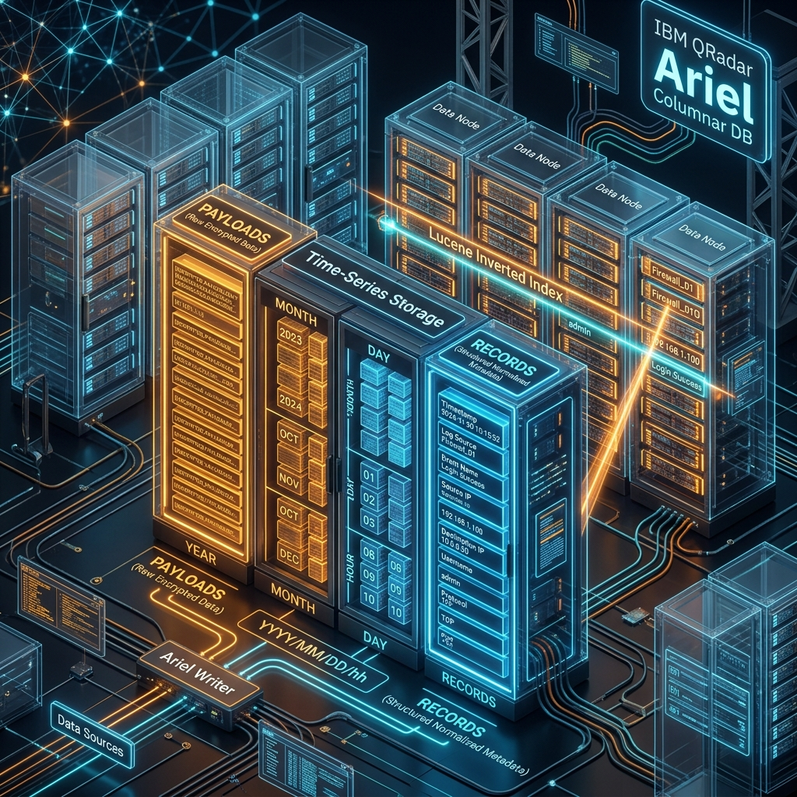
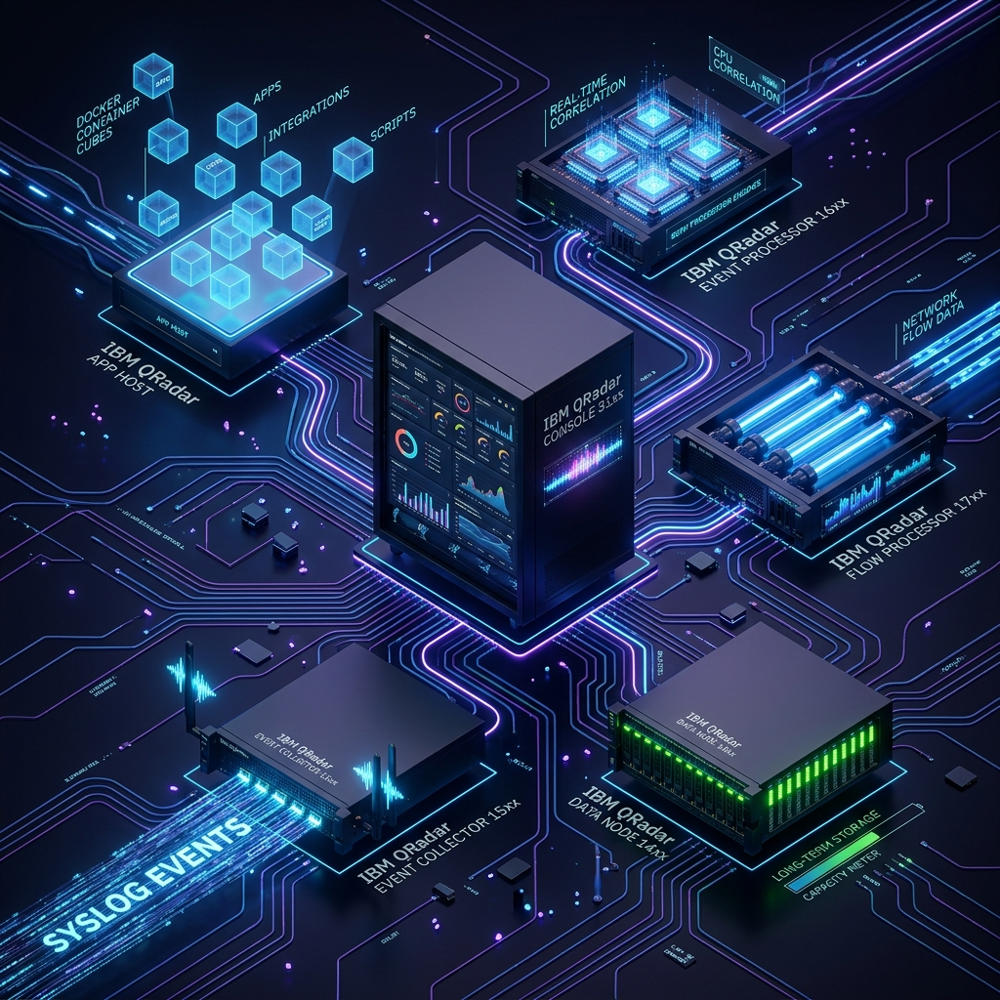

# 🗺️ 90-Day Enterprise IBM QRadar Administrator Mastery Roadmap

> **Target Role:** Enterprise IBM QRadar Administrator / SIEM Engineer / SOC L2-L3 Engineer / Security Consultant  
> **Methodology:** 80/20 Rule + Architecture Depth + Production Scenarios + Lab Execution + Interview Drills  
> **Status:** Phases 1, 2, 3, 4, 5, 6 & 7 100% Complete (73 Chapters & 73 Embedded Labs Ready) — Next Up: Phase 8 (Days 74–80)

---

## 📸 Enterprise 3D Architecture Topology

*Figure 1: Full Enterprise Distributed IBM QRadar SIEM Architecture (Console 31xx, Event Collectors 15xx, Event Processors 16xx, Flow Processors 17xx, Data Nodes 14xx, App Host & Central Magistrate Core) (`![[01_enterprise_architecture_3d.jpg|1000]]`)*

---

## 🎯 The 80/20 Production Focus
In enterprise environments (5,000 to 100,000+ EPS ingestion), **80% of administrator operations, production outages, and interview scrutiny revolve around:**
1. **End-to-End QRadar Architecture & Event Pipeline** (Source $\rightarrow$ `ecs-ec-ingress` $\rightarrow$ `ecs-ep` $\rightarrow$ CRE $\rightarrow$ Ariel Storage $\rightarrow$ Magistrate / Offense)
2. **Log Source Management & Custom DSMs** (Syslog UDP/TCP/TLS, WinCollect 7/10, Universal Cloud REST API, JDBC, LSX Regex Parser, Autodetection)
3. **CRE Correlation Rule Tuning & Offense Lifecycle** (Rule Tests, Functions, Building Blocks, Reference Sets/Maps, Magnitude Calculation, False Positive Suppression)
4. **AQL (Ariel Query Language) Mastery & Performance** (Ariel Indexing, Query optimization, Aggregations, Custom Properties, Historical Searches)
5. **System Health, Performance & Linux Troubleshooting** (EPS Spikes, License Token Bucket Throttling, Spool Buffering `/store/transient`, Ariel Partition Degradation, CLI Inspection via `systemctl`, `ps`, `tcpdump`, `grep`, `/var/log/qradar.log`)
6. **High Availability (HA) & Disaster Recovery** (DRBD Replication, Heartbeat/Corosync, Secondary Failover, Configuration vs Data Backups)

---

## 📸 Ingestion Pipeline & Storage Lifecycles

| 8-Stage Ingestion Pipeline | Ariel Columnar Time-Series Storage |
| :---: | :---: |
|  |  |
| *Figure 2: Data flowing from Socket to Ariel & Offenses (`![[02_data_pipeline_8stages_3d.jpg|500]]`)* | *Figure 3: Payloads (Amber) vs Records (Blue) & Lucene Index (`![[03_ariel_storage_columnar_3d.jpg|500]]`)* |

| Events vs Network Flows (QFlow DPI) | Hardware & Component Hierarchy |
| :---: | :---: |
|  |  |
| *Figure 4: Discrete EPS vs Continuous QFlow DPI (`![[04_events_vs_flows_qflow_3d.jpg|500]]`)* | *Figure 5: Exploded Appliance Node Breakdown (`![[06_core_components_3d_breakdown.jpg|500]]`)* |

| 3D Core Mindmap Infographic Diagram | 3D Concept Whiteboard & Sticky Notes |
| :---: | :---: |
|  |  |
| *Figure 6: 3D Core Mindmap Infographic (`![[07_qradar_core_mindmap_diagram_3d.jpg|500]]`)* | *Figure 7: 3D Concept Board & Sticky Notes (`![[05_chapter_01_mindmap_sticky_notes_3d.jpg|500]]`)* |

---

## 📅 Roadmap Overview (10 Phases / 90 Days)

| Phase | Focus Area | Timeline | Key Deliverables & Milestones |
| :--- | :--- | :--- | :--- |
| [**Phase 1**](../01%20-%20Phase%201%20-%20QRadar%20Fundamentals/00_Phase_1_Overview_and_TOC.md) | SIEM Fundamentals & Deep QRadar Architecture | Days 1–15 (✅ Complete) | 8-Stage Pipeline, All-in-One vs Distributed Topology, Daemons (`ecs-ec-ingress`, `ecs-ep`, `hostcontext`), Storage (`/store/ariel`), Events vs Flows |
| [**Phase 2**](../02%20-%20Phase%202%20-%20Enterprise%20Installation%20and%20Deployment/00_Phase_2_Overview_and_TOC.md) | Enterprise Installation, Sizing & Deployment Setup | Days 16–22 (✅ Complete) | OS Benchmarks, Appliance Types (15xx, 16xx, 17xx, 14xx, App Host), Token Bucket Licensing, Network Hierarchy, Authorized Services, Backup Config |
| [**Phase 3**](../03%20-%20Phase%203%20-%20Deep%20Log%20Source%20Onboarding%20and%20Integration/00_Phase_3_Overview_and_TOC.md) | Deep Log Source Onboarding & Integration | Days 23–35 (✅ Complete) | Syslog (UDP/TCP/TLS), WinCollect 7 & 10 Architecture, JDBC, Universal Cloud REST API, Firewalls (Palo Alto, Fortinet, Checkpoint), AD, Linux |
| [**Phase 4**](../04%20-%20Phase%204%20-%20DSM%20Parsing%20Normalization%20and%20Custom%20Properties/00_Phase_4_Overview_and_TOC.md) | DSM Parsing, Normalization & Custom Properties | Days 36–45 (✅ Complete) | DSM Editor, QID Mapping, Regex Parsing (LSX), Custom Properties (Regex, AQL, Generic JSON/CEF), Unknown vs Stored vs Normalized Events |
| [**Phase 5**](../05%20-%20Phase%205%20-%20Custom%20Rules%20Engine%20and%20Offenses/00_Phase_5_Overview_and_TOC.md) | Custom Rules Engine (CRE) & Offense Architecture | Days 46–58 (✅ Complete) | In-Memory QEST Engine, Event/Flow/Common/Anomaly Rules, Offense Indexing & Dynamic Magnitude (S/C/R), Building Blocks, False Positive Tuning |
| [**Phase 6**](../06%20-%20Phase%206%20-%20Reference%20Data%20and%20Advanced%20Building%20Blocks/00_Phase_6_Overview_and_TOC.md) | Reference Data & Advanced Building Blocks | Days 59–65 (✅ Complete) | 5 Reference Collections (Sets, Maps, Map of Sets, Tables, Map of Maps), TTL Dynamic Caching, REST API & TAXII Feeds, Active Defense Auto-Ban |
| [**Phase 7**](../07%20-%20Phase%207%20-%20AQL%20Mastery%20and%20Ariel%20Storage%20Optimization/00_Phase_7_Overview_and_TOC.md) | AQL Mastery & Ariel Storage Optimization | Days 66–73 (✅ Complete) | AQL Syntax & Query Planner, Distributed Aggregations (HLL), Functions (INCIDR, GeoIP), Subqueries, Hourly Partitions, Lucene Indexing, 10 Forensic Queries |
| **Phase 8** | Daily Admin, Linux CLI & Service Management | Days 74–80 | `hostcontext`, `tomcat`, `postgres`, `imq`, Disk Sizing & Saturated Partitions (`/store` 90%+), Memory/CPU Leaks, Daily/Weekly/Monthly Admin Runbooks |
| **Phase 9** | High Availability (HA), Backup, DR & Performance | Days 81–85 | HA Pairing, Primary/Secondary Synchronization, DRBD/Storage Replication, Split-Brain Troubleshooting, Backup/Restore & Disaster Recovery |
| **Phase 10** | Advanced Troubleshooting & Master Mock Interviews | Days 86–90 | Real-World Incident Outages, Pipeline Backpressure, Dropped Packets, Live Scenario Drills, Level 3-4 Interview Response Formulations |

---

## 📋 Detailed Day-by-Day Syllabus

### 🧱 Phase 1: SIEM Fundamentals & Deep QRadar Architecture (Days 1–15)
- **Day 1:** SIEM Core Foundations: What is Machine Data, SIEM vs Traditional Log Management, IBM QRadar High-Level Anatomy, 8-Stage Pipeline.
- **Day 2:** Distributed Architecture: Console, Event Collector (15xx), Event Processor (16xx), Flow Collector (17xx), Data Node (14xx), App Host.
- **Day 3:** The Internal Daemons: `hostcontext`, `ecs-ec-ingress`, `ecs-ep`, `tomcat`, `postgres`, `imq` (ActiveMQ).
- **Day 4:** Ariel Storage Engine & Directory Layout: `/store/ariel/events/records/`, `/store/ariel/events/payloads/`, `/store/transient/`.
- **Day 5:** Events vs Network Flows: Discrete Event Telemetry vs Bidirectional Flows (QFlow, NetFlow, IPFIX, sFlow).
- **Day 6:** The Magistrate & Offense Manager: Central Offense Indexing, Magnitude Scoring (Severity, Credibility, Relevance).
- **Day 7:** QRadar Network Ports, Protocols & Security Matrix (514, 443, 22, 32006, 32011/32012, 8413).
- **Day 8:** QRadar Licensing Mechanics: Token Bucket Algorithm, Allocated EPS vs System EPS, Giveback Pools, License Throttling.
- **Day 9:** Network Hierarchy: Internal vs External Context, CIDR Blocks, Geolocation, Impact on CRE Correlation.
- **Day 10:** Asset Model & Asset Profiler: Passive Profiling via Flows & DHCP/Kerberos Logs, Identity Reconciliation.
- **Day 11:** Vulnerability Data & Threat Intelligence: Scanner Ingestion (Nessus, Qualys), TAXII/STIX Ingestion feeds.
- **Day 12:** QRadar App Framework & App Host: Containerized Apps, Memory Allocation, Offloading from Console.
- **Day 13:** System Notifications & Top Bar Monitoring: Analyzing System Health alerts and Pipeline Backlog warnings.
- **Day 14:** Phase 1 Hands-On Architecture Lab: Verifying Cluster Process Trees, Listening Sockets & Partition Health via CLI.
- **Day 15:** Phase 1 Comprehensive Review, Benchmark Exam & Knowledge Gap Evaluation.

### ⚙️ Phase 2: Enterprise Installation & Topology Setup (Days 16–22)
- **Day 16:** Hardware Benchmarks, Specs & OS Partitioning (Lab 16)
- **Day 17:** Console Installation & Software Deployment (Lab 17)
- **Day 18:** Adding & Configuring Managed Hosts (Lab 18)
- **Day 19:** Authorized Services, REST API Security & Tokens (Lab 19)
- **Day 20:** User Administration, RBAC & Security Profiles (Lab 20)
- **Day 21:** Enterprise Backup: Config vs Data Recovery (Lab 21)
- **Day 22:** Phase 2 Capstone: Multi-Tier Distributed Lab Deployment Simulation (Lab 22)

### 📥 Phase 3: Deep Log Source Onboarding & Integration (Days 23–35)
- **Day 23:** Log Source Core Anatomy & Ingestion Protocols (Lab 23)
- **Day 24:** Enterprise Syslog Ingestion: UDP / TCP / TLS (Lab 24)
- **Day 25:** WinCollect Architecture: Standalone vs Managed Modes (Lab 25)
- **Day 26:** Advanced WinCollect: XPath Queries & Security Channels (Lab 26)
- **Day 27:** JDBC Protocol Ingestion: Database Polling & Watermarking (Lab 27)
- **Day 28:** Universal Cloud REST API & Workflows (Lab 28)
- **Day 29:** Next-Gen Firewalls: Palo Alto, Fortinet, Check Point (Lab 29)
- **Day 30:** Linux & Unix Server Ingestion: Auditd & Syslog (Lab 30)
- **Day 31:** Active Directory & Domain Controller Security Ingestion (Lab 31)
- **Day 32:** Network Infrastructure: Cisco IOS, Switches, VPN (Lab 32)
- **Day 33:** Log Source Autodetection & Traffic Analysis (Lab 33)
- **Day 34:** Log Source Troubleshooting & Packet Forensics (Lab 34)
- **Day 35:** Phase 3 Capstone: Production Onboarding of Multi-Protocol Sources (Lab 35)

### 🔬 Phase 4: DSM Parsing, Normalization & Custom Properties (Days 36–45)
- **Day 36:** DSM Architecture & The Normalization Engine (Lab 36)
- **Day 37:** The Normalization Pipeline: Raw to Security Tuple (Lab 37)
- **Day 38:** QID Map & Event Mapping Architecture (Lab 38)
- **Day 39:** The DSM Editor: Live Ingestion Parsing (Lab 39)
- **Day 40:** Custom Event Properties: Regex Extraction (Lab 40)
- **Day 41:** Advanced Custom Properties: JSON, CEF & AQL (Lab 41)
- **Day 42:** Log Source Extensions (LSX) XML Architecture (Lab 42)
- **Day 43:** Troubleshooting Unparsed Events: Stored vs Unknown (Lab 43)
- **Day 44:** Regex Optimization & Catastrophic Backtracking (Lab 44)
- **Day 45:** Phase 4 Capstone: Building a Custom DSM (Lab 45)

### ⚡ Phase 5: Custom Rules Engine (CRE) & Offense Architecture (Days 46–58)
- **Day 46:** CRE Engine Architecture & JVM Heap (Lab 46)
- **Day 47:** The 4 Rule Types: Event, Flow, Common & Anomaly (Lab 47)
- **Day 48:** Rule Test Conditions & Fail-Fast Optimization (Lab 48)
- **Day 49:** Rule Actions, Responses & Custom Scripts (Lab 49)
- **Day 50:** Offense Indexing & Incident Consolidation (Lab 50)
- **Day 51:** Dynamic Magnitude Calculation: Severity, Credibility, Relevance (Lab 51)
- **Day 52:** Building Blocks (BB): Modular Architecture & Suppressions (Lab 52)
- **Day 53:** Production Use Case 1: Brute Force & Password Spraying (Lab 53)
- **Day 54:** Production Use Case 2: Privilege Escalation & Admin Accounts (Lab 54)
- **Day 55:** Production Use Case 3: PowerShell, LOLBins & Ransomware (Lab 55)
- **Day 56:** Production Use Case 4: Data Exfiltration & DNS Tunneling (Lab 56)
- **Day 57:** Systematic Rule Tuning & Whitelisting (Lab 57)
- **Day 58:** Phase 5 Capstone: Multi-Stage Threat Pipeline (Lab 58)

### 🧠 Phase 6: Reference Data & Advanced Building Blocks (Days 59–65)
- **Day 59:** Reference Data Foundations & In-Memory Core (Lab 59)
- **Day 60:** Reference Sets: TTL Caching & Whitelists (Lab 60)
- **Day 61:** Reference Maps & Map of Sets: Identity Mapping (Lab 61)
- **Day 62:** Reference Tables & CMDB Asset Enrichment (Lab 62)
- **Day 63:** Automated Ingestion: REST API & TAXII Feeds (Lab 63)
- **Day 64:** Rule Optimization: Regex vs O(1) Lookups (Lab 64)
- **Day 65:** Phase 6 Capstone: Automated Active Defense Integration (Lab 65)

### 🔍 Phase 7: AQL Mastery & Ariel Storage Optimization (Days 66–73)
- **Day 66:** [[../07 - Phase 7 - AQL Mastery and Ariel Storage Optimization/Chapter_66_AQL_Core_Foundations_Syntax_Clauses_and_Execution.md|Chapter 66: AQL Core Syntax & Query Execution]]
- **Day 67:** [[../07 - Phase 7 - AQL Mastery and Ariel Storage Optimization/Chapter_67_Advanced_AQL_Aggregations_COUNT_UNIQUECOUNT_SUM_AVG_TOP.md|Chapter 67: Advanced AQL Aggregations & Grouping]]
- **Day 68:** [[../07 - Phase 7 - AQL Mastery and Ariel Storage Optimization/Chapter_68_AQL_Function_Library_String_Network_Math_Date_Functions.md|Chapter 68: AQL Function Library (INCIDR, GeoIP)]]
- **Day 69:** [[../07 - Phase 7 - AQL Mastery and Ariel Storage Optimization/Chapter_69_Advanced_AQL_Correlation_Subqueries_and_Historical_Baselines.md|Chapter 69: Subqueries & Historical Baselines]]
- **Day 70:** [[../07 - Phase 7 - AQL Mastery and Ariel Storage Optimization/Chapter_70_Ariel_Database_Internals_Partitions_Lucene_and_Pruning.md|Chapter 70: Ariel Database Storage & Retention]]
- **Day 71:** [[../07 - Phase 7 - AQL Mastery and Ariel Storage Optimization/Chapter_71_Ariel_Index_Management_Custom_Property_Indexing_and_Benchmarks.md|Chapter 71: Index Management & CEP Indexing]]
- **Day 72:** [[../07 - Phase 7 - AQL Mastery and Ariel Storage Optimization/Chapter_72_Query_Optimization_and_Troubleshooting.md|Chapter 72: Query Optimization & Troubleshooting]]
- **Day 73:** [[../07 - Phase 7 - AQL Mastery and Ariel Storage Optimization/Chapter_73_Phase_7_Capstone_10_Enterprise_Forensic_AQL_Queries.md|Chapter 73: Phase 7 Capstone: 10 Forensic Queries]]

### 🛠️ Phase 8: Daily Admin, Linux CLI & Health Management (Days 74–80)
- **Day 74:** [[../08 - Phase 8 - Daily Administration Linux CLI and Health/Chapter_74_Linux_CLI_Toolkit_for_QRadar_systemctl_journalctl_ps_netstat_tcpdump.md|Chapter 74: Linux CLI Toolkit for QRadar (systemctl, ss, tcpdump)]]
- **Day 75:** [[../08 - Phase 8 - Daily Administration Linux CLI and Health/Chapter_75_QRadar_Administrative_Binaries_system_info_qradar_netstat_arielsql_sancheck.md|Chapter 75: QRadar Administrative Binaries (system_info.py, arielsql, sancheck)]]
- **Day 76:** [[../08 - Phase 8 - Daily Administration Linux CLI and Health/Chapter_76_Log_File_Mastery_qradar_log_qradar_error_spool_ActiveMQ_Tomcat.md|Chapter 76: Log File Mastery (qradar.log, error, ActiveMQ, Tomcat)]]
- **Day 77:** [[../08 - Phase 8 - Daily Administration Linux CLI and Health/Chapter_77_Daily_Weekly_Monthly_Admin_Runbooks_Storage_LogSources_Licenses_Certificates.md|Chapter 77: Daily, Weekly & Monthly Admin Runbooks & SSL Renewals]]
- **Day 78:** [[../08 - Phase 8 - Daily Administration Linux CLI and Health/Chapter_78_Disk_Space_Emergencies_Store_at_90_and_95_Percent_Automated_Shutdown_Cleanups.md|Chapter 78: Disk Space Emergencies & /store 95% Shutdown Recovery]]
- **Day 79:** [[../08 - Phase 8 - Daily Administration Linux CLI and Health/Chapter_79_Memory_CPU_Contention_Runaway_Java_Heaps_Tomcat_Crashes_ecs_ep_Thread_Saturation.md|Chapter 79: Memory & CPU Contention (JVM Heaps & GC Thrashing)]]
- **Day 80:** [[../08 - Phase 8 - Daily Administration Linux CLI and Health/Chapter_80_Phase_8_Capstone_10_Step_Enterprise_Health_Audit_on_Degraded_Cluster.md|Chapter 80: Phase 8 Capstone: 10-Step Enterprise Health Audit]]

### 🛡️ Phase 9: High Availability (HA), Backup, DR & Performance (Days 81–85)
- **Day 81:** [[../09 - Phase 9 - High Availability Backup and Disaster Recovery/Chapter_81_High_Availability_Architecture_Active_Passive_DRBD_Replication_Heartbeat_Corosync.md|Chapter 81: HA Architecture (Active/Passive, DRBD Protocol C, Corosync)]]
- **Day 82:** [[../09 - Phase 9 - High Availability Backup and Disaster Recovery/Chapter_82_HA_Failover_Synchronization_Planned_Switchover_Unplanned_Split_Brain_Recovery.md|Chapter 82: HA Failover, Switchovers & Split-Brain Recovery]]
- **Day 83:** [[../09 - Phase 9 - High Availability Backup and Disaster Recovery/Chapter_83_Backup_and_Disaster_Recovery_Config_Backups_Cold_Storage_Ariel_Sync_Reconstruction.md|Chapter 83: Backup & DR (Config Backups, Cold Storage Ariel Sync & Reconstruction)]]
- **Day 84:** [[../09 - Phase 9 - High Availability Backup and Disaster Recovery/Chapter_84_EPS_Capacity_Planning_Ingestion_Growth_Data_Node_Storage_Math_Giveback_Pool.md|Chapter 84: EPS Capacity Planning, Sizing Math & Data Node Scale-Out]]
- **Day 85:** [[../09 - Phase 9 - High Availability Backup and Disaster Recovery/Chapter_85_Phase_9_Capstone_Simulating_Primary_Console_Failure_Manual_Failover_and_State_Recovery.md|Chapter 85: Phase 9 Capstone: Primary Console Crash & Manual Failover]]

### 🎓 Phase 10: Advanced Troubleshooting & Master Mock Interviews (Days 86–90)
- **Day 86:** [[../10 - Phase 10 - Advanced Troubleshooting and Master Mock Interviews/Chapter_86_Outage_Simulation_1_Sudden_EPS_Drop_from_Critical_Firewall_RCA.md|Chapter 86: Outage 1: Firewall EPS Drop & 7-Layer Wire RCA]]
- **Day 87:** [[../10 - Phase 10 - Advanced Troubleshooting and Master Mock Interviews/Chapter_87_Outage_Simulation_2_Offenses_Stopped_Generating_CRE_ActiveMQ_Debugging.md|Chapter 87: Outage 2: Offenses Stopped Generating & ActiveMQ Debugging]]
- **Day 88:** [[../10 - Phase 10 - Advanced Troubleshooting and Master Mock Interviews/Chapter_88_Outage_Simulation_3_WinCollect_Fleet_Failure_Certificate_Expiration.md|Chapter 88: Outage 3: WinCollect Fleet Failure & Certificate Expiration]]
- **Day 89:** [[../10 - Phase 10 - Advanced Troubleshooting and Master Mock Interviews/Chapter_89_360_Degree_QRadar_Administrator_Interview_Simulation_Drilling_QA.md|Chapter 89: 360-Degree QRadar Administrator Interview Simulation]]
- **Day 90:** [[../10 - Phase 10 - Advanced Troubleshooting and Master Mock Interviews/Chapter_90_Final_Competency_Assessment_Resume_Projects_Production_Certification.md|Chapter 90: Final Competency Assessment, Resume Framing & Certification]]
