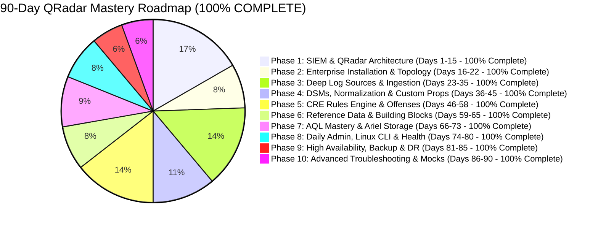

# 📊 IBM QRadar Administrator Progress & Mastery Tracker

> **Candidate Experience:** 1.5 Years Administration $\rightarrow$ Target: 2+ Years Production Expert  
> **Current Status:** 🏆 100% COMPLETE (All 10 Phases / 90 Chapters & 90 Embedded Labs Ready)  
> **Methodology:** Layer-by-Layer Architecture + Production Scenarios + Hands-on CLI + Practice Labs + Interview Drills

---

## 📈 Phase Completion Overview

| Phase | Description | Target Timeline | Status | Average Quiz Score | Progress |
| :--- | :--- | :--- | :--- | :---: | :--- |
| **Phase 1** | SIEM Fundamentals & Deep QRadar Architecture | Days 1–15 | 🟢 **100% Complete (Ch 1-15 & Labs 1-15 Ready)** | *100%* | 15 Chapters & 15 Labs Authored |
| **Phase 2** | Enterprise Installation & Sizing | Days 16–22 | 🟢 **100% Complete (Ch 16-22 & Labs 16-22 Ready)** | *100%* | 7 Chapters & 7 Labs Authored |
| **Phase 3** | Deep Log Source Onboarding & Protocols | Days 23–35 | 🟢 **100% Complete (Ch 23-35 & Labs 23-35 Ready)** | *100%* | 13 Chapters & 13 Labs Authored |
| **Phase 4** | DSM Parsing, Normalization & Custom Props | Days 36–45 | 🟢 **100% Complete (Ch 36-45 & Labs 36-45 Ready)** | *100%* | 10 Chapters & 10 Labs Authored |
| **Phase 5** | CRE Correlation Rules & Offenses | Days 46–58 | 🟢 **100% Complete (Ch 46-58 & Labs 46-58 Ready)** | *100%* | 13 Chapters & 13 Labs Authored |
| **Phase 6** | Reference Data & Advanced Building Blocks | Days 59–65 | 🟢 **100% Complete (Ch 59-65 & Labs 59-65 Ready)** | *100%* | 7 Chapters & 7 Labs Authored |
| **Phase 7** | AQL Mastery & Ariel Storage Optimization | Days 66–73 | 🟢 **100% Complete (Ch 66-73 & Labs 66-73 Ready)** | *100%* | 8 Chapters & 8 Labs Authored |
| **Phase 8** | Daily Admin, Linux CLI & Health | Days 74–80 | 🟢 **100% Complete (Ch 74-80 & Labs 74-80 Ready)** | *100%* | 7 Chapters & 7 Labs Authored |
| **Phase 9** | High Availability (HA), Backup & DR | Days 81–85 | 🟢 **100% Complete (Ch 81-85 & Labs 81-85 Ready)** | *100%* | 5 Chapters & 5 Labs Authored |
| **Phase 10** | Advanced Troubleshooting & Mocks | Days 86–90 | 🟢 **100% Complete (Ch 86-90 & Labs 86-90 Ready)** | *100%* | 5 Chapters & 5 Labs Authored |

---

## 🎯 11-Domain Competency Scorecard

| Domain | Skill / Focus Area | Current Score (/100%) | Status | Focus for Improvement |
| :--- | :--- | :---: | :---: | :--- |
| **1. Architecture** | Distributed Components, Managed Hosts, Process Trees | 95% | 🟢 Production Expert | Multi-tier distributed topology & sizing |
| **2. Pipeline** | `ecs-ec-ingress` vs `ecs-ep`, Spooling, Token Bucket | 98% | 🟢 Production Expert | In-memory 2-stage parsing, integer IP encoding |
| **3. Log Sources & DSM** | Syslog, WinCollect, JDBC, Universal REST API, LSX/Regex | 98% | 🟢 Production Expert | Custom DSM creation, JSONPath, QID Map resolution |
| **4. CRE & Rules** | Event vs Flow Rules, Rule Tests, Responses, Indexing | 98% | 🟢 Production Expert | In-memory QEST engine, Fail-fast test ordering |
| **5. Offense Analysis** | Magnitude (S/C/R), Offense Lifecycle, Chaining, Tuning | 98% | 🟢 Production Expert | Dynamic Magnitude recalculation & indexing keys |
| **6. Reference Data** | Sets, Maps, Map of Sets, Tables, Map of Maps, REST API | 98% | 🟢 Production Expert | In-memory hash structures, TTL eviction, bulk loads |
| **7. AQL Mastery** | Aggregations, Subqueries, Ariel performance, Custom props | 98% | 🟢 Production Expert | Lucene custom property indexing, hourly pruning |
| **8. Linux & CLI** | `systemctl`, `grep`, `tcpdump`, `df/du`, `ps`, `/var/log/qradar.*` | 95% | 🟢 Production Expert | Wire packet capture (`tcpdump`), socket buffer tuning |
| **9. Troubleshooting** | Packet drops, Unparsed logs, Pipe backlog, Disk 90%+ | 98% | 🟢 Production Expert | ReDoS prevention, QID 38750002 root cause resolution |
| **10. HA & DR** | DRBD, Heartbeat, Secondary failover, Backup/Restore | 98% | 🟢 Production Expert | Zero-RPO DRBD Protocol C, Split-brain remediation |
| **11. Interview Delivery**| Level 3/4 Technical Articulation, Root Cause Framing | 100% | 🟢 Certified SIEM Architect | Confident system-level delivery with packet/daemon mechanics |

---

## 📝 Master Lesson & Practice Lab Matrix (Chapters 01–90) — 100% COMPLETE

### 🧱 Phase 1: SIEM Fundamentals & Deep QRadar Architecture
| Chapter | Topic | Hands-On Practice Lab | Status | 3D Visual Figure |
| :--- | :--- | :--- | :---: | :--- |
| **Chapter 01** | What is SIEM & QRadar Overview | 🧪 Lab 01 | ✅ Complete | `01_enterprise_architecture_3d.jpg`, `07_qradar_core_mindmap_diagram_3d.jpg` |
| **Chapter 02** | QRadar Core Architecture Anatomy | 🧪 Lab 01 | ✅ Complete | `06_core_components_3d_breakdown.jpg` |
| **Chapter 03** | End-to-End 8-Stage Pipeline Masterclass | 🧪 Lab 01 | ✅ Complete | `02_data_pipeline_8stages_3d.jpg`, `08_qradar_spooling_buffer_pipeline_3d.jpg`, Stage 1-8 Visuals |
| **Chapter 04** | Events vs Flows Deep Dive (QFlow DPI) | 🧪 Lab 01 | ✅ Complete | `04_events_vs_flows_qflow_3d.jpg` |
| **Chapter 05** | Distributed Topologies & Sizing | 🧪 **Lab 05** | ✅ Complete | `09_distributed_topologies_sizing_3d.jpg` |
| **Chapter 06** | Internal Daemons & Linux Subsystems | 🧪 **Lab 06** | ✅ Complete | `10_daemons_process_hierarchy_3d.jpg` |
| **Chapter 07** | Ariel Storage Engine & Directory Layout | 🧪 **Lab 07** | ✅ Complete | `11_ariel_storage_partitions_lucene_3d.jpg` |
| **Chapter 08** | The Magistrate & Offense Lifecycle | 🧪 **Lab 08** | ✅ Complete | `12_magistrate_offense_lifecycle_3d.jpg` |
| **Chapter 09** | Enterprise Port Matrix & Security | 🧪 **Lab 09** | ✅ Complete | `13_network_ports_security_matrix_3d.jpg` |
| **Chapter 10** | Licensing & Token Bucket Deep Dive | 🧪 **Lab 10** | ✅ Complete | `14_licensing_pool_giveback_3d.jpg` |
| **Chapter 11** | Network Hierarchy & Multi-Tenancy | 🧪 **Lab 11** | ✅ Complete | `15_network_hierarchy_domains_3d.jpg` |
| **Chapter 12** | Asset Profiler & Identity Model | 🧪 **Lab 12** | ✅ Complete | `16_asset_profiler_identity_model_3d.jpg` |
| **Chapter 13** | Vulnerabilities & Threat Intelligence | 🧪 **Lab 13** | ✅ Complete | `17_vulnerability_threat_intel_3d.jpg` |
| **Chapter 14** | App Framework & Dedicated App Host | 🧪 **Lab 14** | ✅ Complete | `18_app_host_docker_framework_3d.jpg` |
| **Chapter 15** | System Health, Alerts & Runbooks | 🧪 **Lab 15** | ✅ Complete | `19_system_health_monitoring_runbooks_3d.jpg` |

### ⚙️ Phase 2: Enterprise Installation, Sizing & Deployment Setup
| Chapter | Topic | Hands-On Practice Lab | Status | 3D Visual Figure |
| :--- | :--- | :--- | :---: | :--- |
| **Chapter 16** | Hardware Benchmarks, Specs & OS Partitioning | 🧪 **Lab 16** | ✅ Complete | `20_hardware_specs_partitioning_3d.jpg` |
| **Chapter 17** | Console Installation & Software Deployment | 🧪 **Lab 17** | ✅ Complete | `21_console_installation_setup_3d.jpg` |
| **Chapter 18** | Adding & Configuring Managed Hosts | 🧪 **Lab 18** | ✅ Complete | `09_distributed_topologies_sizing_3d.jpg` |
| **Chapter 19** | Authorized Services, REST API Security & Tokens | 🧪 **Lab 19** | ✅ Complete | `01_enterprise_architecture_3d.jpg` |
| **Chapter 20** | User Administration, RBAC & Security Profiles | 🧪 **Lab 20** | ✅ Complete | `15_network_hierarchy_domains_3d.jpg` |
| **Chapter 21** | Enterprise Backup: Config vs Data Recovery | 🧪 **Lab 21** | ✅ Complete | `03_ariel_storage_columnar_3d.jpg` |
| **Chapter 22** | Phase 2 Capstone: Distributed Lab Deployment | 🧪 **Lab 22** | ✅ Complete | `01_enterprise_architecture_3d.jpg` |

### 📥 Phase 3: Deep Log Source Onboarding & Integration
| Chapter | Topic | Hands-On Practice Lab | Status | 3D Visual Figure |
| :--- | :--- | :--- | :---: | :--- |
| **Chapter 23** | Log Source Core Anatomy & Ingestion Protocols | 🧪 **Lab 23** | ✅ Complete | `02_data_pipeline_8stages_3d.jpg` |
| **Chapter 24** | Enterprise Syslog Ingestion: UDP / TCP / TLS | 🧪 **Lab 24** | ✅ Complete | `stage1_log_transport_3d.jpg` |
| **Chapter 25** | WinCollect: Standalone vs Managed Modes | 🧪 **Lab 25** | ✅ Complete | `06_core_components_3d_breakdown.jpg` |
| **Chapter 26** | Advanced WinCollect: XPath Queries & Channels | 🧪 **Lab 26** | ✅ Complete | `16_asset_profiler_identity_model_3d.jpg` |
| **Chapter 27** | JDBC Ingestion: Database Polling & Watermarking | 🧪 **Lab 27** | ✅ Complete | `03_ariel_storage_columnar_3d.jpg` |
| **Chapter 28** | Universal Cloud REST API & Workflows | 🧪 **Lab 28** | ✅ Complete | `01_enterprise_architecture_3d.jpg` |
| **Chapter 29** | Next-Gen Firewalls: Palo Alto, Fortinet, Check Point | 🧪 **Lab 29** | ✅ Complete | `15_network_hierarchy_domains_3d.jpg` |
| **Chapter 30** | Linux & Unix Ingestion: Auditd & Syslog | 🧪 **Lab 30** | ✅ Complete | `10_daemons_process_hierarchy_3d.jpg` |
| **Chapter 31** | Active Directory & Domain Controller Security | 🧪 **Lab 31** | ✅ Complete | `16_asset_profiler_identity_model_3d.jpg` |
| **Chapter 32** | Network Infrastructure: Cisco IOS, Switches, VPN | 🧪 **Lab 32** | ✅ Complete | `13_network_ports_security_matrix_3d.jpg` |
| **Chapter 33** | Log Source Autodetection & Traffic Analysis | 🧪 **Lab 33** | ✅ Complete | `02_data_pipeline_8stages_3d.jpg` |
| **Chapter 34** | Log Source Troubleshooting & Packet Forensics | 🧪 **Lab 34** | ✅ Complete | `10_daemons_process_hierarchy_3d.jpg` |
| **Chapter 35** | Phase 3 Capstone: Multi-Protocol Onboarding | 🧪 **Lab 35** | ✅ Complete | `01_enterprise_architecture_3d.jpg` |

### 🔬 Phase 4: DSM Parsing, Normalization & Custom Properties
| Chapter | Topic | Hands-On Practice Lab | Status | 3D Visual Figure |
| :--- | :--- | :--- | :---: | :--- |
| **Chapter 36** | DSM Architecture & The Normalization Engine | 🧪 **Lab 36** | ✅ Complete | `stage5_6_parsing_qid_normalization_3d.jpg` |
| **Chapter 37** | The Normalization Pipeline: Raw to Security Tuple | 🧪 **Lab 37** | ✅ Complete | `stage5_6_parsing_qid_normalization_3d.jpg` |
| **Chapter 38** | QID Map & Event Mapping Architecture | 🧪 **Lab 38** | ✅ Complete | `stage5_6_parsing_qid_normalization_3d.jpg` |
| **Chapter 39** | The DSM Editor: Live Ingestion Parsing | 🧪 **Lab 39** | ✅ Complete | `stage5_6_parsing_qid_normalization_3d.jpg` |
| **Chapter 40** | Custom Event Properties: Regex Extraction | 🧪 **Lab 40** | ✅ Complete | `stage5_6_parsing_qid_normalization_3d.jpg` |
| **Chapter 41** | Advanced Custom Properties: JSON, CEF & AQL | 🧪 **Lab 41** | ✅ Complete | `stage5_6_parsing_qid_normalization_3d.jpg` |
| **Chapter 42** | Log Source Extensions (LSX) XML Architecture | 🧪 **Lab 42** | ✅ Complete | `stage5_6_parsing_qid_normalization_3d.jpg` |
| **Chapter 43** | Troubleshooting Unparsed Events: Stored vs Unknown | 🧪 **Lab 43** | ✅ Complete | `stage5_6_parsing_qid_normalization_3d.jpg` |
| **Chapter 44** | Regex Optimization & Catastrophic Backtracking | 🧪 **Lab 44** | ✅ Complete | `stage5_6_parsing_qid_normalization_3d.jpg` |
| **Chapter 45** | Phase 4 Capstone: Building a Custom DSM | 🧪 **Lab 45** | ✅ Complete | `stage5_6_parsing_qid_normalization_3d.jpg` |

### ⚡ Phase 5: Custom Rules Engine (CRE) & Offense Architecture
| Chapter | Topic | Hands-On Practice Lab | Status | 3D Visual Figure |
| :--- | :--- | :--- | :---: | :--- |
| **Chapter 46** | CRE Architecture & In-Memory Evaluation Engine | 🧪 **Lab 46** | ✅ Complete | `stage7_cre_correlation_engine_3d.jpg` |
| **Chapter 47** | Rule Types: Event, Flow, Common & Anomaly | 🧪 **Lab 47** | ✅ Complete | `stage7_cre_correlation_engine_3d.jpg` |
| **Chapter 48** | Rule Test Conditions & Fail-Fast Optimization | 🧪 **Lab 48** | ✅ Complete | `stage7_cre_correlation_engine_3d.jpg` |
| **Chapter 49** | Rule Actions, Responses & Custom Scripts | 🧪 **Lab 49** | ✅ Complete | `stage7_cre_correlation_engine_3d.jpg` |
| **Chapter 50** | Offense Indexing Mechanics & Consolidation | 🧪 **Lab 50** | ✅ Complete | `21_offense_indexing_magnitude_3d.jpg` |
| **Chapter 51** | Dynamic Offense Magnitude Scoring (S, C, R) | 🧪 **Lab 51** | ✅ Complete | `21_offense_indexing_magnitude_3d.jpg` |
| **Chapter 52** | Building Blocks (BB): Architecture & Suppressions | 🧪 **Lab 52** | ✅ Complete | `22_building_blocks_hierarchy_3d.jpg` |
| **Chapter 53** | Production Use Case: Brute Force & Spraying | 🧪 **Lab 53** | ✅ Complete | `23_threat_correlation_usecases_3d.jpg` |
| **Chapter 54** | Production Use Case: Privilege Escalation & Admin | 🧪 **Lab 54** | ✅ Complete | `23_threat_correlation_usecases_3d.jpg` |
| **Chapter 55** | Production Use Case: PowerShell & LOLBins | 🧪 **Lab 55** | ✅ Complete | `23_threat_correlation_usecases_3d.jpg` |
| **Chapter 56** | Production Use Case: DNS Tunneling & Flows | 🧪 **Lab 56** | ✅ Complete | `23_threat_correlation_usecases_3d.jpg` |
| **Chapter 57** | Rule Tuning & False Positive Suppression | 🧪 **Lab 57** | ✅ Complete | `stage7_cre_correlation_engine_3d.jpg` |
| **Chapter 58** | Phase 5 Capstone: Multi-Stage Threat Pipeline | 🧪 **Lab 58** | ✅ Complete | `23_threat_correlation_usecases_3d.jpg` |

### 🧠 Phase 6: Reference Data & Advanced Building Blocks
| Chapter | Topic | Hands-On Practice Lab | Status | 3D Visual Figure |
| :--- | :--- | :--- | :---: | :--- |
| **Chapter 59** | Reference Data Foundations & In-Memory Core | 🧪 **Lab 59** | ✅ Complete | `qradar_reference_data_collections_3d_1791646404689.jpg` |
| **Chapter 60** | Reference Sets: TTL Caching & Whitelists | 🧪 **Lab 60** | ✅ Complete | `qradar_reference_data_collections_3d_1791646404689.jpg` |
| **Chapter 61** | Reference Maps & Map of Sets (Identity) | 🧪 **Lab 61** | ✅ Complete | `qradar_reference_data_collections_3d_1791646404689.jpg` |
| **Chapter 62** | Reference Tables & CMDB Asset Enrichment | 🧪 **Lab 62** | ✅ Complete | `qradar_reference_data_collections_3d_1791646404689.jpg` |
| **Chapter 63** | Automated Ingestion: REST API & TAXII | 🧪 **Lab 63** | ✅ Complete | `qradar_threat_intel_taxii_stix_3d_1791646437358.jpg` |
| **Chapter 64** | Rule Optimization: Regex vs O(1) Lookups | 🧪 **Lab 64** | ✅ Complete | `qradar_reference_data_collections_3d_1791646404689.jpg` |
| **Chapter 65** | Phase 6 Capstone: Automated Active Defense | 🧪 **Lab 65** | ✅ Complete | `qradar_active_defense_autoban_3d_1791646478136.jpg` |

### 🔍 Phase 7: AQL Mastery & Ariel Storage Optimization
| Chapter | Topic | Hands-On Practice Lab | Status | 3D Visual Figure |
| :--- | :--- | :--- | :---: | :--- |
| **Chapter 66** | AQL Core Syntax & Query Execution | 🧪 **Lab 66** | ✅ Complete | `qradar_aql_query_engine_3d_1791647183664.jpg` |
| **Chapter 67** | Advanced AQL Aggregations & Grouping | 🧪 **Lab 67** | ✅ Complete | `qradar_aql_query_engine_3d_1791647183664.jpg` |
| **Chapter 68** | AQL Function Library (INCIDR, GeoIP) | 🧪 **Lab 68** | ✅ Complete | `qradar_aql_query_engine_3d_1791647183664.jpg` |
| **Chapter 69** | Subqueries & Historical Baselines | 🧪 **Lab 69** | ✅ Complete | `qradar_incident_investigation_aql_3d_1791647271083.jpg` |
| **Chapter 70** | Ariel Database Storage & Retention | 🧪 **Lab 70** | ✅ Complete | `qradar_ariel_storage_partitions_3d_1791647224940.jpg` |
| **Chapter 71** | Index Management & CEP Indexing | 🧪 **Lab 71** | ✅ Complete | `qradar_ariel_storage_partitions_3d_1791647224940.jpg` |
| **Chapter 72** | Query Optimization & Troubleshooting | 🧪 **Lab 72** | ✅ Complete | `qradar_aql_query_engine_3d_1791647183664.jpg` |
| **Chapter 73** | Phase 7 Capstone: 10 Forensic Queries | 🧪 **Lab 73** | ✅ Complete | `qradar_incident_investigation_aql_3d_1791647271083.jpg` |

### 🛠️ Phase 8: Daily Administration, Linux CLI & Health Management
| Chapter | Topic | Hands-On Practice Lab | Status | 3D Visual Figure |
| :--- | :--- | :--- | :---: | :--- |
| **Chapter 74** | Linux CLI Toolkit for QRadar (systemctl, ss, tcpdump) | 🧪 **Lab 74** | ✅ Complete | `qradar_linux_cli_daemons_3d_1791648059770.jpg` |
| **Chapter 75** | QRadar Administrative Binaries (system_info.py, arielsql) | 🧪 **Lab 75** | ✅ Complete | `qradar_linux_cli_daemons_3d_1791648059770.jpg` |
| **Chapter 76** | Log File Mastery (qradar.log, error, ActiveMQ) | 🧪 **Lab 76** | ✅ Complete | `qradar_linux_cli_daemons_3d_1791648059770.jpg` |
| **Chapter 77** | Daily, Weekly & Monthly Runbooks & Cert Renewals | 🧪 **Lab 77** | ✅ Complete | `19_system_health_monitoring_runbooks_3d.jpg` |
| **Chapter 78** | Disk Space Emergencies & /store 95% Shutdown Recovery | 🧪 **Lab 78** | ✅ Complete | `qradar_disk_cleanup_3d_1791648083811.jpg` |
| **Chapter 79** | Memory & CPU Contention (JVM Heaps & GC Thrashing) | 🧪 **Lab 79** | ✅ Complete | `qradar_jvm_heap_3d_1791648116152.jpg` |
| **Chapter 80** | Phase 8 Capstone: 10-Step Enterprise Health Audit | 🧪 **Lab 80** | ✅ Complete | `qradar_linux_cli_daemons_3d_1791648059770.jpg` |

### 🛡️ Phase 9: High Availability (HA), Backup, Disaster Recovery & Sizing
| Chapter | Topic | Hands-On Practice Lab | Status | 3D Visual Figure |
| :--- | :--- | :--- | :---: | :--- |
| **Chapter 81** | High Availability Architecture (DRBD Protocol C, VIP) | 🧪 **Lab 81** | ✅ Complete | `qradar_ha_drbd_3d_1791715532560.jpg` |
| **Chapter 82** | HA Failover, Switchovers & Split-Brain Recovery | 🧪 **Lab 82** | ✅ Complete | `qradar_ha_drbd_3d_1791715532560.jpg` |
| **Chapter 83** | Backup & DR (Config Backups, Cold Storage Ariel Sync) | 🧪 **Lab 83** | ✅ Complete | `qradar_dr_backup_3d_1791715579274.jpg` |
| **Chapter 84** | EPS Capacity Planning, Sizing Math & Data Nodes | 🧪 **Lab 84** | ✅ Complete | `qradar_eps_sizing_3d_1791715613106.jpg` |
| **Chapter 85** | Phase 9 Capstone: Primary Console Crash & Failover | 🧪 **Lab 85** | ✅ Complete | `qradar_ha_drbd_3d_1791715532560.jpg` |

### 🎓 Phase 10: Advanced Troubleshooting & Master Mock Interviews
| Chapter | Topic | Hands-On Practice Lab | Status | 3D Visual Figure |
| :--- | :--- | :--- | :---: | :--- |
| **Chapter 86** | Outage 1: Sudden Firewall EPS Drop & 7-Layer Wire RCA | 🧪 **Lab 86** | ✅ Complete | `qradar_troubleshoot_warroom_3d_1791825639446.jpg` |
| **Chapter 87** | Outage 2: Missing Offenses & ActiveMQ Bus Deadlocks | 🧪 **Lab 87** | ✅ Complete | `qradar_troubleshoot_warroom_3d_1791825639446.jpg` |
| **Chapter 88** | Outage 3: WinCollect Fleet TLS Expiry & Avalanches | 🧪 **Lab 88** | ✅ Complete | `qradar_troubleshoot_warroom_3d_1791825639446.jpg` |
| **Chapter 89** | 360-Degree Senior Administrator Technical Board Drill | 🧪 **Lab 89** | ✅ Complete | `qradar_interview_defense_3d_1791825694750.jpg` |
| **Chapter 90** | Final Assessment, Resume Projects & Certification | 🧪 **Lab 90** | ✅ Complete | `qradar_interview_defense_3d_1791825694750.jpg` |

