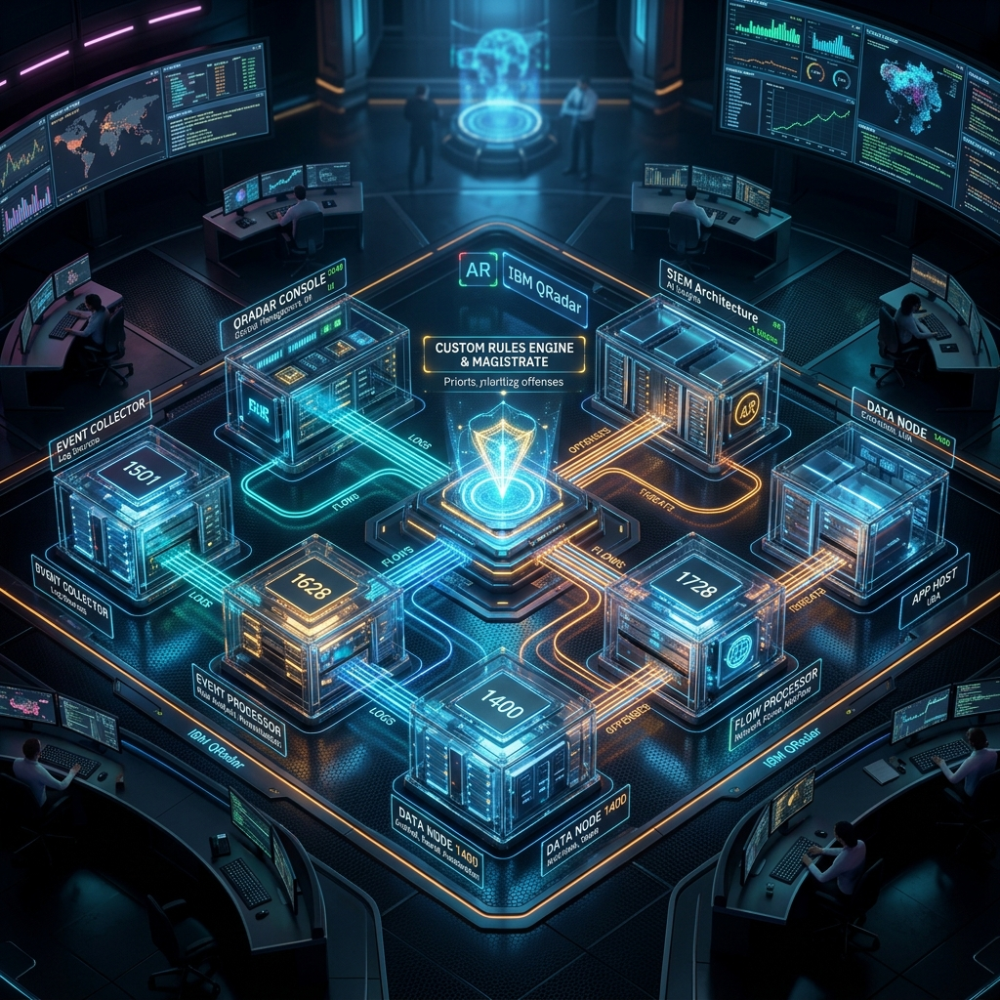
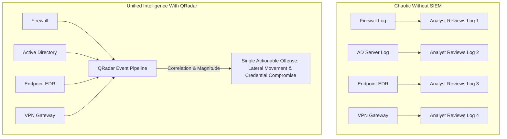
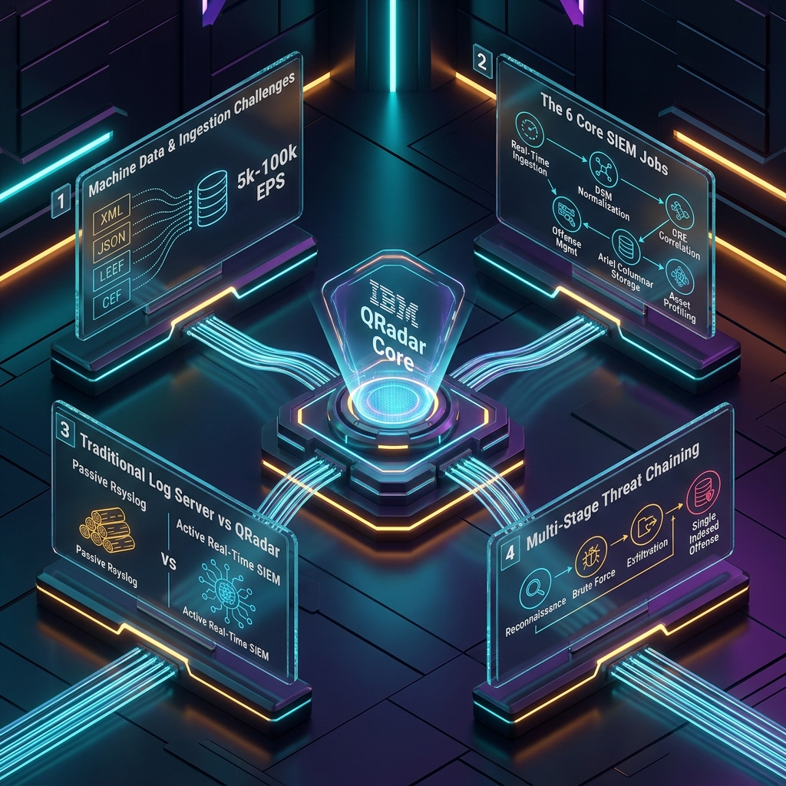

# 📖 Chapter 01: What is SIEM & IBM QRadar Overview

> **The IBM QRadar Administrator's Handbook** | Phase 1: QRadar Fundamentals  
> **Target Audience:** 1.5-Year Administrators $\rightarrow$ Senior SIEM Engineers  
> **Prerequisites:** Basic understanding of IT networking & operating systems

---

## 📸 1. Visual Overview: The Enterprise SIEM Ingestion & Noise Reduction Funnel


*Figure 1.1: Diverse, chaotic machine data streams ingested, parsed, correlated and unified into actionable Offenses by QRadar (`![[01_enterprise_architecture_3d.jpg|1000]]`)*

---

## 2. What is Machine Data?

Every computing asset in an enterprise—switches, firewalls, Linux servers, Windows Domain Controllers, databases, cloud instances—continuously emits structured and unstructured text records of digital actions.

### Real-World Machine Data Examples Ingested by QRadar

```text
1. Linux Authentication Syslog (/var/log/secure):
May 12 14:02:11 auth-srv-01 sshd[18492]: Failed password for invalid user root from 198.51.100.42 port 52311 ssh2

2. Windows Security Event Log (Event ID 4625 - An account failed to log on):
<Event xmlns="http://schemas.microsoft.com/win/2004/08/events/event">
  <System><EventID>4625</EventID><TimeCreated SystemTime="2026-05-12T14:02:12.102Z"/></System>
  <EventData><Data Name="TargetUserName">svc_backup</Data><Data Name="IpAddress">10.10.40.85</Data><Data Name="Status">0xC000006D</Data></EventData>
</Event>

3. Palo Alto Firewall Threat Syslog (LEEF / CEF Format):
LEEF:1.0|Palo Alto Networks|PAN-OS|10.1.0|threat|cat=spyware|src=10.10.40.85|dst=203.0.113.99|srcPort=49210|dstPort=80|threat_name=C2-Traffic-Detected

4. Cisco ASA VPN Connection Syslog:
%ASA-6-722022: Group <Corp_VPN> User <jsmith> IP <198.51.100.42> IPv4 Address <10.10.200.15> assigned to session
```

---

## 3. Why Do We Need a SIEM? (The Enterprise Problem)

Without a SIEM, log management suffers from four major fatal flaws:
1. **Siloed Visibility**: A single attack touches the Firewall, the VPN, the Active Directory server, and the Endpoint. No individual system has the complete picture.
2. **Heterogeneous Formats**: Every vendor writes logs differently. A human or script cannot easily correlate Palo Alto syntax with Windows XML and Cisco ASA logs.
3. **Massive Ingestion Scale**: An enterprise of 5,000 employees produces between **5,000 and 50,000 Events Per Second (EPS)** ($400\text{ million to }4\text{ billion logs/day}$).
4. **Alert Fatigue & No Deduplication**: Standard monitoring tools fire a separate email alert for every single failure, overwhelming the security team.



---

## 4. What is IBM QRadar?

**IBM Security QRadar SIEM** is an enterprise-grade security intelligence platform that collects log events and network flow data across the entire IT estate, normalizes the data into a unified taxonomy, correlates events in real-time using the **Custom Rules Engine (CRE)**, and groups related security alerts into a single, contextualized **Offense**.

### The 6 Core Jobs of QRadar
1. **Real-Time Data Ingestion**: Captures high-throughput event telemetry (EPS) and flow metrics (FPM/FPS) across hundreds of protocols.
2. **DSM Normalization**: Uses Device Support Modules (DSMs) to parse raw strings into standardized properties (`Source IP`, `Destination IP`, `Username`, `Event Name`, `Port`).
3. **Real-Time Correlation**: Microsecond evaluation of incoming events against behavioral rules, building blocks, and reference data sets.
4. **Intelligent Offense Management**: Groups hundreds of correlated events into a single incident with an automated **Magnitude Score** (0–10).
5. **High-Speed Ariel Storage**: Stores raw encrypted payloads alongside indexed structured records in an optimized time-series columnar format.
6. **Network & Asset Profiling**: Passively discovers assets, open ports, vulnerabilities, and user identities by observing traffic flows and authentication logs.

---

## 5. Traditional Log Management vs. IBM QRadar SIEM

| Dimension | Traditional Log Server (Rsyslog / Logstash) | IBM QRadar SIEM |
| :--- | :--- | :--- |
| **Primary Goal** | Centralized storage and grep-based archival. | Real-time threat detection, correlation & incident response. |
| **Data Processing** | Stores raw text as received without deep categorization. | Normalizes every log against a unified IBM **QID Map** taxonomy. |
| **Correlation** | None (or basic search queries run periodically). | **CRE (Custom Rules Engine)** evaluates millions of events in real time. |
| **Incident Handling** | Emits raw alerts (e.g. 100 emails for 100 failed logins). | Generates **1 Offense** indexed by attacker IP, updating in real time. |
| **Network Telemetry** | Events/logs only. | **Events + Network Flows (QFlow)** with layer-7 packet inspection. |
| **Contextual Data** | Static files. | Dynamic **Reference Sets**, **Asset Models**, and **Vulnerability Feeds**. |

---

## 6. Real-World Production Scenario: Multi-Stage Cyber Attack

### The Attack Scenario
An attacker performs the following 4 steps over 20 minutes:
1. **Reconnaissance**: Scans external IP ranges (`198.51.100.42` hits 50 closed ports on the perimeter firewall).
2. **Brute Force**: Tries 100 passwords against the corporate VPN portal until succeeding on user `jsmith`.
3. **Privilege Escalation**: From inside the VPN (`10.10.200.15`), accesses a Domain Controller and fails 5 Kerberos authentications before succeeding as `svc_backup`.
4. **Data Exfiltration**: Opens an outbound connection to an external Russian IP (`203.0.113.99`) and transfers 4.2 GB of database backup files.

### How QRadar Handles It
1. **Firewall Log** arrives $\rightarrow$ Normalized $\rightarrow$ Triggers Rule: *“Reconnaissance: Port Scan Detected”*.
2. **VPN Log** arrives $\rightarrow$ Normalized $\rightarrow$ Triggers Rule: *“Authentication: Multiple Failed Logins Followed by Success”*.
3. **Active Directory Log** arrives $\rightarrow$ Normalized $\rightarrow$ Triggers Rule: *“Privilege Escalation: Unusual Service Account Login”*.
4. **QFlow NetFlow** arrives $\rightarrow$ Analyzed $\rightarrow$ Triggers Rule: *“Flow: Large Outbound Transfer to Suspicious Country”*.
5. **The Outcome**: Because all 4 rules index on the same actor (`198.51.100.42` / `jsmith`), QRadar **does not** create 4 separate alerts. The **Magistrate** chains all 4 events into **One Single High-Magnitude Offense (Magnitude: 9/10)**, allowing the L2 SOC analyst to see the entire attack timeline in one pane of glass.

---

## 📌 7. Visual Mind Map & Sticky Notes (Chapter 01 Quick-Review)

### 📸 1. Visual 3D Concept Whiteboard

*Figure 1.2: 3D Visual Concept & Sticky Note Board (`![[05_chapter_01_mindmap_sticky_notes_3d.jpg|1000]]`)*

---

### 📸 2. 3D Infographic Diagram: IBM QRadar Core Mindmap

*Figure 1.3: 3D Isometric Mindmap Infographic Diagram: Machine Data & Ingestion $\rightarrow$ 6 Core SIEM Jobs $\rightarrow$ Log Server vs QRadar $\rightarrow$ Multi-Stage Threat Chaining (`![[07_qradar_core_mindmap_diagram_3d.jpg|1000]]`)*

---

### 🧠 Hierarchical Interactive Mind Map
```mermaid
mindmap
  root((IBM QRadar Core))
    Machine Data
      What Is It?
        Continuous digital breadcrumbs of all activity
        Unstructured text, XML, JSON, LEEF, CEF
      The Ingestion Challenge
        Heterogeneous vendor formats
        5,000 to 100,000+ Events Per Second
        Siloed visibility across network & cloud
    The 6 Core SIEM Jobs
      1. Real-Time Ingestion
        Syslog UDP/TCP/TLS 514, WinCollect 8413, APIs
      2. DSM Normalization
        Extract standard IPs, Ports, Users, Categories
        Map to IBM QID taxonomy
      3. Real-Time CRE Correlation
        Microsecond in-memory rule pipelines
      4. Offense Management
        Consolidate 1000s of events into 1 incident
        Dynamic Magnitude Score (0-10)
      5. Ariel Columnar Storage
        Payloads (raw) vs Records (metadata)
      6. Asset & Flow Profiling
        Passive asset discovery via QFlow DPI
    Traditional Log Server vs QRadar
      Rsyslog / Logstash
        Passive log archive
        No correlation / High alert noise
      QRadar SIEM
        Real-time correlation & deduplication
        Events + Flows (L7 Deep Packet Inspection)
        Dynamic Reference Data Caching
    Multi-Stage Threat Chaining
      Reconnaissance + Brute Force + Exfiltration
      Single Offense indexed by Attacker IP
```

---

### 🗂️ Color-Coded Digital Sticky Notes

#### 🟨 Sticky Note 1: What is Machine Data?
```text
┌─────────────────────────────────────────────────────────────┐
│ 📌 CONCEPT: MACHINE DATA (THE DIGITAL FOOTPRINT)           │
│                                                             │
│ • Definition: Raw, timestamped text generated by servers,   │
│   firewalls, routers, cloud VPCs, and applications.         │
│ • Key Trait: Highly polymorphic (LEEF, CEF, Syslog, XML).  │
│ • Real Example:                                             │
│   "sshd[18492]: Failed password for root from 198.51.100.42"│
│ • Rule of Thumb: If an enterprise device computes, it logs. │
└─────────────────────────────────────────────────────────────┘
```

#### 🟩 Sticky Note 2: Normalization & The QID Map
```text
┌─────────────────────────────────────────────────────────────┐
│ 📌 GOLDEN RULE: NORMALIZATION (THE UNIFIED TAXONOMY)        │
│                                                             │
│ • Raw Logs = Vendor-specific chaos.                         │
│ • QRadar DSM = Normalizes raw strings into standard fields: │
│   Source IP, Dest IP, Username, Event Name, Port.           │
│ • QID (QRadar Identifier) = Unique integer mapping for      │
│   every known event (e.g., QID 5000032 = Login Failed).     │
│ • Benefit: One single CRE rule detects failed logins across │
│   Windows, Linux, Cisco, Check Point, and AWS combined!     │
└─────────────────────────────────────────────────────────────┘
```

#### 🟪 Sticky Note 3: The 6 Core Jobs of QRadar
```text
┌─────────────────────────────────────────────────────────────┐
│ 📌 THE 6 CORE JOBS OF IBM QRADAR SIEM                       │
│                                                             │
│ 1. Ingestion     ──► Ingests Syslog, WinCollect, NetFlow, APIs │
│ 2. Normalization ──► Maps vendor logs to standard QIDs      │
│ 3. Correlation   ──► CRE microsecond in-memory rule engine  │
│ 4. Offense Mgmt  ──► Chaining events into 1 incident (Mag)  │
│ 5. Ariel Storage ──► Payloads vs Records in columnar format │
│ 6. Asset Profile ──► Passive network discovery via QFlow    │
└─────────────────────────────────────────────────────────────┘
```

#### 🟦 Sticky Note 4: The Noise Reduction Funnel
```text
┌─────────────────────────────────────────────────────────────┐
│ 📌 ENTERPRISE VALUE: THE NOISE REDUCTION FUNNEL             │
│                                                             │
│ • Ingestion: 50,000,000 Raw Events / Day                    │
│ • Parsing: Normalized into standard QID categories          │
│ • CRE Evaluation: 5,000 Correlated Rule Triggers            │
│ • Magistrate Output: 15 High-Priority Actionable Offenses   │
│                                                             │
│ 💡 SOC Takeaway: QRadar exists to eliminate Alert Fatigue!  │
└─────────────────────────────────────────────────────────────┘
```

#### 🟧 Sticky Note 5: Interview Cheat Code (Syslog vs. SIEM)
```text
┌─────────────────────────────────────────────────────────────┐
│ 📌 INTERVIEW CHEAT CODE: "WHY NOT JUST USE RSYSLOG/ELK?"    │
│                                                             │
│ "A centralized Syslog or ELK cluster is a passive search    │
│ repository. QRadar is an active Security Intelligence       │
│ platform that normalizes disparate logs into unified QIDs,  │
│ correlates layer-7 flows and events in real time with the   │
│ CRE, and consolidates thousands of alerts into a single     │
│ indexed Offense with automated Magnitude scoring."          │
└─────────────────────────────────────────────────────────────┘
```

#### 🟥 Sticky Note 6: Common Administrator Pitfall
```text
┌─────────────────────────────────────────────────────────────┐
│ ⚠️ CRITICAL PITFALL: UNPARSED LOG FLOODS                    │
│                                                             │
│ • If a device sends logs with an unrecognized format,       │
│   QRadar marks them as 'SIM Generic Log DSM' / 'Unknown'.   │
│ • Unparsed logs cannot be correlated by standard CRE rules! │
│ • Admin Mandate: Regularly audit Log Activity for           │
│   QID 38750003 (Unknown Event) and apply custom DSMs.       │
└─────────────────────────────────────────────────────────────┘
```

---

### ⚡ Rapid-Recall Flashcards

| # | Question (Front) | Answer (Back) |
| :-: | :--- | :--- |
| **01** | What does **DSM** stand for in IBM QRadar? | **Device Support Module** (The parsing and normalization XML/regex engine). |
| **02** | What is an IBM **QID**? | **QRadar Identifier** — a numeric identifier assigned to a specific categorized event. |
| **03** | What is the primary purpose of the **Custom Rules Engine (CRE)**? | To evaluate normalized events and flows in microsecond memory pipelines against behavioral correlation rules. |
| **04** | What is an **Offense** in QRadar? | A consolidated, actionable security incident containing multiple correlated events/flows grouped by an indexing key. |
| **05** | What are the two core file types stored in the Ariel database? | **Payloads** (raw compressed text) and **Records** (normalized structured binary metadata). |
| **06** | What metric measures log event ingestion vs flow ingestion? | Events = **EPS** (Events Per Second); Flows = **FPM** (Flows Per Minute) / **FPS**. |
