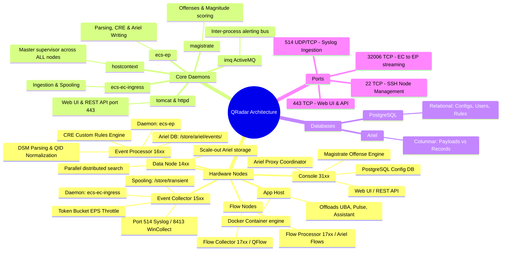

# 📖 Chapter 02: QRadar Core Architecture & Component Breakdown

> **The IBM QRadar Administrator's Handbook** | Phase 1: QRadar Fundamentals  
> **Target Audience:** 1.5-Year Administrators $\rightarrow$ Senior SIEM Engineers  
> **Key Focus:** All-in-One vs Distributed Topology, Managed Host Roles, Daemon Assignments & Linux Internals

---

## 📸 1. Visual Overview: QRadar Hardware & Component Ecosystem


*Figure 2.1: 3D Exploded View of QRadar Appliances: Central Console 31xx, Event Collector 15xx, Event Processor 16xx, Flow Processor 17xx, Data Node 14xx, and Containerized App Host (`![[06_core_components_3d_breakdown.jpg|1000]]`)*

---

## 2. Enterprise Component Hierarchy

IBM QRadar is a modular, distributed SIEM architecture. Depending on the size of the organization (from 1,000 EPS to over 200,000 EPS), components can run on a single physical/virtual appliance or be distributed across dozens of specialized appliances.

```
┌────────────────────────────────────────────────────────────────────────┐
│                     QRADAR CONSOLE (31xx)                             │
│  - Web UI (Apache/Tomcat 443)    - Central Config DB (PostgreSQL)      │
│  - Magistrate Engine             - Central Ariel Proxy Coordinator     │
└──────────────┬──────────────────────────────────────────┬──────────────┘
               │                                          │
    (Encrypted SSH 22 / REST API / Config Sync)           │ (Distributed Ariel Search)
               │                                          │
               ▼                                          ▼
┌──────────────────────────────┐           ┌──────────────────────────────┐
│    EVENT PROCESSOR (16xx)    │           │    FLOW PROCESSOR (17xx)     │
│  - Daemon: ecs-ep            │           │  - Daemon: ecs-ep / qflow    │
│  - DSM Normalization (QID)   │           │  - Flow Correlation (CRE)    │
│  - CRE Rule Engine           │           │  - Writes to Ariel Flows DB  │
│  - Writes to Ariel Events DB │           └──────────────┬───────────────┘
└──────────────┬───────────────┘                          │
               │ (Port 32006 Stream)                      │ (Port 32007 Stream)
               ▼                                          ▼
┌──────────────────────────────┐           ┌──────────────────────────────┐
│    EVENT COLLECTOR (15xx)    │           │    FLOW COLLECTOR (17xx)     │
│  - Daemon: ecs-ec-ingress    │           │  - Daemon: qflow             │
│  - Ingests Syslog, APIs, etc │           │  - Ingests NetFlow/SPAN/TAPs │
│  - Spool: /store/transient   │           │  - Deep Packet Inspection    │
│  - Token Bucket EPS Throttle │           └──────────────────────────────┘
└──────────────────────────────┘
               │
               ▼ (Scale-Out Storage & Search Compute)
┌──────────────────────────────┐
│       DATA NODE (14xx)       │
│  - Ariel Storage Extension   │
│  - Parallel Search Execution │
└──────────────────────────────┘
```

---

## 3. Deep Dive: The Core QRadar Appliances & Managed Hosts

### 1. The QRadar Console (Appliance Type: 3100 / 3105 / 3128 / 3199 All-in-One)
- **Role**: The centralized management, configuration, and visualization plane.
- **Key Daemons**:
  - `tomcat`: Java application server hosting the Web User Interface and REST API endpoints.
  - `httpd` (Apache): Reverse proxy handling SSL/TLS termination on port `443`.
  - `hostcontext`: Master supervisor daemon managing all inter-appliance state, config deployment, and status checks.
  - `magistrate`: The engine responsible for central offense generation, rule indexing, and magnitude calculation.
  - `postgres`: The relational database (`qsys`, `configdb`) storing user credentials, log source configurations, network hierarchy, and rule definitions.
- **In an All-in-One Appliance (3199)**: The Console also runs `ecs-ec-ingress`, `ecs-ep`, and local Ariel storage on the same box.

---

### 2. Event Collector (EC - Appliance Type: 1501 / 1540)
- **Role**: Dedicated log intake point placed close to log sources (e.g. remote branch offices, cloud VPCs, or datacenter perimeters).
- **Key Daemon**: `ecs-ec-ingress`.
- **Core Operations**:
  1. **Network Listening**: Listens on UDP/TCP 514 (Syslog), 8413 (WinCollect), and executes active polling protocols (JDBC, REST API, SFTP).
  2. **In-Memory Buffering & Disk Spooling**: Buffers incoming packets in memory. If downstream components (such as `ecs-ep` or WAN links) experience latency or temporary disconnects, it writes excess logs to disk spool: `/store/transient/` or `/store/spool/`.
  3. **License Enforcement (Token Bucket)**: Enforces the allocated EPS rate.
  4. **Inter-Appliance Forwarding**: Compresses and encrypts event bundles, streaming them over TCP port `32006` to the designated Event Processor.

> [!NOTE]
> An Event Collector **does not parse, normalize, evaluate rules, or permanently store events**. Its only job is reliable ingestion, spooling, and transport.

---

### 3. Event Processor (EP - Appliance Type: 1605 / 1628 / 1640)
- **Role**: The high-performance computational brain of log processing.
- **Key Daemon**: `ecs-ep`.
- **Core Operations**:
  1. **DSM Normalization**: Matches raw logs against Log Source Identifiers, executes regex extraction, populates standardized properties, and maps the event to an IBM **QID (QRadar Identifier)**.
  2. **CRE (Custom Rules Engine)**: Ingests the normalized event into microsecond in-memory correlation pipelines.
  3. **Offense Triggering**: If a rule condition matches and has an Offense response, `ecs-ep` sends an ActiveMQ (`imq`) notification to the Magistrate on the Console.
  4. **Ariel Storage Engine**: Writes the raw payload to `/store/ariel/events/payloads/` and the normalized metadata to `/store/ariel/events/records/`.

---

### 4. Flow Collector (FC / QFlow - Appliance Type: 1201 / 1301 / 1310)
- **Role**: Collects network flow telemetry across internal networks.
- **Key Daemon**: `qflow`.
- **Modes of Collection**:
  - **Internal Flow Telemetry**: NetFlow (v5/v9), IPFIX, sFlow, J-Flow received on port `2055` / `4739`.
  - **Deep Packet Inspection (DPI)**: Connects directly to physical network TAPs or switch SPAN/mirror ports. Inspects the first 64 to 256 bytes of payload to identify unencrypted protocols, malware beacons, and SSL handshake metadata.

---

### 5. Flow Processor (FP - Appliance Type: 1705 / 1728)
- **Role**: Receives flow bundles from Flow Collectors via port `32007`, runs flow-based correlation rules in the CRE, and writes flow records to `/store/ariel/flows/`.

---

### 6. Data Node (DN - Appliance Type: 1405 / 1428 / 1440)
- **Role**: Horizontal scale-out storage and search acceleration.
- **How It Works**:
  - A Data Node is attached directly to an Event Processor or Flow Processor.
  - As events are processed by `ecs-ep`, storage is round-robined across the local EP disks and attached Data Nodes.
  - When an analyst executes an AQL query, the Data Nodes search their local Ariel databases in parallel, multiplying search speeds by $N$ nodes.

---

### 7. App Host (Dedicated Container Appliance)
- **Role**: Runs containerized QRadar Extensions (e.g. QRadar Use Case Manager, Pulse, User Behavior Analytics, IBM QRadar Assistant).
- **Why It Matters**: In older versions (7.3 and earlier), apps ran on the Console, causing memory exhaustion and Tomcat crashes. The App Host isolates Docker/container overhead to a dedicated appliance.

---

## 4. Storage Architecture: PostgreSQL vs. Ariel Database

| Characteristic | PostgreSQL (`qsys` / `configdb`) | Ariel Database (`/store/ariel/`) |
| :--- | :--- | :--- |
| **Database Type** | Relational SQL Database (RDBMS). | Proprietary Columnar Time-Series Database. |
| **What It Stores** | Administrative configurations: Users, Roles, Log Sources, Network Hierarchy, Rule definitions, Asset models, Scheduled Reports. | Security telemetry: Historical Raw Event Payloads, Normalized Event Records, Network Flow Records. |
| **Location** | Resides primarily on the Console appliance (`/store/postgres/`). | Resides on every Event Processor, Flow Processor, and Data Node (`/store/ariel/`). |
| **Query Engine** | Standard SQL queries managed internally by `hostcontext` / `tomcat`. | **AQL (Ariel Query Language)** executed via `ariel_proxy_server` and `arield`. |
| **Write Velocity** | Low throughput (Config changes, user logins, rule updates). | Massive high-throughput (Up to 100,000+ EPS continuous sequential disk writes). |
| **Backup Type** | Included in daily **Configuration Backups** (small: ~50 MB to 500 MB). | Included only in **Data Backups** (massive: hundreds of GBs to TBs). |

---

## 5. Master Daemon & Process Table for Administrators

| Process / Daemon Name | Running On | Primary Responsibility | If Stopped / Failed Symptom |
| :--- | :--- | :--- | :--- |
| `hostcontext` | **All Appliances** | Master process supervisor, inter-node configuration synchronization, deployment listener. | Managed host shows "Unavailable" / "Disconnected" in Deployment Actions. |
| `ecs-ec-ingress` | Console, EC, All-in-One | Event & flow collection, network port listening, token bucket license throttling, disk spooling. | Logs not reaching QRadar; port 514 closed; incoming packet drop. |
| `ecs-ep` | Console, EP, All-in-One | DSM parsing, QID normalization, CRE rule execution, writing to Ariel database. | Events ingested but not parsed; CRE rules not firing; Ariel not updating. |
| `tomcat` | Console | Web User Interface, REST API gateway. | Cannot access Web UI (HTTP 500 / Connection Refused on port 443). |
| `magistrate` | Console | Central offense evaluation, rule index aggregation, magnitude calculation. | Rules match in Log Activity, but no new Offenses are created. |
| `imq` (ActiveMQ) | Console & Processors | Internal publish-subscribe messaging bus connecting `ecs-ep` to `magistrate`. | CRE alerts fail to reach the Console; offense generation stops. |
| `postgres` | Console | Relational configuration storage. | Console fails to boot; login errors; configuration save failures. |
| `ariel_proxy_server` | Console | Coordinates distributed AQL searches across managed hosts and gathers results. | AQL searches hang or immediately return proxy communication errors. |

---

## 6. Enterprise Network Port Matrix

| Port | Protocol | Source | Destination | Purpose |
| :---: | :---: | :---: | :---: | :--- |
| **443** | TCP | Admin / Analyst Workstation | Console | Web User Interface & REST API management. |
| **22** | TCP | Console | All Managed Hosts | Encrypted SSH cluster administration, deployment sync & health polling. |
| **514** | UDP / TCP | Log Sources (Firewalls, AD, Linux) | Event Collector / Console | Syslog ingestion. |
| **8413** | TCP | Windows Endpoints (WinCollect) | Event Collector / Console | WinCollect agent config management & log forwarding. |
| **32006** | TCP | Event Collector (15xx) | Event Processor (16xx) | Compressed inter-appliance event stream. |
| **32007** | TCP | Flow Collector (17xx) | Flow Processor (17xx) | Inter-appliance flow stream. |
| **32011 / 32012** | TCP | Console (Ariel Proxy) | Event Processors / Data Nodes | Distributed Ariel search query and data return. |
| **2055 / 4739** | UDP | Network Switches / Routers | Flow Collector (17xx) | NetFlow / IPFIX telemetry ingestion. |

---

## 📌 7. Visual Mind Map & Sticky Notes (Chapter 02 Quick-Review)

### 📸 Visual 3D Concept Board

*Figure 2.2: 3D Concept Board for Hardware Nodes and Software Processes (`![[06_core_components_3d_breakdown.jpg|1000]]`)*

### 🧠 Hierarchical Mind Map


### 🗂️ Color-Coded Digital Sticky Notes

#### 🟨 Sticky Note 1: Console vs. Event Processor
```text
┌─────────────────────────────────────────────────────────────┐
│ 📌 CONCEPT: CONSOLE (31xx) VS EVENT PROCESSOR (16xx)       │
│                                                             │
│ • Console (31xx): Management & Visualization Plane.         │
│   - Hosts Tomcat, PostgreSQL, and the Magistrate.           │
│ • Event Processor (16xx): Computational & Storage Plane.    │
│   - Hosts ecs-ep, DSM parsing, CRE engine, and Ariel DB.    │
│ • In All-in-One (3199): Both roles reside on ONE appliance. │
└─────────────────────────────────────────────────────────────┘
```

#### 🟩 Sticky Note 2: What Does an Event Collector (15xx) NOT Do?
```text
┌─────────────────────────────────────────────────────────────┐
│ 📌 GOLDEN RULE: EVENT COLLECTOR (15xx) BOUNDARIES           │
│                                                             │
│ • An Event Collector DOES:                                  │
│   - Ingest raw packets (Syslog, APIs, WinCollect).          │
│   - Spool logs to /store/transient on network backpressure. │
│   - Enforce Token Bucket EPS limits.                        │
│   - Stream compressed logs via Port 32006 to the EP.        │
│ • An Event Collector DOES NOT:                              │
│   - ❌ Parse or Normalize logs (No DSM execution!).         │
│   - ❌ Run CRE Correlation Rules.                           │
│   - ❌ Store data in the Ariel database.                    │
└─────────────────────────────────────────────────────────────┘
```

#### 🟪 Sticky Note 3: The Supervisor Daemon (`hostcontext`)
```text
┌─────────────────────────────────────────────────────────────┐
│ 📌 MASTER DAEMON: hostcontext (THE GLUE OF QRADAR)          │
│                                                             │
│ • Runs on: EVERY managed host in the deployment.            │
│ • Responsibilities:                                         │
│   1. Supervises and auto-restarts child daemons.            │
│   2. Listens for "Deploy Changes" from the Console.         │
│   3. Syncs configurations and certificates over SSH (22).   │
│ • If hostcontext dies: The node shows "Disconnected" in UI. │
└─────────────────────────────────────────────────────────────┘
```

#### 🟦 Sticky Note 4: PostgreSQL vs. Ariel DB
```text
┌─────────────────────────────────────────────────────────────┐
│ 📌 STORAGE ARCHITECTURE: POSTGRESQL VS. ARIEL               │
│                                                             │
│ • PostgreSQL: Relational SQL DB on Console.                 │
│   - Stores: Users, Log Sources, Network Hierarchy, Rules.   │
│ • Ariel: Columnar Time-Series DB on Processors & Data Nodes.│
│   - Stores: Historical Raw Payloads and Normalized Records. │
│                                                             │
│ 💡 Daily Config Backups backup PostgreSQL, NOT Ariel logs!  │
└─────────────────────────────────────────────────────────────┘
```

#### 🟧 Sticky Note 5: Interview Cheat Code (Data Nodes)
```text
┌─────────────────────────────────────────────────────────────┐
│ 📌 INTERVIEW CHEAT CODE: "WHY DEPLOY DATA NODES (14xx)?"    │
│                                                             │
│ "Data Nodes provide linear scale-out storage and search     │
│ compute for Event and Flow Processors. Instead of replacing │
│ an EP when disks reach capacity, Data Nodes distribute      │
│ incoming Ariel writes and execute distributed AQL queries   │
│ in parallel, dramatically accelerating forensic searches."  │
└─────────────────────────────────────────────────────────────┘
```

#### 🟥 Sticky Note 6: Common Administrator Pitfall
```text
┌─────────────────────────────────────────────────────────────┐
│ ⚠️ CRITICAL PITFALL: PORT 32006 WAN FIREWALL BLOCK          │
│                                                             │
│ • When deploying remote Event Collectors (15xx) across WAN, │
│   network teams frequently forget to open TCP port 32006.   │
│ • Symptom: EC receives logs on port 514, but logs never     │
│   appear in Log Activity; /store/transient fills to 100%!   │
│ • Fix: Always test TCP 32006 with `nc -zv <EP_IP> 32006`.   │
└─────────────────────────────────────────────────────────────┘
```

---

### ⚡ Rapid-Recall Flashcards

| # | Question (Front) | Answer (Back) |
| :-: | :--- | :--- |
| **01** | Which daemon is responsible for log collection and token bucket rate limiting? | **`ecs-ec-ingress`** |
| **02** | Which daemon is responsible for DSM normalization, CRE correlation, and Ariel writing? | **`ecs-ep`** |
| **03** | On which port do Event Collectors stream compressed logs to Event Processors? | **TCP Port 32006** |
| **04** | What is the function of the **App Host**? | Dedicated container host that runs QRadar apps (UBA, Pulse) offloading CPU/RAM from the Console. |
| **05** | Where does QRadar spool logs during downstream network congestion? | **`/store/transient/`** (or `/store/spool/`) |
| **06** | Which daemon communicates CRE rule triggers to the Magistrate for Offense creation? | **`imq` (ActiveMQ)** |
