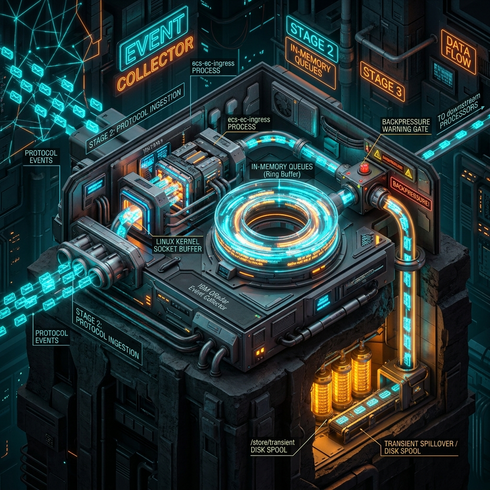
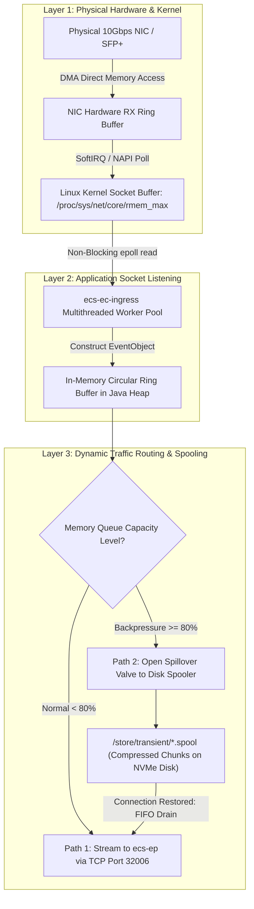
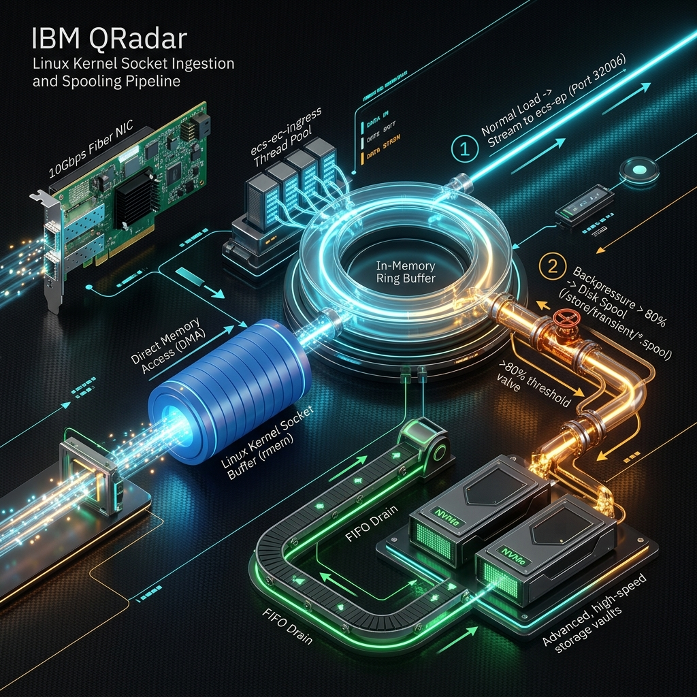
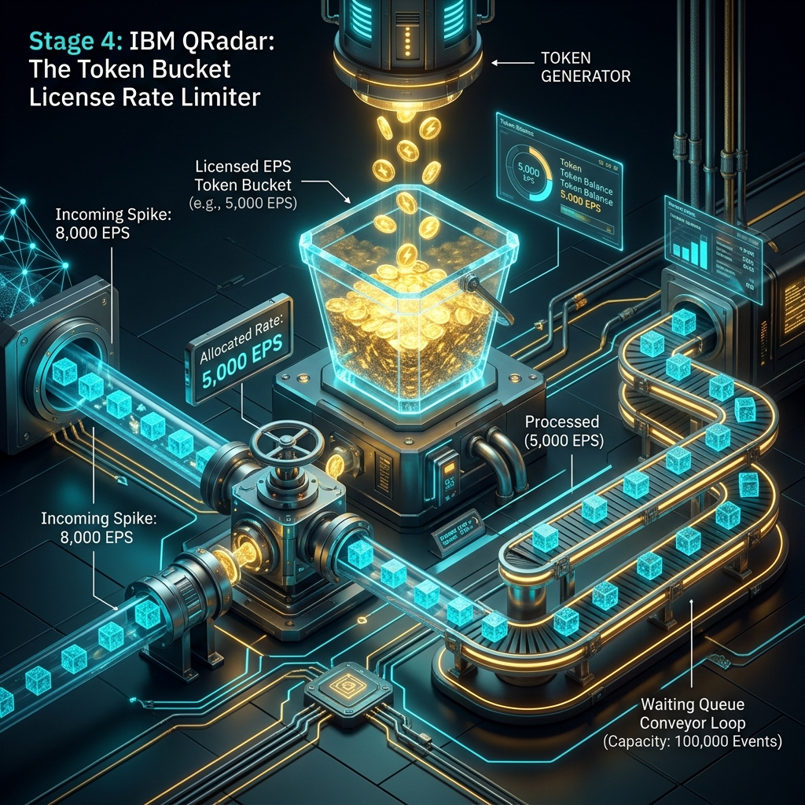
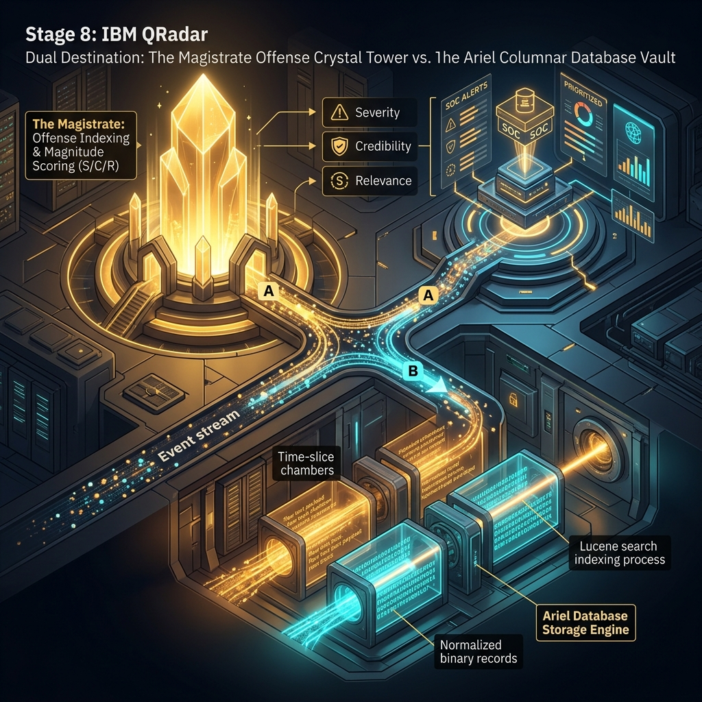

# 📖 Chapter 03: The End-to-End 8-Stage Event Pipeline Masterclass

> **The IBM QRadar Administrator's Definitive Technical Guide** | Phase 1: QRadar Fundamentals  
> **Target Audience:** 1.5-Year Administrators $\rightarrow$ Senior SIEM Engineers & Architects  
> **Focus:** Deep Internal Mechanics, Linux Kernel Sockets, Token Bucket Mathematics, Regex Deconstruction, Microsecond CRE Pipelines, Columnar Ariel Storage, Magistrate Offense Chaining & Diagnostic Runbooks

---

## 📸 1. Visual Overview: The Complete 8-Stage Event Processing Pipeline


*Figure 3.1: 3D Isometric Master View of the IBM QRadar Event Pipeline: Ingestion $\rightarrow$ Token Bucket $\rightarrow$ DSM Parsing $\rightarrow$ Normalization $\rightarrow$ CRE $\rightarrow$ Magistrate & Ariel Storage (`![[02_data_pipeline_8stages_3d.jpg|1000]]`)*

---

## 2. Complete Pipeline Architecture Blueprint

```
 ┌──────────────────────────────────────────────────────────────────────────────────┐
 │ STAGE 1: LOG SOURCE & TRANSPORT LAYER                                            │
 │ • Protocols: Syslog (UDP/TCP/TLS 514/6514), WinCollect (8413), JDBC, Cloud APIs  │
 │ • Formats: RFC 3164/5424 Syslog, LEEF 1.0/2.0, CEF, JSON, Windows XML Evtx       │
 └────────────────────────────────────────┬─────────────────────────────────────────┘
                                          │
                                          ▼
 ┌──────────────────────────────────────────────────────────────────────────────────┐
 │ STAGE 2: KERNEL SOCKET INGESTION & LISTENER (`ecs-ec-ingress`)                   │
 │ • Hardware NIC Ring Buffer ──► Linux Kernel Socket Buffer (rmem)                 │
 │ • Multithreaded Protocol Listeners on Event Collector (Port 514, 8413, etc.)     │
 └────────────────────────────────────────┬─────────────────────────────────────────┘
                                          │
                                          ▼
 ┌──────────────────────────────────────────────────────────────────────────────────┐
 │ STAGE 3: IN-MEMORY QUEUES & DISK SPOOLING (`/store/transient`)                   │
 │ • Non-blocking In-Memory Ring Buffer (High/Low Watermarks)                       │
 │ • Emergency Spillover Spool to Disk (`/store/transient/*.spool`) on Backpressure  │
 └────────────────────────────────────────┬─────────────────────────────────────────┘
                                          │
                                          ▼
 ┌──────────────────────────────────────────────────────────────────────────────────┐
 │ STAGE 4: LICENSE ENFORCEMENT (TOKEN BUCKET RATE LIMITING)                        │
 │ • Token Generator (Allocated EPS injected every 1000ms)                          │
 │ • Token Consumption (1 Event = 1 Token) + Burst Queueing + License Giveback Pool │
 └────────────────────────────────────────┬─────────────────────────────────────────┘
                                          │
                                          ▼ (Port 32006 Compressed Inter-Appliance Stream)
 ┌──────────────────────────────────────────────────────────────────────────────────┐
 │ STAGE 5: DSM PARSING & LOG SOURCE IDENTIFIER MATCHING (`ecs-ep`)                 │
 │ • Header Regex Evaluation ──► Matches Log Source Identifier (IP/Hostname)        │
 │ • Device Support Module (DSM) Engine executes Payload Regex Extractions          │
 └────────────────────────────────────────┬─────────────────────────────────────────┘
                                          │
                                          ▼
 ┌──────────────────────────────────────────────────────────────────────────────────┐
 │ STAGE 6: NORMALIZATION & QID TAXONOMY RESOLUTION                                 │
 │ • Maps variables to Standard Taxonomy Schema (SrcIP, DstIP, Port, User, Identity)│
 │ • (LogSourceTypeID, VendorEventID) ──► QID Map Lookup ──► Numeric QID & Category  │
 └────────────────────────────────────────┬─────────────────────────────────────────┘
                                          │
                                          ▼
 ┌──────────────────────────────────────────────────────────────────────────────────┐
 │ STAGE 7: CUSTOM RULES ENGINE (CRE) REAL-TIME CORRELATION                         │
 │ • Microsecond In-Memory Pipeline (Property Tests, Building Blocks, Time Windows) │
 │ • O(1) Reference Data Lookups (Sets, Maps, Tables) ──► Action Dispatches         │
 └────────────────────┬────────────────────────────────────────┬────────────────────┘
                      │ (Rule Matches Offense Response)        │ (Commit to Storage)
                      ▼                                        ▼
 ┌─────────────────────────────────────────┐ ┌──────────────────────────────────────┐
 │ STAGE 8A: MAGISTRATE & OFFENSE ENGINE   │ │ STAGE 8B: ARIEL DATABASE STORAGE     │
 │ • ActiveMQ (`imq`) Alert Bus Reception  │ │ • Payloads: `/store/ariel/payloads/` │
 │ • Indexing Key Evaluation (Chaining)    │ │ • Records: `/store/ariel/records/`   │
 │ • Magnitude Scoring: S (0-10), C, R     │ │ • Lucene Inverted Index Building     │
 └─────────────────────────────────────────┘ └──────────────────────────────────────┘
```

---

## 3. Deep Dive: The 8 Pipeline Stages Under the Hood

---

### 🌐 STAGE 1: Log Source Generation & Network Transport Layer

#### 📸 Stage 1 3D Visual Architecture

*Figure 3.2: 3D Visual of Stage 1 — Diverse Enterprise Sources (Firewalls, Active Directory, Linux, Cloud) Emitting Telemetry over Syslog, WinCollect, and APIs (`![[stage1_log_transport_3d.jpg|1000]]`)*

#### 🔬 Detailed Architectural Mechanics
1. **The Originating Event**: An operating system, appliance, or application triggers an audit event.
2. **Payload Formatting Protocols**:
   - **Syslog RFC 3164 (BSD Syslog)**: Legacy header format (`<PRI>TIMESTAMP HOSTNAME TAG: PAYLOAD`). Maximum payload length is traditionally 1024 bytes. Susceptible to truncated headers.
   - **Syslog RFC 5424 (IETF Syslog)**: Modern structured syslog (`<PRI>VERSION TIMESTAMP HOSTNAME APP-NAME PROCID MSGID [STRUCTURED-DATA] PAYLOAD`). Supports ISO 8601 UTC timestamps with millisecond precision and unbounded payload sizes.
   - **LEEF (Log Extended Event Format)**: IBM's proprietary key-value syslog format optimized for QRadar (`LEEF:2.0|Vendor|Product|Version|EventID|key=value|...`). Requires minimal regex overhead during parsing.
   - **CEF (Common Event Format)**: Standardized ArcSight format supported natively by QRadar DSMs.
3. **Transport Protocol Execution**:
   - **UDP Syslog (Port 514)**: Fire-and-forget datagrams. Zero transport overhead, but packets are dropped without notification if routers, firewalls, or QRadar socket buffers become congested.
   - **TCP Syslog (Port 514)**: Three-way TCP handshake establishes a reliable stream. If QRadar throttles ingestion, TCP window sizing pauses the sender, eliminating packet loss.
   - **TLS Encrypted Syslog (Port 6514)**: Mutual authentication via X.509 certificates ensuring payload confidentiality across untrusted networks.
   - **WinCollect Agent (TCP Port 8413)**: Installed on Windows servers. WinCollect communicates directly with the Windows Event Log API (EvtSubscribe/EvtQuery), maintains an on-disk bookmark/cursor, and pushes events over a secure TCP channel.
   - **Active Ingestion (JDBC / Universal Cloud REST API)**:
     - **JDBC**: QRadar connects to database audit tables (Oracle, MS SQL, Postgres) on scheduled intervals, executing SQL queries using a tracking/watermark timestamp column (`WHERE timestamp > :last_read`).
     - **Universal REST API**: QRadar executes HTTP GET/POST workflows against cloud APIs (AWS CloudTrail, Azure Event Hubs, Microsoft Graph, Okta), handling OAuth2 bearer tokens and API pagination tokens.

---

### 📥 STAGES 2 & 3: Protocol Ingestion, Kernel Sockets & In-Memory Spooling Masterclass

#### 📸 Stages 2 & 3 3D Visual Architecture

*Figure 3.3: 3D Cutaway of Stages 2 & 3 — Linux Kernel Socket Buffer $\rightarrow$ `ecs-ec-ingress` In-Memory Ring Buffer $\rightarrow$ Spillover to `/store/transient` Disk Spool (`![[stage2_3_ingestion_spooling_3d.jpg|1000]]`)*

---

#### 💡 The Intuitive Everyday Analogy: The International Airport Baggage System
To understand how QRadar ingests millions of chaotic log packets without crashing or losing data, imagine an **International Airport Baggage System**:
1. **The Cargo Plane Landing (Stage 1)**: Airplanes from around the world (Firewalls, Domain Controllers, Linux servers) arrive simultaneously carrying thousands of bags (log packets).
2. **The Unloading Chute (Stage 2 - Kernel Socket `rmem`)**: Bags slide down a fast unloading chute into the terminal. If the chute is too narrow and bags arrive in a sudden avalanche, bags spill over the sides and are lost forever (**UDP Kernel Drops**).
3. **The Airport Baggage Workers (`ecs-ec-ingress`)**: Dedicated airport workers grab bags off the chute at lightning speed and place them onto the main motorized conveyor belt.
4. **The Motorized Indoor Carousel (Stage 3 - In-Memory Ring Buffer)**: Bags smoothly glide along the circular indoor conveyor belt in high-speed RAM.
5. **The Emergency Overflow Warehouse (Stage 3 - Disk Spool `/store/transient`)**: If the inspection scanners downstream (`ecs-ep`) slow down or the power cable to the main terminal disconnects (network outage), the carousel fills up to 80% capacity. Instead of letting bags pile up and crash the conveyor, workers immediately divert overflow bags into a secure **Temporary Storage Warehouse on Disk**.
6. **The FIFO Re-injection Loop (Stage 3 - Zero-Drop Guarantee)**: As soon as the downstream inspection scanners resume full speed, workers roll bags out of the warehouse in the exact order they arrived (**First-In-First-Out**) and re-inject them onto the main track. **Result: Not a single piece of luggage is ever lost!**

---

#### 🔬 Step-by-Step Technical Deep Dive: From the Copper Wire to NVMe Spool



---

#### 🛠️ Layer-by-Layer Engineering Mechanics

##### 1. Layer 1: The Network Interface Card (NIC) & Direct Memory Access (DMA)
- **The Arrival**: Physical electrical pulses (or optical laser signals) enter the Ethernet/Fiber port on the QRadar appliance.
- **DMA Transfer**: The NIC hardware controller bypasses the CPU entirely and uses **Direct Memory Access (DMA)** to write raw Ethernet frames directly into the host RAM's hardware RX Ring Buffer.
- **Kernel Interrupts**: The NIC issues a hardware interrupt (`HardIRQ`), switching the CPU into the Linux kernel network driver. The kernel uses **NAPI (New API)** polling to batch-read frames off the hardware ring buffer, stripping Ethernet and IP headers.

##### 2. Layer 2: The Linux Kernel Socket Receive Buffer (`rmem`)
- **The Operating System Holding Bucket**: The kernel places the incoming packet payload into the UDP/TCP socket receive buffer associated with the listening port (e.g. `0.0.0.0:514`).
- **The Critical UDP Vulnerability**:
  - UDP is a connectionless protocol without acknowledgments, retries, or window flow-control.
  - If a sudden burst of 50,000 UDP logs arrives in a 100ms window, and the kernel socket buffer is full, the Linux kernel **instantly drops the packets at the OS level**.
  - `ecs-ec-ingress` never even knows the packets existed!
  - **Linux Diagnostic**: Check dropped UDP packets with `netstat -su | grep "receive buffer errors"`.
- **The TCP Advantage**: With TCP Syslog (port 514) or WinCollect (port 8413), TCP sliding window flow-control automatically signals the sending device to throttle transmission until the buffer clears.

##### 3. Layer 3: The `ecs-ec-ingress` Daemon & Multithreaded Worker Pool
- **Who is `ecs-ec-ingress`?**: The primary event collection and protocol ingestion engine running on all QRadar Event Collectors and Console appliances.
- **Socket Listeners**: `ecs-ec-ingress` binds to configured ingestion ports (UDP 514, TCP 514, TCP 8413 for WinCollect, UDP 2055 for NetFlow) using Linux `epoll` non-blocking I/O.
- **Worker Thread Execution**:
  - A pool of worker threads reads raw byte arrays off the socket.
  - Instantiates lightweight Java `EventObject` references containing the raw timestamp, source IP, source port, and unparsed byte payload.

##### 4. Layer 4: The In-Memory Circular Ring Buffer (High-Speed RAM Queue)
- **Why In-Memory?**: Writing to RAM takes $\approx 50\text{ nanoseconds}$, whereas writing to physical disk takes $\approx 0.5\text{ to }5\text{ milliseconds}$ (10,000x slower). An in-memory queue allows QRadar to absorb massive instantaneous ingestion spikes without stuttering.
- **Capacity**: The in-memory circular queue is allocated inside the `ecs-ec-ingress` Java Virtual Machine (JVM) heap, typically holding between **50,000 and 200,000 events**.
- **The Threshold Watermarks**:
  - **Low-Water Mark (0% to 79%)**: Traffic flows smoothly through memory directly into the Token Bucket limiter and downstream TCP 32006 streaming.
  - **High-Water Mark ($\ge 80\%$)**: Memory queue saturation reaches danger levels, triggering immediate backpressure protection.

##### 5. Layer 5: Backpressure & The Disk Spooling Mechanism (`/store/transient`)
- **What Causes Backpressure?**:
  1. **Network WAN Outage**: The remote Event Collector loses its connection to the central Event Processor.
  2. **Downstream Processor Congestion**: The Event Processor's CPU is pegged at 100% due to complex regex parsing or CRE correlation rule loops.
  3. **License Throttling**: Ingestion rate exceeds the licensed EPS for a prolonged period.
- **The Disk Spooler Action**:
  - As soon as the queue hits 80%, `ecs-ec-ingress` activates the **Disk Spool Subsystem**.
  - Events are removed from memory and appended into sequentially numbered, compressed binary spool files on disk:
    ```text
    /store/transient/spool_events_1778594500000_001.spool
    /store/transient/spool_events_1778594501000_002.spool
    /store/transient/spool_events_1778594502000_003.spool
    ```
  - Spool files include checksums and transactional headers to guarantee zero data corruption.

##### 6. Layer 6: The FIFO Recovery Draining Loop (Zero-Drop Guarantee)
- **Restoration**: When network connectivity to the Event Processor is restored or downstream CPU load drops, the in-memory queue drains below the **20% Low-Water Mark**.
- **FIFO Draining**:
  - Dedicated background spool-reader threads open the oldest `.spool` file in `/store/transient/`.
  - Events are deserialized and injected into the outbound transmission pipeline in strict **First-In-First-Out (FIFO)** chronological order.
  - As each `.spool` file is fully verified and acknowledged by the Event Processor, it is immediately deleted from disk.
  - Live incoming events continue to be processed in parallel.

---

#### 📸 Detailed Engineering Blueprint: Socket Ingestion & Spooling Pipeline

*Figure 3.3B: 3D Isometric Engineering Blueprint: 10Gbps Fiber NIC DMA $\rightarrow$ Kernel Socket Buffer (`rmem`) $\rightarrow$ `ecs-ec-ingress` Thread Pool $\rightarrow$ In-Memory Ring Buffer $\rightarrow$ Path 1 (Port 32006 Stream) vs Path 2 (>80% Backpressure to NVMe Disk Spool & FIFO Drain) (`![[08_qradar_spooling_buffer_pipeline_3d.jpg|1000]]`)*

---

#### 🛠️ Administrator Diagnostic Runbook for Ingestion & Spooling

```bash
# 1. Check if the Linux Kernel is dropping UDP Syslog packets at the OS socket
netstat -su | grep -E "buffer errors|RcvbufErrors|packet receive errors"

# 2. Inspect active socket queue depths (Send-Q / Recv-Q) on Port 514
ss -u -a -p | grep 514

# 3. Verify Linux OS kernel receive buffer limits
sysctl net.core.rmem_max net.core.rmem_default net.core.netdev_max_backlog

# 4. Tune Linux kernel socket buffer for high-throughput 40k+ EPS environments
sysctl -w net.core.rmem_max=33554432
sysctl -w net.core.rmem_default=33554432
sysctl -w net.core.netdev_max_backlog=10000

# 5. Check if /store/transient is currently spooling to disk
ls -lh /store/transient/
du -sh /store/transient/

# 6. Monitor ecs-ec-ingress live logs for spooling transitions and backpressure
tail -f /var/log/qradar.log | grep -iE "spool|backpressure|ingress|transient"
```

---

#### 🗂️ Ingestion & Spooling Quick-Reference Cards

```text
┌─────────────────────────────────────────────────────────────────────────┐
│ 📌 INGESTION GOLDEN RULES: STAGES 2 & 3                                │
│                                                                         │
│ 1. UDP packet loss occurs at the KERNEL, not inside QRadar application. │
│ 2. Always tune `rmem_max` to 32MB on high-volume Event Collectors.      │
│ 3. /store/transient filling with .spool files indicates DOWNSTREAM      │
│    bottlenecks (Port 32006 firewall block, EP CPU 100%, or WAN down).   │
│ 4. Spooling guarantees ZERO log loss during outages up to disk size!    │
└─────────────────────────────────────────────────────────────────────────┘
```

---

### ⏱️ STAGE 4: License Enforcement (The Token Bucket Algorithm)

#### 📸 Stage 4 3D Visual Architecture

*Figure 3.4: 3D Visualization of Stage 4 — The Token Bucket Rate Limiter with Continuous Token Replenishment and Ingestion Queueing (`![[stage4_token_bucket_limiter_3d.jpg|1000]]`)*

#### 🔬 Detailed Architectural Mechanics
1. **The Token Bucket Mathematical Model**:
   - The license capacity is defined as a fixed bucket capacity $C$ and an injection fill rate $r$ tokens/second (where $r = \text{Allocated EPS}$).
   - Every millisecond, the system credits $r / 1000$ tokens to the active bucket.
   - Maximum token accumulation cannot exceed the bucket capacity $C = r \times \text{BurstTimeAllowance}$ (typically 1 to 3 seconds of EPS).
2. **Token Consumption**:
   - Each event entering the pipeline must acquire exactly **1 token** to proceed to DSM parsing.
   - If $T_{\text{available}} \ge 1$: Token is decremented, event proceeds instantly.
   - If $T_{\text{available}} < 1$: The event cannot pass and is held in the **License Queue** (spooled to disk/memory).
3. **Behavior During Ingestion Bursts**:
   - **Example**: Appliance licensed for **5,000 EPS** receives an unexpected **12,000 EPS burst** for 10 seconds:
     - **Second 1–10**: Exactly 5,000 events/sec consume tokens and proceed to `ecs-ep`.
     - 7,000 events/sec $\times 10\text{ sec} = 70,000\text{ events}$ are queued in `/store/transient/`.
     - **Second 11**: Incoming traffic drops back to 2,000 EPS.
     - The license generates 5,000 tokens. 2,000 tokens are used for live traffic, and 3,000 tokens are used to drain the queued burst.
     - Within 24 seconds, all 70,000 queued events are processed with **zero data loss**.
4. **License Giveback Pools (Distributed Deployments)**:
   - In a multi-EP deployment, a central License Manager pools unused EPS. If Collector A is using only 1,000 of its 5,000 EPS, the remaining 4,000 EPS can be dynamically allocated to Collector B experiencing a surge.
5. **Throttling Notifications**:
   - If the license queue exceeds configured time limits (e.g. queue duration $> 15\text{ mins}$ or size $> 2,000,000\text{ events}$), QRadar Console raises:
     - **System Notification: `Events Queued / EPS License Exceeded`**.

---

### 🔬 STAGES 5 & 6: DSM Parsing, Regex Deconstruction & QID Normalization

#### 📸 Stages 5 & 6 3D Visual Architecture

*Figure 3.5: 3D Laser Deconstruction of Stages 5 & 6 — Header Regex Matching $\rightarrow$ Payload Field Extraction $\rightarrow$ QID Map Table Lookup Matrix (`![[stage5_6_parsing_qid_normalization_3d.jpg|1000]]`)*

#### 🔬 Detailed Architectural Mechanics
1. **Inter-Appliance Transport (Port 32006)**:
   - The Event Collector compresses and encrypts event blocks using AES-GCM and streams them over TCP port `32006` to `ecs-ep` on the Event Processor.
2. **Stage 5: Log Source Identifier Matching**:
   - `ecs-ep` parses the event header using the **Header Regex Engine**.
   - It extracts the **Log Source Identifier** (e.g., Hostname `fw-core-01.corp` or IP `192.168.1.1`).
   - It performs an $O(1)$ lookup in an in-memory hash cache synced from PostgreSQL.
   - If a match is found: The event is routed to the configured **DSM (Device Support Module)** (e.g., *Check Point FireWall-1 DSM*).
   - If no match is found: The event is passed to the **Traffic Analysis / Autodetection Engine** (analyzes 25–50 sample events to auto-identify the vendor). If autodetection fails, it falls back to **`SIM Generic Log DSM`**.
3. **Stage 5: Payload Field Parsing (Regex Extraction)**:
   - The DSM executes XML-defined regular expressions against the payload to extract named variables:
     ```text
     Raw Log:
     <134>May 12 14:02:11 10.10.40.85 sshd[18492]: Failed password for invalid user admin from 198.51.100.42 port 52311 ssh2

     Extracted Variables:
     $1 (Timestamp) = May 12 14:02:11
     $2 (DeviceIP)   = 10.10.40.85
     $3 (Process)    = sshd
     $4 (Username)   = admin
     $5 (SourceIP)   = 198.51.100.42
     $6 (SourcePort) = 52311
     $7 (EventID)    = Failed password
     ```
4. **Stage 6: Event Normalization & Schema Mapping**:
   - Maps extracted variables into standardized QRadar binary properties:
     - `sourceip` $\rightarrow$ `198.51.100.42`
     - `destinationip` $\rightarrow$ `10.10.40.85`
     - `sourceport` $\rightarrow$ `52311`
     - `destinationport` $\rightarrow$ `22` (inferred from protocol/service)
     - `username` $\rightarrow$ `admin`
     - `devicetime` $\rightarrow$ `1778594531000` (Epoch milliseconds)
5. **Stage 6: QID Map Resolution**:
   - QRadar evaluates the tuple: `(LogSourceTypeID, VendorEventID)`.
   - It queries the in-memory **QID Map table**:
     $$\text{Query: } (\text{Type: LinuxOS (67)}, \text{EventID: 'Failed password'}) \implies \text{QID: 5000032}$$
   - Resolves to:
     - **QID**: `5000032`
     - **Event Name**: `User Login Failure via SSH`
     - **High-Level Category**: `Authentication`
     - **Low-Level Category**: `Admin Login Failure`
     - **Default Severity**: `6 / 10`

---

### ⚡ STAGE 7: Custom Rules Engine (CRE) Real-Time Correlation Core

#### 📸 Stage 7 3D Visual Architecture

*Figure 3.6: 3D View of Stage 7 — `ecs-ep` Microprocessor Core Evaluating Property Tests, Reference Sets, and Threshold Counters in Microseconds (`![[stage7_cre_correlation_engine_3d.jpg|1000]]`)*

#### 🔬 Detailed Architectural Mechanics
1. **In-Memory Streaming Execution**:
   - The normalized event object is passed into the CRE engine inside `ecs-ep` **before** any disk writing occurs.
   - Execution is non-blocking and evaluated in microsecond pipelines across multiple worker threads.
2. **The 4-Phase Rule Evaluation Architecture**:
   - **Phase 1: Property Pre-Filtering ($O(1)$)**: Fast binary bitmask checks (e.g., does this event match High-Level Category `Authentication`?). Non-matching rules are immediately bypassed.
   - **Phase 2: Building Block (BB) Evaluation**: Evaluates shared logic (e.g., `BB:HostDefinition: DMZ Servers`, `BB:FalsePositive: Vulnerability Scanner IPs`).
   - **Phase 3: Reference Data Matching**: Performs instantaneous in-memory hash lookups:
     - `when Source IP is contained in Active_Threat_Intel_Feed` ($O(1)$ lookup time against 100,000+ cached IPs).
   - **Phase 4: State & Threshold Tracking**:
     - Uses in-memory sliding time windows:
       - `and when at least 5 events occur with the same Source IP within 3 minutes`.
     - Maintains in-memory count state per indexing key.
3. **Rule Actions & Response Dispatch**:
   - When all rule tests evaluate to `TRUE`, the CRE triggers its configured actions:
     1. **Offense Trigger**: Serializes an alert payload and dispatches it onto the internal message broker (`imq` / Apache ActiveMQ) targeting the Magistrate daemon.
     2. **Reference Set Modification**: Dynamically inserts or removes elements (e.g., adds `Source IP` to `Auto_Blocked_Scanners` with a 24-hour TTL).
     3. **External Notifications**: Emits SNMP traps, emails, or syslog alerts to external SOAR platforms.

---

### 🛡️ STAGES 8A & 8B: Dual Destination — Magistrate & Ariel Storage Engine

#### 📸 Stage 8 3D Visual Architecture

*Figure 3.7: 3D Dual Output of Stage 8 — Path A: Magistrate Offense Crystal Tower with Magnitude Scoring vs. Path B: Subterranean Ariel Columnar DB Vault with Lucene Indexing (`![[stage8_magistrate_ariel_dual_storage_3d.jpg|1000]]`)*

#### 🔬 Detailed Architectural Mechanics

```mermaid
flowchart TD
    CRE[Stage 7: CRE Normalized Event Stream] -->|Alert via ActiveMQ| MAG[Stage 8A: The Magistrate]
    CRE -->|Direct Disk Commit| ARIEL[Stage 8B: Ariel Storage Engine]

    subgraph Magistrate Offense Lifecycle
        MAG --> IDX{Match Existing Offense Index?}
        IDX -->|Yes: Key Found| CHAIN[Chain Event & Update Timeline]
        IDX -->|No: New Key| NEW[Create New Offense]
        CHAIN --> MAG_CALC[Calculate Magnitude: f(S, C, R)]
        NEW --> MAG_CALC
        MAG_CALC --> SOC_DASH[Render on SOC Offenses Dashboard]
    end

    subgraph Ariel Columnar DB Storage
        ARIEL --> PAYLOADS["Payloads: /store/ariel/events/payloads/YYYY/MM/DD/hh/ (Raw Gzip)"]
        ARIEL --> RECORDS["Records: /store/ariel/events/records/YYYY/MM/DD/hh/ (Binary Columnar)"]
        RECORDS --> LUCENE["Lucene Inverted Indexing (Super-Intervals)"]
    end
```

---

#### 🏛️ Path A: The Magistrate (Offense Management & Magnitude Lifecycle)
1. **Alert Reception via ActiveMQ**: The `magistrate` process on the Console listens on the `qsys_events` ActiveMQ queue.
2. **Offense Indexing & Chaining Engine**:
   - The rule specifies an **Offense Indexing Key** (e.g. `Index by Source IP`, `Index by Destination IP`, `Index by Username`).
   - The Magistrate checks PostgreSQL for an existing active offense matching that key:
     - **If an open offense exists**: The Magistrate appends the new event ID, increments the event counter, extends the offense active timeout (default 30 mins), and updates the attack category list.
     - **If no offense exists**: The Magistrate generates a new `Offense ID` and renders it on the SOC dashboard.
3. **The Magnitude Formula ($0\text{ to }10$)**:
   $$\text{Magnitude} = \text{WeightedComposite}(\text{Severity}, \text{Credibility}, \text{Relevance})$$
   - **Severity ($0-10$)**: Threat weight defined in the rule action (e.g., Ransomware = 10, Port scan = 3).
   - **Credibility ($0-10$)**: Reliability of the log source (e.g., Network TAP = 9, Antivirus alert = 8, Unauthenticated Syslog = 4).
   - **Relevance ($0-10$)**: Determined by QRadar Asset Model and Vulnerability Data. If an Apache Struts exploit targets a host confirmed by Nessus/Qualys to run vulnerable Apache Struts, Relevance = 10. If the host is Windows IIS, Relevance = 1.

---

#### 🗄️ Path B: The Ariel Database Storage & Indexing Engine
1. **Dual Columnar Storage Split**:
   - `ecs-ep` commits data to `/store/ariel/events/` across two distinct file trees:
     - **Payloads (`.../payloads/YYYY/MM/DD/hh/`)**: Exact, verbatim raw log string compressed with gzip or zstd. Preserved for legal non-repudiation and deep forensic export.
     - **Records (`.../records/YYYY/MM/DD/hh/`)**: Fixed-width columnar binary metadata containing integer pointers, timestamps, IP integers (`inet_ntoa`), and QIDs.
2. **Hourly Partitioning (Time-Slices)**:
   - Data is partitioned into strictly bounded hourly directories:
     ```text
     /store/ariel/events/records/2026/08/29/18/
     ├── records.data
     ├── records.index
     └── SuperInterval.idx
     ```
   - **Why this matters**: When an analyst searches for events in the last 15 minutes, the query coordinator skips 99.9% of historical directories on disk without reading a single byte.
3. **Lucene Inverted Indexing (Super-Intervals)**:
   - Every minute, background indexer threads read normalized fields (and indexed custom properties) and construct Lucene inverted index blocks.
   - Enables sub-second keyword lookups across billions of historical records during AQL executions.

---

## 4. Master Diagnostic & Troubleshooting Matrix for Administrators

| Stage | Failure Symptom | Underlying Root Cause | Exact CLI Diagnostic Commands |
| :---: | :--- | :--- | :--- |
| **1** | No events appearing; device shows disconnected. | Network firewall blocking UDP/TCP 514; routing failure; source stopped emitting logs. | `tcpdump -nnAs0 -i eth0 udp port 514 and host <IP>`<br>`nc -zuv <QRadar_IP> 514` |
| **2** | Event packet loss during heavy ingestion bursts. | Linux kernel socket receive buffer (`rmem`) overflowing before `ecs-ec-ingress` reads it. | `netstat -su \| grep "buffer errors"`<br>`sysctl net.core.rmem_max` |
| **3** | `/store/transient` partition fills to 100%; disk alarms. | Inter-appliance TCP port 32006 blocked by WAN firewall; downstream `ecs-ep` thread deadlocked. | `ls -lh /store/transient/`<br>`nc -zv <EP_IP> 32006`<br>`tail -f /var/log/qradar.log \| grep -i "spool"` |
| **4** | Notification: "Events Queued / EPS License Exceeded". | Ingestion rate persistently higher than licensed EPS; license pool exhausted. | `tail -f /var/log/qradar.log \| grep -i "license"`<br>`/opt/qradar/bin/system_info.py` |
| **5** | All logs show as `SIM Generic Log DSM` or `Unknown`. | Log Source Identifier mismatch in Syslog header; DSM parser missing or disabled. | Filter Log Activity for `Log Source = SIM Generic Log DSM`<br>Inspect raw payload header in Log Activity |
| **6** | Events parsed but tagged with `QID 38750003`. | Event ID in payload is not mapped in QRadar QID Map table. | Check DSM Editor $\rightarrow$ Event Mapping tab<br>`/opt/qradar/bin/qidmap_cli.sh -l <VendorID>` |
| **7** | Rule conditions met in Log Activity, but no alerts generated. | ActiveMQ `imq` broker disconnected; CRE rule response missing "Dispatch to Offense". | `systemctl status imq`<br>`grep -E "CRE\|ActiveMQ" /var/log/qradar.error` |
| **8A**| Rules fire, but no Offenses appear on SOC dashboard. | Magistrate daemon frozen or PostgreSQL table lock on `qsys` offense tables. | `systemctl status magistrate`<br>`psql -U qradar -d qsys -c "SELECT count(*) FROM offense;"` |
| **8B**| AQL searches hang or timeout; Ariel search degradation. | `/store` disk space $> 90\%$; corrupted Lucene index files; disk IOPS saturated. | `df -h /store`<br>`iostat -xz 1 10`<br>`tail -n 50 /var/log/qradar.error \| grep -i "ariel"` |

---

## 5. Real-World Production War Stories & Architecture Case Studies

### 💥 Production War Story 1: The UDP Silent Drop Catastrophe
- **Environment**: A multinational bank onboarded 80 Cisco Nexus core switches emitting **40,000 EPS of UDP Syslog** directly to a single Event Collector.
- **The Incident**: The SOC noticed that only ~18,000 EPS was visible in Log Activity. The network team verified that the switches were sending 40,000 EPS. No errors appeared in `/var/log/qradar.log`.
- **Root Cause**: The Linux kernel socket buffer (`rmem_max`) was set to the OS default of $208\text{ KB}$. Under 40,000 EPS bursts, the kernel was dropping 22,000 packets/sec at the NIC layer *before* `ecs-ec-ingress` could process them.
- **Resolution**:
  1. Increased kernel buffer to $32\text{ MB}$:
     ```bash
     sysctl -w net.core.rmem_max=33554432
     sysctl -w net.core.rmem_default=33554432
     ```
  2. Increased `ecs-ec-ingress` socket queue in `/opt/qradar/conf/ecs.conf`.
  3. Migrated core switches to **TCP Syslog over TLS**, eliminating packet drops entirely.

---

### 💥 Production War Story 2: The Catastrophic Regex Backtracking Freeze
- **Environment**: An administrator created a custom regex property to extract transaction IDs from unstructured Java logs: `TransactionID:\s*(.*)+`.
- **The Incident**: Immediately after deploying changes, `ecs-ep` CPU pegged at **100% across all 32 cores**. Ingestion ground to a halt, and `/store/transient` filled with 50 GB of spooled events within 10 minutes.
- **Root Cause**: The nested quantifier `(.*)+` caused **Catastrophic Regular Expression Backtracking (ReDoS)** on malformed log lines, freezing the Java thread pool in infinite evaluation loops.
- **Resolution**:
  1. Killed the runaway thread pool by restarting `ecs-ep`: `systemctl restart ecs-ep`.
  2. Replaced the greedy regex with an atomic, non-backtracking pattern: `TransactionID:\s*([A-Za-z0-9_-]+)`.

---

## 📌 6. Visual Mind Map & Sticky Notes (Chapter 03 Quick-Review)

### 📸 3D Infographic Diagram

*Figure 3.8: 3D Isometric Pipeline & Core SIEM Hierarchy (`![[07_qradar_core_mindmap_diagram_3d.jpg|1000]]`)*

### 🧠 Hierarchical Interactive Mind Map
```mermaid
mindmap
  root((8-Stage Pipeline))
    Stage 1: Transport
      Syslog RFC 3164/5424 (UDP/TCP/TLS 514/6514)
      WinCollect Agent 8413
      JDBC SQL Polling
      Universal Cloud REST API
    Stage 2: Ingestion
      Linux Kernel Socket Buffer rmem
      Daemon: ecs-ec-ingress
      Multithreaded socket workers
    Stage 3: Spooling
      In-Memory Ring Buffer
      High/Low Watermarks (80%/20%)
      Disk Spool: /store/transient/*.spool
      Zero data loss FIFO recovery
    Stage 4: Token Bucket
      License Manager EPS Quota
      Bucket Capacity C and Fill Rate r
      Burst queueing vs Giveback pools
    Stage 5: DSM Parsing
      Header Regex extraction
      Log Source Identifier matching
      Payload regex variable extraction
    Stage 6: Normalization
      Taxonomy mapping (IPs, Ports, Users)
      QID Map Lookup (TypeID, EventID)
      Categorization (High/Low level)
    Stage 7: CRE Correlation
      In-Memory microsecond evaluation
      Property pre-filter (O1)
      Reference Data hash matching
      ActiveMQ imq alert dispatch
    Stage 8: Dual Destination
      8A: Magistrate Offense Tower
        Offense Chaining by Index Key
        Magnitude Scoring S/C/R
      8B: Ariel Columnar Storage
        Payloads (Raw gzip) vs Records (Binary columnar)
        Hourly time-slices (YYYY/MM/DD/hh/)
        Lucene Inverted Super-Interval Index
```

---

### 🗂️ Color-Coded Digital Sticky Notes

#### 🟨 Sticky Note 1: Ingestion to Spooling (`ecs-ec-ingress`)
```text
┌─────────────────────────────────────────────────────────────┐
│ 📌 CONCEPT: ecs-ec-ingress & /store/transient               │
│                                                             │
│ • ecs-ec-ingress listens on network sockets (e.g. UDP 514). │
│ • Events enter an in-memory ring buffer.                    │
│ • If downstream EP is slow or network drops, events spool   │
│   to /store/transient/ on disk.                             │
│ • Once connection clears, spool drains in FIFO order.       │
│ • RESULT: Zero packet loss during brief network blips!      │
└─────────────────────────────────────────────────────────────┘
```

#### 🟩 Sticky Note 2: The Token Bucket Algorithm
```text
┌─────────────────────────────────────────────────────────────┐
│ 📌 GOLDEN RULE: TOKEN BUCKET RATE LIMITING                  │
│                                                             │
│ • Licensed EPS = Tokens added to bucket per second.         │
│ • 1 Event Ingested = 1 Token Consumed.                      │
│ • When incoming EPS > Licensed EPS:                         │
│   - Excess events wait in queue/spool buffer.               │
│   - Drained when traffic drops below threshold.             │
│ • If buffer stays full: Console generates "Events Queued".  │
└─────────────────────────────────────────────────────────────┘
```

#### 🟪 Sticky Note 3: DSM Parsing & QID Resolution
```text
┌─────────────────────────────────────────────────────────────┐
│ 📌 PARSING PIPELINE: HEADER REGEX $\rightarrow$ QID MAP     │
│                                                             │
│ 1. Header Regex matches Log Source Identifier (IP/Host).    │
│ 2. DSM regex extracts event parameters.                     │
│ 3. Vendor Event ID (e.g., Windows 4625) is looked up in     │
│    the QID Map table.                                       │
│ 4. QRadar assigns an internal integer QID (e.g. 5000032).   │
│ 5. If no match: Tagged as 'SIM Generic Log' / 'Unknown'.    │
└─────────────────────────────────────────────────────────────┘
```

#### 🟦 Sticky Note 4: Payloads vs. Records in Ariel
```text
┌─────────────────────────────────────────────────────────────┐
│ 📌 STORAGE INTERNALS: PAYLOADS VS. RECORDS                  │
│                                                             │
│ • Payloads (/store/ariel/events/payloads/):                 │
│   - Exact, verbatim raw log string compressed with gzip/zst.│
│ • Records (/store/ariel/events/records/):                   │
│   - Binary structured metadata (Source IP, Port, QID, time).│
│ • Organized by: YYYY/MM/DD/hh/ time-slice folders.          │
└─────────────────────────────────────────────────────────────┘
```

#### 🟧 Sticky Note 5: Interview Cheat Code (Tracing Event Flow)
```text
┌─────────────────────────────────────────────────────────────┐
│ 📌 INTERVIEW CHEAT CODE: "EXPLAIN END-TO-END EVENT FLOW"    │
│                                                             │
│ "Log arrives at NIC $\rightarrow$ Ingested by ecs-ec-ingress│
│ $\rightarrow$ Spooled if necessary $\rightarrow$ Token      │
│ Bucket license check $\rightarrow$ Streamed over TCP 32006  │
│ to ecs-ep $\rightarrow$ Matched to DSM & mapped to QID      │
│ $\rightarrow$ Evaluated by CRE microsecond rule pipeline    │
│ $\rightarrow$ Alert sent via ActiveMQ to Magistrate on      │
│ Console $\rightarrow$ Written to Ariel payloads and records │
│ on disk $\rightarrow$ Offense indexed & Magnitude updated." │
└─────────────────────────────────────────────────────────────┘
```

#### 🟥 Sticky Note 6: Common Administrator Pitfall
```text
┌─────────────────────────────────────────────────────────────┐
│ ⚠️ CRITICAL PITFALL: DROPPED PACKETS AT KERNEL SOCKET       │
│                                                             │
│ • When UDP Syslog bursts exceed Linux kernel buffer sizes,   │
│   packets drop AT THE OS NIC before ecs-ec-ingress sees it! │
│ • Check drops via: `netstat -su` (Look for 'RcvbufErrors'). │
│ • Remediation: Switch high-volume sources to TCP Syslog or  │
│   tune Linux `sysctl net.core.rmem_max`.                    │
└─────────────────────────────────────────────────────────────┘
```

---

### ⚡ Rapid-Recall Flashcards

| # | Question (Front) | Answer (Back) |
| :-: | :--- | :--- |
| **01** | What algorithm does QRadar use to enforce EPS licenses? | **Token Bucket Algorithm**. |
| **02** | Where are events spooled when the Event Processor is unreachable? | **`/store/transient/`** (or `/store/spool/`). |
| **03** | What is the difference between an Ariel **Payload** and an Ariel **Record**? | **Payload** = Raw unmodified compressed log text; **Record** = Indexed structured binary metadata. |
| **04** | Which daemon evaluates correlation rules against normalized events? | **`ecs-ep`** (CRE engine). |
| **05** | What message bus transports CRE rule alerts to the Magistrate? | **`imq` (Apache ActiveMQ)**. |
| **06** | What is assigned to an event when QRadar cannot find a matching DSM? | **`SIM Generic Log DSM` / QID 38750003 (Unknown Event)**. |
| **07** | What are the three factors that calculate an Offense Magnitude? | **Severity (0-10)**, **Credibility (0-10)**, and **Relevance (0-10)**. |
| **08** | On what port do Event Collectors forward compressed logs to Event Processors? | **TCP Port 32006**. |
| **09** | What command inspects kernel UDP socket buffer overflow drops? | **`netstat -su`** (looking for `RcvbufErrors` or `receive buffer errors`). |
| **10** | Why does Ariel store events in hourly folders (`YYYY/MM/DD/hh/`)? | To allow AQL queries with time filters to prune and skip 99% of disk blocks instantly. |

---

## 🎯 2-Year Administrator Interview Drilling: Master Questions & Model Answers

### Question 1: "Can you trace the exact journey of a Windows security log from an Active Directory server to an Offense on QRadar?"
> **Interviewer Focus**: Testing whether the candidate understands agent collection, transport, parsing, correlation, and magistrate indexing.
> 
> **Model Level 4 Answer**:
> *"The Windows Domain Controller records Event ID 4625 (Failed Logon). The **WinCollect agent** uses the Windows Event Log API to read the event off the channel, packages it into a Syslog payload, and forwards it over TCP port 8413 (or 514) to the Event Collector.
> At the Collector, `ecs-ec-ingress` reads the packet from the kernel socket buffer into its in-memory ring buffer, passes the Token Bucket license check, and streams it over encrypted TCP port 32006 to `ecs-ep` on the Event Processor.
> `ecs-ep` uses Header Regex to resolve the Log Source Identifier to the Microsoft Windows Security Event Log DSM, extracts properties (TargetUserName, IpAddress), and queries the QID Map to assign **QID 5000032 (Account Failed to Log On)** under the Authentication category.
> The normalized event enters the **Custom Rules Engine (CRE)** in-memory pipeline. If a rule such as 'Multiple Login Failures from Same IP' meets its threshold (e.g. 5 failures in 3 minutes), the CRE dispatches an alert over ActiveMQ (`imq`) to the **Magistrate** on the Console.
> Simultaneously, `ecs-ep` writes the raw payload to `/store/ariel/events/payloads/` and binary metadata to `/store/ariel/events/records/`.
> The Magistrate receives the alert, checks if an open offense exists for that Source IP (indexing key), chains the event to it, recalculates the **Magnitude score**, and updates the SOC Analyst Offenses dashboard in real time."*

---

### Question 2: "What happens when an Event Collector receives 10,000 EPS for 10 minutes when it is only licensed for 2,000 EPS?"
> **Interviewer Focus**: Testing knowledge of Token Bucket rate-limiting, spooling, zero data loss guarantee, and system notifications.
> 
> **Model Level 4 Answer**:
> *"QRadar enforces the license using a Token Bucket algorithm. In this scenario:
> 1. Ingestion threads on `ecs-ec-ingress` continue to receive all 10,000 packets/sec into memory without dropping them at the application layer.
> 2. The Token Bucket permits exactly 2,000 events/sec to stream downstream to `ecs-ep`.
> 3. The remaining 8,000 events/sec exceed in-memory ring buffer thresholds and are spooled directly to disk at `/store/transient/` as compressed `.spool` files. Over 10 minutes, approximately 4.8 million events accumulate in disk spool.
> 4. QRadar triggers a Console System Notification: 'License Exceeded / Events Queued in Pipeline'.
> 5. Once the burst ends and traffic returns below 2,000 EPS, `ecs-ec-ingress` automatically drains the `.spool` files in FIFO order, ensuring **100% data integrity with zero log loss**."*
