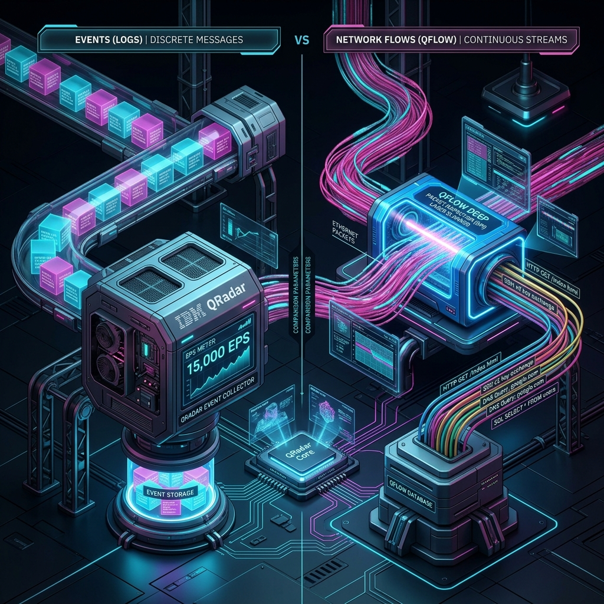
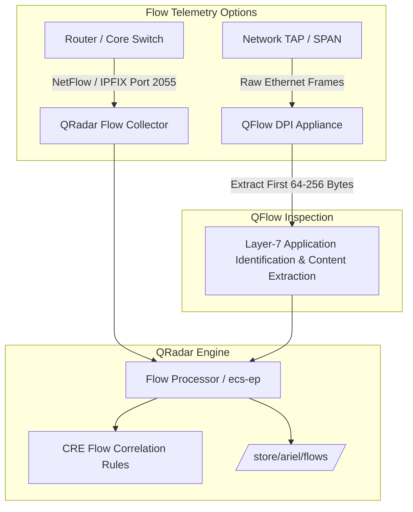

# 📖 Chapter 04: Events vs. Network Flows Deep Dive

> **The IBM QRadar Administrator's Handbook** | Phase 1: QRadar Fundamentals  
> **Target Audience:** 1.5-Year Administrators $\rightarrow$ Senior SIEM Engineers  
> **Focus:** Telemetry Comparison, QFlow Deep Packet Inspection (DPI), NetFlow vs IPFIX, Storage & SOC Incident Investigation

---

## 📸 1. Visual Overview: Events (Logs) vs. Network Flows (QFlow DPI)


*Figure 4.1: 3D Comparison View: Discrete Point-in-Time Event Cubes (Left) vs. Continuous Network Flow Fiber Streams with QFlow DPI Laser Inspection (Right) (`![[04_events_vs_flows_qflow_3d.jpg|1000]]`)*

---

## 2. What is an Event vs. What is a Network Flow?

In IBM QRadar, security telemetry is fundamentally divided into two major data types: **Events (Logs)** and **Network Flows (Flows)**.

```
┌────────────────────────────────────────────────────────────────────────┐
│                        EVENT (LOG) TELEMETRY                           │
│  "Discrete Point-in-Time Action"                                       │
│  Example: "User 'admin' failed SSH authentication on 10.10.10.5"       │
│  Trigger: An application or system executes a specific action.         │
│  Metric: Events Per Second (EPS)                                       │
└────────────────────────────────────────────────────────────────────────┘

┌────────────────────────────────────────────────────────────────────────┐
│                        NETWORK FLOW TELEMETRY                          │
│  "Continuous Session Duration & Byte Volume"                          │
│  Example: "10.10.10.5 spoke to 203.0.113.99 for 45 mins, sent 3.8 GB"   │
│  Trigger: Ongoing layer-3/4/7 network session between two IP nodes.   │
│  Metric: Flows Per Minute (FPM) / Flows Per Second (FPS)               │
└────────────────────────────────────────────────────────────────────────┘
```

---

## 3. Comprehensive Comparison Matrix

| Dimension | Event (Log) | Network Flow (QFlow / NetFlow) |
| :--- | :--- | :--- |
| **Nature of Data** | Point-in-time timestamp of a single isolated occurrence. | Continuous session tracking over a period of time (e.g. 60-second intervals or session close). |
| **Ingestion Protocol** | Syslog (UDP/TCP/TLS 514), WinCollect (8413), JDBC, REST API. | NetFlow v5/v9, IPFIX, sFlow, J-Flow (UDP 2055/4739), or raw Ethernet TAPs/SPAN. |
| **Primary Metric** | **EPS** (Events Per Second). | **FPM** (Flows Per Minute) / **FPS** (Flows Per Second). |
| **Key Insights** | User identities, error codes, application status, login results, commands executed. | Source/Destination IP & Port, byte counts, packet counts, session duration, directionality. |
| **Adversary Tampering Risk** | **High**: Attackers can disable Windows logging, clear event logs (`wevtutil cl`), or modify audit configurations. | **Low**: Network flows captured from switches, routers, or physical TAPs cannot be turned off by an endpoint attacker. |
| **Storage Location** | `/store/ariel/events/` | `/store/ariel/flows/` |
| **Underlying Daemons** | `ecs-ec-ingress` $\rightarrow$ `ecs-ep` | `qflow` $\rightarrow$ `ecs-ep` (or Flow Processor) |

---

## 4. Flow Types: External Flow Telemetry vs. QFlow Deep Packet Inspection (DPI)

### 1. External Flow Telemetry (NetFlow, sFlow, IPFIX, J-Flow)
- **Source**: Routers, core switches, and cloud VPC flow logs (AWS VPC Flow Logs, Azure NSG Flow Logs).
- **What it provides**: Pure Layer-3 and Layer-4 metadata:
  - Source IP & Source Port
  - Destination IP & Destination Port
  - IP Protocol (TCP/UDP/ICMP)
  - Number of Packets & Total Bytes Transferred
  - Duration of Session

### 2. QFlow Deep Packet Inspection (DPI)
- **Source**: Dedicated IBM QRadar QFlow Collector (Appliance 12xx/13xx) connected to a **Network TAP** or **Switch SPAN / Mirror Port**.
- **How It Works**:
  - `qflow` captures the full Ethernet packet off the wire.
  - It inspects the **first 64 to 256 bytes of the payload**.
  - It identifies the true Layer-7 application (e.g., detecting that traffic on port 443 is actually a BitTorrent or SSH tunnel rather than HTTPS).
  - It extracts application-level metadata: SSL certificate common names, HTTP User-Agents, unencrypted DNS queries, and asymmetric routing.



---

## 5. Why Does a Production SOC Require Both Events and Flows?

In modern SOC operations, investigating advanced cyber attacks without flows leaves a critical blind spot:

### Scenario 1: Command & Control (C2) Beaconing
- **The Event View**: The attacker infects a workstation. The antivirus fails to detect the malware, so zero endpoint logs are generated.
- **The Flow View**: QFlow records a session where the workstation connects to an external IP every 60 seconds transmitting exactly 256 bytes. QRadar's CRE rule *"Anomalous Periodic Outbound Connection (Beaconing)"* triggers an Offense based purely on flow telemetry.

### Scenario 2: Massive Data Exfiltration
- **The Event View**: The database server logs a normal `SELECT` query by an authorized user.
- **The Flow View**: QFlow records 45 GB of outbound traffic leaving the database server to an unknown foreign IP within 15 minutes. CRE rule *"Data Exfiltration: Outbound Transfer Exceeds Threshold"* fires immediately.

### Scenario 3: Network Reconnaissance / Lateral Movement
- **The Event View**: No logs generated by internal unmonitored endpoints.
- **The Flow View**: QFlow captures one internal IP sending TCP SYN packets to 500 different internal IPs across port 445 (SMB) within 30 seconds. CRE fires *"Reconnaissance: Internal Lateral Port Scan"*.

---

## 📌 6. Visual Mind Map & Sticky Notes (Chapter 04 Quick-Review)

### 🧠 Hierarchical Mind Map
```mermaid
mindmap
  root((Events vs Flows))
    Event Telemetry
      Discrete Point-in-Time
      EPS (Events Per Second)
      Usernames, Status codes, Error logs
      Source: Syslog, WinCollect, JDBC
      Ariel: /store/ariel/events/
      Vulnerability: Can be cleared by attacker
    Flow Telemetry
      Continuous Session Tracking
      FPM (Flows Per Minute) / FPS
      IPs, Ports, Byte counts, Duration
      Source: NetFlow, IPFIX, SPAN, TAPs
      Ariel: /store/ariel/flows/
      Immunity: Cannot be disabled from endpoint
    External Flow vs QFlow DPI
      External Flow
        NetFlow v5/v9, IPFIX, sFlow
        Pure L3/L4 packet metadata
      QFlow DPI
        Network TAP / Switch SPAN
        Inspects first 64-256 payload bytes
        L7 Application Identification
        Detects hidden tunnels on port 443
    SOC Use Cases
      C2 Periodic Beaconing
      Massive Data Exfiltration (45 GB outbound)
      Lateral Port Scanning (SMB 445)
```

### 🗂️ Color-Coded Digital Sticky Notes

#### 🟨 Sticky Note 1: Events vs. Flows (The Core Distinction)
```text
┌─────────────────────────────────────────────────────────────┐
│ 📌 CONCEPT: EVENTS VS. FLOWS                                │
│                                                             │
│ • Event = "WHO did WHAT" at a single point in time.         │
│   (e.g., User 'admin' failed password at 14:02:11).         │
│ • Flow = "WHO talked to WHOM" and "HOW MUCH DATA" moved.    │
│   (e.g., Host A sent 3.8 GB to Host B over 45 minutes).     │
│ • Key Takeaway: Events explain intent; Flows prove impact.  │
└─────────────────────────────────────────────────────────────┘
```

#### 🟩 Sticky Note 2: QFlow Deep Packet Inspection (DPI)
```text
┌─────────────────────────────────────────────────────────────┐
│ 📌 GOLDEN RULE: QFLOW DEEP PACKET INSPECTION                │
│                                                             │
│ • Standard NetFlow only sees IP headers and Port numbers.   │
│ • QFlow taps raw packets and inspects the first 64-256 bytes│
│   of payload content.                                       │
│ • Identifies true Layer-7 application protocols:            │
│   - Detects SSH or BitTorrent running over port 443 (HTTPS) │
│   - Extracts SSL certificate Subject Common Names (CN)      │
│   - Flags unencrypted plain-text credentials in HTTP/FTP.   │
└─────────────────────────────────────────────────────────────┘
```

#### 🟪 Sticky Note 3: NetFlow vs. IPFIX Protocols
```text
┌─────────────────────────────────────────────────────────────┐
│ 📌 FLOW PROTOCOLS MATRIX                                    │
│                                                             │
│ • NetFlow v5  ──► Fixed 7-key L3/L4 schema (Legacy).        │
│ • NetFlow v9  ──► Template-based, supports IPv6 & MPLS.     │
│ • IPFIX       ──► IETF Open Standard (NetFlow v10).         │
│ • sFlow       ──► Packet sampling (Statistical).            │
│ • Listening Port: UDP 2055 / UDP 4739 on Flow Collector.   │
└─────────────────────────────────────────────────────────────┘
```

#### 🟦 Sticky Note 4: The Unstoppable Telemetry
```text
┌─────────────────────────────────────────────────────────────┐
│ 📌 SOC DEFENSE: THE UNSTOPPABLE TELEMETRY                   │
│                                                             │
│ • Sophisticated attackers clear Event Logs via PowerShell   │
│   (`wevtutil cl Security`) or disable local agents.         │
│ • BUT: The attacker CANNOT disable NetFlow or SPAN packets  │
│   captured at the core Cisco/Arista switch level!           │
│ • Flows provide non-repudiable forensic proof of movement.  │
└─────────────────────────────────────────────────────────────┘
```

#### 🟧 Sticky Note 5: Interview Cheat Code (Events vs. Flows)
```text
┌─────────────────────────────────────────────────────────────┐
│ 📌 INTERVIEW CHEAT CODE: "WHY DOES A SOC NEED BOTH?"        │
│                                                             │
│ "Events provide application and user context (who logged in,│
│ which file was accessed, authentication failures), whereas  │
│ Flows provide network session telemetry (bandwidth volume,  │
│ connection duration, C2 beaconing). When an attacker evades │
│ endpoint logging, QFlow and NetFlow captured off the wire   │
│ maintain visibility and trigger Offenses on exfiltration."  │
└─────────────────────────────────────────────────────────────┘
```

#### 🟥 Sticky Note 6: Common Administrator Pitfall
```text
┌─────────────────────────────────────────────────────────────┐
│ ⚠️ CRITICAL PITFALL: ASYMMETRIC ROUTING IN QFLOW            │
│                                                             │
│ • If QFlow only sees the SYN (request) path because the ACK │
│   (response) returns via another router, flow metrics break.│
│ • Symptom: Incomplete flow sessions or unidirectional flows.│
│ • Remediation: Configure Flow Interfaces to merge asymmetric│
│   flow pairs or tap both ingress and egress switch trunks.  │
└─────────────────────────────────────────────────────────────┘
```

---

### ⚡ Rapid-Recall Flashcards

| # | Question (Front) | Answer (Back) |
| :-: | :--- | :--- |
| **01** | What metric is used to measure network flow capacity in QRadar? | **Flows Per Minute (FPM)** or **Flows Per Second (FPS)**. |
| **02** | How many bytes of payload does QFlow inspect for Layer-7 Deep Packet Inspection? | The first **64 to 256 bytes**. |
| **03** | On which UDP ports does QRadar commonly receive NetFlow and IPFIX? | **UDP Port 2055** and **UDP Port 4739**. |
| **04** | Where are historical flow records stored on disk? | **`/store/ariel/flows/`**. |
| **05** | Why are Network Flows considered tamper-resistant compared to Windows Event Logs? | Because flows are captured at the network switch/TAP layer, independent of the compromised endpoint OS. |
| **06** | What is an example of an attack detectable only through Flows? | **Periodic C2 beaconing** with malware bypassing endpoint AV, or **unauthorized massive outbound data exfiltration**. |
