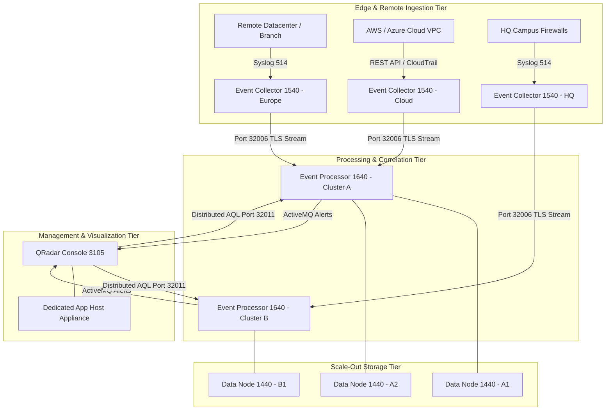
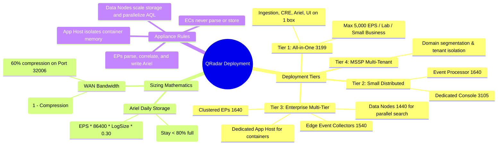

# 📖 Chapter 05: Distributed Deployment Topologies & Sizing Masterclass

> **The IBM QRadar Administrator's Technical Guide** | Phase 1: QRadar Fundamentals  
> **Target Audience:** 1.5-Year Administrators $\rightarrow$ Senior SIEM Engineers & Architects  
> **Focus:** Deployment Archetypes, Multi-Tier Topologies, Cloud/On-Prem Hybrids, Capacity Sizing Mathematics, Bandwidth Engineering & Hands-on Lab

---

## 📸 1. Visual Overview: QRadar Distributed Topologies & Sizing


*Figure 5.1: 3D Isometric View of the 3 Master Deployment Archetypes: All-in-One Appliance (3199), Enterprise Multi-Tier Distributed Topology (Console, EC, EP, FP, Data Nodes, App Host), and Multi-Tenant MSSP Cloud/WAN Hybrid Topology (`![[09_distributed_topologies_sizing_3d.jpg|1000]]`)*

---

## 2. The 4 Master Deployment Archetypes

In enterprise security engineering, selecting the correct topology is the single most critical decision determining whether a SIEM cluster thrives or suffers catastrophic I/O bottlenecks.

```
┌────────────────────────────────────────────────────────────────────────┐
│ TIER 1: ALL-IN-ONE (AIO - 3199)                                        │
│ • Capacity: Up to 5,000 EPS / 100,000 FPM                              │
│ • Topology: Console + Ingress + Parsing + CRE + Storage on 1 Box       │
│ • Use Case: Small Enterprises, Branch Offices, Lab / Dev Environments  │
└────────────────────────────────────────────────────────────────────────┘

┌────────────────────────────────────────────────────────────────────────┐
│ TIER 2: DISTRIBUTED WITH DEDICATED PROCESSOR (3105 + 1640)             │
│ • Capacity: 5,000 to 20,000 EPS / 300,000 FPM                          │
│ • Topology: Dedicated Console (UI, PostgreSQL, Magistrate) +           │
│             Dedicated Event Processor (Parsing, CRE, Ariel DB)         │
│ • Use Case: Mid-Market Enterprises, Regional Datacenters               │
└────────────────────────────────────────────────────────────────────────┘

┌────────────────────────────────────────────────────────────────────────┐
│ TIER 3: ENTERPRISE MULTI-TIER WITH DATA NODES                          │
│ • Capacity: 20,000 to 100,000+ EPS / 1,000,000+ FPM                    │
│ • Topology: Console + Event Collectors (1540) at Edge + Clustered EPs  │
│             + Attached Data Nodes (1440) + Dedicated App Host          │
│ • Use Case: Global Banks, Telecommunications, Fortune 500 Enterprises  │
└────────────────────────────────────────────────────────────────────────┘

┌────────────────────────────────────────────────────────────────────────┐
│ TIER 4: MULTI-TENANT MSSP TOPOLOGY                                     │
│ • Capacity: 100,000+ EPS across 50+ Independent Organizations          │
│ • Topology: Central Console + Domain Segmentation + Remote Event       │
│             Collectors over WAN/TLS + Tenant-Isolated Security Profiles│
│ • Use Case: Managed Security Service Providers (MSSPs), Shared Socs    │
└────────────────────────────────────────────────────────────────────────┘
```

---

## 3. Deep Dive: Architectural Component Roles in Distributed Deployments



### 1. The Separation of Management and Compute
- In an All-in-One deployment, when an analyst runs a heavy 30-day AQL query, the Ariel search engine consumes 100% of the CPU and RAM.
- This starves the Tomcat web server (causing UI crashes) and delays the CRE correlation engine (causing delayed offenses).
- In a **Distributed Architecture**, the Console runs **zero log parsing and zero disk writes**. Its CPU is 100% dedicated to UI rendering, API queries, PostgreSQL configuration integrity, and Magistrate offense calculations.

### 2. Edge Event Collectors (15xx) vs Central Event Processors (16xx)
- **Why place Event Collectors at the network edge?**
  - **Bandwidth Reduction**: ECs compress raw syslog streams by **50% to 70%** before sending them over the WAN via TCP port `32006`.
  - **WAN Resilience**: If the corporate WAN fails, the EC buffers logs to disk at `/store/transient/` with zero packet loss.
  - **Protocol Offloading**: Active polling protocols (JDBC queries, Universal Cloud REST API token negotiations) run locally at the edge without traversing international firewalls.

### 3. Data Nodes (14xx) for Linear Scale-Out Search & Storage
- When an Event Processor hits disk capacity or search performance degrades:
  - You do **not** replace the Event Processor with a bigger box.
  - You attach one or more **Data Nodes (1440)** to the EP.
  - Storage is automatically striped across the EP and Data Nodes in a round-robin cluster.
  - When an AQL search is executed, the EP and Data Nodes query their local disks **in parallel**, dividing search times by the number of nodes ($T_{\text{search}} = \frac{T_{\text{baseline}}}{N}$).

---

## 4. Enterprise Sizing Mathematics & Capacity Planning

As a 2-year experienced SIEM Administrator or Architect, you must be able to calculate bandwidth, storage retention, CPU, and memory requirements with mathematical precision.

---

### 🧮 Formula 1: Network WAN Bandwidth Sizing
To calculate the network bandwidth required to stream logs from a remote Event Collector to a central Event Processor:

$$\text{Bandwidth (Mbps)} = \frac{\text{EPS} \times \text{Avg Log Size (Bytes)} \times 8}{1,000,000} \times (1 - \text{Compression Ratio})$$

#### Real-World Example:
- **Remote Site Ingestion**: $10,000\text{ EPS}$
- **Average Syslog Size**: $500\text{ Bytes}$
- **QRadar Port 32006 Compression**: $60\%\text{ reduction}$ (Compression Factor = $0.40$)

$$\text{Raw Uncompressed Bandwidth} = \frac{10,000 \times 500 \times 8}{1,000,000} = 40\text{ Mbps}$$
$$\text{Compressed WAN Bandwidth} = 40\text{ Mbps} \times 0.40 = \mathbf{16\text{ Mbps}}$$

> [!TIP]
> **Architect Recommendation**: Always add a $30\%$ safety margin for burst peaks: $16\text{ Mbps} \times 1.30 = \mathbf{20.8\text{ Mbps}}$ dedicated bandwidth.

---

### 🧮 Formula 2: Daily Ariel Storage Sizing Math
To calculate physical disk storage required per day for raw payloads and binary normalized records:

$$\text{Raw Daily Ingestion (GB)} = \frac{\text{EPS} \times 86,400\text{ seconds/day} \times \text{Avg Log Size (Bytes)}}{1,073,741,824\text{ Bytes/GB}}$$
$$\text{Ariel Disk Storage Required (GB/Day)} = \text{Raw Daily Ingestion} \times \text{Ariel Compression Factor (0.25 to 0.35)}$$

#### Real-World Example:
- **Deployment Rate**: $20,000\text{ EPS}$
- **Average Log Size**: $600\text{ Bytes}$
- **Retention Policy**: $90\text{ Days Hot Searchable Storage}$
- **Ariel Compression**: $70\%\text{ Compression}$ (Factor = $0.30$)

$$\text{Raw Daily Volume} = \frac{20,000 \times 86,400 \times 600}{1,073,741,824} = \mathbf{965.5\text{ GB / Day}}$$
$$\text{Ariel Stored Per Day} = 965.5\text{ GB} \times 0.30 = \mathbf{289.65\text{ GB / Day}}$$
$$\text{90-Day Retention Storage} = 289.65\text{ GB} \times 90\text{ Days} = \mathbf{26,068.5\text{ GB (25.46 TB)}}$$

> [!IMPORTANT]
> **The 20% Storage Safety Overhead Rule**:
> In QRadar, `/store` must never exceed **85% utilization** (at 90%, QRadar issues critical alerts; at 95%, Ariel writes are halted).
> $$\text{Usable Storage Required} = 25.46\text{ TB} \div 0.80 = \mathbf{31.8\text{ TB Net Usable Storage}}$$

---

## 5. Hardware Specification & Appliance Matrix

| Appliance Model | Role | CPU Cores | RAM | Storage Subsystem | Max Rated EPS / FPM |
| :--- | :--- | :--- | :--- | :--- | :--- |
| **QRadar 3105 / 3128** | Dedicated Console | 16–32 Cores | 64–128 GB | 4–8 TB RAID-10 | Management Only (500k EPS Cluster) |
| **QRadar 3199** | All-in-One Appliance | 16–24 Cores | 64–128 GB | 12–24 TB RAID-10 | Up to 5,000 EPS / 100k FPM |
| **QRadar 1501 / 1540** | Event Collector | 8–16 Cores | 32–64 GB | 2–4 TB Spool NVMe | Up to 40,000 EPS Ingestion |
| **QRadar 1605 / 1640** | Event Processor | 24–36 Cores | 128–256 GB | 16–48 TB RAID-10 | Up to 40,000 EPS Processing |
| **QRadar 1705 / 1740** | Flow Processor | 16–32 Cores | 64–128 GB | 16–32 TB RAID-10 | Up to 1,200,000 FPM |
| **QRadar 1405 / 1440** | Data Node | 16–24 Cores | 64–128 GB | 48–96 TB RAID-6 | Scale-out Storage & Search |
| **App Host (Dedicated)** | App Engine (Docker) | 16–32 Cores | 64–256 GB | 2 TB High-Speed SSD | Runs UBA, Pulse, Use Case Mgr |

---

## 📌 6. Visual Mind Map & Sticky Notes (Chapter 05 Quick-Review)

### 🧠 Hierarchical Mind Map


### 🗂️ Color-Coded Digital Sticky Notes

#### 🟨 Sticky Note 1: All-in-One vs. Distributed Threshold
```text
┌─────────────────────────────────────────────────────────────┐
│ 📌 CONCEPT: WHEN TO MIGRATE FROM AIO TO DISTRIBUTED?        │
│                                                             │
│ • Migration Triggers:                                       │
│   1. Sustained ingestion exceeds 5,000 EPS.                 │
│   2. Complex AQL forensic searches crash the Tomcat Web UI. │
│   3. Multiple remote datacenters experience WAN latency.    │
│ • The First Split: Move Event Processing to a dedicated     │
│   Event Processor (1640), keeping the Console for UI & DB.  │
└─────────────────────────────────────────────────────────────┘
```

#### 🟩 Sticky Note 2: Data Node Parallelization Rule
```text
┌─────────────────────────────────────────────────────────────┐
│ 📌 GOLDEN RULE: DATA NODES ACCELERATE AQL SEARCHES          │
│                                                             │
│ • Attaching 3 Data Nodes to an Event Processor:             │
│   - Splits incoming Ariel writes 4-ways in round-robin.     │
│   - Queries execute across 4 local storage buses in parallel│
│   - A 10-minute historical search drops to ~2.5 minutes!    │
└─────────────────────────────────────────────────────────────┘
```

#### 🟪 Sticky Note 3: The 80% Disk Safety Rule
```text
┌─────────────────────────────────────────────────────────────┐
│ 📌 STORAGE RULE: THE 80% /STORE THRESHOLD                   │
│                                                             │
│ • Always size storage so 90-day retention fills < 80%.      │
│ • At 85%: Warning notification.                             │
│ • At 90%: High-priority alarm; auto-retention purge starts. │
│ • At 95%: Ariel writes halt to protect disk corruption!     │
└─────────────────────────────────────────────────────────────┘
```

#### 🟦 Sticky Note 4: The App Host Isolation Mandate
```text
┌─────────────────────────────────────────────────────────────┐
│ 📌 ARCHITECTURE MANDATE: DEDICATED APP HOST                 │
│                                                             │
│ • Apps like UBA (User Behavior Analytics) and Machine       │
│   Learning models consume massive RAM (32GB–64GB).          │
│ • NEVER run high-memory apps on the Console in production.  │
│ • Deploy a dedicated App Host to isolate Docker containers. │
└─────────────────────────────────────────────────────────────┘
```

#### 🟧 Sticky Note 5: Interview Cheat Code (Sizing Math)
```text
┌─────────────────────────────────────────────────────────────┐
│ 📌 INTERVIEW CHEAT CODE: "HOW DO YOU SIZE A 20K EPS SIEM?"  │
│                                                             │
│ "At 20k EPS with 600-byte logs, raw daily volume is ~1 TB.  │
│ With Ariel's 70% compression, we store ~300 GB/day. For     │
│ 90-day retention, that requires ~27 TB net. Adding a 20%    │
│ headroom buffer to stay under the 80% watermark, we size    │
│ 34 TB usable RAID-10 storage on an EP 1640 with Data Nodes."│
└─────────────────────────────────────────────────────────────┘
```

#### 🟥 Sticky Note 6: Common Administrator Pitfall
```text
┌─────────────────────────────────────────────────────────────┐
│ ⚠️ CRITICAL PITFALL: SIZING BANDWIDTH WITHOUT COMPRESSION   │
│                                                             │
│ • Raw syslog over WAN consumes massive uncompressed pipes.  │
│ • Always deploy an Event Collector (15xx) at remote sites.  │
│ • Port 32006 inter-appliance streaming compresses logs by   │
│   60%, reducing a 50 Mbps WAN requirement down to 20 Mbps!  │
└─────────────────────────────────────────────────────────────┘
```

---

### ⚡ Rapid-Recall Flashcards

| # | Question (Front) | Answer (Back) |
| :-: | :--- | :--- |
| **01** | What is the maximum recommended EPS capacity for an All-in-One (3199)? | **5,000 EPS** (under standard rule/search loads). |
| **02** | What primary benefit does an Event Collector (15xx) provide over WAN? | **60% bandwidth compression** on Port 32006 and local disk spooling during outages. |
| **03** | How do Data Nodes (14xx) accelerate historical AQL searches? | By distributing data blocks and running searches in **parallel across all attached nodes**. |
| **04** | At what disk utilization percentage does QRadar stop writing new Ariel records? | At **95% utilization on `/store`**. |
| **05** | Which appliance is specifically responsible for hosting containerized QRadar apps? | The **App Host Appliance**. |
| **06** | What is the formula for calculating daily Ariel compressed storage? | $\text{Raw Volume (GB)} \times \text{Compression Factor (0.25 to 0.35)}$. |

---

## 🧪 7. Hands-on Practice Lab 05: Deployment Topology Verification & Sizing Validation

### 🎯 Lab Objectives
1. Verify cluster topology, managed host roles, and connection status via Linux CLI.
2. Inspect storage partition allocations (`/store`, `/store/ariel`) across distributed nodes.
3. Validate inter-appliance encrypted communication channels on Port 32006.
4. Calculate exact EPS throughput and storage consumption on active partitions.

---

### 📋 Step-by-Step Practical Lab Procedures

#### Step 1: Inspect Managed Host Topology via CLI
Log into the QRadar Console via SSH and query the deployment topology:
```bash
# Display all managed hosts, appliance types, and IP assignments
/opt/qradar/support/deployment_info.sh

# Alternative: Query PostgreSQL deployment tables
psql -U qradar -d qsys -c "SELECT id, hostname, ip, appliance_type_id, status FROM managed_host;"
```
*Expected Output*: Displays Console (3105), Event Processors (1640), and Data Nodes (1440) with `status = ACTIVE`.

---

#### Step 2: Verify Partition Utilization & Watermarks
On the Console and each Event Processor, verify disk capacity:
```bash
# Check filesystem utilization on /store
df -h /store /store/ariel /store/transient

# Check detailed Ariel database directory sizing
du -sh /store/ariel/events/records/$(date +%Y)/$(date +%m)/$(date +%d)
du -sh /store/ariel/events/payloads/$(date +%Y)/$(date +%m)/$(date +%d)
```

---

#### Step 3: Test Inter-Appliance Streaming Port (32006)
From an Event Collector, verify network connectivity to the central Event Processor:
```bash
# Test TCP Port 32006 connectivity
nc -zv <Event_Processor_IP> 32006

# Inspect active established streaming sockets
ss -tanp | grep 32006
```
*Expected Output*: Connection to `<Event_Processor_IP> 32006 port [tcp/*] succeeded!`

---

#### Step 4: Sizing Exercise Challenge
**Scenario**: Your enterprise is onboarding a new cloud datacenter generating **15,000 EPS** with an average log size of **450 Bytes**. The security policy mandates **180 Days of Hot Searchable Retention**.

**Your Task**: Calculate:
1. Required WAN Bandwidth from the Cloud EC to the central EP (assuming 60% compression).
2. Daily uncompressed log volume in GB.
3. Daily Ariel compressed storage in GB (assuming 70% compression).
4. Total net usable disk storage required for 180 days (including the 20% safety margin).

**Answer Key**:
1. $\text{WAN Bandwidth} = \frac{15,000 \times 450 \times 8}{1,000,000} \times 0.40 = \mathbf{21.6\text{ Mbps}}$
2. $\text{Daily Raw} = \frac{15,000 \times 86,400 \times 450}{1,073,741,824} = \mathbf{543.1\text{ GB / Day}}$
3. $\text{Daily Ariel} = 543.1 \times 0.30 = \mathbf{162.9\text{ GB / Day}}$
4. $\text{180-Day Net} = 162.9 \times 180 = 29,322\text{ GB (28.6 TB)} \div 0.80 = \mathbf{35.8\text{ TB Usable Storage}}$.
