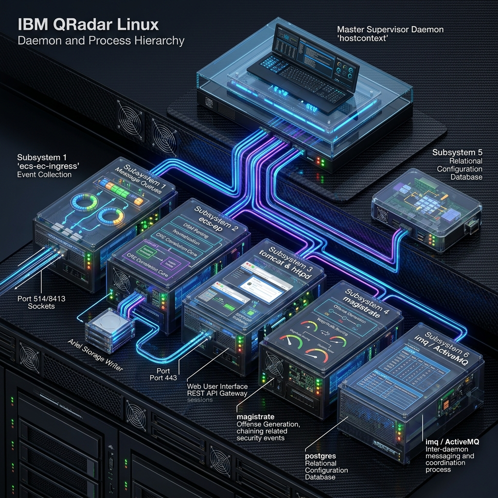
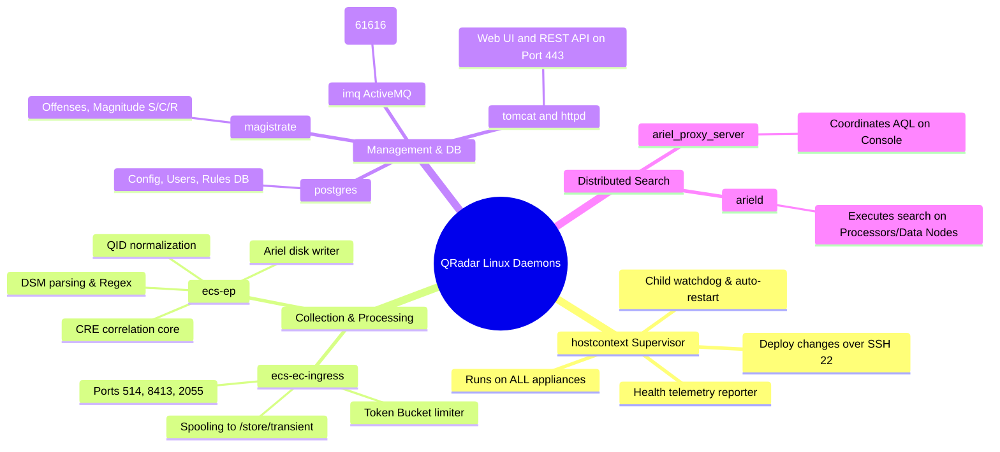

# 📖 Chapter 06: Internal Daemons & Linux Subsystems Masterclass

> **The IBM QRadar Administrator's Technical Guide** | Phase 1: QRadar Fundamentals  
> **Target Audience:** 1.5-Year Administrators $\rightarrow$ Senior SIEM Engineers & Architects  
> **Focus:** Linux Daemon Hierarchy, `hostcontext` Supervisor, Process States, JVM Memory Tuning, IPC Messaging & Hands-on Lab

---

## 📸 1. Visual Overview: QRadar Daemon & Process Hierarchy


*Figure 6.1: 3D Isometric View of the Linux Process Hierarchy: Master Supervisor `hostcontext` commanding `ecs-ec-ingress`, `ecs-ep`, `tomcat & httpd`, `magistrate`, `postgres`, and `imq / ActiveMQ` (`![[10_daemons_process_hierarchy_3d.jpg|1000]]`)*

---

## 2. The Master Process Tree & Daemon Ecosystem

Behind the QRadar web user interface sits an enterprise Linux subsystem (RHEL) orchestrating a dozen specialized Java Virtual Machines, C/C++ daemons, and relational databases.

```
                               ┌─────────────────────────────┐
                               │        SYSTEMD / OS         │
                               │      (PID 1 - Init)         │
                               └──────────────┬──────────────┘
                                              │
                                              ▼
                               ┌─────────────────────────────┐
                               │         hostcontext         │
                               │  (Master Node Supervisor)   │
                               └──────────────┬──────────────┘
                                              │
         ┌──────────────────┬─────────────────┼──────────────────┬──────────────────┐
         │                  │                 │                  │                  │
         ▼                  ▼                 ▼                  ▼                  ▼
┌──────────────────┐ ┌──────────────┐ ┌──────────────┐ ┌──────────────────┐ ┌──────────────┐
│  ecs-ec-ingress  │ │    ecs-ep    │ │    tomcat    │ │    magistrate    │ │  ariel_proxy  │
│(Collection/Spool)│ │(Parsing/CRE) │ │  (Web/API)   │ │ (Offense Engine) │ │(Distributed Q)│
└──────────────────┘ └──────────────┘ └──────────────┘ └──────────────────┘ └──────────────┘
         │                  │                 │                  │
         └──────────────────┼─────────────────┼──────────────────┘
                            ▼                 ▼
                   ┌──────────────────┐ ┌──────────────┐
                   │  imq / ActiveMQ  │ │   postgres   │
                   │(Inter-Proc Bus)  │ │ (Config DB)  │
                   └──────────────────┘ └──────────────┘
```

---

## 3. Deep Dive: Master Daemon Architecture & Responsibilities

---

### 👑 1. `hostcontext` — The Master Cluster Supervisor
- **Runs on**: **Every single appliance** in the QRadar deployment (Console, EC, EP, FP, Data Node, App Host).
- **Core Responsibilities**:
  1. **Child Process Supervisor**: Acts as the watchdog for all QRadar child services. If `ecs-ep` or `tomcat` crashes due to memory exhaustion, `hostcontext` catches the exit signal and restarts it.
  2. **Cluster Configuration Listener**: Listens on encrypted SSH (port `22`) for administrative commands from the Console.
  3. **"Deploy Changes" Orchestrator**: When an administrator clicks *Deploy Changes* in the Web UI, `hostcontext` downloads updated XML configurations, rule files, and DSM definitions, pushing them to child worker processes without requiring a full OS reboot.
  4. **Health Telemetry Reporter**: Continuously monitors disk space, CPU load, and memory queues, reporting host status back to the Console.

> [!IMPORTANT]
> If `hostcontext` fails or stops running on a managed host, the appliance immediately transitions to **"Unavailable"** or **"Disconnected"** in the Deployment Editor!

---

### 📥 2. `ecs-ec-ingress` — Event Collection Ingress Engine
- **Runs on**: Console, Event Collectors (15xx), All-in-One (3199).
- **Core Responsibilities**:
  - Owns all external listening network sockets (UDP/TCP 514 for Syslog, TCP 8413 for WinCollect, UDP 2055 for NetFlow).
  - Executes active polling protocols (JDBC database polling, Universal Cloud REST API workflows).
  - Enforces the **Token Bucket License Rate Limiter**.
  - Manages the **In-Memory Ring Buffer** and disk spooling to `/store/transient/` during backpressure.
  - Streams compressed, encrypted event bundles over TCP port `32006` to `ecs-ep`.

---

### 🧠 3. `ecs-ep` — Event & Flow Processing Engine
- **Runs on**: Console, Event Processors (16xx), Flow Processors (17xx), All-in-One (3199).
- **Core Responsibilities**:
  - **DSM Header & Payload Parsing**: Executes regex pattern matching to extract standardized variables.
  - **QID Normalization**: Maps vendor event signatures to standard numeric QIDs in the QID Map.
  - **CRE (Custom Rules Engine)**: Evaluates incoming normalized events against behavioral rules, building blocks, and reference data in microseconds.
  - **Ariel Writer Subsystem**: Writes raw payloads to `/store/ariel/events/payloads/` and binary columnar records to `/store/ariel/events/records/`.
  - **Offense Alert Dispatch**: Emits rule match alerts onto the internal ActiveMQ bus targeting the Magistrate.

---

### 🌐 4. `tomcat` & `httpd` — Web Application & API Gateway
- **Runs on**: The **Console Appliance Only**.
- **Core Responsibilities**:
  - `httpd` (Apache): Terminates incoming SSL/TLS connections on port `443`, handles session certificates, and proxies HTTP traffic to Tomcat.
  - `tomcat` (Apache Tomcat Java Servlet Container): Hosts the QRadar Web UI, Dashboard widgets, Report generator, and RESTful API endpoints (`/api/`).
  - **Memory Footprint**: Typically configured with **8 GB to 16 GB** of JVM heap memory.

---

### 🏛️ 5. `magistrate` — Central Offense & Magnitude Engine
- **Runs on**: The **Console Appliance Only**.
- **Core Responsibilities**:
  - Subscribes to the `qsys_events` ActiveMQ queue.
  - Receives correlation rule trigger messages from all distributed `ecs-ep` instances.
  - Evaluates the **Offense Indexing Key** (e.g. Source IP, Destination IP, Username).
  - Chains related events into existing open offenses or generates new Offenses.
  - Dynamically calculates the **Magnitude Score** ($0\text{ to }10$) based on Severity, Credibility, and Asset Vulnerability Relevance.

---

### 🗄️ 6. `postgres` — Relational Configuration Database
- **Runs on**: The **Console Appliance Only** (`/store/postgres/`).
- **Core Responsibilities**:
  - Houses the central relational databases: `qsys` (offenses, assets, deployment hierarchy) and `configdb` (rules, users, security profiles, log source definitions).
  - Backed up nightly during daily **Configuration Backups**.

---

### 📬 7. `imq` (Apache ActiveMQ) — Inter-Daemon Message Broker
- **Runs on**: Console and Event Processors.
- **Core Responsibilities**:
  - High-performance, low-latency Java Message Service (JMS) broker running on port `61616`.
  - Acts as the decoupled communications bridge between the real-time processing engine (`ecs-ep`) and the offense coordinator (`magistrate`).

---

### 🔍 8. `ariel_proxy_server` & `arield` — Distributed Query Engine
- **Runs on**: `ariel_proxy_server` on the Console; `arield` on all Processors and Data Nodes.
- **Core Responsibilities**:
  - When an analyst executes an AQL query, `ariel_proxy_server` breaks the query into parallel tasks and distributes them over TCP ports `32011` / `32012` to `arield` workers across all managed hosts.
  - Aggregates and merges intermediate results, streaming the final table back to the Web UI.

---

## 4. Master Daemon State & Port Reference Table

| Daemon Name | Binary / Service Unit | Bound Ports | Primary Config Files | Log File Location |
| :--- | :--- | :--- | :--- | :--- |
| `hostcontext` | `systemctl status hostcontext` | 22 (SSH Listener) | `/opt/qradar/conf/nva.conf` | `/var/log/qradar.log` |
| `ecs-ec-ingress`| Managed by `hostcontext` | 514 (Syslog), 8413, 2055 | `/opt/qradar/conf/ecs.conf` | `/var/log/qradar.log` |
| `ecs-ep` | Managed by `hostcontext` | 32006 (Ingress Stream) | `/opt/qradar/conf/ecs-ep.conf`| `/var/log/qradar.log` / `qradar.error` |
| `tomcat` | `systemctl status tomcat` | 8080 (Local), 443 (via httpd)| `/opt/tomcat/conf/server.xml` | `/var/log/qradar.log` / `catalina.out` |
| `magistrate` | Managed by `hostcontext` | Internal ActiveMQ Queue | `/opt/qradar/conf/magistrate.conf`| `/var/log/qradar.log` / `magistrate.log`|
| `postgres` | `systemctl status postgresql` | 5432 (Local TCP) | `/store/postgres/data/postgresql.conf` | `/var/log/qradar.log` / `postgresql.log` |
| `imq` | `systemctl status imq` | 61616 (ActiveMQ JMS) | `/opt/activemq/conf/activemq.xml` | `/var/log/activemq.log` |
| `ariel_proxy` | Managed by `hostcontext` | 32011 / 32012 | `/opt/qradar/conf/ariel.conf` | `/var/log/qradar.log` / `ariel_proxy.log`|

---

## 📌 5. Visual Mind Map & Sticky Notes (Chapter 06 Quick-Review)

### 🧠 Hierarchical Mind Map


### 🗂️ Color-Coded Digital Sticky Notes

#### 🟨 Sticky Note 1: The Supervisor Principle (`hostcontext`)
```text
┌─────────────────────────────────────────────────────────────┐
│ 📌 CONCEPT: NEVER START CHILD DAEMONS MANUALLY!             │
│                                                             │
│ • Child daemons (ecs-ec-ingress, ecs-ep, magistrate) are    │
│   supervised directly by `hostcontext`.                     │
│ • If you need to restart event processing:                  │
│   - Preferred: `systemctl restart hostcontext`              │
│   - Or use: `/opt/qradar/bin/qradar_netstat.sh`             │
│ • Manually killing ecs-ep causes hostcontext to auto-revive │
│   the process within 10 seconds.                            │
└─────────────────────────────────────────────────────────────┘
```

#### 🟩 Sticky Note 2: ActiveMQ Broker Health
```text
┌─────────────────────────────────────────────────────────────┐
│ 📌 GOLDEN RULE: IMQ (ACTIVEMQ) IS THE ALERT LIFELINE        │
│                                                             │
│ • If CRE rules fire in Log Activity but no Offenses generate│
│   on the Console dashboard:                                 │
│   - First suspect: ActiveMQ broker queue failure!           │
│ • Verify ActiveMQ state: `systemctl status imq`             │
│ • Inspect broker depth: Look for stalled messages in JMS.   │
└─────────────────────────────────────────────────────────────┘
```

#### 🟪 Sticky Note 3: Tomcat Web UI Memory Crash
```text
┌─────────────────────────────────────────────────────────────┐
│ 📌 JVM TUNING: TOMCAT OUTOFMEMORYERROR (OOM)                │
│                                                             │
│ • Symptom: HTTP 500 or "Server Unreachable" on Port 443.    │
│ • Cause: Heavy dashboard widgets or massive REST API pulls. │
│ • Check log: `/var/log/qradar.log` for `java.lang.OutOfMemory`│
│ • Fix: Adjust `-Xmx` in `/opt/tomcat/bin/setenv.sh` and     │
│   restart Tomcat: `systemctl restart tomcat`.               │
└─────────────────────────────────────────────────────────────┘
```

#### 🟦 Sticky Note 4: PostgreSQL Backup Boundary
```text
┌─────────────────────────────────────────────────────────────┐
│ 📌 CONFIG DATABASE: POSTGRESQL (QSYS & CONFIGDB)            │
│                                                             │
│ • PostgreSQL stores metadata, NOT historical event logs.    │
│ • Running `psql -U qradar -d qsys` lets admins inspect      │
│   managed hosts, log sources, and active offenses.          │
│ • Nightly Config Backups dump Postgres to a `.tar.gz` file. │
└─────────────────────────────────────────────────────────────┘
```

#### 🟧 Sticky Note 5: Interview Cheat Code (Daemon Responsibilities)
```text
┌─────────────────────────────────────────────────────────────┐
│ 📌 INTERVIEW CHEAT CODE: "NAME THE CORE QRADAR DAEMONS"     │
│                                                             │
│ "QRadar is orchestrated by `hostcontext` on every host.     │
│ Ingestion is owned by `ecs-ec-ingress`, parsing/CRE/storage │
│ is owned by `ecs-ep`, UI/API is served by `tomcat`, and     │
│ Offense lifecycle is calculated by the `magistrate` via     │
│ `ActiveMQ` alerts, while configurations live in PostgreSQL."│
└─────────────────────────────────────────────────────────────┘
```

#### 🟥 Sticky Note 6: Common Administrator Pitfall
```text
┌─────────────────────────────────────────────────────────────┐
│ ⚠️ CRITICAL PITFALL: SSH PORT 22 KEY CORRUPTION             │
│                                                             │
│ • hostcontext uses SSH (Port 22) and authorized_keys to sync│
│   deployments and poll managed hosts.                       │
│ • If an admin regenerates SSH keys or disables root login,  │
│   all managed hosts become 'Disconnected' in the UI!        │
│ • Fix: Resync keys via `/opt/qradar/support/all_servers.sh`.│
└─────────────────────────────────────────────────────────────┘
```

---

### ⚡ Rapid-Recall Flashcards

| # | Question (Front) | Answer (Back) |
| :-: | :--- | :--- |
| **01** | What is the master supervisor daemon in QRadar? | **`hostcontext`** (runs on all managed hosts). |
| **02** | Which daemon evaluates CRE correlation rules and writes to Ariel? | **`ecs-ep`**. |
| **03** | Which process receives CRE alerts and calculates Offense Magnitude? | **`magistrate`** on the Console. |
| **04** | What messaging service bridges `ecs-ep` to the Magistrate? | **`imq` (Apache ActiveMQ)** on port 61616. |
| **05** | What database stores log source definitions and user security profiles? | **PostgreSQL** (`qsys` and `configdb`). |
| **06** | Which daemon coordinates distributed AQL searches across managed hosts? | **`ariel_proxy_server`** on the Console. |

---

## 🧪 6. Hands-on Practice Lab 06: Daemon Management, Process Inspection & Diagnostics

### 🎯 Lab Objectives
1. Inspect the live process hierarchy, thread states, and memory allocation of core QRadar daemons.
2. Verify inter-process communication on ActiveMQ (`imq`) and PostgreSQL (`5432`).
3. Generate and analyze a JVM Thread Dump (`jstack`) on a busy processing engine.
4. Execute administrative recovery commands for stuck services.

---

### 📋 Step-by-Step Practical Lab Procedures

#### Step 1: Inspect Daemon Process Tree & PIDs
Log into the Console or Event Processor via SSH:
```bash
# 1. Check systemd status of hostcontext
systemctl status hostcontext

# 2. View running child processes spawned by QRadar
ps -ef | grep -E "ecs-ec-ingress|ecs-ep|tomcat|magistrate|postgres" | grep -v grep

# 3. View process memory (RSS) and CPU consumption
top -b -n 1 | head -n 20
```

---

#### Step 2: Verify Listening Sockets & Inter-Daemon Ports
```bash
# Verify listening ports for Web (443), ActiveMQ (61616), Postgres (5432), and Ingress (32006)
ss -tulpn | grep -E "443|61616|5432|32006|32011"
```

---

#### Step 3: Inspect Database Connectivity to PostgreSQL
```bash
# Query active offense count directly from PostgreSQL
psql -U qradar -d qsys -c "SELECT status, count(*) FROM offense GROUP BY status;"

# Check active database connections
psql -U qradar -d qsys -c "SELECT count(*) FROM pg_stat_activity;"
```

---

#### Step 4: Generate a Java JVM Thread Dump for Troubleshooting
When `ecs-ep` or `tomcat` becomes unresponsive or experiences high CPU:
```bash
# Identify the PID of ecs-ep
PID=$(pgrep -f "ecs-ep")

# Generate thread dump using jstack
jstack -l $PID > /tmp/ecs_ep_threads_$(date +%s).tdump

# Inspect top locked or runnable threads
head -n 40 /tmp/ecs_ep_threads_*.tdump | grep -E "RUNNABLE|BLOCKED|WAITING"
```
*Expected Output*: Displays all active Java worker threads, showing whether threads are waiting on network I/O or locked on regex evaluation.

---

#### Step 5: Execute Clean Service Restart Runbook
If an appliance experiences daemon degradation:
```bash
# Cleanly restart hostcontext and all supervised child services
systemctl restart hostcontext

# Monitor the startup sequence in real time
tail -f /var/log/qradar.log | grep -E "hostcontext|Starting|Registered"
```
