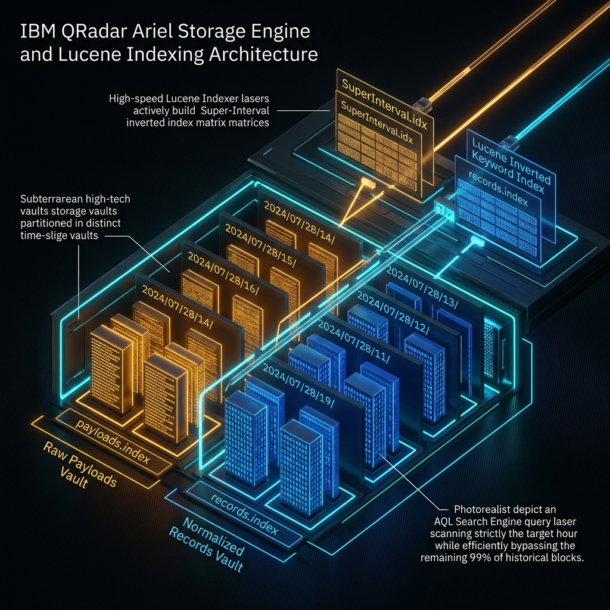
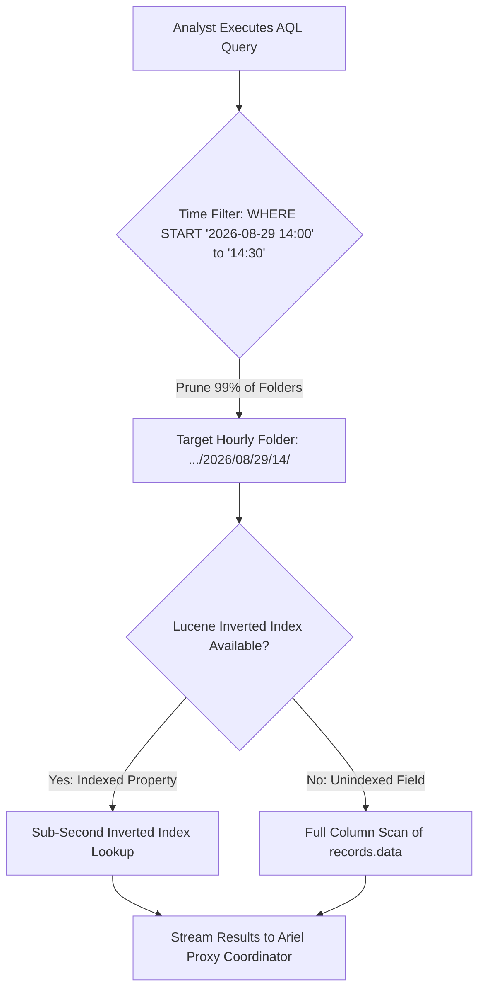
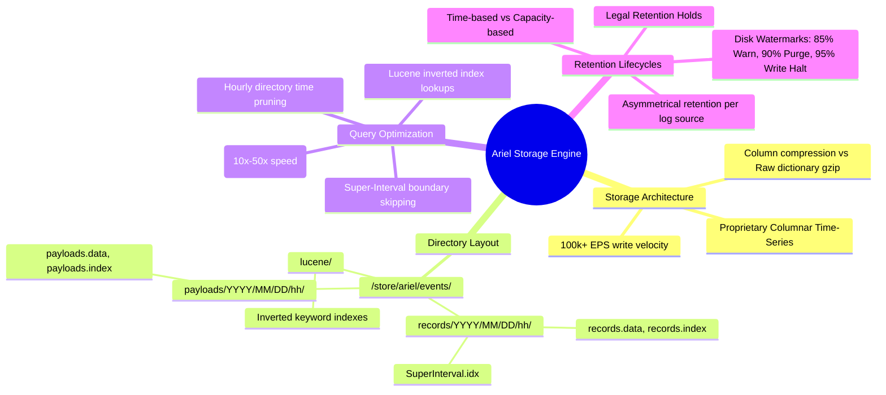

# 📖 Chapter 07: Ariel Storage Engine & Directory Layout Masterclass

> **The IBM QRadar Administrator's Technical Guide** | Phase 1: QRadar Fundamentals  
> **Target Audience:** 1.5-Year Administrators $\rightarrow$ Senior SIEM Engineers & Architects  
> **Focus:** Columnar Database Architecture, Time-Slice Partitioning, Lucene Super-Intervals, Retention Lifecycles, Index Optimization & Hands-on Lab

---

## 📸 1. Visual Overview: The Ariel Storage Engine & Lucene Indexing


*Figure 7.1: 3D Isometric Cutaway of the Subterranean Ariel Storage Vaults: Hourly Time-Slice Partitions (`YYYY/MM/DD/hh/`), Amber Raw Payloads Vault, Sapphire Blue Columnar Records Vault, High-Speed Lucene Indexing Lasers & Targeted AQL Query Execution (`![[11_ariel_storage_partitions_lucene_3d.jpg|1000]]`)*

---

## 2. Why Ariel? (Columnar vs. Traditional Relational Storage)

Traditional relational databases (PostgreSQL, MySQL, Oracle) write data in **row-oriented format**. While excellent for transactional banking, row storage completely breaks down when ingesting **100,000 Events Per Second**:
- In row storage, inserting an event requires writing all 50 fields across disk sectors, thrashing disk I/O.
- Running an analytical aggregation (e.g., `SELECT SUM(eventcount) WHERE sourceip = '10.0.0.1'`) requires reading **every single byte of every column** off the disk.

**IBM Ariel** is a proprietary, high-throughput **Columnar Time-Series Database** engineered specifically for security log telemetry.

```
┌────────────────────────────────────────────────────────────────────────┐
│ ROW-ORIENTED STORAGE (PostgreSQL / Relational)                         │
│ [Row 1: Time, SrcIP, DstIP, Port, User, EventName, Payload...]         │
│ [Row 2: Time, SrcIP, DstIP, Port, User, EventName, Payload...]         │
│ ❌ Reading 'SrcIP' requires reading the entire disk row!               │
└────────────────────────────────────────────────────────────────────────┘

┌────────────────────────────────────────────────────────────────────────┐
│ COLUMNAR TIME-SERIES STORAGE (IBM Ariel Engine)                        │
│ [Column 1 - Timestamps]: [T1, T2, T3, T4, T5...] (Compressed Array)    │
│ [Column 2 - Source IPs]: [IP1, IP2, IP3, IP4...] (Compressed Integers) │
│ [Column 3 - QIDs]:       [Q1, Q2, Q3, Q4...]     (Direct Integer Map)  │
│ [Separate Payloads]:     [Raw Text Blobs compressed with gzip/zstd]    │
│ ✅ Reading 'SrcIP' reads ONLY the Source IP column block! 100x faster! │
└────────────────────────────────────────────────────────────────────────┘
```

---

## 3. Ariel Directory Hierarchy & File Structure

All historical log and flow data is stored under the `/store/ariel/` filesystem partition on Event Processors, Flow Processors, and Data Nodes.

```
/store/ariel/
├── events/
│   ├── records/                              <-- Structured Columnar Metadata
│   │   └── YYYY/
│   │       └── MM/
│   │           └── DD/
│   │               └── hh/                   <-- Strictly Bounded Hourly Folder
│   │                   ├── records.data      <-- Fixed-width columnar binary records
│   │                   ├── records.index     <-- Byte-offset pointers
│   │                   └── SuperInterval.idx <-- 1-min / 5-min index blocks
│   ├── payloads/                             <-- Raw Unmodified Log Strings
│   │   └── YYYY/
│   │       └── MM/
│   │           └── DD/
│   │               └── hh/
│   │                   ├── payloads.data     <-- Compressed raw strings (gzip/zstd)
│   │                   └── payloads.index    <-- Payload record pointers
│   ├── lucene/                               <-- Lucene Inverted Keyword Indexes
│   │   └── YYYY/MM/DD/hh/                    <-- Inverted index terms for fast AQL
│   └── persistent_data/                      <-- Global search caches & temp tables
└── flows/
    ├── records/YYYY/MM/DD/hh/                <-- Normalized Flow Metadata
    └── payloads/YYYY/MM/DD/hh/               <-- Flow DPI Payload Snippets (64-256B)
```

---

## 4. Deep Dive: Payloads vs. Records Separation

| Dimension | Ariel Payloads (`/store/ariel/events/payloads/`) | Ariel Records (`/store/ariel/events/records/`) |
| :--- | :--- | :--- |
| **Data Nature** | Raw, unmodified, verbatim text as sent by the log source. | Normalized, structured binary columnar metadata fields. |
| **Compression** | High-ratio dictionary compression (`gzip` or `zstd`). | Columnar compression (Run-length encoding, integer bit-packing). |
| **Key Fields Stored** | Complete Syslog string, XML blob, CEF/LEEF payload. | `sourceip`, `destinationip`, `sourceport`, `destinationport`, `qid`, `devicetime`, `identity`, `logsourceid`. |
| **Primary Purpose** | Legal non-repudiation, raw payload inspection, forensic exports. | Rapid AQL filtering, mathematical aggregations, `GROUP BY`, time sorting. |
| **Disk Size Ratio** | Represents $\approx 60\%\text{ to }70\%$ of total Ariel disk space. | Represents $\approx 30\%\text{ to }40\%$ of total Ariel disk space. |

---

## 5. Super-Intervals & Lucene Inverted Indexing



### 1. Hourly Time-Slicing & Directory Pruning
- Because events are strictly written into hourly subdirectories (`.../YYYY/MM/DD/hh/`), any AQL query specifying a `START` and `STOP` time immediately prunes all out-of-scope directories.
- If searching the last 1 hour across a 1-year archive, the query engine skips **8,759 hourly folders** without executing a single disk read!

### 2. Super-Intervals
- Within each hourly folder, events are aggregated into **Super-Intervals** (1-minute and 5-minute micro-partitions).
- Contains min/max property bounds (e.g. minimum timestamp, maximum IP). If a query filters for `sourceip = '192.168.1.50'`, the query engine checks the Super-Interval boundary; if the IP range does not encompass that subnet, the entire 5-minute block is skipped.

### 3. Lucene Inverted Keyword Indexing
- Background worker threads construct Lucene inverted keyword indexes on core properties (`SourceIP`, `DestIP`, `Username`, `LogSourceID`, `QID`) and **Indexed Custom Properties**.
- **The Power of Custom Property Indexing**:
  - Unindexed Custom Property: Query executes a slow, CPU-intensive full regex scan across millions of raw payloads.
  - Indexed Custom Property: Query performs an instantaneous $O(1)$ Lucene dictionary lookup, accelerating searches by **10x to 50x**!

---

## 6. Retention Policies & Disk Space Lifecycles

QRadar manages storage retention through two cooperative mechanisms: **Time-Based Retention** and **Capacity-Based Retention**.

```
┌────────────────────────────────────────────────────────────────────────┐
│                     /STORE DISK WATERMARK LADDER                       │
│                                                                        │
│ 100% ───────────────────────────────────────────────────────────────── │
│  95% ──► CRITICAL EMERGENCY: Ariel writes HALTED to protect filesystem │
│  90% ──► HIGH ALARM: Auto-retention aggressively purges oldest unheld  │
│  85% ──► WARNING THRESHOLD: System notification generated              │
│  80% ──► OPTIMAL CEILING: Standard configured retention target         │
│   0% ───────────────────────────────────────────────────────────────── │
└────────────────────────────────────────────────────────────────────────┘
```

### 1. Retention Configuration Types
- **Retention Period (Days)**: Specifies how long data remains hot on disk (e.g., 90 Days, 180 Days, 365 Days).
- **Asymmetrical Retention (Log Source Specific)**:
  - High-compliance audit logs (Active Directory, Domain Controllers, Firewall admin logins) $\rightarrow$ Retained for **365 Days**.
  - High-volume, low-value noise logs (Perimeter firewall drops, internal NetFlow) $\rightarrow$ Retained for **14 Days**.
- **Data Retention Holds (Legal Hold)**: Administrators can apply a legal retention hold to specific searches or time intervals, preventing the automated retention cleaner from ever deleting those blocks during storage purges.

---

## 📌 7. Visual Mind Map & Sticky Notes (Chapter 07 Quick-Review)

### 🧠 Hierarchical Mind Map


### 🗂️ Color-Coded Digital Sticky Notes

#### 🟨 Sticky Note 1: The Hourly Time-Slice Rule
```text
┌─────────────────────────────────────────────────────────────┐
│ 📌 CONCEPT: HOURLY DIRECTORY PRUNING                        │
│                                                             │
│ • Ariel partitions all data into YYYY/MM/DD/hh/ folders.   │
│ • AQL Golden Rule: ALWAYS include `START` and `STOP` times! │
│ • Omitting time bounds forces Ariel to scan all historical  │
│   directories across the entire multi-terabyte disk array!  │
└─────────────────────────────────────────────────────────────┘
```

#### 🟩 Sticky Note 2: Payloads vs. Records Disk Split
```text
┌─────────────────────────────────────────────────────────────┐
│ 📌 GOLDEN RULE: RECORDS FOR SEARCH, PAYLOADS FOR PROOF      │
│                                                             │
│ • Records (Blue Vault): Columnar metadata for fast AQL.     │
│ • Payloads (Amber Vault): Exact raw text for forensic proof.│
│ • Writing both allows sub-second analytics while maintaining│
│   strict legal chain-of-custody compliance.                 │
└─────────────────────────────────────────────────────────────┘
```

#### 🟪 Sticky Note 3: Custom Property Indexing
```text
┌─────────────────────────────────────────────────────────────┐
│ 📌 PERFORMANCE: INDEX YOUR CUSTOM PROPERTIES                │
│                                                             │
│ • If your SOC frequently searches a Custom Regex Property   │
│   (e.g., `TransactionID` or `PolicyName`):                  │
│ • Check "Enable Indexing" in Custom Event Properties.       │
│ • Transforms a 5-minute payload scan into a 2-second Lucene │
│   dictionary lookup!                                        │
└─────────────────────────────────────────────────────────────┘
```

#### 🟦 Sticky Note 4: The 95% Disk Write Halt Emergency
```text
┌─────────────────────────────────────────────────────────────┐
│ 📌 DISK EMERGENCY: THE 95% WRITING FREEZE                   │
│                                                             │
│ • When /store hits 95% capacity, ecs-ep instantly STOPS     │
│   writing to Ariel to prevent filesystem corruption.        │
│ • Incoming logs spool to /store/transient until disk space  │
│   is recovered or disk fills to 100%.                       │
│ • Fix: Purge unindexed test data or extend Data Nodes.      │
└─────────────────────────────────────────────────────────────┘
```

#### 🟧 Sticky Note 5: Interview Cheat Code (Ariel Mechanics)
```text
┌─────────────────────────────────────────────────────────────┐
│ 📌 INTERVIEW CHEAT CODE: "HOW DOES ARIEL STORE DATA?"       │
│                                                             │
│ "Ariel is a columnar time-series storage engine that splits │
│ data into hourly time-slice folders. It separates raw       │
│ compressed payloads from fixed-width binary records. It uses│
│ super-interval boundaries and Lucene inverted indexes to    │
│ prune 99% of historical blocks during AQL execution."       │
└─────────────────────────────────────────────────────────────┘
```

#### 🟥 Sticky Note 6: Common Administrator Pitfall
```text
┌─────────────────────────────────────────────────────────────┐
│ ⚠️ CRITICAL PITFALL: DELETING ARIEL FILES WITH `RM -RF`     │
│                                                             │
│ • NEVER manually delete `/store/ariel/` folders via `rm -rf`│
│ • Doing so corrupts PostgreSQL pointer tables and breaks    │
│   Ariel search indexes!                                     │
│ • Remediation: Always manage retention through the QRadar   │
│   Admin UI Retention Policies or `ariel_retention.py`.      │
└─────────────────────────────────────────────────────────────┘
```

---

### ⚡ Rapid-Recall Flashcards

| # | Question (Front) | Answer (Back) |
| :-: | :--- | :--- |
| **01** | Where are structured columnar event records stored on disk? | **`/store/ariel/events/records/YYYY/MM/DD/hh/`**. |
| **02** | Where are raw compressed event payloads stored on disk? | **`/store/ariel/events/payloads/YYYY/MM/DD/hh/`**. |
| **03** | What are **Super-Intervals** in the Ariel database? | 1-minute and 5-minute index blocks with min/max property boundaries for fast skipping. |
| **04** | What happens when `/store` disk space hits **95%**? | `ecs-ep` halts all Ariel disk writes to prevent filesystem corruption. |
| **05** | How much search acceleration does enabling Lucene indexing on a Custom Property provide? | **10x to 50x faster** query execution. |
| **06** | What is **Asymmetrical Retention**? | Configuring different retention periods for different log source types (e.g. 365 days for AD vs 14 days for firewall drops). |

---

## 🧪 8. Hands-on Practice Lab 07: Ariel Storage Inspection, Index Auditing & Disk Management

### 🎯 Lab Objectives
1. Explore the physical `/store/ariel/` directory tree and inspect hourly record partitions.
2. Measure payload vs record compression ratios on active production disks.
3. Audit custom properties to identify unindexed high-cost search targets.
4. Execute disk retention health audits via Linux CLI.

---

### 📋 Step-by-Step Practical Lab Procedures

#### Step 1: Explore the Ariel Directory Tree
Log into an Event Processor or All-in-One Console via SSH:
```bash
# Navigate to today's hourly records directory
CURRENT_HOUR=$(date +%H)
TODAY_PATH="/store/ariel/events/records/$(date +%Y)/$(date +%m)/$(date +%d)/$CURRENT_HOUR"

# List files inside the active hourly partition
ls -lh $TODAY_PATH
```
*Expected Output*: Displays `records.data`, `records.index`, and `SuperInterval.idx` with active write timestamps.

---

#### Step 2: Compare Payloads vs Records Storage Sizes
```bash
# Compare total disk size of records vs payloads for today
du -sh /store/ariel/events/records/$(date +%Y)/$(date +%m)/$(date +%d)
du -sh /store/ariel/events/payloads/$(date +%Y)/$(date +%m)/$(date +%d)
```
*Expected Output*: Payloads directory is typically $\approx 2\times$ the size of the records directory due to raw text retention.

---

#### Step 3: Inspect Ariel Lucene Index Files
```bash
# View active Lucene index folders for the current day
ls -lh /store/ariel/events/lucene/$(date +%Y)/$(date +%m)/$(date +%d)/
```

---

#### Step 4: Audit Custom Properties for Indexing Status
```bash
# Query PostgreSQL to list Custom Properties and check if indexing is enabled
psql -U qradar -d configdb -c "SELECT id, property_name, is_indexed FROM custom_property ORDER BY is_indexed DESC LIMIT 15;"
```
*Expected Output*: Lists custom property names with `is_indexed = t` (True) or `f` (False).

---

#### Step 5: Check Disk Retention Watermarks & Alarms
```bash
# Check current filesystem utilization on /store
df -h /store

# Check QRadar Ariel storage retention logs
grep -i "retention" /var/log/qradar.log | tail -n 25
```
