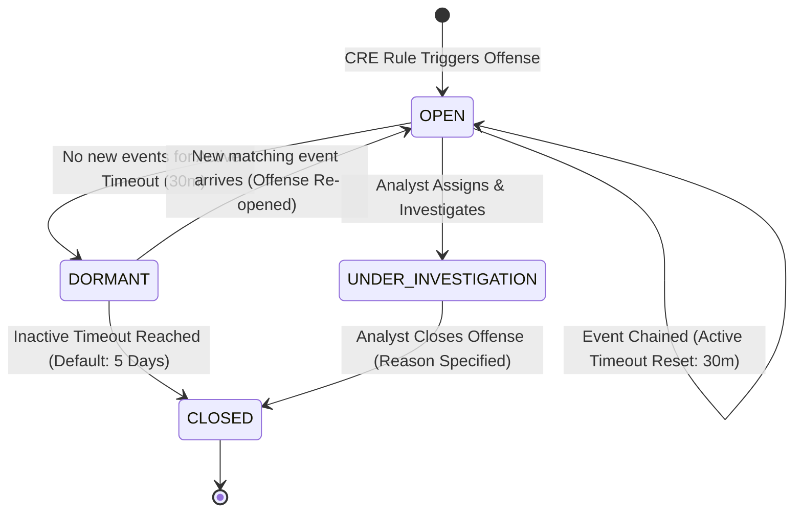
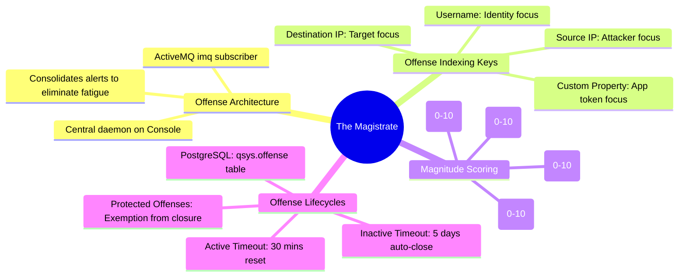

# 📖 Chapter 08: The Magistrate Engine & Offense Lifecycle Masterclass

> **The IBM QRadar Administrator's Technical Guide** | Phase 1: QRadar Fundamentals  
> **Target Audience:** 1.5-Year Administrators $\rightarrow$ Senior SIEM Engineers & Architects  
> **Focus:** Magistrate Daemon Architecture, Offense Indexing Mechanics, Dynamic Magnitude Math (S/C/R), Chaining Lifecycles & Hands-on Lab

---

## 📸 1. Visual Overview: The Magistrate Engine & Offense Lifecycle


*Figure 8.1: 3D Isometric View of the Magistrate Core Command Tower: ActiveMQ `imq` Event Bus, Offense Indexing Matrix, Holographic Magnitude Calculation Chamber (Severity, Credibility, Relevance), Incident Chaining Timeline & SOC Analyst Action Center (`![[12_magistrate_offense_lifecycle_3d.jpg|1000]]`)*

---

## 2. What is an Offense? (The Anti-Alert-Fatigue Engine)

In traditional log monitoring tools, if an attacker executes 5,000 brute-force attempts in 5 minutes, the SIEM emits **5,000 separate alerts**, overwhelming the security operations team.

In **IBM QRadar**, an **Offense** is an intelligent, dynamic security incident container that groups dozens, hundreds, or thousands of related events and flows into a **single actionable incident**.

```
┌────────────────────────────────────────────────────────────────────────┐
│ TRADITIONAL SIEM / LOGSTASH (Alert Storm Chaos)                       │
│ 5,000 Failed Logins ──► 5,000 Email Alerts / Tickets                   │
│ ❌ Analyst spends 4 hours triaging duplicate noise!                    │
└────────────────────────────────────────────────────────────────────────┘

┌────────────────────────────────────────────────────────────────────────┐
│ IBM QRADAR SIEM (Magistrate Offense Intelligence)                      │
│ 5,000 Failed Logins ──► CRE Matches ──► Magistrate Evaluates Index Key │
│ ──► ONE SINGLE OFFENSE #1042 (Magnitude: 8.2)                          │
│ ✅ Analyst investigates 1 ticket with full timeline and source context! │
└────────────────────────────────────────────────────────────────────────┘
```

---

## 3. The Magistrate Architecture & Message Flow

```mermaid
flowchart TD
    EP1[Event Processor A: CRE Rule Triggers] -->|JMS Message| IMQ[ActiveMQ 'imq' Broker: Port 61616]
    EP2[Event Processor B: CRE Rule Triggers] -->|JMS Message| IMQ
    FP1[Flow Processor: CRE Flow Rule Triggers] -->|JMS Message| IMQ

    subgraph Console Magistrate Core
        IMQ -->|qsys_events Topic| MAG[The Magistrate Daemon]
        MAG --> IDX_EVAL{Evaluate Rule Offense Index Key}
        IDX_EVAL -->|Match Existing Open Offense| CHAIN[Chain Event & Increment Counter]
        IDX_EVAL -->|No Matching Key Found| NEW_OFF[Create Brand New Offense ID]
        CHAIN --> MAG_CALC[Calculate Dynamic Magnitude Score: f(S, C, R)]
        NEW_OFF --> MAG_CALC
        MAG_CALC --> PG_COMMIT[(Commit to PostgreSQL: qsys.offense)]
        PG_COMMIT --> SOC_UI[Render on SOC Offenses Tab & Dashboards]
    end
```

---

## 4. Offense Indexing Keys: The Architectural Core of Incident Structuring

When a detection engineer creates a Custom Rule in the CRE, the most critical decision is selecting the **Offense Indexing Key**. The Indexing Key determines which field is used to group future events together.

| Indexing Key Option | When to Use (Best Practice) | Real-World Incident Example |
| :--- | :--- | :--- |
| **Index by Source IP** | When detecting **Attacker-centric behaviors** (Reconnaissance, Port Scanning, Brute Force from an external IP). | Attacker `198.51.100.42` scans 10 servers; all 10 scans chain into **1 Offense** tracking that attacker. |
| **Index by Destination IP** | When detecting **Target-centric / Asset-centric attacks** (DDoS, Web Shell deployment, Database exploitation). | Multiple attackers probe a critical Oracle DB; all attempts chain into **1 Offense** tracking the DB's status. |
| **Index by Username** | When detecting **Identity-centric threats** (Compromised credentials, Insider threats, Impossible travel). | User `jsmith` logs in from Tokyo and London within 10 minutes; chains into **1 Offense** for user `jsmith`. |
| **Index by Custom Property** | When detecting application-specific identifiers (e.g. `CreditCardHash`, `TransactionID`, `API_Key`). | Fraudulent transactions sharing the same `API_Key` chain into **1 Offense** regardless of IP. |
| **Index by Event Name / Rule** | General signature grouping (Rarely used in production; causes overly broad offenses). | Groups all port scans across the entire company into 1 giant offense. |

---

## 5. Magnitude Calculation Mathematics: Severity, Credibility & Relevance

The **Magnitude Score** ($0\text{ to }10$) is QRadar's automated risk rating that tells SOC analysts which incident to triage first.

$$\text{Magnitude} = \text{WeightedComposite}(\text{Severity}, \text{Credibility}, \text{Relevance})$$

```
┌────────────────────────────────────────────────────────────────────────┐
│ 🔴 SEVERITY (0 to 10)                                                  │
│ • "How dangerous is this attack type?"                                 │
│ • Defined statically inside the CRE Rule Response configuration.       │
│ • Examples: Port Scan = 3 | Failed Login = 4 | Ransomware Exec = 10    │
├────────────────────────────────────────────────────────────────────────┤
│ 🔵 CREDIBILITY (0 to 10)                                               │
│ • "How reliable is the log source reporting this event?"               │
│ • Derived from Log Source Type and Event Verification:                 │
│   - Network TAP / Physical QFlow DPI = 9 / 10                          │
│   - EDR / Antivirus Verified Detection = 8 / 10                        │
│   - Unauthenticated Perimeter Syslog Drop = 4 / 10                     │
├────────────────────────────────────────────────────────────────────────┤
│ 🟢 RELEVANCE (0 to 10)                                                 │
│ • "Is the target asset vulnerable to this specific exploit?"           │
│ • Dynamically calculated against the QRadar Asset Model & Scanners:    │
│   - Target host confirmed vulnerable by Nessus/Qualys scan = 10 / 10   │
│   - Target host running different OS/service (Not vulnerable) = 1 / 10 │
└────────────────────────────────────────────────────────────────────────┘
```

#### Magnitude Calculation Example:
- **Rule**: *Apache Struts Remote Code Execution Attempt (CVE-2017-5638)* $\rightarrow$ **Severity = 9**
- **Log Source**: *Perimeter Next-Gen Firewall* $\rightarrow$ **Credibility = 7**
- **Scenario A (Non-Vulnerable Target)**:
  - Target server `10.10.10.5` runs Microsoft IIS (Windows Server 2022).
  - QRadar Asset Model confirms target is NOT running Apache Struts $\rightarrow$ **Relevance = 1**
  - **Resulting Magnitude**: $\mathbf{4.2\text{ / }10}$ (Low priority; automated scan blocked by mismatched platform).
- **Scenario B (Vulnerable Target)**:
  - Target server `10.10.10.50` runs Linux with Apache Struts confirmed vulnerable by Qualys scan $\rightarrow$ **Relevance = 10**
  - **Resulting Magnitude**: $\mathbf{9.4\text{ / }10}$ (CRITICAL EMERGENCY: Active exploit against confirmed vulnerable asset!).

---

## 6. The Offense Lifecycle State Machine & Timeouts



### 1. Active Timeout (Default: 30 Minutes)
- If an open offense receives a new correlated event within 30 minutes, the timer resets back to 0.
- If no events arrive for 30 minutes, the offense transitions to **Dormant** (waiting for activity).

### 2. Inactive Timeout (Default: 5 Days)
- If an offense remains in Dormant state for 5 consecutive days without any new events, the Magistrate automatically **closes the offense**.

### 3. Protecting Offenses (Legal / Regulatory Hold)
- Administrators or SOC Leads can check **"Protect Offense"** in the UI.
- Protected Offenses are **exempt from inactive timeout closure and retention purges**, remaining active until manually reviewed and released.

---

## 📌 7. Visual Mind Map & Sticky Notes (Chapter 08 Quick-Review)

### 🧠 Hierarchical Mind Map


### 🗂️ Color-Coded Digital Sticky Notes

#### 🟨 Sticky Note 1: The Offense Indexing Golden Rule
```text
┌─────────────────────────────────────────────────────────────┐
│ 📌 GOLDEN RULE: CHOOSE YOUR INDEXING KEY CAREFULLY!         │
│                                                             │
│ • Index by Source IP ──► For external attacks (Scanners).   │
│ • Index by Dest IP   ──► For internal assets under siege.   │
│ • Index by Username  ──► For credential compromise/insiders.│
│ • Wrong Choice: Indexing by Event Name merges all distinct  │
│   attacks across the enterprise into 1 massive mess!        │
└─────────────────────────────────────────────────────────────┘
```

#### 🟩 Sticky Note 2: Dynamic Magnitude via Relevance
```text
┌─────────────────────────────────────────────────────────────┐
│ 📌 RELEVANCE: THE MAGIC OF ASSET & SCANNER DATA             │
│                                                             │
│ • Severity is static; Relevance is DYNAMIC.                 │
│ • Ingesting vulnerability scanner data (Nessus/Qualys)      │
│   allows QRadar to automatically raise Magnitude to 9-10    │
│   for vulnerable targets and drop to 3-4 for immune hosts.  │
└─────────────────────────────────────────────────────────────┘
```

#### 🟪 Sticky Note 3: Active vs. Inactive Timeouts
```text
┌─────────────────────────────────────────────────────────────┐
│ 📌 TIMEOUT MECHANICS: 30 MINUTES VS 5 DAYS                  │
│                                                             │
│ • Active Timeout (30 min): Time window to chain events.     │
│   Each new event resets this clock.                         │
│ • Inactive Timeout (5 days): Once dormant for 5 days, the   │
│   Magistrate auto-closes the offense to declutter the SOC.  │
└─────────────────────────────────────────────────────────────┘
```

#### 🟦 Sticky Note 4: Protected Offenses
```text
┌─────────────────────────────────────────────────────────────┐
│ 📌 COMPLIANCE: PROTECTED OFFENSES                           │
│                                                             │
│ • Clicking 'Protect' prevents automated closure by timeouts.│
│ • Prevents deletion during storage purges.                  │
│ • Mandatory for active forensic investigations and audit.   │
└─────────────────────────────────────────────────────────────┘
```

#### 🟧 Sticky Note 5: Interview Cheat Code (Magistrate Engine)
```text
┌─────────────────────────────────────────────────────────────┐
│ 📌 INTERVIEW CHEAT CODE: "HOW DOES QRADAR CREATE OFFENSES?" │
│                                                             │
│ "When CRE rules trigger, alerts are published to ActiveMQ.  │
│ The Magistrate daemon evaluates the rule's Indexing Key,    │
│ checks PostgreSQL for an existing open offense, chains the  │
│ event or creates a new incident, and dynamically computes   │
│ the Magnitude based on Severity, Credibility, and Asset     │
│ Vulnerability Relevance."                                   │
└─────────────────────────────────────────────────────────────┘
```

#### 🟥 Sticky Note 6: Common Administrator Pitfall
```text
┌─────────────────────────────────────────────────────────────┐
│ ⚠️ CRITICAL PITFALL: UNINDEXED RULES CREATING OFFENSE STORMS│
│                                                             │
│ • If a rule has 'Generate Offense' enabled but no indexing  │
│   field selected, it generates a new offense for EVERY event!│
│ • Result: 10,000 offenses flood the Console in minutes.     │
│ • Fix: Always ensure an indexing property is selected.      │
└─────────────────────────────────────────────────────────────┘
```

---

### ⚡ Rapid-Recall Flashcards

| # | Question (Front) | Answer (Back) |
| :-: | :--- | :--- |
| **01** | On which appliance does the **Magistrate** daemon run? | The **Console Appliance**. |
| **02** | What message queue does the Magistrate listen to for CRE alerts? | **`qsys_events`** on Apache ActiveMQ (`imq`). |
| **03** | What three components determine the **Magnitude Score**? | **Severity (0-10)**, **Credibility (0-10)**, and **Relevance (0-10)**. |
| **04** | What is the default **Active Timeout** for an Offense? | **30 Minutes** (resets upon each chained event). |
| **05** | What is the default **Inactive Timeout** before an offense auto-closes? | **5 Days**. |
| **06** | In which database table are Offenses stored? | **PostgreSQL `qsys` database**, inside the `offense` table. |

---

## 🧪 8. Hands-on Practice Lab 08: Offense Management, Database Inspection & Magnitude Auditing

### 🎯 Lab Objectives
1. Inspect live Offenses directly from the PostgreSQL `qsys` database.
2. Query offense magnitudes, event counts, and indexing keys via SQL.
3. Trace ActiveMQ messaging status between `ecs-ep` and `magistrate`.
4. Audit closed offenses and identify top false-positive generation rules.

---

### 📋 Step-by-Step Practical Lab Procedures

#### Step 1: Query Active Offenses in PostgreSQL
Log into the Console via SSH:
```bash
# Query the top 10 highest magnitude active offenses
psql -U qradar -d qsys -c "
SELECT id, description, magnitude, severity, credibility, relevance, event_count, status 
FROM offense 
WHERE status = 'OPEN' 
ORDER BY magnitude DESC 
LIMIT 10;
"
```
*Expected Output*: Displays Offense ID, description, calculated magnitude, event count, and status.

---

#### Step 2: Inspect Offense Indexing Keys
```bash
# View offenses grouped by indexing source
psql -U qradar -d qsys -c "
SELECT id, offender_ip, username, magnitude, assigned_to_user 
FROM offense 
WHERE status = 'OPEN' 
LIMIT 10;
"
```

---

#### Step 3: Check ActiveMQ Broker Message Status
```bash
# Check if ActiveMQ has pending or stuck messages in the offense queue
systemctl status imq

# Inspect ActiveMQ log for connection errors
tail -n 25 /var/log/activemq.log
```

---

#### Step 4: Audit Top Offense-Generating Rules
```bash
# Query PostgreSQL for rules that have generated the most offenses
psql -U qradar -d qsys -c "
SELECT rule_name, count(*) as total_offenses 
FROM offense 
GROUP BY rule_name 
ORDER BY total_offenses DESC 
LIMIT 10;
"
```
*Expected Output*: Identifies high-noise rules that require threshold tuning or building block suppression.
