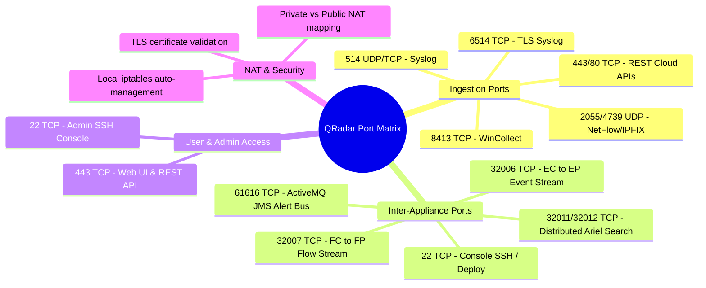

# 📖 Chapter 09: Enterprise Port Matrix & Network Security Masterclass

> **The IBM QRadar Administrator's Technical Guide** | Phase 1: QRadar Fundamentals  
> **Target Audience:** 1.5-Year Administrators $\rightarrow$ Senior SIEM Engineers & Architects  
> **Focus:** Complete Bidirectional Port Matrix, Firewall Boundary Traversals, TLS Certificate Chains, NAT Mappings & Hands-on Lab

---

## 📸 1. Visual Overview: QRadar Enterprise Port & Security Matrix


*Figure 9.1: 3D Isometric View of the Enterprise Network Port Matrix: Console, Event Collectors, Event Processors, Flow Collectors, and Endpoints communicating across Firewall Boundaries (`![[13_network_ports_security_matrix_3d.jpg|1000]]`)*

---

## 2. Complete Bidirectional Enterprise Port Matrix

To build and maintain a production QRadar deployment, you must master the bidirectional firewall rules required between endpoints, managed hosts, and the Console.

```
┌──────────────────────────────────────────────────────────────────────────────────────────────────┐
│ INGESTION PORTS (Endpoints / Log Sources ──► Event / Flow Collectors)                            │
│ • UDP/TCP 514   ──► Syslog Ingestion (Firewalls, Routers, Linux, Switches)                       │
│ • TCP 6514      ──► TLS Encrypted Syslog (Mutual Certificate Authentication)                     │
│ • TCP 8413      ──► WinCollect Agent Configuration & Log Forwarding                              │
│ • UDP 2055/4739 ──► NetFlow (v5/v9), IPFIX Telemetry from Routers and Switches                  │
│ • TCP 443 / 80  ──► Universal Cloud REST API Polling (AWS, Azure, SaaS Providers)                │
└──────────────────────────────────────────────────────────────────────────────────────────────────┘

┌──────────────────────────────────────────────────────────────────────────────────────────────────┐
│ INTER-APPLIANCE CLUSTER PORTS (Managed Hosts ◄──► Console / Processors)                          │
│ • TCP 22        ──► SSH Cluster Administration, Deployment Updates, Certificate Sync (Console->All)│
│ • TCP 32006     ──► Compressed & Encrypted Event Stream (Event Collector 15xx ──► Event Processor)│
│ • TCP 32007     ──► Compressed & Encrypted Flow Stream (Flow Collector 17xx ──► Flow Processor)  │
│ • TCP 32011     ──► Distributed Ariel Query Request (Console Ariel Proxy ──► Processors/Data Nodes)│
│ • TCP 32012     ──► Distributed Ariel Query Data Return Stream (Processors/Data Nodes ──► Console)│
│ • TCP 61616     ──► Apache ActiveMQ (imq) JMS Message Bus (Processors ──► Console Magistrate)    │
│ • TCP 5432      ──► PostgreSQL Relational DB Communication (Localhost / Console Only)            │
└──────────────────────────────────────────────────────────────────────────────────────────────────┘

┌──────────────────────────────────────────────────────────────────────────────────────────────────┐
│ USER INTERFACE & API ACCESS (Admin / Analyst Workstation ──► Console)                            │
│ • TCP 443       ──► HTTPS Web User Interface & REST API Gateway (Apache / Tomcat)                │
│ • TCP 22        ──► Administrative SSH Command Line Terminal Access                              │
└──────────────────────────────────────────────────────────────────────────────────────────────────┘
```

---

## 3. Deep Dive: Key Port Subsystems & Firewall Architecture

---

### 1. Inter-Appliance Streaming (TCP Port 32006 & 32007)
- **Source**: Remote Event Collectors (15xx) or Flow Collectors (17xx).
- **Destination**: Central Event Processors (16xx) or Flow Processors (17xx).
- **Payload**: Gzipped binary event blocks encrypted using AES-GCM TLS tunnels.
- **Production Pitfall**: If a WAN firewall blocks TCP port `32006`, the Event Collector receives logs on port `514` but cannot forward them, causing `/store/transient/` to fill to $100\%$!

---

### 2. Cluster Supervisor & Deployment Sync (TCP Port 22 - SSH)
- **Source**: QRadar Console.
- **Destination**: All Managed Hosts (ECs, EPs, FPs, Data Nodes, App Host).
- **Mechanism**: The Console uses SSH key pairs stored in `/root/.ssh/authorized_keys` to execute administrative deployments, copy updated configuration bundles, push software patches, and poll health metrics.
- **Security Rule**: Port `22` between Console and Managed Hosts must **never be filtered or blocked by internal firewalls**.

---

### 3. Distributed AQL Query Engine (TCP Ports 32011 & 32012)
- **Port 32011 (Query Dispatch)**: The `ariel_proxy_server` on the Console sends compiled AQL AST trees to `arield` daemons across all distributed processors and Data Nodes.
- **Port 32012 (Data Return)**: `arield` streams columnar record batches and aggregation arrays back to the Console for UI rendering.

---

### 4. WinCollect Agent Communication (TCP Port 8413)
- **Managed Mode**: The WinCollect agent on Windows endpoints connects to the Console or Event Collector over TCP `8413` to pull its polling schedule, log channel configurations, and XPath queries.
- **Dual-Channel Option**: WinCollect can send both configuration heartbeats and log payloads over port `8413`, or push logs separately over TLS port `6514`.

---

## 4. Network Address Translation (NAT) & Multi-Homed Routing

When managed hosts reside behind enterprise NAT routers or in public cloud VPCs (AWS/Azure) with non-routable private subnets:

```
┌────────────────────────┐      (NAT Gateway)       ┌────────────────────────┐
│   EVENT COLLECTOR      │  ─────────────────────►  │     QRADAR CONSOLE     │
│ Private IP: 10.200.1.5 │   Public: 198.51.100.10  │ Private IP: 10.10.1.50 │
└────────────────────────┘                          └────────────────────────┘
```

### NAT Configuration Protocol:
1. When adding a managed host behind NAT, administrators must check **"Host is behind NAT"** in the Deployment Editor.
2. Configure both the **Private IP** (used for local binding) and the **Public/NAT IP** (used by the Console to establish SSH tunnels and Port 32006 routes).
3. QRadar updates its internal `/opt/qradar/conf/nva.conf` and `hosts` maps to ensure inter-appliance certificate validation matches the external IP.

---

## 📌 5. Visual Mind Map & Sticky Notes (Chapter 09 Quick-Review)

### 🧠 Hierarchical Mind Map


### 🗂️ Color-Coded Digital Sticky Notes

#### 🟨 Sticky Note 1: Port 32006 vs Port 514
```text
┌─────────────────────────────────────────────────────────────┐
│ 📌 CONCEPT: PORT 514 IS INGESTION, PORT 32006 IS STREAMING  │
│                                                             │
│ • Port 514 UDP/TCP: Log source ──► Event Collector.         │
│ • Port 32006 TCP: Event Collector ──► Event Processor.      │
│ • Common Mistake: Opening 514 on the firewall but forgetting│
│   32006 between QRadar appliances!                          │
└─────────────────────────────────────────────────────────────┘
```

#### 🟩 Sticky Note 2: Port 22 is the Cluster Nervous System
```text
┌─────────────────────────────────────────────────────────────┐
│ 📌 GOLDEN RULE: NEVER BLOCK PORT 22 BETWEEN APPLIANCES      │
│                                                             │
│ • QRadar relies on SSH (Port 22) for:                       │
│   1. Deploy Changes synchronization.                        │
│   2. Health metric polling.                                 │
│   3. High Availability heartbeats.                          │
│ • Blocking Port 22 breaks cluster management entirely!      │
└─────────────────────────────────────────────────────────────┘
```

#### 🟪 Sticky Note 3: WinCollect Port 8413
```text
┌─────────────────────────────────────────────────────────────┐
│ 📌 WINCOLLECT PORTS: TCP 8413                               │
│                                                             │
│ • Managed WinCollect agents require TCP Port 8413 to:       │
│   - Register with the Console / EC.                         │
│   - Download new XML log source configs.                    │
│   - Send agent status heartbeats.                           │
└─────────────────────────────────────────────────────────────┘
```

#### 🟦 Sticky Note 4: Distributed Ariel Ports (32011 / 32012)
```text
┌─────────────────────────────────────────────────────────────┐
│ 📌 AQL SEARCH PORTS: 32011 & 32012                          │
│                                                             │
│ • Port 32011: Query request sent to Processors & Data Nodes.│
│ • Port 32012: Data stream returned back to Console.         │
│ • Both ports must be open bidirectionally between Console   │
│   and all storage/processing nodes.                         │
└─────────────────────────────────────────────────────────────┘
```

#### 🟧 Sticky Note 5: Interview Cheat Code (Ports Matrix)
```text
┌─────────────────────────────────────────────────────────────┐
│ 📌 INTERVIEW CHEAT CODE: "WHAT PORTS MUST BE OPEN FOR SIEM?"│
│                                                             │
│ "In QRadar, log sources send via 514 (Syslog), 8413         │
│ (WinCollect), or 2055 (NetFlow). Inter-appliance streaming  │
│ uses TCP 32006 (Events) and 32007 (Flows), cluster sync uses│
│ SSH 22, ActiveMQ uses 61616, and distributed Ariel search   │
│ runs over 32011/32012, while UI access is secured on 443."  │
└─────────────────────────────────────────────────────────────┘
```

#### 🟥 Sticky Note 6: Common Administrator Pitfall
```text
┌─────────────────────────────────────────────────────────────┐
│ ⚠️ CRITICAL PITFALL: SSH ROOT LOGIN RESTRICTION             │
│                                                             │
│ • Corporate security hardening scripts often disable SSH    │
│   root login (`PermitRootLogin no` in sshd_config).         │
│ • In QRadar, hostcontext REQUIRES root SSH key authentication│
│   between managed hosts! Disabling it causes instant outage.│
└─────────────────────────────────────────────────────────────┘
```

---

### ⚡ Rapid-Recall Flashcards

| # | Question (Front) | Answer (Back) |
| :-: | :--- | :--- |
| **01** | Which port streams compressed events from Event Collector to Event Processor? | **TCP Port 32006**. |
| **02** | Which port is used for WinCollect agent configuration and management? | **TCP Port 8413**. |
| **03** | Which ports coordinate distributed AQL searches between Console and Data Nodes? | **TCP Ports 32011 and 32012**. |
| **04** | Which port is used by `hostcontext` to deploy changes and sync configurations? | **TCP Port 22 (SSH)**. |
| **05** | On which port does Apache ActiveMQ (`imq`) transport alert messages? | **TCP Port 61616**. |
| **06** | What command tests TCP port connectivity between two QRadar appliances? | **`nc -zv <Destination_IP> <Port>`** or **`curl -vk https://<IP>:<Port>`**. |

---

## 🧪 6. Hands-on Practice Lab 09: Port Auditing, Firewall Validation & TLS Inspection

### 🎯 Lab Objectives
1. Audit all active listening ports and established sockets across a QRadar cluster.
2. Validate inter-appliance network connectivity on Ports 32006, 32011, and 61616.
3. Verify local Linux firewall rules (`iptables`) managed automatically by QRadar.
4. Inspect SSL/TLS certificate chains on Web (443) and Syslog TLS (6514) endpoints.

---

### 📋 Step-by-Step Practical Lab Procedures

#### Step 1: Audit Active Listening Sockets via CLI
Log into the Console or Event Processor via SSH:
```bash
# Display all listening TCP and UDP sockets with owning process names
ss -tulpn | grep -E "443|22|514|8413|32006|32011|32012|61616|2055"
```
*Expected Output*: Shows `ecs-ec-ingress`, `ecs-ep`, `httpd`, `imq`, and `sshd` bound to their designated ports.

---

#### Step 2: Validate Inter-Appliance Connectivity
From an Event Collector, test connectivity to the central Event Processor:
```bash
# 1. Test Event Streaming Port 32006
nc -zv <Event_Processor_IP> 32006

# 2. Test SSH Cluster Management Port 22
nc -zv <Event_Processor_IP> 22

# 3. Test ActiveMQ Alert Port 61616
nc -zv <Console_IP> 61616
```

---

#### Step 3: Inspect QRadar Managed Firewall Rules (`iptables`)
```bash
# View active iptables firewall chains generated by QRadar
iptables -L -n -v | head -n 30
```
*Expected Output*: Displays pre-configured chains permitting inter-appliance communication while dropping unauthenticated traffic.

---

#### Step 4: Inspect SSL/TLS Certificates via OpenSSL
```bash
# Inspect the Web UI TLS Certificate on Port 443
openssl s_client -connect 127.0.0.1:443 -showcerts < /dev/null 2>/dev/null | openssl x509 -noout -dates -subject -issuer
```
*Expected Output*: Displays certificate Subject, Issuer, and Expiration Dates (`notBefore`, `notAfter`).
