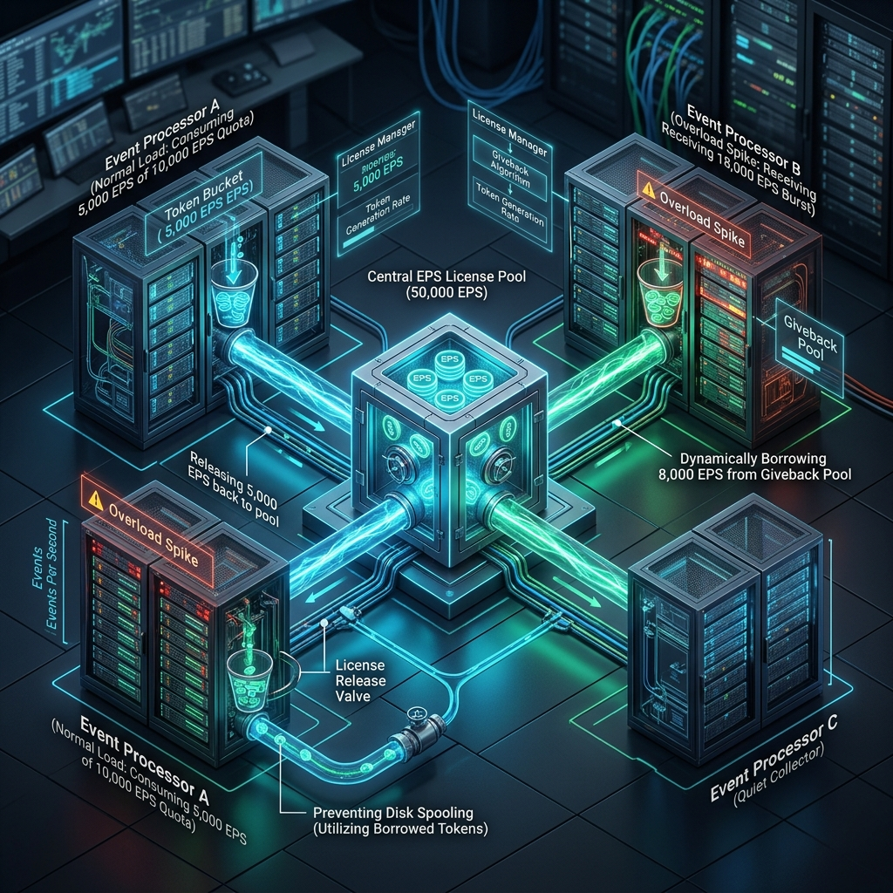
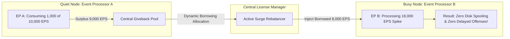
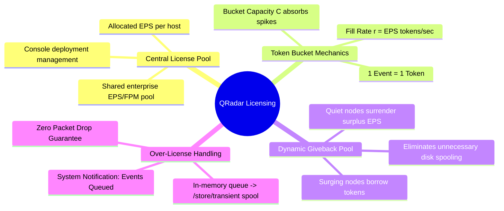

# 📖 Chapter 10: Licensing & Token Bucket Deep Dive Masterclass

> **The IBM QRadar Administrator's Technical Guide** | Phase 1: QRadar Fundamentals  
> **Target Audience:** 1.5-Year Administrators $\rightarrow$ Senior SIEM Engineers & Architects  
> **Focus:** License Pool Allocation, Token Bucket Mathematical Mechanics, Giveback Algorithms, Burst Queueing & Hands-on Lab

---

## 📸 1. Visual Overview: QRadar Licensing Pool & Giveback Architecture


*Figure 10.1: 3D Isometric View of the Central EPS License Pool (50,000 EPS), Token Bucket Rate Limiting Valves, and the Dynamic Giveback Algorithm: Quiet Event Processors releasing surplus EPS to Overloaded Processors to eliminate disk spooling (`![[14_licensing_pool_giveback_3d.jpg|1000]]`)*

---

## 2. Enterprise Licensing Models: Node Licenses vs. Shared License Pools

In modern enterprise QRadar deployments, licensing is managed through a **Centralized Shared License Pool**.

```
┌────────────────────────────────────────────────────────────────────────┐
│                   CENTRALIZED EPS / FPM LICENSE POOL                   │
│ • Total Purchased Enterprise Capacity (e.g. 50,000 EPS / 1,000,000 FPM)│
│ • Managed centrally on the QRadar Console Deployment License Manager   │
└───────────────────────────────────┬────────────────────────────────────┘
                                    │
       ┌────────────────────────────┼────────────────────────────┐
       │                            │                            │
       ▼                            ▼                            ▼
┌──────────────┐             ┌──────────────┐             ┌──────────────┐
│  EP A (HQ)   │             │ EP B (Cloud) │             │  EC C (Edge) │
│ Allocated:   │             │ Allocated:   │             │ Allocated:   │
│  20,000 EPS  │             │  20,000 EPS  │             │  10,000 EPS  │
└──────────────┘             └──────────────┘             └──────────────┘
```

---

## 3. The Token Bucket Algorithm: Mathematical Mechanics

The **Token Bucket Algorithm** is the core mathematical engine inside `ecs-ec-ingress` and `ecs-ep` that governs rate-limiting.

$$\text{Token Injection Rate } r = \text{Allocated EPS (Tokens / Second)}$$
$$\text{Bucket Capacity } C = r \times \text{BurstTimeAllowance (1 to 3 seconds)}$$

```
┌────────────────────────────────────────────────────────────────────────┐
│ 1. Continuous Token Injection                                          │
│    Every millisecond, the License Manager deposits r/1000 tokens into  │
│    the bucket. Unused tokens accumulate up to maximum capacity C.      │
│                                                                        │
│ 2. Event Ingestion Check                                               │
│    Every incoming event requests 1 token from the bucket.              │
│    - If Tokens >= 1: Token is consumed; event proceeds to parsing.     │
│    - If Tokens < 1: Bucket is empty! Event is diverted to Queue.       │
│                                                                        │
│ 3. Burst Absorption                                                    │
│    Accumulated tokens in capacity C allow instantaneous bursts         │
│    (e.g., 15k EPS for 2 seconds) to pass without any queue delay.      │
└────────────────────────────────────────────────────────────────────────┘
```

---

## 4. The Dynamic License Giveback Pool

In a distributed environment, log volumes fluctuate constantly:
- At 02:00 AM, the European office is asleep (consuming only $1,000\text{ of its }10,000\text{ EPS}$ quota).
- Simultaneously, the US West Coast is experiencing a heavy DDoS attack generating $18,000\text{ EPS}$ against an allocated $10,000\text{ EPS}$ quota.

Without dynamic sharing, the US processor would spool millions of events to disk, delaying threat detection.



### The Giveback Lifecycle:
1. **Surplus Detection**: Every 60 seconds, `hostcontext` monitors actual EPS consumption on each managed host.
2. **Giveback Surrender**: Any host using less than its allocated EPS releases the unused headroom into the **Giveback Pool**.
3. **Surge Redistribution**: Any host experiencing an ingestion surge exceeding its local quota automatically borrows tokens from the Giveback Pool.
4. **Graceful Rebalance**: When the surge subsides, borrowed tokens are returned to the common pool.

---

## 5. Throttling vs. Dropping: The Zero-Drop Guarantee

Unlike conventional log systems that drop packets during license overages:
- **QRadar NEVER drops logs due to license limits!**
- When license capacity is fully saturated:
  1. Excess events enter the **In-Memory Buffer**.
  2. If the burst persists, events are safely written to disk spool at `/store/transient/*.spool`.
  3. Once the event rate drops below the licensed threshold, the spool automatically drains in FIFO order.

---

## 📌 6. Visual Mind Map & Sticky Notes (Chapter 10 Quick-Review)

### 🧠 Hierarchical Mind Map


### 🗂️ Color-Coded Digital Sticky Notes

#### 🟨 Sticky Note 1: Zero-Drop Guarantee
```text
┌─────────────────────────────────────────────────────────────┐
│ 📌 GOLDEN RULE: QRADAR NEVER DROPS LOGS ON LICENSE EXCEEDED │
│                                                             │
│ • Exceeding licensed EPS DOES NOT cause log deletion.       │
│ • Events are spooled to /store/transient/ on disk.          │
│ • Once traffic slows, spool drains in FIFO order.           │
│ • Consequence: Delayed search visibility, NOT data loss!    │
└─────────────────────────────────────────────────────────────┘
```

#### 🟩 Sticky Note 2: License Giveback Benefit
```text
┌─────────────────────────────────────────────────────────────┐
│ 📌 PERFORMANCE: ENABLE LICENSE GIVEBACK                     │
│                                                             │
│ • Always allocate EPS with Giveback enabled in Admin UI.    │
│ • Allows quiet nodes (e.g. branch offices at night) to fund │
│   surge capacity for busy datacenters automatically!        │
└─────────────────────────────────────────────────────────────┘
```

#### 🟪 Sticky Note 3: License Warning Notification
```text
┌─────────────────────────────────────────────────────────────┐
│ 📌 ALARM: "EVENTS QUEUED / LICENSE EXCEEDED"                │
│                                                             │
│ • Fires when: An appliance stays over-license for $>15$ mins│
│   or queue depth exceeds 2,000,000 events.                  │
│ • Fix: Rebalance EPS allocation in System & License Mgmt.   │
└─────────────────────────────────────────────────────────────┘
```

#### 🟦 Sticky Note 4: Ingested vs. Allocated EPS
```text
┌─────────────────────────────────────────────────────────────┐
│ 📌 METRICS: INGESTED EPS VS ALLOCATED EPS                   │
│                                                             │
│ • Ingested EPS: Raw volume arriving at the NIC (Stage 1-2). │
│ • Allocated EPS: License limit granted to that host.        │
│ • If Ingested > Allocated: Giveback pool borrows or spools. │
└─────────────────────────────────────────────────────────────┘
```

#### 🟧 Sticky Note 5: Interview Cheat Code (Licensing)
```text
┌─────────────────────────────────────────────────────────────┐
│ 📌 INTERVIEW CHEAT CODE: "HOW DOES QRADAR HANDLE EPS OVERAGE?"│
│                                                             │
│ "QRadar uses a Token Bucket algorithm backed by a shared    │
│ Giveback Pool. During bursts, surging nodes borrow surplus  │
│ tokens from quiet nodes. If the global pool is exhausted,   │
│ events are spooled to `/store/transient` on disk without any│
│ packet loss, draining in FIFO order once traffic subsides." │
└─────────────────────────────────────────────────────────────┘
```

#### 🟥 Sticky Note 6: Common Administrator Pitfall
```text
┌─────────────────────────────────────────────────────────────┐
│ ⚠️ CRITICAL PITFALL: UNALLOCATED POOL CAPACITY              │
│                                                             │
│ • Administrators buy 50k EPS but forget to allocate it to   │
│   the Event Processors in the UI!                           │
│ • Result: EP throttles at default 1,000 EPS while 40,000 EPS│
│   sits unused in the unallocated Console pool!              │
└─────────────────────────────────────────────────────────────┘
```

---

### ⚡ Rapid-Recall Flashcards

| # | Question (Front) | Answer (Back) |
| :-: | :--- | :--- |
| **01** | What algorithm enforces EPS limits in QRadar? | **Token Bucket Algorithm**. |
| **02** | What happens to logs when an appliance exceeds its EPS license? | They are **queued in memory and spooled to disk** (`/store/transient/`); none are dropped. |
| **03** | What is the purpose of the **License Giveback Pool**? | Allows nodes with surplus EPS to share tokens dynamically with nodes experiencing traffic surges. |
| **04** | Where in the Admin UI do you distribute EPS to managed hosts? | **Admin Tab $\rightarrow$ System and License Management**. |
| **05** | What CLI command checks license allocation and current EPS rates? | **`/opt/qradar/bin/system_info.py`**. |
| **06** | What system notification indicates an appliance has a persistent license backlog? | **"Events Queued / EPS License Exceeded"**. |

---

## 🧪 7. Hands-on Practice Lab 10: License Auditing & Ingestion Rate Monitoring

### 🎯 Lab Objectives
1. Inspect global license allocations and active EPS consumption across all cluster nodes.
2. Query license utilization metrics via Linux CLI tools.
3. Monitor real-time token bucket queue status in `/var/log/qradar.log`.
4. Rebalance EPS allocations across managed hosts.

---

### 📋 Step-by-Step Practical Lab Procedures

#### Step 1: Query Cluster License Status via CLI
Log into the Console via SSH:
```bash
# Run system_info.py to view license allocations and EPS consumption
/opt/qradar/bin/system_info.py

# Query license limits directly from PostgreSQL
psql -U qradar -d qsys -c "
SELECT id, hostname, ip, license_eps, license_fpm 
FROM managed_host;
"
```
*Expected Output*: Displays each host with its assigned `license_eps` and `license_fpm`.

---

#### Step 2: Monitor Real-Time EPS Rates via QRadar Log
```bash
# Filter qradar.log for License Metric entries
grep -i "License:" /var/log/qradar.log | tail -n 25
```
*Sample Log Entry*:
```text
License: Host 10.10.1.50 EPS rate: Current=4210, Allocated=5000, Queue size=0, Giveback=790
```

---

#### Step 3: Check Transient Spool Directory for License Overflows
```bash
# Verify if any logs are currently spooled due to license saturation
ls -lh /store/transient/
du -sh /store/transient/
```
*Expected Output*: Directory is empty or contains active draining `.spool` files.

---

#### Step 4: Rebalance License Allocation Exercise
**Scenario**: Event Processor A (HQ) is allocated 10,000 EPS but uses only 3,000 EPS. Event Processor B (Cloud) is allocated 5,000 EPS but is receiving 9,000 EPS and generating "Events Queued" warnings.

**Remediation Steps**:
1. Open QRadar Web UI $\rightarrow$ **Admin Tab** $\rightarrow$ **System and License Management**.
2. Select **Systems** view $\rightarrow$ Click **License Pool Management**.
3. Reduce EP A allocation from $10,000\text{ EPS}$ to $5,000\text{ EPS}$.
4. Increase EP B allocation from $5,000\text{ EPS}$ to $10,000\text{ EPS}$.
5. Click **Save** and **Deploy Changes**. Verify queue drains on EP B within 5 minutes.
