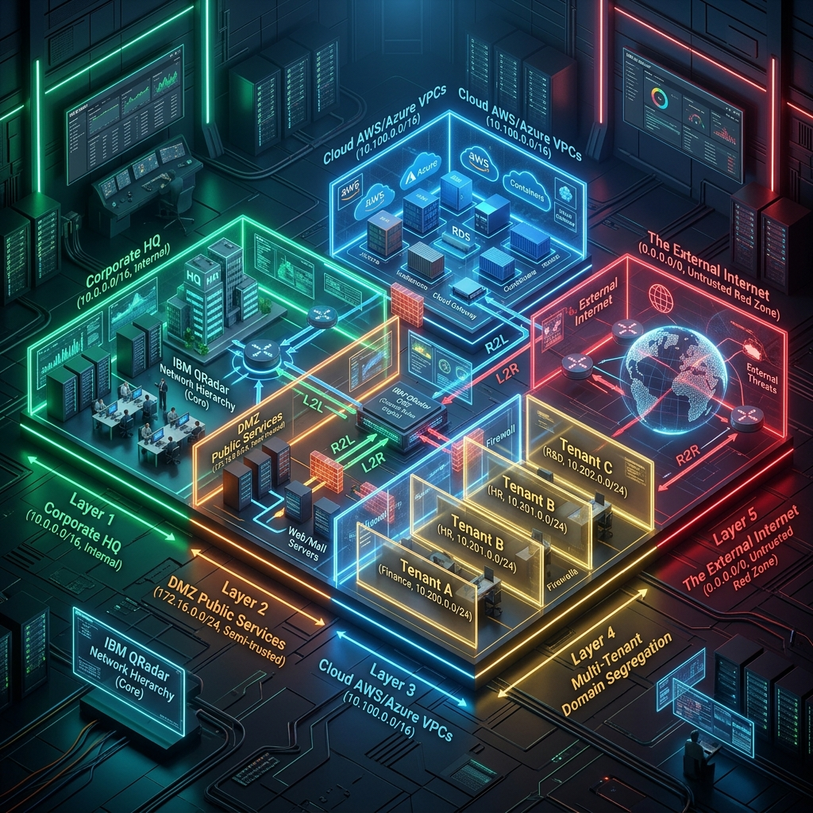
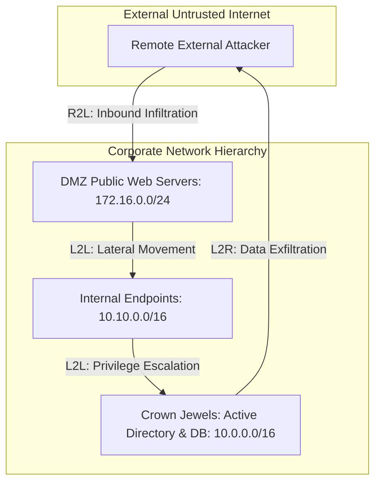
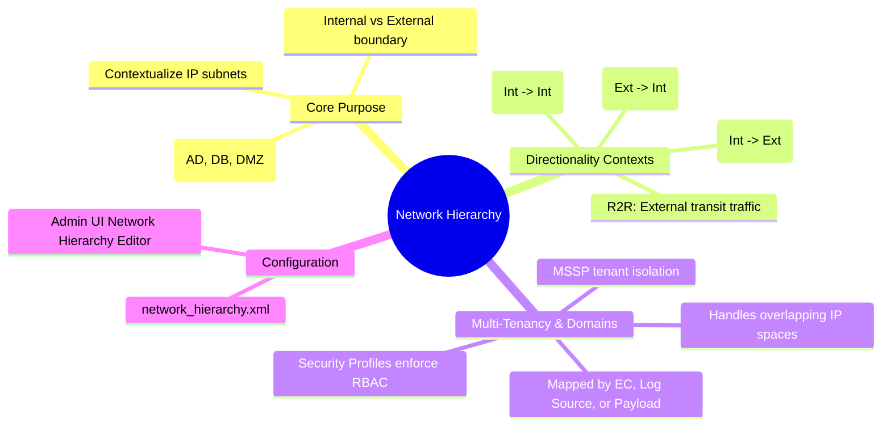

# 📖 Chapter 11: Network Hierarchy & Multi-Tenancy Masterclass

> **The IBM QRadar Administrator's Technical Guide** | Phase 1: QRadar Fundamentals  
> **Target Audience:** 1.5-Year Administrators $\rightarrow$ Senior SIEM Engineers & Architects  
> **Focus:** Network Hierarchy Context, Traffic Directionality (L2R, R2L, L2L), Domain Segmentation, MSSP Multi-Tenancy & Hands-on Lab

---

## 📸 1. Visual Overview: QRadar Network Hierarchy & Domain Segmentation


*Figure 11.1: 3D Isometric View of the Network Hierarchy: Layer 1 Corporate HQ, Layer 2 DMZ Public Services, Layer 3 Cloud VPCs, Layer 4 Multi-Tenant Domain Segregation (Tenant A, B, C), and Layer 5 Untrusted External Internet with Traffic Directionality Conduits (`![[15_network_hierarchy_domains_3d.jpg|1000]]`)*

---

## 2. Why is Network Hierarchy Essential? (The Context Engine)

Without a defined **Network Hierarchy**, QRadar sees every IP address as an arbitrary number. It cannot know whether `10.10.40.85` is an internal CEO workstation, a public web server in the DMZ, or a remote adversary in another country.

Defining the Network Hierarchy informs QRadar:
1. **Which IP addresses belong to your organization** (Internal / Local) vs the rest of the world (External / Remote).
2. **Which subnets host critical server infrastructure** (Domain Controllers, Mail Servers, Database clusters).
3. **Traffic Directionality**: Crucial for CRE correlation rules to detect whether an attack is **Inbound**, **Outbound**, or **Internal Lateral Movement**.

---

## 3. The 4 Traffic Directionality Contexts in the CRE

When QRadar processes an event or network flow, it evaluates the `Source IP` and `Destination IP` against the Network Hierarchy to assign a **Direction Context**:

```
┌────────────────────────────────────────────────────────────────────────┐
│ 1. REMOTE TO LOCAL (R2L) — INBOUND ATTACK                              │
│ • Source IP: External Internet (0.0.0.0/0)                             │
│ • Destination IP: Internal Network (e.g. 10.0.0.0/8, DMZ 172.16.0.0/24)│
│ • Threat Focus: External Port Scans, Brute Force, Web App Exploits     │
├────────────────────────────────────────────────────────────────────────┤
│ 2. LOCAL TO REMOTE (L2R) — OUTBOUND EXFILTRATION & BEACONING           │
│ • Source IP: Internal Workstation (e.g. 10.10.40.85)                   │
│ • Destination IP: External Internet (e.g. 203.0.113.99)                │
│ • Threat Focus: C2 Malware Beaconing, Data Exfiltration, Phishing Click│
├────────────────────────────────────────────────────────────────────────┤
│ 3. LOCAL TO LOCAL (L2L) — INTERNAL LATERAL MOVEMENT                    │
│ • Source IP: Internal Workstation (10.10.40.85)                        │
│ • Destination IP: Internal Domain Controller / Database (10.10.10.5)   │
│ • Threat Focus: Ransomware propagation, Pass-the-Hash, Internal Scan   │
├────────────────────────────────────────────────────────────────────────┤
│ 4. REMOTE TO REMOTE (R2R) — TRANSIT TRAFFIC                            │
│ • Source IP: External Internet                                         │
│ • Destination IP: External Internet                                    │
│ • Threat Focus: Proxied traffic, VPN transit, Non-monitored routes     │
└────────────────────────────────────────────────────────────────────────┘
```



---

## 4. Multi-Tenancy & Domain Segmentation Architecture

In large enterprises or **Managed Security Service Providers (MSSPs)**, multiple business units or independent client companies share a single QRadar deployment.

### 1. What is a Domain?
- A **Domain** is a logical security partition in QRadar that isolates log sources, network flows, offenses, and user visibility.
- Overlapping subnets: Two different clients can both use `192.168.1.0/24`. By assigning them to **Domain_Client_A** and **Domain_Client_B**, QRadar separates their assets and telemetry completely.

### 2. Domain Assignment Methods:
- **By Event Collector**: All logs arriving at `EC-Europe` are tagged as `Domain_Europe`.
- **By Log Source**: Specific firewalls are mapped to `Domain_Finance`.
- **By Custom Property / Payload Regex**: A multi-tenant SaaS log containing `"tenant_id": "AcmeCorp"` is automatically mapped to `Domain_Acme`.

### 3. Security Profiles & RBAC:
- Analysts are assigned to **Security Profiles** granting access only to specific Domains (e.g. Tenant A analysts cannot view Tenant B events or offenses).

---

## 📌 5. Visual Mind Map & Sticky Notes (Chapter 11 Quick-Review)

### 🧠 Hierarchical Mind Map


### 🗂️ Color-Coded Digital Sticky Notes

#### 🟨 Sticky Note 1: Missing Network Hierarchy Pitfall
```text
┌─────────────────────────────────────────────────────────────┐
│ 📌 CONCEPT: UNCONFIGURED NETWORK HIERARCHY BREAKS CRE       │
│                                                             │
│ • If your internal subnet `10.50.0.0/16` is not defined in  │
│   Network Hierarchy:                                        │
│ • QRadar treats it as EXTERNAL internet!                    │
│ • L2L internal ransomware rules FAIL to trigger!            │
│ • R2L inbound firewall rules generate thousands of FALSE    │
│   positives on internal employee traffic!                   │
└─────────────────────────────────────────────────────────────┘
```

#### 🟩 Sticky Note 2: Hierarchical Subnet Slicing
```text
┌─────────────────────────────────────────────────────────────┐
│ 📌 BEST PRACTICE: SPECIFIC BEFORE GENERAL                   │
│                                                             │
│ • Define supernets first, then slice specific subnets:      │
│   - `Corporate_HQ`: 10.0.0.0/8                              │
│   - `Domain_Controllers`: 10.10.10.0/24 (Inside HQ)         │
│   - `DMZ_Web`: 172.16.1.0/24                                │
│ • QRadar always matches the MOST SPECIFIC CIDR mask!        │
└─────────────────────────────────────────────────────────────┘
```

#### 🟪 Sticky Note 3: Multi-Tenancy Overlapping IPs
```text
┌─────────────────────────────────────────────────────────────┐
│ 📌 MULTI-TENANCY: OVERLAPPING IP SUBNETS                    │
│                                                             │
│ • Tenant A uses `192.168.1.0/24`.                           │
│ • Tenant B ALSO uses `192.168.1.0/24`.                      │
│ • Assigning Tenant A and B to distinct DOMAINS prevents     │
│   Asset Model merging and keeps offenses 100% isolated!     │
└─────────────────────────────────────────────────────────────┘
```

#### 🟦 Sticky Note 4: The 4 Directionality Codes
```text
┌─────────────────────────────────────────────────────────────┐
│ 📌 CRE DIRECTIONALITY CODES                                 │
│                                                             │
│ • R2L = Remote to Local (Inbound penetration attempts)      │
│ • L2R = Local to Remote (C2 beaconing & data exfiltration)  │
│ • L2L = Local to Local  (Internal lateral traversal)       │
│ • R2R = Remote to Remote (Transit traffic)                  │
└─────────────────────────────────────────────────────────────┘
```

#### 🟧 Sticky Note 5: Interview Cheat Code (Network Hierarchy)
```text
┌─────────────────────────────────────────────────────────────┐
│ 📌 INTERVIEW CHEAT CODE: "WHY IS NETWORK HIERARCHY CRITICAL?"│
│                                                             │
│ "Network Hierarchy defines the internal vs external security│
│ boundary in QRadar. It determines traffic directionality    │
│ (R2L for inbound attacks, L2R for data exfiltration, L2L    │
│ for lateral movement) and allows CRE correlation rules to   │
│ evaluate context without generating massive false alerts."  │
└─────────────────────────────────────────────────────────────┘
```

#### 🟥 Sticky Note 6: Common Administrator Pitfall
```text
┌─────────────────────────────────────────────────────────────┐
│ ⚠️ CRITICAL PITFALL: FORGETTING TO DEPLOY CHANGES           │
│                                                             │
│ • Modifying Network Hierarchy in the Admin UI saves to the  │
│   staging database, NOT production!                         │
│ • You MUST click 'Deploy Changes' to push the updated       │
│   network_hierarchy.xml to all distributed Event Processors!│
└─────────────────────────────────────────────────────────────┘
```

---

### ⚡ Rapid-Recall Flashcards

| # | Question (Front) | Answer (Back) |
| :-: | :--- | :--- |
| **01** | What traffic direction code represents C2 malware beaconing from internal PC to internet? | **`L2R` (Local to Remote)**. |
| **02** | What traffic direction code represents lateral ransomware propagation between servers? | **`L2L` (Local to Local)**. |
| **03** | How does QRadar resolve matching an IP that falls under both `10.0.0.0/8` and `10.10.10.0/24`? | It matches the **most specific CIDR prefix** (`10.10.10.0/24`). |
| **04** | What feature allows an MSSP to manage two clients with identical overlapping IP subnets? | **Domain Segmentation (Multi-Tenancy)**. |
| **05** | Where is the Network Hierarchy XML configuration file stored? | **`/store/configservices/staging/globalconfig/network_hierarchy.xml`**. |
| **06** | What administrative action is required after updating Network Hierarchy? | Clicking **"Deploy Changes"** in the Admin tab. |

---

## 🧪 6. Hands-on Practice Lab 11: Network Hierarchy & Domain Configuration via CLI

### 🎯 Lab Objectives
1. Inspect the live `network_hierarchy.xml` configuration on the Console.
2. Query defined network objects and CIDRs from PostgreSQL `configdb`.
3. Verify domain segmentation mappings for multi-tenant isolation.
4. Test traffic directionality evaluation in active CRE rules.

---

### 📋 Step-by-Step Practical Lab Procedures

#### Step 1: Inspect `network_hierarchy.xml` Configuration
Log into the Console via SSH:
```bash
# View the live network hierarchy XML file
cat /store/configservices/staging/globalconfig/network_hierarchy.xml | head -n 40
```
*Expected Output*: Displays XML tags `<networkGroup>` and `<ipNetwork>` with CIDR definitions and group names.

---

#### Step 2: Query Defined Network Groups from PostgreSQL
```bash
# Query all configured internal network groups and IP masks
psql -U qradar -d configdb -c "
SELECT id, name, ip_mask 
FROM network_hierarchy 
LIMIT 15;
"
```

---

#### Step 3: Audit Domain Segmentation Configuration
```bash
# Query active Domains in PostgreSQL
psql -U qradar -d configdb -c "
SELECT id, name, description, is_default 
FROM domain;
"
```
*Expected Output*: Displays all configured tenant domains and the default system domain.

---

#### Step 4: Network Hierarchy Definition Challenge
**Scenario**: You are onboarding a new AWS Cloud environment with the following subnets:
- AWS VPC Supernet: `10.100.0.0/16`
- AWS EKS Kubernetes Cluster: `10.100.10.0/24`
- AWS RDS Aurora Database Subnet: `10.100.20.0/24`

**Procedure**:
1. Open QRadar Web UI $\rightarrow$ **Admin Tab** $\rightarrow$ **Network Hierarchy**.
2. Create group: `AWS_Cloud_VPC` $\rightarrow$ Add `10.100.0.0/16`.
3. Create child group: `AWS_EKS_Containers` $\rightarrow$ Add `10.100.10.0/24`.
4. Create child group: `AWS_RDS_Databases` $\rightarrow$ Add `10.100.20.0/24`.
5. Click **Save** $\rightarrow$ **Deploy Changes**.
