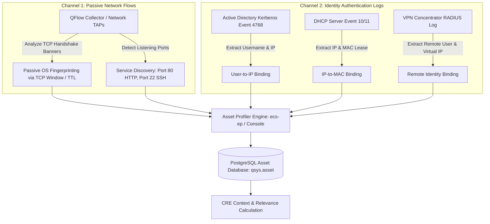

# 📖 Chapter 12: Asset Profiler & Identity Model Masterclass

> **The IBM QRadar Administrator's Technical Guide** | Phase 1: QRadar Fundamentals  
> **Target Audience:** 1.5-Year Administrators $\rightarrow$ Senior SIEM Engineers & Architects  
> **Focus:** Passive Asset Discovery, QFlow DPI Fingerprinting, DHCP/Kerberos Identity Reconciliation, Asset Growth Control & Hands-on Lab

---

## 📸 1. Visual Overview: QRadar Asset Profiler & Identity Architecture


*Figure 12.1: 3D Isometric View of the Asset Profiler Core Database receiving Passive Network Flow Fingerprints (QFlow) and Identity Authentication Logs (Active Directory Kerberos, DHCP leases, VPN RADIUS) to build Unified Dynamic Asset Cards with Risk Scoring (`![[16_asset_profiler_identity_model_3d.jpg|1000]]`)*

---

## 2. What is the Asset Model? (The Living CMDB)

In enterprise IT, static CMDB (Configuration Management Database) spreadsheets are outdated within 48 hours. Laptops change IP addresses via DHCP, cloud instances spin up and down, and employees bring unauthorized devices onto the network.

The **QRadar Asset Profiler** is a real-time, **passive asset intelligence engine** that automatically discovers, tracks, and updates every device on the network by observing live network traffic and authentication logs.

```
┌────────────────────────────────────────────────────────────────────────┐
│                        UNIFIED ASSET PROFILE                           │
│ • Unified Asset ID: #8491                                              │
│ • Hostname: WIN10-CORP-482.corp.internal                               │
│ • MAC Address: 00:1A:2B:3C:4D:5E (NIC Vendor: Intel Corporation)       │
│ • Current IP: 10.10.40.85 (Assigned via DHCP Lease at 08:30 AM)       │
│ • Logged-in User: jsmith (Active Directory Kerberos TGT 4768)          │
│ • Operating System: Windows 10 Enterprise Build 19044 (Passive TCP TTL)│
│ • Open Ports / Services: 445 (SMB), 3389 (RDP), 135 (MSRPC)            │
│ • Vulnerabilities: 3 High CVEs (Nessus Scanner Match)                  │
│ • Asset Risk Score: 72 / 100                                           │
└────────────────────────────────────────────────────────────────────────┘
```

---

## 3. The 2 Ingestion Channels of Asset Discovery



---

## 4. Identity Reconciliation: Solving the DHCP IP Shuffle

### The Problem:
- At **09:00 AM**, User `jsmith` is assigned IP `10.10.40.85` via DHCP and downloads a malicious spreadsheet.
- At **01:00 PM**, `jsmith` shuts down their laptop.
- At **02:00 PM**, User `bwhite` connects their workstation and is assigned the same IP `10.10.40.85`.
- At **04:00 PM**, QRadar detects C2 beaconing that started at 09:15 AM from `10.10.40.85`.

### How Identity Reconciliation Solves It:
1. QRadar continuously records timestamped **Identity Updates**:
   - `[09:00 AM - 01:00 PM] 10.10.40.85 ──► jsmith (MAC: 00:1A:2B:3C:4D:5E)`
   - `[02:00 PM - 05:00 PM] 10.10.40.85 ──► bwhite (MAC: 00:5E:4D:3C:2B:1A)`
2. When the Offense is generated for the 09:15 AM event, QRadar correlates the historical timestamp against the identity timeline and correctly attributes the incident to **`jsmith`**, not `bwhite`!

---

## 5. Asset Growth Management & Blacklisting

In large networks, certain devices generate massive amounts of chaotic IP-to-MAC churn:
- **NAT Gateways / Proxy Servers**: Thousands of distinct user sessions appear to originate from a single MAC address.
- **Vulnerability Scanners (Nessus/Qualys)**: Send spoofed packets across thousands of IPs.
- **Load Balancers (F5 BIG-IP)**: Rotate virtual IPs constantly.

If left unchecked, this causes **Asset Database Explosion**, consuming gigabytes of RAM and corrupting asset profiles.

### The Administrator Solution: Asset Blacklisting
Administrators configure **Asset Profiler Blacklists** to block specific IPs, MACs, or subnets from generating new asset records:
```text
Blacklist: IP 10.10.0.1 (F5 Load Balancer VIP) ──► Do not update MAC address
Blacklist: MAC 00:50:56:AB:CD:EF (NAT Firewall) ──► Do not update IP address
```

---

## 📌 6. Visual Mind Map & Sticky Notes (Chapter 12 Quick-Review)

### 🧠 Hierarchical Mind Map
```mermaid
mindmap
  root((Asset Profiler))
    Passive Discovery
      QFlow Network Flows (TCP Window, TTL)
      Service discovery on open ports
    Identity Model
      AD Kerberos (4768) user binding
      DHCP IP-to-MAC lease tracking
      Historical identity reconciliation
    Asset Profile Contents
      Unified Asset ID, Hostname, MAC, IP
      OS Fingerprint & Open Ports
      Scanner Vulnerability matches (CVEs)
      Calculated Asset Risk Score
    Growth Management
      Asset Database explosion risk
      Blacklisting NAT firewalls & Proxies
      PostgreSQL asset tables maintenance
```

### 🗂️ Color-Coded Digital Sticky Notes

#### 🟨 Sticky Note 1: Passive vs Active Discovery
```text
┌─────────────────────────────────────────────────────────────┐
│ 📌 CONCEPT: PASSIVE ASSET DISCOVERY                         │
│                                                             │
│ • QRadar DOES NOT actively ping or scan the network!        │
│ • It discovers assets PASSIVELY by listening to live flows  │
│   and parsing authentication logs in the event pipeline.    │
│ • Zero network overhead / Zero intrusion risk!              │
└─────────────────────────────────────────────────────────────┘
```

#### 🟩 Sticky Note 2: Identity Reconciliation Magic
```text
┌─────────────────────────────────────────────────────────────┐
│ 📌 GOLDEN RULE: TIMESTAMPS DEFINE IDENTITY                  │
│                                                             │
│ • When DHCP rotates an IP, QRadar maintains the history.    │
│ • Always ingest DHCP logs (Event 10/11) and Active Directory│
│   Kerberos logs (4768) to unlock accurate user attribution! │
└─────────────────────────────────────────────────────────────┘
```

#### 🟪 Sticky Note 3: The NAT Gateway Blacklist Rule
```text
┌─────────────────────────────────────────────────────────────┐
│ 📌 PERFORMANCE: BLACKLIST NAT GATEWAYS IMMEDIATELY!         │
│                                                             │
│ • If a NAT router MAC is not blacklisted, QRadar attempts to│
│   merge 10,000 corporate laptops into ONE giant asset!      │
│ • Fix: Admin Tab $\rightarrow$ Asset Profiler Configuration │
│   $\rightarrow$ Add NAT MAC to Blacklist.                   │
└─────────────────────────────────────────────────────────────┘
```

#### 🟦 Sticky Note 4: Asset Risk Score
```text
┌─────────────────────────────────────────────────────────────┐
│ 📌 ASSET RISK SCORE (0 to 100)                              │
│                                                             │
│ • Calculated dynamically from:                              │
│   1. Quantity and CVSS severity of open CVE vulnerabilities.│
│   2. Number of active high-magnitude offenses.              │
│   3. Asset business criticality weighting (Admin defined).  │
└─────────────────────────────────────────────────────────────┘
```

#### 🟧 Sticky Note 5: Interview Cheat Code (Asset Model)
```text
┌─────────────────────────────────────────────────────────────┐
│ 📌 INTERVIEW CHEAT CODE: "WHAT IS THE ASSET PROFILER?"      │
│                                                             │
│ "The Asset Profiler is a passive intelligence engine that   │
│ builds a real-time asset database by combining QFlow Layer-7│
│ fingerprinting with Active Directory Kerberos and DHCP      │
│ identity logs. It resolves historical user-to-IP bindings   │
│ and provides the Relevance score for Offense Magnitude."    │
└─────────────────────────────────────────────────────────────┘
```

#### 🟥 Sticky Note 6: Common Administrator Pitfall
```text
┌─────────────────────────────────────────────────────────────┐
│ ⚠️ CRITICAL PITFALL: PURGING ASSET DATABASE INCORRECTLY     │
│                                                             │
│ • Never manually delete rows from `qsys.asset` via SQL!     │
│ • Always clean corrupted assets through the QRadar UI Asset │
│   tab or use `/opt/qradar/bin/asset_profiler_tools.sh`.     │
└─────────────────────────────────────────────────────────────┘
```

---

### ⚡ Rapid-Recall Flashcards

| # | Question (Front) | Answer (Back) |
| :-: | :--- | :--- |
| **01** | What two primary log sources feed user identity into the Asset Profiler? | **Active Directory Kerberos (4768)** and **DHCP Server lease logs**. |
| **02** | How does QFlow passively determine an asset's operating system? | By analyzing **TCP SYN/ACK packet banners, Window Sizes, and IP TTLs**. |
| **03** | Why must NAT firewalls and proxy MAC addresses be blacklisted in Asset Profiler? | To prevent QRadar from merging thousands of distinct hosts into **one corrupted mega-asset**. |
| **04** | How does the Asset Model impact Offense Magnitude? | It provides the **Relevance (0-10)** score by matching exploit signatures against known asset vulnerabilities. |
| **05** | Where can administrators configure Asset Blacklists? | **Admin Tab $\rightarrow$ System Configuration $\rightarrow$ Asset Profiler Configuration**. |
| **06** | What CLI script is used to audit and manage the asset database? | **`/opt/qradar/bin/asset_profiler_tools.sh`**. |

---

## 🧪 7. Hands-on Practice Lab 12: Asset Database Querying & Blacklist Management

### 🎯 Lab Objectives
1. Query discovered assets directly from PostgreSQL `qsys`.
2. Inspect user identity-to-IP bindings and historical timeline records.
3. Identify and blacklist noisy MAC addresses causing asset profile merging.
4. Execute asset database maintenance via CLI scripts.

---

### 📋 Step-by-Step Practical Lab Procedures

#### Step 1: Query Discovered Assets from PostgreSQL
Log into the Console via SSH:
```bash
# Query the top 10 most recently discovered assets with OS and IP
psql -U qradar -d qsys -c "
SELECT id, host_name, ip_address, mac_address, os_name, risk_score 
FROM asset_profile 
ORDER BY last_update_time DESC 
LIMIT 10;
"
```
*Expected Output*: Displays unified asset profiles with Hostname, IP, MAC, OS, and Risk Score.

---

#### Step 2: Query Active User Identity Bindings
```bash
# Query user identity mappings linked to asset profiles
psql -U qradar -d qsys -c "
SELECT asset_id, user_name, last_logon_time 
FROM asset_user 
ORDER BY last_logon_time DESC 
LIMIT 10;
"
```

---

#### Step 3: Audit Asset Profile Growth & Identification Conflicts
```bash
# Run the official asset profiler diagnostic script
/opt/qradar/bin/asset_profiler_tools.sh --status
```
*Expected Output*: Displays total asset count, growth rate, and flags potential NAT merge conflicts.

---

#### Step 4: Asset Blacklist Configuration Challenge
**Scenario**: Your perimeter Palo Alto NAT interface (`MAC: 00:50:56:9A:BC:DE`) is constantly overwriting internal user asset profiles.

**Procedure**:
1. Open QRadar Web UI $\rightarrow$ **Admin Tab** $\rightarrow$ **Asset Profiler Configuration**.
2. Click **MAC Blacklist** $\rightarrow$ Click **Add**.
3. Enter MAC: `00:50:56:9A:BC:DE` $\rightarrow$ Description: `Perimeter NAT Interface`.
4. Click **Save** $\rightarrow$ **Deploy Changes**.
