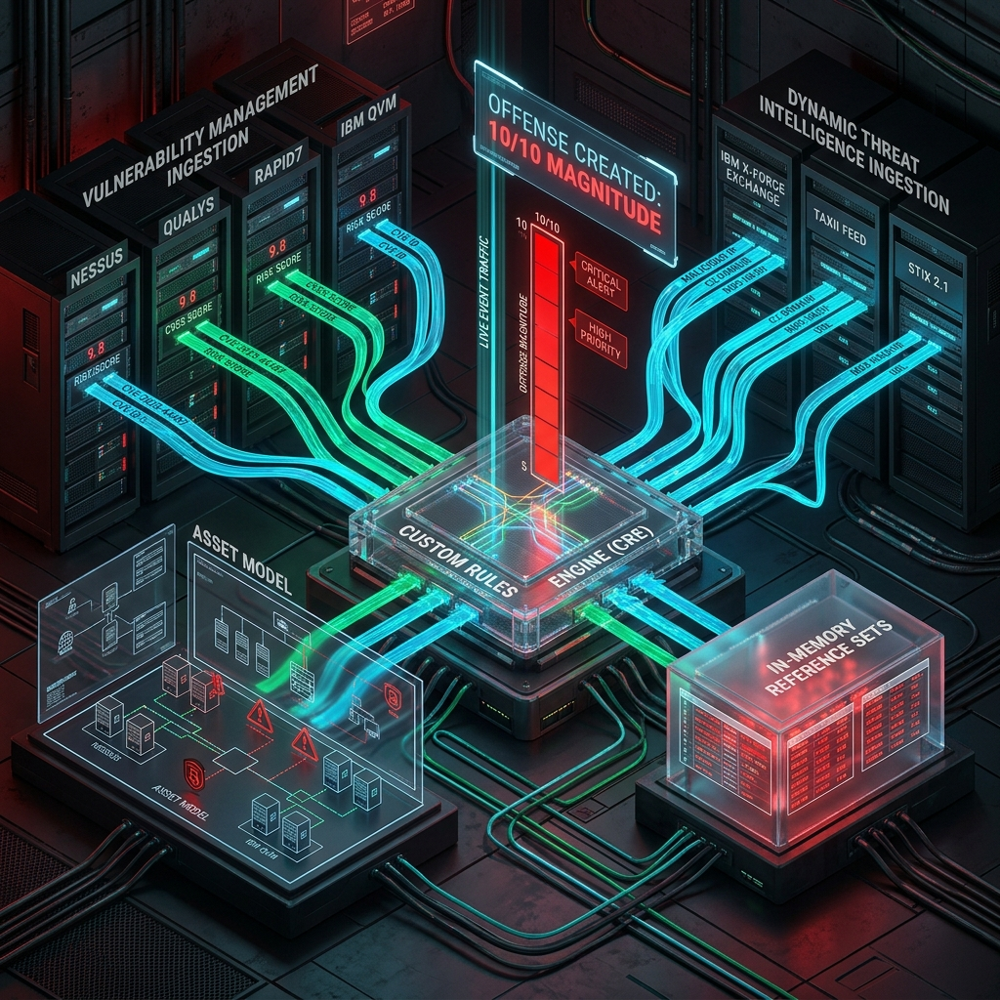

# 📖 Chapter 13: Vulnerability Management & Threat Intelligence Masterclass

> **The IBM QRadar Administrator's Technical Guide** | Phase 1: QRadar Fundamentals  
> **Target Audience:** 1.5-Year Administrators $\rightarrow$ Senior SIEM Engineers & Architects  
> **Focus:** Scanner Integrations (Nessus/Qualys), CVE Ingestion, TAXII/STIX 2.1 Threat Intel, Reference Set Auto-Population & Hands-on Lab

---

## 📸 1. Visual Overview: Vulnerability Management & Threat Intelligence


*Figure 13.1: 3D Isometric View of Vulnerability Scanners (Nessus, Qualys, Rapid7, QVM) feeding CVEs into the Asset Model, while Dynamic TAXII/STIX Feeds populate In-Memory Reference Sets, driving the Custom Rules Engine (CRE) to escalate Magnitude to 10/10 (`![[17_vulnerability_threat_intel_3d.jpg|1000]]`)*

---

## 2. The Power of Grounded Intelligence (Vulnerability + Threat Intel + Logs)

A standalone SIEM analyzing logs in a vacuum produces thousands of low-confidence alerts.
By combining **Live Logs** with **Vulnerability Scans** and **Threat Intelligence**, QRadar transforms raw events into high-confidence threat detections:

```
┌────────────────────────────────────────────────────────────────────────┐
│ 1. THE RAW LOG (Telemetry)                                             │
│ "External IP 198.51.100.42 sent HTTP POST /struts/upload to 10.10.10.5"│
├────────────────────────────────────────────────────────────────────────┤
│ 2. THREAT INTEL MATCH (TAXII / X-Force Reference Set)                  │
│ "198.51.100.42 is a verified Active C2 Botnet Server (IoC Match!)"    │
├────────────────────────────────────────────────────────────────────────┤
│ 3. VULNERABILITY DATA MATCH (Qualys / Nessus Asset Model)              │
│ "Server 10.10.10.5 has CVE-2017-5638 (Apache Struts RCE) UNPATCHED!"   │
├────────────────────────────────────────────────────────────────────────┤
│ 4. THE QRADAR CRE CORRELATION OUTCOME                                  │
│ 🚨 INSTANT MAGNITUDE 10 / 10 OFFENSE: ACTIVE EXPLOIT ON VULNERABLE ASSET│
└────────────────────────────────────────────────────────────────────────┘
```

---

## 3. Vulnerability Scanner Ingestion Architecture

```mermaid
flowchart TD
    subgraph Enterprise Vulnerability Scanners
        N[Tenable Nessus] -->|Scheduled REST API Pull| VA[VA Scanner Engine on Console]
        Q[QualysGuard Cloud] -->|API XML / JSON Ingestion| VA
        R[Rapid7 Nexpose] -->|Site Scan Results| VA
        M[IBM QVM Scanner] -->|Native Direct Ingestion| VA
    end

    subgraph QRadar Context Pipeline
        VA --> ASSET_MOD[(Asset Model Database: qsys.asset_vuln)]
        ASSET_MOD --> CRE[Custom Rules Engine (CRE)]
    end

    subgraph Correlation & Offenses
        EVENT[Live Event Stream: Exploit Detected] --> CRE
        CRE -->|Match Found: Target is Confirmed Vulnerable!| MAG[Magistrate: Sets Relevance = 10 / Magnitude = 10]
    end
```

### Supported Ingestion Workflows:
1. **Live API Connectors**: QRadar queries scanner APIs (Tenable.io, Qualys Cloud Platform) on a daily or weekly cron schedule, importing scan results for target IP ranges.
2. **Scheduled On-Demand Scans**: Administrators can trigger scans directly from the QRadar Web UI when an asset is implicated in an Offense.
3. **CIDR Mapping**: Associates vulnerability data directly with the Asset Profile's unified Asset ID.

---

## 4. Dynamic Threat Intelligence Ingestion (TAXII & STIX 2.1)

```mermaid
flowchart LR
    subgraph External Threat Feeds
        XF[IBM X-Force Exchange]
        OTX[AlienVault OTX]
        MISP[Internal MISP / STIX 2.1]
    end

    subgraph Threat Intelligence App / REST API
        XF -->|TAXII 2.1 Polling| TI[Threat Intel Engine]
        OTX -->|REST API IoC Pull| TI
        MISP -->|STIX XML/JSON| TI
    end

    subgraph High-Speed In-Memory Reference Sets
        TI -->|Auto-Populate / TTL| RS1[Ref Set: Threat_Intel_Malicious_IPs]
        TI -->|Auto-Populate / TTL| RS2[Ref Set: Threat_Intel_C2_Domains]
        TI -->|Auto-Populate / TTL| RS3[Ref Set: Threat_Intel_MD5_Hashes]
    end

    RS1 --> CRE[CRE Microsecond O(1) Rule Tests]
    RS2 --> CRE
    RS3 --> CRE
```

### 1. What is STIX / TAXII?
- **STIX 2.1 (Structured Threat Information Expression)**: Standardized JSON language for defining Cyber Threat Intelligence (IoCs, Threat Actors, Attack Patterns, Malware signatures).
- **TAXII 2.1 (Trusted Automated Exchange of Intelligence Information)**: The application protocol (REST API over HTTPS) used to subscribe to and stream STIX threat feeds.

### 2. In-Memory Reference Set Auto-Population:
- Threat feeds automatically populate **In-Memory Reference Sets** in `ecs-ep`.
- Each threat IoC is assigned a **Time-To-Live (TTL)** (e.g., 14 Days).
- When a threat IP goes dormant, it naturally expires from RAM, ensuring the SIEM does not generate false alarms on reassigned IPs.

---

## 📌 5. Visual Mind Map & Sticky Notes (Chapter 13 Quick-Review)

### 🧠 Hierarchical Mind Map
```mermaid
mindmap
  root((Vulnerability & Threat Intel))
    Vulnerability Scanners
      Nessus, Qualys, Rapid7, QVM
      API cron pulls & XML reports
      Maps CVEs & CVSS scores to Asset Model
    Threat Intelligence Feeds
      IBM X-Force Exchange
      TAXII 2.1 and STIX 2.1 open standards
      IoCs: IPs, C2 Domains, MD5 Hashes
    Reference Set Integration
      Auto-population with TTL expiration
      O(1) memory lookup in CRE
    Offense Impact
      Elevates Relevance score to 10
      Generates instant Magnitude 10 Offenses
```

### 🗂️ Color-Coded Digital Sticky Notes

#### 🟨 Sticky Note 1: Grounded Intelligence Formula
```text
┌─────────────────────────────────────────────────────────────┐
│ 📌 CONCEPT: THE 3-PILLAR GROUNDED INTELLIGENCE FORMULA      │
│                                                             │
│ • Logs alone = Noise without context.                       │
│ • Threat Intel = Proves the attacker is dangerous.          │
│ • Vulnerability Data = Proves your target is vulnerable.    │
│ • Together = Highest-priority actionable alert (Mag: 10)!   │
└─────────────────────────────────────────────────────────────┘
```

#### 🟩 Sticky Note 2: Dynamic TTL on Threat Intel
```text
┌─────────────────────────────────────────────────────────────┐
│ 📌 GOLDEN RULE: ALWAYS SET A TTL ON THREAT INTEL SETS       │
│                                                             │
│ • Cloud IPs are re-allocated daily by AWS / Azure.          │
│ • An attacker C2 IP today will be a legitimate business tomorrow!
│ • Best Practice: Set a 7-day to 14-day TTL on Threat Sets.  │
└─────────────────────────────────────────────────────────────┘
```

#### 🟪 Sticky Note 3: CVE to Relevance Mapping
```text
┌─────────────────────────────────────────────────────────────┐
│ 📌 RELEVANCE SCORING: HOW QRADAR MAPS CVES                  │
│                                                             │
│ • QRadar compares the incoming signature's CVE number with  │
│   the list of open CVEs on the destination Asset Profile.   │
│ • If CVE Match = TRUE: Relevance jumps from 1 to 10!        │
└─────────────────────────────────────────────────────────────┘
```

#### 🟦 Sticky Note 4: TAXII Protocol Port
```text
┌─────────────────────────────────────────────────────────────┐
│ 📌 TAXII COMMUNICATION: HTTPS PORT 443                      │
│                                                             │
│ • TAXII 2.1 feeds poll external endpoints over HTTPS (443). │
│ • Outbound proxy whitelisting: Ensure Console / App Host    │
│   can reach external threat intelligence repositories.      │
└─────────────────────────────────────────────────────────────┘
```

#### 🟧 Sticky Note 5: Interview Cheat Code (Threat Intel)
```text
┌─────────────────────────────────────────────────────────────┐
│ 📌 INTERVIEW CHEAT CODE: "HOW DO YOU INTEGRATE THREAT FEEDS?"│
│                                                             │
│ "We integrate commercial and open-source TAXII/STIX feeds   │
│ into QRadar using the Threat Intelligence App. Threat IoCs  │
│ automatically populate In-Memory Reference Sets with TTLs,  │
│ allowing CRE correlation rules to execute $O(1)$ memory     │
│ checks and raise Offense Magnitude on confirmed attacks."   │
└─────────────────────────────────────────────────────────────┘
```

#### 🟥 Sticky Note 6: Common Administrator Pitfall
```text
┌─────────────────────────────────────────────────────────────┐
│ ⚠️ CRITICAL PITFALL: STATIC MILLION-IOC DUMPS               │
│                                                             │
│ • Importing 2,000,000 stale IP indicators into a single     │
│   Reference Set without TTL exhausts Java heap memory!      │
│ • Remediation: Enforce TTL and filter feeds for high-       │
│   confidence indicators (Confidence Score > 80).            │
└─────────────────────────────────────────────────────────────┘
```

---

### ⚡ Rapid-Recall Flashcards

| # | Question (Front) | Answer (Back) |
| :-: | :--- | :--- |
| **01** | What open-standard formats does QRadar use for threat intelligence feeds? | **STIX 2.1** (JSON data format) and **TAXII 2.1** (HTTPS transport protocol). |
| **02** | What data structure in QRadar stores threat intelligence IoCs for real-time CRE evaluation? | **In-Memory Reference Sets**. |
| **03** | Why should Reference Sets populated by threat feeds have a **TTL (Time-To-Live)**? | To automatically purge stale indicators and prevent false positives on reallocated IP addresses. |
| **04** | How does vulnerability scanner data influence Offense Magnitude? | By dynamically elevating the **Relevance score (0 to 10)** when an attack matches a target's open CVE. |
| **05** | Name three major vulnerability scanners natively supported by QRadar. | **Tenable Nessus**, **QualysGuard**, and **Rapid7 Nexpose**. |
| **06** | What QRadar application is used to configure and automate TAXII/STIX feeds? | **IBM QRadar Threat Intelligence App**. |

---

## 🧪 6. Hands-on Practice Lab 13: Threat Intel Reference Set Ingestion & CVE Matching

### 🎯 Lab Objectives
1. Create a dynamic In-Memory Reference Set with TTL for Malicious IP indicators.
2. Query asset vulnerability records in PostgreSQL `qsys`.
3. Populate threat indicators via QRadar REST API.
4. Build and test a CRE correlation rule matching inbound traffic against threat intelligence.

---

### 📋 Step-by-Step Practical Lab Procedures

#### Step 1: Create a Threat Intel Reference Set via CLI / API
Log into the Console via SSH:
```bash
# Create an in-memory Reference Set for Malicious IPs with a 14-day (1,209,600 sec) TTL
/opt/qradar/bin/ReferenceDataUtil.sh create Threat_Intel_Malicious_IPs IP 1209600
```
*Expected Output*: Reference set `Threat_Intel_Malicious_IPs` created successfully.

---

#### Step 2: Inject Sample Malicious IoCs into Reference Set
```bash
# Add malicious command-and-control IP indicators to the set
/opt/qradar/bin/ReferenceDataUtil.sh add Threat_Intel_Malicious_IPs 198.51.100.42
/opt/qradar/bin/ReferenceDataUtil.sh add Threat_Intel_Malicious_IPs 203.0.113.99

# Verify elements stored in memory
/opt/qradar/bin/ReferenceDataUtil.sh list Threat_Intel_Malicious_IPs
```

---

#### Step 3: Query Vulnerability CVEs in PostgreSQL
```bash
# Query imported scanner vulnerabilities linked to assets
psql -U qradar -d qsys -c "
SELECT asset_id, cve_id, cvss_score, title 
FROM asset_vuln 
ORDER BY cvss_score DESC 
LIMIT 10;
"
```
*Expected Output*: Displays CVE identifiers and CVSS severity scores imported from Nessus/Qualys.

---

#### Step 4: Build CRE Threat Intel Rule Challenge
**Scenario**: Create a real-time detection rule that alerts whenever an internal host communicates with a known Threat Intel Malicious IP.

**Rule Configuration Procedure**:
1. Open QRadar Web UI $\rightarrow$ **Offenses Tab** $\rightarrow$ **Rules** $\rightarrow$ **New Event Rule**.
2. **Condition 1**: `and when the event(s) have not been parsed as Generic Log DSM`
3. **Condition 2**: `and when any of sourceip are contained in any of Threat_Intel_Malicious_IPs`
4. **Action**: *Ensure Offense is generated* $\rightarrow$ **Index by**: `Source IP` $\rightarrow$ **Severity**: `9`.
5. Click **Save** $\rightarrow$ **Deploy Changes**.
