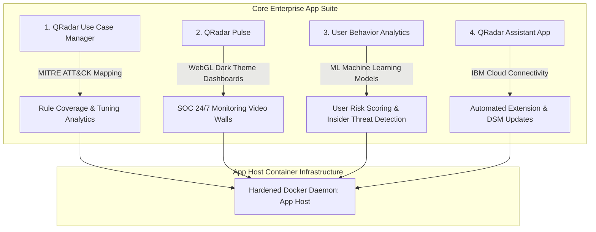
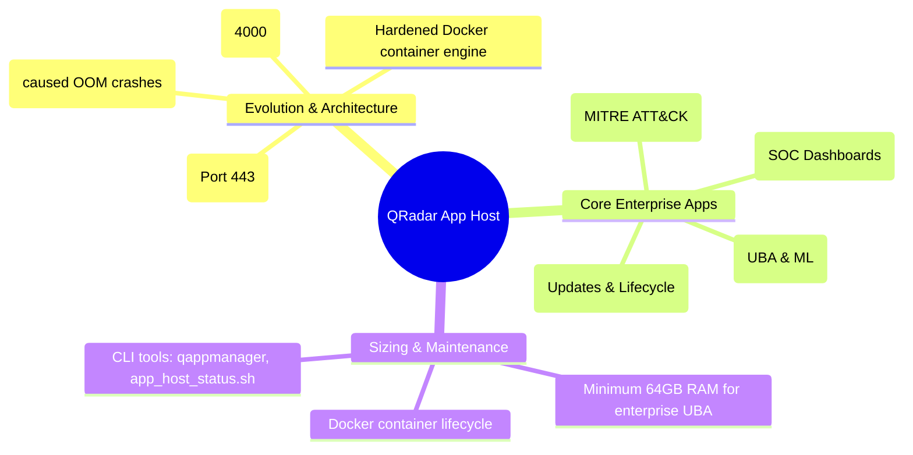

# 📖 Chapter 14: App Framework & Dedicated App Host Architecture Masterclass

> **The IBM QRadar Administrator's Technical Guide** | Phase 1: QRadar Fundamentals  
> **Target Audience:** 1.5-Year Administrators $\rightarrow$ Senior SIEM Engineers & Architects  
> **Focus:** App Host Appliance Sizing, Docker Container Engine, UBA/Pulse Apps, Memory Isolation & Hands-on Lab

---

## 📸 1. Visual Overview: QRadar App Host & Container Framework


*Figure 14.1: 3D Isometric View of the QRadar Console offloading containerized applications over Encrypted TLS 443 API links to the Dedicated App Host, running Docker pods for Use Case Manager, Pulse, UBA & ML Engine, and Assistant App with isolated CPU and Memory allocations (`![[18_app_host_docker_framework_3d.jpg|1000]]`)*

---

## 2. The Evolution of the QRadar App Framework

In earlier versions of QRadar (7.2 and 7.3 legacy), applications installed from the IBM App Exchange ran directly as local processes on the **QRadar Console**.

### The Console Crash Crisis (Legacy Architecture Flaw):
- When enterprise apps like **User Behavior Analytics (UBA)** or **Machine Learning models** processed millions of events, they consumed **32 GB to 64 GB of RAM**.
- This starved the Console's **Tomcat** application server and **PostgreSQL** database, causing:
  - Frequent Web UI lockups and `HTTP 500` errors.
  - Delayed Offense generation and report timeouts.

### The Modern Solution: Dedicated App Host (Appliance Type: 4000)
- In QRadar 7.3.3 and later, IBM introduced the **Dedicated App Host**.
- All Docker container runtimes, Python/NodeJS app microservices, and in-memory caches are offloaded entirely to a separate, hardened appliance.

```
┌────────────────────────────────────────────────────────────────────────┐
│                        QRADAR CONSOLE (3105)                           │
│ • Runs ONLY Core SIEM: Tomcat (UI/API), PostgreSQL, Magistrate         │
│ • Zero Docker container overhead! Guaranteed 99.999% Web UI uptime!    │
└───────────────────────────────────┬────────────────────────────────────┘
                                    │
                                    │ (Encrypted TLS API Link - Port 443)
                                    ▼
┌────────────────────────────────────────────────────────────────────────┐
│                     DEDICATED APP HOST (4000)                          │
│ • Hardened Docker Engine Subsystem                                     │
│ • Isolated CPU Cores & 64GB–256GB Dedicated App Memory                 │
│ • Pod 1: QRadar Use Case Manager (MITRE ATT&CK Matrix)                 │
│ • Pod 2: QRadar Pulse (Real-Time Cyber SOC Dashboards)                 │
│ • Pod 3: User Behavior Analytics (UBA - ML Behavioral Profiler)        │
│ • Pod 4: IBM QRadar Assistant (App Update & Lifecycle Manager)         │
└────────────────────────────────────────────────────────────────────────┘
```

---

## 3. The 4 Essential Enterprise QRadar Applications



### 1. QRadar Use Case Manager (UCM)
- Visualizes the organization's detection coverage mapped against the **MITRE ATT&CK Framework**.
- Identifies detection blind spots (e.g. missing coverage for *Lateral Movement: Pass-the-Hash*).
- Provides rule tuning wizards to suppress high-volume false positives without modifying production XML manually.

### 2. QRadar Pulse
- Modern, dynamic, WebGL-accelerated visualization dashboard designed for SOC video walls.
- Features real-time dark-theme geographical attack maps, offense magnitude gauges, and metric counters.

### 3. User Behavior Analytics (UBA)
- Focuses on **Insider Threats**, credential theft, and compromised accounts.
- Builds baseline behavioral profiles for every employee (typical login hours, normal network subnets, regular data access).
- Assigns a dynamic **User Risk Score ($0\text{ to }100$)**, escalating alerts when users exhibit anomalous behavioral spikes.

### 4. IBM QRadar Assistant App
- Manages app lifecycles, checks for DSM updates, and downloads new detection packages directly from the IBM Security App Exchange.

---

## 4. App Host Hardware Specs & Memory Sizing Matrix

| Deployment Tier | Installed Enterprise Apps | Recommended CPU | Minimum RAM | Storage Subsystem |
| :--- | :--- | :--- | :--- | :--- |
| **Small App Host** | Pulse + Use Case Manager | 8 Cores | 32 GB | 500 GB SSD |
| **Medium App Host** | Pulse + UCM + Threat Intel + Assistant | 16 Cores | 64 GB | 1 TB NVMe SSD |
| **Enterprise App Host** | UBA with ML + Pulse + UCM + SOAR Apps | 24–32 Cores | 128–256 GB | 2 TB NVMe SSD |

---

## 📌 5. Visual Mind Map & Sticky Notes (Chapter 14 Quick-Review)

### 🧠 Hierarchical Mind Map


### 🗂️ Color-Coded Digital Sticky Notes

#### 🟨 Sticky Note 1: App Host Isolation Principle
```text
┌─────────────────────────────────────────────────────────────┐
│ 📌 CONCEPT: ISOLATE CONTAINERS AWAY FROM CONSOLE            │
│                                                             │
│ • Running UBA on the Console is a critical design failure!  │
│ • Machine learning models consume 30GB+ of RAM.             │
│ • App Host isolates memory exhaustion: Even if an app       │
│   crashes, the Console, UI, and Offense engine remain 100%  │
│   online and unaffected!                                    │
└─────────────────────────────────────────────────────────────┘
```

#### 🟩 Sticky Note 2: Use Case Manager MITRE ATT&CK
```text
┌─────────────────────────────────────────────────────────────┐
│ 📌 DETECTION COVERAGE: USE CASE MANAGER                     │
│                                                             │
│ • Always install QRadar Use Case Manager in production.     │
│ • Maps all active CRE rules to MITRE ATT&CK tactics.        │
│ • Instantly shows auditors which attack stages are covered. │
└─────────────────────────────────────────────────────────────┘
```

#### 🟪 Sticky Note 3: App Migration Command
```text
┌─────────────────────────────────────────────────────────────┐
│ 📌 MIGRATION: MOVING APPS TO APP HOST                       │
│                                                             │
│ • To migrate apps from Console to a newly added App Host:   │
│ • Admin Tab $\rightarrow$ System & License Management       │
│   $\rightarrow$ Select App Host $\rightarrow$ App Host      │
│   Deploy $\rightarrow$ Migrate Apps.                        │
└─────────────────────────────────────────────────────────────┘
```

#### 🟦 Sticky Note 4: Docker CLI Access
```text
┌─────────────────────────────────────────────────────────────┐
│ 📌 ADMIN CLI: DOCKER ON APP HOST                            │
│                                                             │
│ • SSH into the App Host directly to run `docker ps`.        │
│ • View individual container CPU/RAM consumption via `top`.  │
│ • Inspect container logs via `docker logs <container_id>`.  │
└─────────────────────────────────────────────────────────────┘
```

#### 🟧 Sticky Note 5: Interview Cheat Code (App Framework)
```text
┌─────────────────────────────────────────────────────────────┐
│ 📌 INTERVIEW CHEAT CODE: "WHY DO WE DEPLOY AN APP HOST?"    │
│                                                             │
│ "The App Host is a dedicated appliance that runs Docker     │
│ containers for enterprise extensions like UBA, Pulse, and   │
│ Use Case Manager. It isolates memory and CPU consumption    │
│ away from the Console, preventing Tomcat OutOfMemory crashes│
│ and ensuring high availability for the Web UI and DB."      │
└─────────────────────────────────────────────────────────────┘
```

#### 🟥 Sticky Note 6: Common Administrator Pitfall
```text
┌─────────────────────────────────────────────────────────────┐
│ ⚠️ CRITICAL PITFALL: UNDERSIZED APP HOST RAM                │
│                                                             │
│ • Installing UBA and Pulse on a 16GB virtual App Host causes│
│   Linux OOM Killer to terminate containers randomly!        │
│ • Minimum Rule of Thumb: Allocate at least 64GB RAM for any │
│   deployment running User Behavior Analytics.               │
└─────────────────────────────────────────────────────────────┘
```

---

### ⚡ Rapid-Recall Flashcards

| # | Question (Front) | Answer (Back) |
| :-: | :--- | :--- |
| **01** | What underlying container technology runs applications on the App Host? | **Docker Engine**. |
| **02** | Why was the App Framework separated from the Console to a dedicated App Host? | To prevent high-memory apps (like UBA) from causing **Tomcat OutOfMemory crashes** on the Console. |
| **03** | Which QRadar app maps detection rules against the MITRE ATT&CK matrix? | **QRadar Use Case Manager**. |
| **04** | Which app calculates dynamic User Risk Scores ($0-100$) based on behavioral anomalies? | **User Behavior Analytics (UBA)**. |
| **05** | What is the minimum recommended RAM for an App Host running UBA with Machine Learning? | **64 GB to 128 GB RAM**. |
| **06** | What CLI command checks the operational status of the App Host? | **`/opt/qradar/bin/app_host_status.sh`** or **`/opt/qradar/bin/qappmanager`**. |

---

## 🧪 6. Hands-on Practice Lab 14: App Host Management & Container Inspection

### 🎯 Lab Objectives
1. Inspect running Docker containers and application memory allocations on the App Host.
2. Verify communication between the Console and App Host on Port 443.
3. Manage application states (Start, Stop, Restart) using `qappmanager`.
4. Inspect container error logs and health metrics via CLI.

---

### 📋 Step-by-Step Practical Lab Procedures

#### Step 1: Check App Host Health & Status via CLI
Log into the Console via SSH:
```bash
# Check App Host registration and connection status
/opt/qradar/bin/app_host_status.sh

# Query installed applications and their container states
/opt/qradar/bin/qappmanager
```
*Expected Output*: Lists application names, Application IDs (e.g., `1051`), Memory Limits, and Status (`RUNNING`).

---

#### Step 2: SSH into App Host & Inspect Docker Containers
Log into the App Host directly:
```bash
# View active Docker container processes
docker ps --format "table {{.ID}}\t{{.Image}}\t{{.Status}}\t{{.Names}}"

# Inspect live container CPU and Memory usage
docker stats --no-stream
```
*Expected Output*: Displays container IDs, memory utilization (e.g. `12.4 GiB / 64 GiB`), and CPU percentages.

---

#### Step 3: Inspect Application Logs for Errors
```bash
# Identify the container ID for Use Case Manager
CONTAINER_ID=$(docker ps | grep -i "usecase" | awk '{print $1}')

# Tail container logs
docker logs --tail 50 $CONTAINER_ID
```

---

#### Step 4: Restart an Unresponsive App via `qappmanager`
```bash
# Restart a specific application by its App ID (e.g. App ID 1051)
/opt/qradar/bin/qappmanager --restart 1051
```
*Expected Output*: Application stops, container recreates, and transitions back to `RUNNING` status within 60 seconds.
