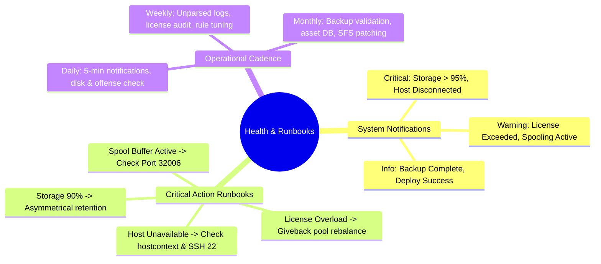

# 📖 Chapter 15: System Notifications, Health Monitoring & Runbooks Masterclass

> **The IBM QRadar Administrator's Technical Guide** | Phase 1: QRadar Fundamentals  
> **Target Audience:** 1.5-Year Administrators $\rightarrow$ Senior SIEM Engineers & Architects  
> **Focus:** Top-Bar System Notifications, Storage Alarms, Pipeline Health, Daily/Weekly/Monthly Admin Runbooks & Hands-on Lab

---

## 📸 1. Visual Overview: QRadar System Health Monitoring & Operations


*Figure 15.1: 3D Isometric View of the QRadar 24/7 Operations Center: Holographic System Notification Banners (Storage > 90%, License Rate Limit Reached, Spool Buffer Active, Host Timeout), Live Telemetry Terminals (CPU, JVM Heap, Disk IOPS, Socket Health), and Interactive Daily/Weekly/Monthly Administrator Runbooks (`![[19_system_health_monitoring_runbooks_3d.jpg|1000]]`)*

---

## 2. The System Notification Engine: The SIEM's Central Alarm System

In IBM QRadar, when a hardware, software, network, or license bottleneck occurs, the **System Notification Engine** generates an immediate alert banner at the top of the Web User Interface.

```
┌────────────────────────────────────────────────────────────────────────┐
│ 🔔 QRADAR SYSTEM NOTIFICATIONS (Top Bar Alert Hierarchy)              │
│                                                                        │
│ 🔴 CRITICAL ALARMS (Immediate Service Impact / Data Loss Risk)         │
│ • Storage Utilization Exceeds 95% on /store                            │
│ • Managed Host Status: Disconnected / Unavailable                     │
│ • Custom Property Regex Catastrophic Backtracking Detected            │
├────────────────────────────────────────────────────────────────────────┤
│ 🟡 WARNING NOTIFICATIONS (Performance Degradation / Spooling)          │
│ • Events Queued: Ingestion Exceeds Licensed EPS Threshold              │
│ • Disk Spooling Active in /store/transient                             │
│ • High Percentage of Unparsed Logs (SIM Generic Log DSM)               │
├────────────────────────────────────────────────────────────────────────┤
│ 🔵 INFORMATIONAL NOTIFICATIONS (System State Transitions)              │
│ • Nightly Configuration Backup Completed Successfully                  │
│ • Deploy Changes Completed on All Managed Hosts                        │
└────────────────────────────────────────────────────────────────────────┘
```

---

## 3. Top 6 Critical System Notifications & Root Cause Action Items

### 1. Notification: `Storage Utilization > 90% on /store`
- **Root Cause**: Daily ingestion volume exceeded physical disk sizing, or old data is locked by legal retention holds.
- **Immediate Admin Action**:
  1. Inspect partition: `df -h /store`.
  2. Audit high-volume noisy log sources generating unnecessary disk writes.
  3. Verify retention policies: Check if asymmetrical retention can prune noisy firewall drops from 90 days to 14 days.

---

### 2. Notification: `Events Queued / EPS License Exceeded`
- **Root Cause**: Log sources are emitting traffic faster than the allocated EPS license on that appliance.
- **Immediate Admin Action**:
  1. Check queue: Inspect `/store/transient/` for accumulated `.spool` files.
  2. Rebalance license: Open **System & License Management** and allocate unused EPS from quiet collectors via the **Giveback Pool**.

---

### 3. Notification: `Pipeline Spool Buffer Active (/store/transient)`
- **Root Cause**: The Event Collector cannot forward events to the Event Processor (Port 32006 firewall block, WAN link failure, or EP CPU at 100%).
- **Immediate Admin Action**:
  1. Test TCP 32006 connectivity: `nc -zv <EP_IP> 32006`.
  2. Inspect EP processing health: `ps aux | grep ecs-ep` and check `/var/log/qradar.error`.

---

### 4. Notification: `Managed Host Connection Timeout / Unavailable`
- **Root Cause**: `hostcontext` is dead on the managed host, or SSH port `22` keys are desynchronized.
- **Immediate Admin Action**:
  1. SSH into the managed host: `systemctl status hostcontext`.
  2. Restart service: `systemctl restart hostcontext`.
  3. Resync deployment keys from Console: `/opt/qradar/support/all_servers.sh`.

---

### 5. Notification: `Custom Property Regex Performance Degradation`
- **Root Cause**: A newly added custom regex property contains greedy quantifiers causing Catastrophic ReDoS backtracking.
- **Immediate Admin Action**:
  1. Open **Custom Event Properties** $\rightarrow$ Disable the offending regex.
  2. Optimize the regex expression to be atomic (replace `(.*)+` with `([A-Za-z0-9_-]+)`).

---

### 6. Notification: `SIM Generic Log DSM / Unparsed Log Floods`
- **Root Cause**: Log sources are sending events in an unrecognized format, or the Log Source Identifier in the Syslog header does not match the configured host.
- **Immediate Admin Action**:
  1. Filter Log Activity for `Log Source = SIM Generic Log DSM`.
  2. Inspect raw payload header $\rightarrow$ Adjust Log Source Identifier or assign appropriate DSM.

---

## 4. The Master Administrator Operational Cadence

To maintain an enterprise QRadar environment at peak performance, follow this standard operational runbook:

```
┌────────────────────────────────────────────────────────────────────────┐
│ 📅 DAILY RUNBOOK (5-Minute Health Audit - Start of Every Shift)         │
│ 1. Check Web UI Top-Bar Notifications for Critical Red/Yellow alerts.  │
│ 2. Verify Log Activity live stream (Confirm events are flowing).       │
│ 3. Check /store disk capacity on Console and all Processors (df -h).   │
│ 4. Review top 5 highest Magnitude Offenses (> 8.0) with SOC Lead.      │
├────────────────────────────────────────────────────────────────────────┤
│ 📅 WEEKLY RUNBOOK (1-Hour Maintenance & Optimization)                  │
│ 1. Audit Unparsed Logs: Search for QID 38750003 (Unknown Event).        │
│ 2. Audit License Utilization: Check Giveback balance & peak EPS usage. │
│ 3. Check ActiveMQ JMS health & Ariel search latency.                   │
│ 4. Review noisy False-Positive rules generating excessive offenses.   │
├────────────────────────────────────────────────────────────────────────┤
│ 📅 MONTHLY RUNBOOK (Strategic Governance & Compliance)                 │
│ 1. Validate Nightly Configuration Backups (Test restore to lab).       │
│ 2. Audit Asset Profiler database growth and verify Blacklists.         │
│ 3. Review User Accounts, Inactive Analysts, and Security Profiles.     │
│ 4. Apply latest DSM updates and Security SFS Patches from IBM FixCentral│
└────────────────────────────────────────────────────────────────────────┘
```

---

## 📌 5. Visual Mind Map & Sticky Notes (Chapter 15 Quick-Review)

### 🧠 Hierarchical Mind Map


### 🗂️ Color-Coded Digital Sticky Notes

#### 🟨 Sticky Note 1: The Daily 5-Minute Drill
```text
┌─────────────────────────────────────────────────────────────┐
│ 📌 CONCEPT: THE DAILY 5-MINUTE ADMIN DRILL                  │
│                                                             │
│ • Step 1: Open System Notifications (Check for red banners).│
│ • Step 2: Run `df -h /store` across all managed hosts.      │
│ • Step 3: Inspect Log Activity for live event flow.         │
│ • Doing this every morning prevents 95% of SIEM outages!    │
└─────────────────────────────────────────────────────────────┘
```

#### 🟩 Sticky Note 2: Disk Space Watermarks
```text
┌─────────────────────────────────────────────────────────────┐
│ 📌 GOLDEN RULE: DISK WATERMARK LADDER                       │
│                                                             │
│ • 85%: Warning notification.                                │
│ • 90%: High alarm $\rightarrow$ Automated retention purges  │
│   unheld historical logs.                                   │
│ • 95%: Ariel writes HALT to protect the filesystem!         │
└─────────────────────────────────────────────────────────────┘
```

#### 🟪 Sticky Note 3: Nightly Backup Verification
```text
┌─────────────────────────────────────────────────────────────┐
│ 📌 DISASTER RECOVERY: BACKUP VERIFICATION                   │
│                                                             │
│ • Daily Configuration Backups store PostgreSQL & XML rules. │
│ • Stored in: `/store/backup/`                               │
│ • Golden Rule: Always copy backups to remote offsite storage│
│   (NFS / Cloud S3 / Tape) daily!                            │
└─────────────────────────────────────────────────────────────┘
```

#### 🟦 Sticky Note 4: Unparsed Log Audit (QID 38750003)
```text
┌─────────────────────────────────────────────────────────────┐
│ 📌 LOG QUALITY: QID 38750003 AUDIT                          │
│                                                             │
│ • Unparsed logs cannot be correlated by the CRE engine!     │
│ • Every week, run an AQL search:                            │
│   `SELECT logsourceid, count(*) FROM events WHERE           │
│    qid = 38750003 GROUP BY logsourceid`                     │
│ • Map high-volume unparsed sources using the DSM Editor.    │
└─────────────────────────────────────────────────────────────┘
```

#### 🟧 Sticky Note 5: Interview Cheat Code (Admin Runbooks)
```text
┌─────────────────────────────────────────────────────────────┐
│ 📌 INTERVIEW CHEAT CODE: "WHAT IS YOUR DAILY ADMIN ROUTINE?"│
│                                                             │
│ "As a QRadar Administrator, my daily routine begins with    │
│ reviewing top-bar system notifications, auditing /store disk│
│ utilization across all managed hosts, verifying live event  │
│ and flow ingestion rates against license allocations, and   │
│ coordinating high-magnitude offenses with the SOC lead."    │
└─────────────────────────────────────────────────────────────┘
```

#### 🟥 Sticky Note 6: Common Administrator Pitfall
```text
┌─────────────────────────────────────────────────────────────┐
│ ⚠️ CRITICAL PITFALL: IGNORING SPOOL WARNINGS                │
│                                                             │
│ • When an Event Collector starts spooling to disk, it means │
│   downstream transport is broken.                           │
│ • If ignored for days, the collector disk fills to 100%,    │
│   eventually dropping live incoming UDP syslog packets!     │
└─────────────────────────────────────────────────────────────┘
```

---

### ⚡ Rapid-Recall Flashcards

| # | Question (Front) | Answer (Back) |
| :-: | :--- | :--- |
| **01** | Where are QRadar system notifications displayed in the Web UI? | In the **Top Navigation Bar** (bell / envelope notification icon). |
| **02** | What action does QRadar take when `/store` disk space reaches **95%**? | It **halts all new Ariel disk writes** to prevent filesystem corruption. |
| **03** | What AQL query identifies unparsed logs across the deployment? | **`SELECT logsourceid, count(*) FROM events WHERE qid = 38750003 GROUP BY logsourceid`**. |
| **04** | Where are nightly QRadar Configuration Backups stored on disk? | **`/store/backup/`** (in `.tar.gz` format). |
| **05** | What script generates a comprehensive system diagnostic archive for IBM Support? | **`/opt/qradar/support/get_logs.sh`**. |
| **06** | What are the three cadences of the QRadar Administrator Runbook? | **Daily (5-min audit)**, **Weekly (Optimization & Tuning)**, and **Monthly (Governance & Backups)**. |

---

## 🧪 6. Hands-on Practice Lab 15: Full Enterprise Health Audit via CLI

### 🎯 Lab Objectives
1. Execute a comprehensive Linux CLI health audit across all QRadar subsystems.
2. Verify disk space, partition health, and retention watermark compliance.
3. Audit top unparsed log sources (QID 38750003) via AQL / CLI.
4. Generate a complete system diagnostic health bundle.

---

### 📋 Step-by-Step Practical Lab Procedures

#### Step 1: Execute Full Subsystem Health Inspection Script
Log into the Console via SSH:
```bash
# 1. Inspect cluster deployment status
/opt/qradar/support/deployment_info.sh

# 2. Check storage utilization across all key partitions
df -h / /store /store/ariel /store/transient /store/backup

# 3. Check memory (RAM) and Swap utilization
free -m
```
*Expected Output*: Displays all managed hosts `ACTIVE`, `/store` utilization $< 80\%$, and Swap usage near $0\text{ MB}$.

---

#### Step 2: Audit Active Listening Sockets & Inter-Host Ports
```bash
# Verify all critical listening ports are active
ss -tulpn | grep -E "443|22|514|8413|32006|32011|61616"
```

---

#### Step 3: Check System Logs for Pipeline Warnings & Errors
```bash
# Check recent critical error events in qradar.error
tail -n 30 /var/log/qradar.error

# Check live event pipeline throughput
tail -n 25 /var/log/qradar.log | grep -i "License:"
```

---

#### Step 4: Audit Nightly Configuration Backup Archive
```bash
# Verify the latest nightly configuration backup exists and check file size
ls -lh /store/backup/backup*.tar.gz | tail -n 5
```
*Expected Output*: Displays daily backup archives created within the last 24 hours with expected file sizes ($\approx 50\text{ MB to }500\text{ MB}$).

---

#### Step 5: Generate IBM Support Diagnostic Health Bundle
```bash
# Run the get_logs.sh diagnostic collector to generate a complete health archive
/opt/qradar/support/get_logs.sh -a
```
*Expected Output*: Generates a compressed diagnostic archive under `/store/ibm_support/` containing system logs, daemon configurations, and hardware metrics.
