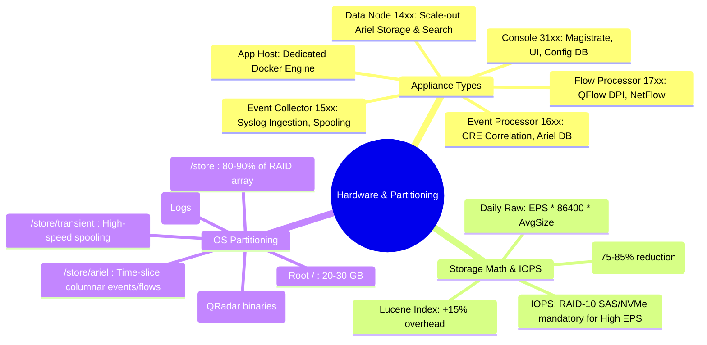

# 📖 Chapter 16: Hardware Benchmarks, Appliance Specs & OS Partitioning Masterclass

> **The IBM QRadar Administrator's Technical Guide** | Phase 2: Enterprise Installation & Deployment  
> **Target Audience:** 1.5-Year Administrators $\rightarrow$ Senior SIEM Engineers & Deployment Architects  
> **Focus:** Appliance Sizing Calculations, Hardware Benchmarks, Disk IOPS, RHEL OS Partitioning (`/store`, `/store/transient`), & Hands-on Lab 16

---

## 📸 1. Visual Overview: Enterprise Hardware Specs & OS Partitioning


*Figure 16.1: 3D Isometric View of Enterprise IBM QRadar Appliance Architecture: High-Density 2U Server Chassis, Xeon Multi-Socket Processors, NVMe / SAS 10K RAID-10 Storage Arrays, RAM Allocations for JVMs (`ecs-ep`, `tomcat`, `postgres`), and the Physical Linux OS Partition Hierarchy (`/`, `/opt`, `/store`, `/store/transient`, `/store/ariel`, `/store/backup`) (`![[20_hardware_specs_partitioning_3d.jpg|1000]]`)*

---

## 2. IBM QRadar Hardware Appliance Portfolio & Specs Matrix

In an enterprise deployment, selecting the proper hardware appliance or virtual machine (VM) specification is critical to prevent pipeline starvation, Ariel search timeouts, and out-of-memory (OOM) kernel panics.

IBM manufactures specialized appliances (M5/M6 Lenovo or Dell OEM hardware) pre-configured with optimized BIOS, RAID controllers, and memory channels.

### 🏢 Core Hardware Appliance Types & Specifications Matrix

| Appliance Type | IBM Model | Core Purpose | CPU Cores | RAM (GB) | Storage Capacity | Maximum Sustained EPS / FPM |
| :--- | :--- | :--- | :---: | :---: | :---: | :---: |
| **All-in-One Console** | QRadar 3105 | Small Org Console + Processor | 16-24 | 64 GB | 6-12 TB RAID-10 | 5,000 EPS / 100,000 FPM |
| **Enterprise Console** | QRadar 3128 / 3148 | Central UI, Magistrate, Rules | 24-32 | 128-256 GB | 12-24 TB RAID-10 | Console Only (Manages Distributed Hosts) |
| **Event Collector** | QRadar 1501 / 1505 | Remote Ingestion, Syslog Parsing | 8-16 | 32-64 GB | 2-4 TB RAID-1 | 15,000 - 40,000 EPS Ingestion |
| **Event Processor** | QRadar 1605 / 1628 / 1648 | CRE Correlation + Ariel Storage | 24-48 | 128-256 GB | 24-48 TB RAID-10 | 20,000 - 80,000 EPS Correlation |
| **Flow Processor** | QRadar 1705 / 1728 / 1748 | QFlow DPI + NetFlow Analysis | 16-32 | 64-128 GB | 12-24 TB RAID-10 | 300,000 - 1,200,000 FPM |
| **Data Node** | QRadar 1400 / 1405 / 1428 | Scale-out Ariel Storage & Search | 16-32 | 64-128 GB | 24-48 TB RAID-10 | Scales Storage & Search Speeds |
| **App Host** | QRadar App Host 500 | Dedicated Docker Container Engine | 16-32 | 64-192 GB | 2-4 TB RAID-10 | Dedicated App Memory Offloading |

---

## 3. Storage Sizing & IOPS Mathematics

Storage is the single most common failure domain in enterprise SIEM engineering. Under-sizing disk IOPS results in disk spooling (`/store/transient`), CRE rule lag, and sluggish AQL searches.

### 🧮 1. Daily Ingestion Storage Calculation Formula

To calculate the uncompressed and compressed daily disk storage requirements:

$$\text{Daily Raw Volume (GB)} = \frac{\text{Average EPS} \times 86,400\text{ seconds} \times \text{Average Payload Size (Bytes)}}{1,073,741,824\text{ Bytes/GB}}$$

Where:
- $\text{Average Payload Size}$: Standard enterprise syslog averages $\approx 450\text{ to }600\text{ Bytes}$ per event (Windows Security Events average $\approx 800\text{ to }1,200\text{ Bytes}$).
- **Compression Ratio in Ariel**: Ariel columnar storage with gzip achieves an average compression ratio between **$4:1$ and $8:1$** (typically $\approx 75\%\text{ to }85\%$ reduction).

$$\text{Daily Ariel Disk Consumption (GB)} = \text{Daily Raw Volume (GB)} \times (1 - \text{Compression Efficiency}) + \text{Lucene Index Overhead (15\%)}$$

#### 💡 Real-World Enterprise Example (10,000 Sustained EPS):
- **Sustained EPS**: $10,000\text{ EPS}$
- **Average Event Size**: $600\text{ Bytes}$
- **Daily Raw Data**: $10,000 \times 86,400 \times 600 = 518,400,000,000\text{ Bytes} \approx 482.8\text{ GB/day}$
- **Compressed Ariel Data ($5:1$ ratio $\approx 80\%$ compression)**: $482.8 \times 0.20 \approx 96.56\text{ GB/day}$
- **Lucene Index & Metadata Overhead ($15\%$)**: $96.56 \times 0.15 \approx 14.48\text{ GB/day}$
- **Total Storage Required per Day**: $96.56 + 14.48 \approx 111.04\text{ GB/day}$
- **90-Day Retention Requirement**: $111.04\text{ GB/day} \times 90\text{ days} \approx 9.99\text{ TB Net Storage}$
- **RAID-10 Usable Sizing + Safety Headroom ($30\%$)**: Target at least **$14.5\text{ TB to }16\text{ TB}$ usable disk space** on `/store`.

---

### ⚡ 2. IOPS Benchmark Requirements

Ariel requires sequential write performance for real-time ingestion, and concurrent random read performance during multi-analyst historical AQL searches.

```
┌────────────────────────────────────────────────────────────────────────┐
│ 🚀 MINIMUM IOPS BENCHMARKS FOR QRADAR APPLIANCES                       │
│                                                                        │
│ • Low Tier (1,000 - 5,000 EPS):    1,500 - 3,000 Sustained IOPS        │
│ • Mid Tier (5,000 - 20,000 EPS):   4,000 - 8,000 Sustained IOPS        │
│ • High Tier (20,000 - 80,000 EPS): 12,000 - 25,000+ Sustained IOPS     │
│ • Disk Configuration: RAID-10 (Striped Mirrors) using Enterprise       │
│   10K/15K SAS or NVMe SSDs. RAID-5/RAID-6 is NEVER RECOMMENDED for     │
│   high-EPS Event Processors due to write parity penalty!               │
└────────────────────────────────────────────────────────────────────────┘
```

---

## 4. Red Hat Enterprise Linux (RHEL) OS Partition Layout

IBM QRadar relies on an optimized Red Hat Enterprise Linux (RHEL) storage layout. In an enterprise installation, the filesystem is partitioned into strict mount points to isolate system binaries, volatile transient queues, and persistent Ariel historical databases.

```
┌────────────────────────────────────────────────────────────────────────┐
│ 🗄️ QRADAR LINUX STORAGE MOUNT HIERARCHY                               │
│                                                                        │
│ / (Root Partition)              [ 20 GB - 30 GB ] (ext4 / xfs)         │
│ ├── /boot                       [ 1 GB - 2 GB ]                        │
│ ├── /opt                        [ 20 GB - 30 GB ] (QRadar Binaries)    │
│ ├── /var/log                    [ 20 GB - 30 GB ] (System Logs)        │
│ ├── /tmp                        [ 10 GB - 20 GB ]                      │
│ └── /store (Persistent Data)    [ 80% - 90% of Total Array ] (xfs)     │
│     ├── /store/ariel/           (Ariel Payloads, Records & Indexes)    │
│     │   ├── events/             (Hourly Time-Slice Partitions)         │
│     │   └── flows/              (Hourly Flow Partitions)               │
│     ├── /store/transient/       (In-Memory / Fast Spool Ring Buffers)  │
│     ├── /store/backup/          (Daily Configuration & Data Tarballs)  │
│     └── /store/postgres/        (PostgreSQL Configuration Databases)   │
└────────────────────────────────────────────────────────────────────────┘
```

### 📋 Enterprise Filesystem Partitioning Breakdown

| Mount Point | Recommended Size | Filesystem Type | Purpose & Critical Notes |
| :--- | :---: | :---: | :--- |
| `/` | 20 GB - 30 GB | `xfs` | Base Operating System binaries, kernel modules, system utilities. |
| `/boot` | 1 GB - 2 GB | `ext4` | GRUB2 bootloader, vmlinuz kernel images, initramfs. |
| `/opt` | 20 GB - 40 GB | `xfs` | QRadar core application software (`/opt/qradar/bin/`, `/opt/qradar/lib/`). |
| `/var/log` | 20 GB - 30 GB | `xfs` | Linux and daemon logs (`/var/log/qradar.log`, `/var/log/messages`, `/var/log/httpd/`). |
| `/tmp` | 10 GB - 20 GB | `xfs` | Temporary scratch space for installers, SFS patch unpackers. |
| `/store` | Remainder (80-90%) | `xfs` | Dedicated high-IOPS RAID-10 partition for all SIEM data, Ariel storage, backups, and databases. |
| `/store/transient` | 10% of `/store` | `xfs` (or tmpfs) | Ring buffer queue spooling when pipeline experiences backpressure or downstream network drops. |
| `/store/ariel` | 75% of `/store` | `xfs` | Time-series columnar storage holding raw payloads and normalized records. |
| `/store/backup` | 10% of `/store` | `xfs` (or NFS) | Local repository for automated nightly `.tgz` configuration backups. |

---

## 5. Memory (RAM) Allocation & JVM Heap Architecture

In QRadar, physical RAM is heavily divided among competing Java Virtual Machines (JVMs) and the Linux kernel cache.

```
┌────────────────────────────────────────────────────────────────────────┐
│ 🧠 PHYSICAL RAM ALLOCATION (128 GB Enterprise Event Processor)         │
│                                                                        │
│ ┌────────────────────────────────────────────────────────────────────┐ │
│ │ 1. ecs-ep (Event Processing Engine / CRE / Ariel Ingestion)        │ │
│ │    JVM Heap: 48 GB - 64 GB                                         │ │
│ ├────────────────────────────────────────────────────────────────────┤ │
│ │ 2. tomcat / Web UI (Console only)                                  │ │
│ │    JVM Heap: 16 GB - 24 GB                                         │ │
│ ├────────────────────────────────────────────────────────────────────┤ │
│ │ 3. hostcontext / Magistrate / ActiveMQ Broker                      │ │
│ │    JVM Heap: 8 GB - 16 GB                                          │ │
│ ├────────────────────────────────────────────────────────────────────┤ │
│ │ 4. postgresql (Configuration Database Shared Buffers)              │ │
│ │    Dedicated RAM: 8 GB - 16 GB                                     │ │
│ ├────────────────────────────────────────────────────────────────────┤ │
│ │ 5. Linux Page Cache / Kernel Buffers (Ariel Sequential Read/Write) │ │
│ │    Remaining RAM: 24 GB - 32 GB                                    │ │
│ └────────────────────────────────────────────────────────────────────┘ │
└────────────────────────────────────────────────────────────────────────┘
```

> [!IMPORTANT]
> **Linux Kernel Page Cache**: Never allocate 100% of physical RAM to Java heaps! Ariel's columnar query engine relies heavily on the operating system page cache (`/proc/sys/vm/drop_caches`) to keep frequently queried Lucene index blocks and super-intervals in RAM.

---

## 📌 6. Visual Mind Map & Sticky Notes (Chapter 16 Quick-Review)

### 🧠 Hierarchical Mind Map


### 🗂️ Color-Coded Digital Sticky Notes

#### 🟨 Sticky Note 1: Sizing Rule of Thumb
```text
┌─────────────────────────────────────────────────────────────┐
│ 📌 CONCEPT: THE 10,000 EPS SIZING BASELINE                  │
│                                                             │
│ • 10,000 EPS $\approx$ 100 GB - 120 GB compressed storage   │
│   per day in `/store/ariel`.                                │
│ • 90-Day Retention = $\approx 10\text{ TB}$ net storage.    │
│ • Always add 30% safety margin for spikes and Lucene index! │
└─────────────────────────────────────────────────────────────┘
```

#### 🟩 Sticky Note 2: RAID-10 vs RAID-5/6
```text
┌─────────────────────────────────────────────────────────────┐
│ 📌 GOLDEN RULE: STORAGE CONTROLLER RAID SELECTION           │
│                                                             │
│ • ALWAYS configure `/store` on RAID-10 (Striped Mirrors).   │
│ • NEVER deploy RAID-5 or RAID-6 for high-EPS processors!    │
│ • Parity calculations in RAID-5/6 cause severe write-lag    │
│   during microsecond Ariel ingestion flushes.               │
└─────────────────────────────────────────────────────────────┘
```

#### 🟪 Sticky Note 3: The Critical `/store` Isolation
```text
┌─────────────────────────────────────────────────────────────┐
│ 📌 ARCHITECTURE: PARTITION ISOLATION                        │
│                                                             │
│ • `/store` MUST be a dedicated logical volume / partition.  │
│ • If `/store` reaches 95% disk usage, QRadar halts writes   │
│   but the Linux base OS on `/` continues to run safely!     │
└─────────────────────────────────────────────────────────────┘
```

#### 🟦 Sticky Note 4: Page Cache Significance
```text
┌─────────────────────────────────────────────────────────────┐
│ 📌 PERFORMANCE: LINUX PAGE CACHE FOR ARIEL                  │
│                                                             │
│ • Leave at least 20-25% of physical server RAM free for the │
│   Linux kernel page cache.                                  │
│ • Hot Lucene index pages are cached directly in RAM,        │
│   accelerating AQL searches by up to 10x!                   │
└─────────────────────────────────────────────────────────────┘
```

#### 🟧 Sticky Note 5: Interview Cheat Code (Hardware Sizing)
```text
┌─────────────────────────────────────────────────────────────┐
│ 📌 INTERVIEW CHEAT CODE: "HOW DO YOU SIZE A QRADAR CLUSTER?"│
│                                                             │
│ "I calculate daily ingestion volume by multiplying sustained│
│ EPS by 86,400 seconds and average payload size (e.g., 600B),│
│ apply a 5:1 Ariel compression ratio, add 15% Lucene index   │
│ overhead, factor in required retention days, and add a 30%  │
│ RAID-10 headroom buffer while ensuring at least 10,000 IOPS."│
└─────────────────────────────────────────────────────────────┘
```

#### 🟥 Sticky Note 6: Critical Pitfall
```text
┌─────────────────────────────────────────────────────────────┐
│ ⚠️ CRITICAL PITFALL: SINGLE PARTITION DEPLOYMENT            │
│                                                             │
│ • Installing QRadar on a single unified `/` partition       │
│   without a dedicated `/store` volume will lead to kernel   │
│   hangs, corrupted OS states, and inability to SSH in when  │
│   log traffic floods the drive to 100%.                     │
└─────────────────────────────────────────────────────────────┘
```

---

### ⚡ Rapid-Recall Flashcards

| # | Question (Front) | Answer (Back) |
| :-: | :--- | :--- |
| **01** | What RAID level is required for high-throughput QRadar `/store` storage? | **RAID-10 (Striped Mirrors)** for maximum random read and sequential write IOPS without parity penalties. |
| **02** | What is the typical compression ratio achieved by the Ariel columnar storage engine? | **$4:1\text{ to }8:1$** (representing a $75\%\text{ to }85\%$ reduction from raw syslog size). |
| **03** | Which appliance model is dedicated solely to running Docker-based containerized apps? | **QRadar App Host (Appliance Model 500)**. |
| **04** | Why must `/store/transient` have high I/O throughput? | It acts as the **in-memory and disk spool buffer** when downstream processing or networking experiences backpressure. |
| **05** | How much RAM should be left free from JVM heaps for the Linux kernel? | At least **$20\%\text{ to }25\%$ of physical RAM** to maintain the Linux Page Cache for Ariel/Lucene speed. |
| **06** | What command inspects disk partition layouts and mount points in Linux? | **`lsblk`** or **`df -h`** or **`fdisk -l`**. |

---

## 🧪 7. Hands-on Practice Lab 16: Hardware Benchmarking & Storage Sizing Audit

### 🎯 Lab Objectives
1. Perform disk partition and filesystem verification on `/store` and `/store/ariel`.
2. Execute a live storage sizing calculation script for an enterprise 15,000 EPS deployment.
3. Benchmark sequential write and random read IOPS on the storage array using `dd` and Linux I/O diagnostics.
4. Audit memory allocations and JVM heap settings across all running services.

---

### 📋 Step-by-Step Practical Lab Procedures

#### Step 1: Inspect Physical Storage Layout & Partition Mounts
Log into the QRadar appliance via SSH as `root`:
```bash
# 1. View block device topology and mount points
lsblk -o NAME,SIZE,TYPE,FSTYPE,MOUNTPOINT

# 2. Check filesystem utilization and free blocks
df -hT / /opt /var/log /store /store/transient /store/ariel

# 3. Check XFS filesystem parameters on /store
xfs_info /store
```
*Expected Output*: Confirms `/store` is mounted on an `xfs` filesystem occupying the majority of the RAID array.

---

#### Step 2: Live Sizing Calculation Script
Execute an automated Python calculation for sizing a 15,000 EPS deployment with 180-day retention:
```bash
python3 -c "
eps = 15000
avg_bytes = 650
retention_days = 180
comp_ratio = 5.0 # 5:1 compression (80% reduction)
lucene_overhead = 0.15 # 15%

daily_raw_gb = (eps * 86400 * avg_bytes) / (1024**3)
daily_ariel_gb = (daily_raw_gb / comp_ratio) * (1 + lucene_overhead)
total_retention_tb = (daily_ariel_gb * retention_days) / 1024
total_with_headroom_tb = total_retention_tb * 1.30

print('=' * 60)
print('🚀 QRADAR ENTERPRISE SIZING CALCULATOR')
print('=' * 60)
print(f'Sustained EPS:             {eps:,} EPS')
print(f'Daily Raw Ingestion:       {daily_raw_gb:.2f} GB/day')
print(f'Daily Ariel Disk Writes:   {daily_ariel_gb:.2f} GB/day')
print(f'180-Day Net Retention:     {total_retention_tb:.2f} TB')
print(f'Recommended RAID-10 Space: {total_with_headroom_tb:.2f} TB (incl 30% Headroom)')
print('=' * 60)
"
```

---

#### Step 3: Benchmark Disk Sequential Write Performance
Run a raw sequential write test to measure storage write bandwidth on `/store/transient`:
```bash
# Test sequential write speed with direct I/O (bypassing page cache)
dd if=/dev/zero of=/store/transient/io_benchmark_test.img bs=1G count=2 oflag=direct status=progress

# Clean up benchmark file immediately
rm -f /store/transient/io_benchmark_test.img
```
*Expected Output*: Enterprise RAID-10 arrays should sustain write throughput $> 350\text{ MB/s}$ (NVMe arrays exceed $1,200\text{ MB/s}$).

---

#### Step 4: Audit Memory Distribution & JVM Heap Sizes
```bash
# 1. Check physical memory and swap
free -h

# 2. Inspect active JVM maximum heap flags (-Xmx) for QRadar services
ps aux | grep java | grep -E "ecs-ep|tomcat|hostcontext" | awk '{for(i=1;i<=NF;i++) if($i ~ /^-Xmx/) print $i}'
```
*Expected Output*: Displays JVM heap parameters (e.g., `-Xmx48G` or `-Xmx64G` on Event Processors).
