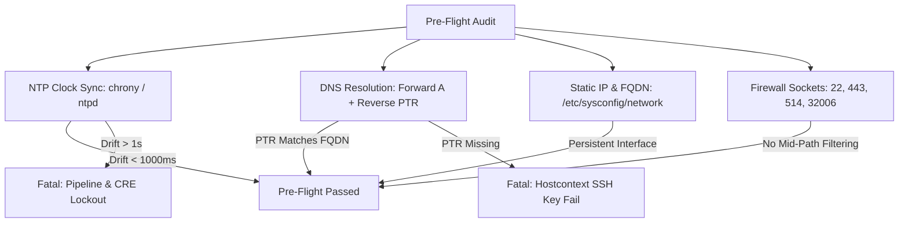
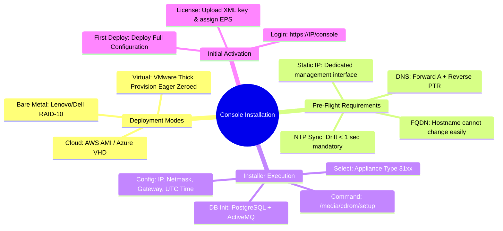

# 📖 Chapter 17: Console Installation & Software Deployment Masterclass

> **The IBM QRadar Administrator's Technical Guide** | Phase 2: Enterprise Installation & Deployment  
> **Target Audience:** 1.5-Year Administrators $\rightarrow$ Senior SIEM Engineers & Deployment Architects  
> **Focus:** Bare-Metal / Virtual / Cloud Deployment, Pre-Flight Network & NTP Validation, `setup` Installer Workflow, & Hands-on Lab 17

---

## 📸 1. Visual Overview: QRadar Console Installation & Deployment


*Figure 17.1: 3D Isometric View of the QRadar Console Installation Pipeline: Booting the RHEL-based ISO Installer, Executing `/media/cdrom/setup`, Interactive Network & FQDN Initialization, Database (`PostgreSQL`) & Message Broker (`ActiveMQ`) Bootstrapping, and the Initial Web UI Admin Activation Workflow (`![[21_console_installation_setup_3d.jpg|1000]]`)*

---

## 2. Deployment Form Factors: Bare Metal, Virtual, and Cloud

IBM QRadar supports three distinct deployment form factors:

```
┌────────────────────────────────────────────────────────────────────────┐
│ 🏗️ QRADAR DEPLOYMENT FORM FACTORS                                     │
│                                                                        │
│ 1. BARE-METAL APPLIANCES (Lenovo SR630 / SR650 or Dell R640 / R740)    │
│    • Factory-installed with optimized firmware, MegaRAID RAID-10.      │
│    • Highest sustained throughput (up to 80,000+ EPS per EP).          │
│ ├────────────────────────────────────────────────────────────────────┤
│ 2. VIRTUAL APPLIANCES (VMware ESXi 7.0/8.0, KVM, Nutanix AHV)         │
│    • Deployed via OVA / ISO templates.                                 │
│    • CRITICAL: Thick Provision Eager Zeroed disk allocation required!  │
│    • Must reserve 100% vCPU and vRAM (No overcommit!).                 │
│ ├────────────────────────────────────────────────────────────────────┤
│ 3. CLOUD DEPLOYMENTS (AWS AMI, Azure VHD, Google Cloud Platform)       │
│    • Deployed from BYOL Marketplace images or custom RHEL templates.   │
│    • Uses cloud-native block storage (AWS EBS gp3/io2, Azure Ultra).   │
└────────────────────────────────────────────────────────────────────────┘
```

---

## 3. Pre-Flight Checklist: Network, DNS, and NTP Precision

Before running the QRadar installer script, verify these critical environmental prerequisites:



### 📋 Critical Pre-Flight Verification Matrix

| Requirement | Specification | Consequence of Failure |
| :--- | :--- | :--- |
| **Time Sync (NTP)** | Time drift must be **$< 1.0\text{ second}$** across all cluster nodes. | Time drift corrupts Ariel hourly directory indexing, breaks CRE time-window threshold rules, and terminates inter-host SSH sessions. |
| **DNS (Forward & Reverse)** | Both forward `A` records and reverse `PTR` records must resolve cleanly. | `hostcontext` fails to validate host identity during managed host certificate signing and deployment sync. |
| **FQDN Consistency** | Hostname must be an explicit FQDN (e.g., `qradar-console.corp.local`). | Changing the hostname post-installation requires a complex cluster rebuild via `/opt/qradar/bin/change_hostname.sh`. |
| **Network Interface** | Dedicated static IP on primary management NIC (`ens192` or `eth0`). | DHCP or dynamic IP assignment will cause immediate managed host disconnects and pipeline failure. |

---

## 4. The `setup` Installer Execution Lifecycle

When installing QRadar from the ISO image, the master installation engine executes sequentially:

```
┌────────────────────────────────────────────────────────────────────────┐
│ ⚙️ QRADAR INSTALLER EXECUTION LIFECYCLE                               │
│                                                                        │
│ 1. Boot ISO / RHEL Installer Environment                              │
│    └── Anaconda installer partitions disks (/store, /opt, /var/log).  │
│                                                                        │
│ 2. Run `/media/cdrom/setup` (or `/root/setup`)                         │
│    ├── Prompts for Appliance Type: `Console (3199/3105)` vs `Managed`  │
│    ├── Network Configuration: IPv4/IPv6, Netmask, Gateway, DNS         │
│    ├── Hostname Definition: Validates FQDN syntax                      │
│    ├── Time Zone Selection: UTC recommended for enterprise SIEM        │
│    └── Security Configuration: Root Password & Web Admin Password      │
│                                                                        │
│ 3. Automated Configuration & Database Bootstrapping                    │
│    ├── Initializes PostgreSQL database clusters (`qradar`, `dsm`)     │
│    ├── Configures Apache ActiveMQ JMS message broker                   │
│    ├── Generates local SSL/TLS encryption certificates & host keys     │
│    ├── Deploys base DSM definitions and default CRE rules              │
│    └── Starts `hostcontext`, `tomcat`, and `ecs-ec-ingress`            │
│                                                                        │
│ 4. Post-Install Ready State                                           │
│    └── Web UI available at: `https://<Console_IP>/console/`            │
└────────────────────────────────────────────────────────────────────────┘
```

---

## 5. Post-Installation Validation & Initial Web UI Activation

Once the command line installer finishes, complete the initial Web UI onboarding:

```
┌────────────────────────────────────────────────────────────────────────┐
│ 🌐 INITIAL CONSOLE ACTIVATION RUNBOOK                                  │
│                                                                        │
│ 1. Access Web Console: Browse to `https://<Console_IP>/` via Chrome.   │
│ 2. Accept self-signed TLS certificate.                                 │
│ 3. Log in as `admin` with the password configured during `setup`.      │
│ 4. Accept the End User License Agreement (EULA).                       │
│ 5. Upload Master License Key:                                          │
│    • Navigate to: Admin Tab ➔ System & License Management               │
│    • Upload base License Key (.xml or license string).                 │
│    • Allocate base EPS (e.g., 5,000 EPS) and FPM to the Console.      │
│ 6. Execute First "Deploy Full Configuration":                          │
│    • Admin Tab ➔ Advanced ➔ Deploy Full Configuration.                │
│    • Generates initial deployment tokens and starts Tomcat listeners.  │
└────────────────────────────────────────────────────────────────────────┘
```

---

## 📌 6. Visual Mind Map & Sticky Notes (Chapter 17 Quick-Review)

### 🧠 Hierarchical Mind Map


### 🗂️ Color-Coded Digital Sticky Notes

#### 🟨 Sticky Note 1: NTP is Non-Negotiable
```text
┌─────────────────────────────────────────────────────────────┐
│ 📌 CONCEPT: THE NTP TIME SYNCHRONIZATION RULE               │
│                                                             │
│ • NTP drift > 1000ms causes silent CRE rule corruption and  │
│   Ariel search index partition desynchronization.           │
│ • Always configure multiple reliable enterprise NTP servers │
│   in `/etc/chrony.conf` before installing!                  │
└─────────────────────────────────────────────────────────────┘
```

#### 🟩 Sticky Note 2: Thick Provisioning in VMware
```text
┌─────────────────────────────────────────────────────────────┐
│ 📌 GOLDEN RULE: VMWARE DISK PROVISIONING                   │
│                                                             │
│ • ALWAYS select "Thick Provision Eager Zeroed" for `/store`.│
│ • Thin provisioning causes severe I/O latency spikes as the │
│   hypervisor allocates blocks during live log bursts!       │
└─────────────────────────────────────────────────────────────┘
```

#### 🟪 Sticky Note 3: Timezone Best Practice
```text
┌─────────────────────────────────────────────────────────────┐
│ 📌 ARCHITECTURE: ENTERPRISE TIMEZONE SELECTION             │
│                                                             │
│ • Always configure QRadar appliances to UTC timezone.       │
│ • Analysts in different global time zones can set their own │
│   local display preferences in User Preferences in the UI!  │
└─────────────────────────────────────────────────────────────┘
```

#### 🟦 Sticky Note 4: DNS Reverse PTR Importance
```text
┌─────────────────────────────────────────────────────────────┐
│ 📌 NETWORKING: REVERSE DNS (PTR) VALIDATION                 │
│                                                             │
│ • If reverse DNS lookup fails for any managed host,         │
│   SSH certificate exchanges and deployment synchronization  │
│   will intermittently hang or abort.                        │
└─────────────────────────────────────────────────────────────┘
```

#### 🟧 Sticky Note 5: Interview Cheat Code (Installation)
```text
┌─────────────────────────────────────────────────────────────┐
│ 📌 INTERVIEW CHEAT CODE: "HOW DO YOU DEPLOY A QRADAR CONSOLE?"│
│                                                             │
│ "I verify strict pre-flight requirements (NTP drift < 1s,   │
│ forward/reverse DNS, static FQDN, Thick Eager Zeroed disks),│
│ boot the installer ISO, run /root/setup to configure network│
│ and database parameters, activate the admin UI, apply the   │
│ license key, and execute a Full Configuration Deploy."      │
└─────────────────────────────────────────────────────────────┘
```

#### 🟥 Sticky Note 6: Critical Pitfall
```text
┌─────────────────────────────────────────────────────────────┐
│ ⚠️ CRITICAL PITFALL: POST-INSTALL HOSTNAME CHANGES          │
│                                                             │
│ • Never change the hostname of a QRadar appliance using the │
│   Linux `hostnamectl` command directly!                     │
│ • Hostname changes require `/opt/qradar/bin/change_hostname.sh`│
│   to regenerate SSL certificates and PostgreSQL references. │
└─────────────────────────────────────────────────────────────┘
```

---

### ⚡ Rapid-Recall Flashcards

| # | Question (Front) | Answer (Back) |
| :-: | :--- | :--- |
| **01** | What installer script initiates QRadar installation from the command line? | **`/media/cdrom/setup`** (or **`/root/setup`**). |
| **02** | What VMware disk provisioning format is strictly required for QRadar virtual machines? | **Thick Provision Eager Zeroed** (to guarantee zero I/O delay during disk growth). |
| **03** | What maximum time drift is tolerated between QRadar cluster nodes? | **$< 1.0\text{ second}$** (enforced by `chronyd` or `ntpd`). |
| **04** | Why must reverse DNS (PTR) records exist for all QRadar appliances? | For **secure inter-host SSH authentication and certificate validation** by `hostcontext`. |
| **05** | What is the recommended timezone for all enterprise QRadar backend appliances? | **UTC (Coordinated Universal Time)**. |
| **06** | What admin action is required after uploading a new QRadar license key? | **Allocate EPS/FPM to appliances** and execute **Deploy Changes / Deploy Full Configuration**. |

---

## 🧪 7. Hands-on Practice Lab 17: Console Pre-Flight Audit & Post-Install Service Verification

### 🎯 Lab Objectives
1. Perform pre-flight network, DNS, and NTP validation checks prior to deployment.
2. Verify persistent FQDN and static interface configurations.
3. Validate active PostgreSQL database clusters and Apache ActiveMQ messaging.
4. Execute a comprehensive post-installation service health audit.

---

### 📋 Step-by-Step Practical Lab Procedures

#### Step 1: Execute Pre-Flight NTP & Time Synchronization Audit
```bash
# 1. Check chrony synchronization tracking
chronyc tracking

# 2. Check NTP sources and stratum offsets
chronyc sources -v

# 3. Verify system clock is synchronized to UTC
timedatectl status
```
*Expected Output*: Displays `Leap status : Normal`, `System time : ... offset < 0.001000 seconds`, and `Time zone: UTC`.

---

#### Step 2: Audit DNS Forward and Reverse PTR Resolution
```bash
# Set target console FQDN and IP
CONSOLE_FQDN="qradar-console.corp.local"
CONSOLE_IP="192.168.10.100"

# 1. Forward DNS lookup
host $CONSOLE_FQDN

# 2. Reverse PTR DNS lookup
host $CONSOLE_IP
```
*Expected Output*: Both lookups return symmetrical results matching `$CONSOLE_IP` and `$CONSOLE_FQDN`.

---

#### Step 3: Validate PostgreSQL Database Clusters
```bash
# 1. Check PostgreSQL service status
systemctl status postgresql

# 2. Query QRadar configuration database version and appliance registry
psql -U qradar -d qradar -c "SELECT id, hostname, ip, appliance_type_id, status FROM managed_host;"
```
*Expected Output*: Returns the local Console row with `status = ACTIVE` and `appliance_type_id = 3199` (or `3105`).

---

#### Step 4: Validate ActiveMQ and Web Services
```bash
# 1. Verify ActiveMQ JMS broker port (61616) and Tomcat HTTPS (443)
ss -tulpn | grep -E "443|61616|22"

# 2. Check Tomcat web application server status
systemctl status tomcat

# 3. Inspect deployment status using deployment_info.sh
/opt/qradar/support/deployment_info.sh
```
*Expected Output*: Confirms all core management daemons are `active (running)` with zero fatal startup errors in `/var/log/qradar.log`.
