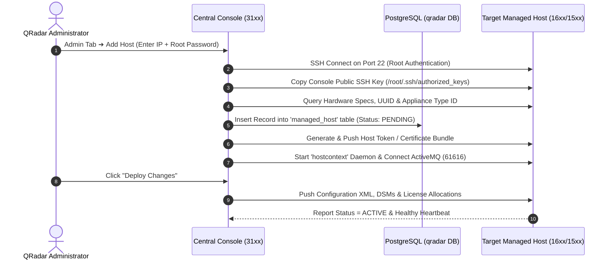
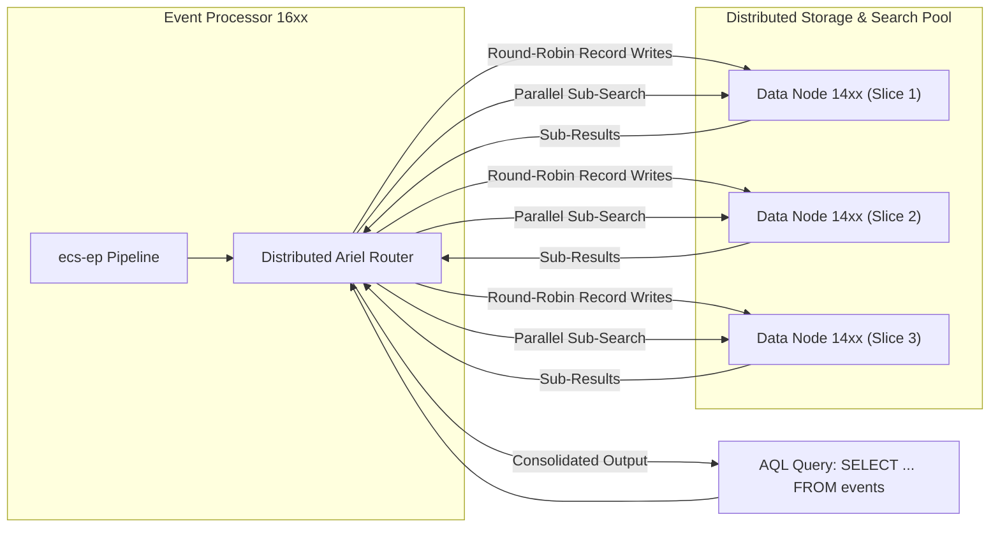
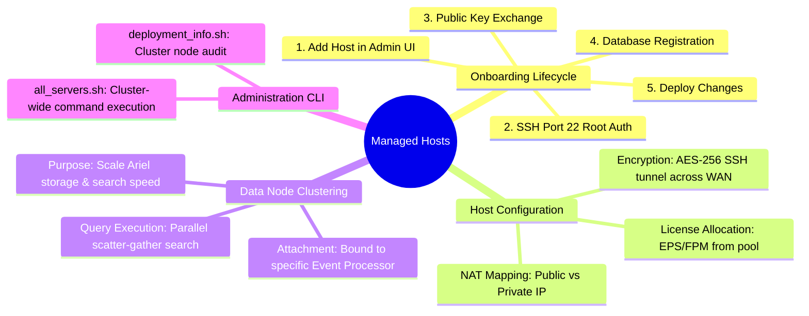

# 📖 Chapter 18: Adding & Configuring Managed Hosts Masterclass

> **The IBM QRadar Administrator's Technical Guide** | Phase 2: Enterprise Installation & Deployment  
> **Target Audience:** 1.5-Year Administrators $\rightarrow$ Senior SIEM Engineers & Deployment Architects  
> **Focus:** Distributed Clustering, SSH Port 22 Key Exchange, Managed Host Onboarding Lifecycle, Data Node Sizing, & Hands-on Lab 18

---

## 📸 1. Visual Overview: Distributed Managed Host Topology & Key Exchange


*Figure 18.1: 3D Isometric View of the Distributed QRadar Cluster: Central Console 31xx orchestrating secure SSH Port 22 tunnels to an Event Processor 16xx, Event Collector 15xx, Flow Processor 17xx, and clustered Data Nodes 14xx. Highlights dynamic deployment tokens, configuration synchronization, and real-time Ariel data scaling (`![[09_distributed_topologies_sizing_3d.jpg|1000]]`)*

---

## 2. Distributed Architecture & The Managed Host Lifecycle

In an enterprise QRadar deployment, processing and storage are decoupled from the Console and distributed across dedicated **Managed Hosts**.

```
┌────────────────────────────────────────────────────────────────────────┐
│ 🌐 DISTRIBUTED DEPLOYMENT TOPOLOGY                                     │
│                                                                        │
│               ┌─────────────────────────────────────┐                  │
│               │       QRADAR CONSOLE (31xx)         │                  │
│               │  Central UI, Magistrate, Config DB  │                  │
│               └──────────────────┬──────────────────┘                  │
│                                  │ (SSH Port 22 + ActiveMQ 61616)      │
│         ┌────────────────────────┼────────────────────────┐            │
│         │                        │                        │            │
│ ┌───────▼────────┐      ┌────────▼────────┐      ┌────────▼────────┐   │
│ │ EVENT COLL (15xx) │   │ EVENT PROC (16xx)│    │ FLOW PROC (17xx) │   │
│ │ Ingest & Parse │      │ CRE + Ariel DB  │      │ QFlow DPI Ingest│   │
│ └───────┬────────┘      └────────┬────────┘      └─────────────────┘   │
│         │                        │ (Ariel Distr Query 32011)           │
│         │ (Port 32006)   ┌───────▼────────┐                            │
│         └───────────────►│ DATA NODE (14xx)│                           │
│                          │ Striped Ariel  │                            │
│                          └────────────────┘                            │
└────────────────────────────────────────────────────────────────────────┘
```

---

## 3. The 5-Stage Managed Host Onboarding Workflow

When a new managed host is added to the deployment, QRadar executes a precise 5-stage orchestration:



### 📋 Stage Breakdown & Administrator Actions

1. **Authentication & Public Key Injection**:
   - The Console initiates an SSH connection on Port 22 using the temporary root password entered by the administrator.
   - The Console injects its public SSH key (`/root/.ssh/id_rsa.pub`) into the managed host's `/root/.ssh/authorized_keys` file, establishing passwordless mutual authentication.
2. **Appliance Fingerprinting**:
   - The Console runs hardware discovery scripts on the managed host to detect CPU cores, RAM size, storage partitions (`/store`), and appliance type (e.g., `1648` Event Processor).
3. **Database Registration**:
   - A new row is inserted into the `managed_host` table in the Console's PostgreSQL database with an initial status of `PENDING`.
4. **Host Token & Security Certificate Issuance**:
   - The Console issues a cryptographically signed host token and SSL/TLS certificate bundle stored under `/etc/qradar/` on the managed host.
5. **Configuration Push & Activation**:
   - The administrator clicks **Deploy Changes** (or **Deploy Full Configuration**).
   - The Console broadcasts configuration files, DSM definitions, CRE rules, and license tokens over encrypted tunnels to the managed host.

---

## 4. Advanced Managed Host Configuration Options

When configuring a managed host in the **System & License Management** UI, several enterprise parameters must be tuned:

```
┌────────────────────────────────────────────────────────────────────────┐
│ ⚙️ MANAGED HOST ENTERPRISE TUNING PARAMETERS                          │
│                                                                        │
│ 1. ENCRYPTION TUNNEL (AES-256 SSH Encapsulation)                       │
│    • Mandatory when Managed Hosts reside across WAN or Cloud VPCs.     │
│    • Encapsulates all event transport (32006), Ariel queries (32011),  │
│      and ActiveMQ messages (61616) inside an encrypted SSH tunnel.     │
│ ├────────────────────────────────────────────────────────────────────┤
│ 2. NAT (NETWORK ADDRESS TRANSLATION) SUPPORT                           │
│    • Required when Managed Hosts communicate across NAT firewalls.     │
│    • Specifies both the Public WAN IP and Internal Private IP.         │
│ ├────────────────────────────────────────────────────────────────────┤
│ 3. ALLOCATED EPS & FPM LICENSING                                       │
│    • Assigns event and flow limits from the Central Giveback Pool.     │
│    • Example: Allocate 25,000 EPS to EP1 and 15,000 EPS to EP2.        │
└────────────────────────────────────────────────────────────────────────┘
```

---

## 5. Data Node Clustering: Scaling Storage & Search Speed

A **Data Node (Appliance 14xx)** is a dedicated scale-out storage appliance attached directly to an Event Processor (16xx) or Flow Processor (17xx).



### 💡 Why Data Nodes Transform Enterprise SIEM:
- **Round-Robin Striping**: Incoming event payloads and normalized records are distributed across all attached Data Nodes in parallel.
- **Linear Storage Expansion**: Adding two 48 TB Data Nodes increases total retention storage by 96 TB without replacing the Event Processor.
- **Search Performance Multiplication**: When an analyst runs an AQL search, each Data Node executes the query locally against its own CPU cores and SSDs. A 4-node cluster searches data up to **$3.5\times\text{ to }4\times\text{ faster}$**!

---

## 📌 6. Visual Mind Map & Sticky Notes (Chapter 18 Quick-Review)

### 🧠 Hierarchical Mind Map


### 🗂️ Color-Coded Digital Sticky Notes

#### 🟨 Sticky Note 1: The SSH Key Handshake
```text
┌─────────────────────────────────────────────────────────────┐
│ 📌 CONCEPT: PASSWORDLESS SSH ARCHITECTURE                   │
│                                                             │
│ • Root password is only used ONCE during host addition.     │
│ • All ongoing communication (deployment sync, heartbeats)   │
│   uses mutual RSA/ECDSA SSH public keys in `authorized_keys`│
│ • Never delete or alter `/root/.ssh/` files manually!       │
└─────────────────────────────────────────────────────────────┘
```

#### 🟩 Sticky Note 2: Deploy Changes vs Full Deploy
```text
┌─────────────────────────────────────────────────────────────┐
│ 📌 GOLDEN RULE: DEPLOY TYPE DECISION                        │
│                                                             │
│ • "Deploy Changes": Soft reloads rules, log sources, and    │
│   configurations without interrupting active log collection.│
│ • "Deploy Full Configuration": Restarts `hostcontext`,      │
│   `ecs-ep`, and `tomcat`. Causes a brief pipeline pause!    │
└─────────────────────────────────────────────────────────────┘
```

#### 🟪 Sticky Note 3: Data Node Elasticity
```text
┌─────────────────────────────────────────────────────────────┐
│ 📌 ARCHITECTURE: DATA NODE ATTACHMENT                       │
│                                                             │
│ • Data Nodes are bound to a specific Event Processor.       │
│ • Once added, Ariel automatically stripes new hourly        │
│   partitions across the Data Nodes without manual database  │
│   sharding!                                                 │
└─────────────────────────────────────────────────────────────┘
```

#### 🟦 Sticky Note 4: WAN Encryption Overhead
```text
┌─────────────────────────────────────────────────────────────┐
│ 📌 PERFORMANCE: ENCRYPTION TUNNEL OVERHEAD                  │
│                                                             │
│ • Enabling SSH Encryption on Managed Hosts adds $\approx 3-5\%$ │
│   CPU overhead for AES-256 encryption/decryption.           │
│ • Essential for PCI-DSS & HIPAA compliance across WAN links!│
└─────────────────────────────────────────────────────────────┘
```

#### 🟧 Sticky Note 5: Interview Cheat Code (Adding Hosts)
```text
┌─────────────────────────────────────────────────────────────┐
│ 📌 INTERVIEW CHEAT CODE: "HOW DO MANAGED HOSTS COMMUNICATE?" │
│                                                             │
│ "Managed hosts communicate with the Console via SSH Port 22 │
│ for deployment pushes and health monitoring via hostcontext,│
│ ActiveMQ Port 61616 for JMS messaging, and send events to   │
│ Event Processors over TCP Port 32006."                      │
└─────────────────────────────────────────────────────────────┘
```

#### 🟥 Sticky Note 6: Critical Pitfall
```text
┌─────────────────────────────────────────────────────────────┐
│ ⚠️ CRITICAL PITFALL: MID-PATH FIREWALL TIMEOUTS             │
│                                                             │
│ • If a corporate firewall between Console and Managed Host  │
│   drops idle TCP sessions after 5 minutes, deployment sync  │
│   will hang indefinitely!                                   │
│ • Configure TCP Keepalives in `/etc/ssh/sshd_config`.       │
└─────────────────────────────────────────────────────────────┘
```

---

### ⚡ Rapid-Recall Flashcards

| # | Question (Front) | Answer (Back) |
| :-: | :--- | :--- |
| **01** | What port and protocol does the Console use to add and synchronize managed hosts? | **SSH over TCP Port 22** (using public key authentication). |
| **02** | What database table stores the registry of all managed hosts in the QRadar deployment? | The **`managed_host`** table in the `qradar` PostgreSQL database. |
| **03** | What is the primary operational benefit of adding Data Nodes (14xx)? | **Scales Ariel disk retention capacity linearly** and **accelerates AQL searches via parallel distributed processing**. |
| **04** | What master script executes a command across all managed hosts simultaneously? | **`/opt/qradar/support/all_servers.sh -C "<command>"`**. |
| **05** | What is the difference between "Deploy Changes" and "Deploy Full Configuration"? | "Deploy Changes" performs **incremental hot-reloads**, while "Deploy Full Configuration" **restarts all backend daemons**. |
| **06** | What daemon on the managed host manages communication with the Console? | **`hostcontext`**. |

---

## 🧪 7. Hands-on Practice Lab 18: Managed Host Cluster Onboarding & Diagnostics

### 🎯 Lab Objectives
1. Inspect the managed host registry in PostgreSQL via command line.
2. Verify mutual SSH public key authentication across cluster nodes.
3. Execute cluster-wide diagnostic commands using `all_servers.sh`.
4. Audit inter-host listening sockets and test tunnel encryption status.

---

### 📋 Step-by-Step Practical Lab Procedures

#### Step 1: Query Managed Host Registry in PostgreSQL
Log into the Console via SSH as `root`:
```bash
# Query the PostgreSQL database to inspect all cluster managed hosts
psql -U qradar -d qradar -x -c "
SELECT 
    id, 
    hostname, 
    ip, 
    appliance_type_id, 
    status, 
    secondary_status, 
    encrypted, 
    version 
FROM managed_host 
ORDER BY id ASC;
"
```
*Expected Output*: Returns all deployed appliances (Console, EPs, ECs, Data Nodes) with `status = ACTIVE`.

---

#### Step 2: Audit Inter-Host SSH Key Authentication
Verify the Console can connect to all managed hosts without password prompts:
```bash
# Test passwordless SSH connectivity and fetch uptime from all managed hosts
/opt/qradar/support/all_servers.sh -C "uptime"
```
*Expected Output*: Displays the output of `uptime` from every managed host in the cluster sequentially with zero authentication errors.

---

#### Step 3: Test Inter-Host Network Sockets
From an Event Collector or Managed Host, test connectivity to the Event Processor:
```bash
EP_IP="192.168.10.102"

# 1. Test SSH management port 22
nc -zv $EP_IP 22

# 2. Test event transport pipeline port 32006
nc -zv $EP_IP 32006

# 3. Test Ariel distributed query port 32011
nc -zv $EP_IP 32011
```
*Expected Output*: Displays `Connection to 192.168.10.102 port [22/32006/32011] [tcp/*] succeeded!`.

---

#### Step 4: Audit Cluster Deployment Synchronization State
```bash
# Run comprehensive deployment health check
/opt/qradar/support/deployment_info.sh
```
*Expected Output*: Reports cluster configuration version, host licenses, active token balances, and confirms all managed host `hostcontext` daemons are in sync.
