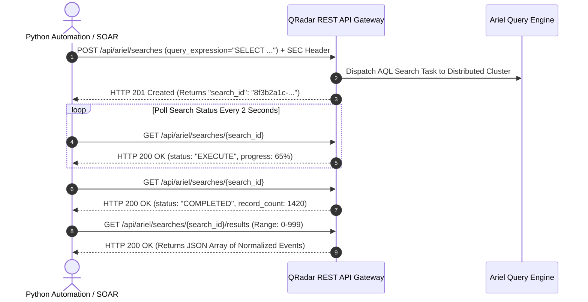

# 📖 Chapter 19: Authorized Services, REST API Security & Tokens Masterclass

> **The IBM QRadar Administrator's Technical Guide** | Phase 2: Enterprise Installation & Deployment  
> **Target Audience:** 1.5-Year Administrators $\rightarrow$ Senior SIEM Engineers & Security Automation Engineers  
> **Focus:** REST API Architecture, Authorized Services vs User Accounts, Token Security, Async Ariel Queries, & Hands-on Lab 19

---

## 📸 1. Visual Overview: REST API Architecture & Token Security


*Figure 19.1: 3D Isometric View of the QRadar REST API Gateway: External Automation Engines (SOAR, Threat Intel Feeds, Python SDK, CI/CD Pipelines) authenticating via cryptographic `SEC` Token Headers, undergoing RBAC Security Profile validation, and executing microsecond REST queries against the Magistrate, Reference Data, and Ariel Query engines (`![[01_enterprise_architecture_3d.jpg|1000]]`)*

---

## 2. QRadar REST API Architecture & Interactive Swagger UI

IBM QRadar provides a comprehensive, versioned RESTful API allowing security engineers to automate 100% of administrative, analytical, and operational workflows.

```
┌────────────────────────────────────────────────────────────────────────┐
│ 🌐 QRADAR REST API ARCHITECTURE                                       │
│                                                                        │
│ • Base URL:         https://<Console_IP>/api/                          │
│ • Interactive Docs: https://<Console_IP>/api_doc (Swagger UI)          │
│ • Data Format:      JSON (Content-Type: application/json)              │
│ • Authentication:   HTTP Header: `SEC: <Authorized_Service_Token>`     │
│ • API Versions:     Explicitly requested via `Version: 19.0` Header    │
└────────────────────────────────────────────────────────────────────────┘
```

### 📋 Core REST API Endpoint Families

| Endpoint Family | Path | Primary Operational Use Cases |
| :--- | :--- | :--- |
| **SIEM / Offenses** | `/api/siem/offenses` | Fetching open incidents, updating magnitude, closing offenses, assigning notes. |
| **Ariel Searches** | `/api/ariel/searches` | Asynchronous AQL execution, polling query completion, streaming record results. |
| **Reference Data** | `/api/reference_data/*` | Real-time threat intel ingestion into Reference Sets, Maps, Maps of Sets, Tables. |
| **Log Sources** | `/api/config/event_sources/...` | Automated onboarding of log sources, DSM assignments, protocol configurations. |
| **System & Health** | `/api/system/*` | Cluster node health, license token allocations, storage capacity tracking. |
| **Asset Model** | `/api/asset_model/assets` | Querying host identities, IP-to-MAC bindings, and vulnerability profiles. |

---

## 3. Authorized Services vs Interactive User Accounts

```
┌────────────────────────────────────────────────────────────────────────┐
│ ⚖️ AUTHORIZED SERVICES VS USER ACCOUNTS                                │
│                                                                        │
│ 🤖 AUTHORIZED SERVICES (For Machines & Automation)                     │
│ • Dedicated API Tokens tied to service accounts (e.g., SOAR_Integration).│
│ • No interactive Web UI login capability (Prevents credential theft). │
│ • Explicit expiration dates and instant cryptographic revocation.      │
│ • Bound to granular User Roles & Security Profiles (Least Privilege).  │
│ ├────────────────────────────────────────────────────────────────────┤
│ 👤 USER ACCOUNTS (For Human Analysts & Administrators)                 │
│ • Interactive username + password + MFA / SAML SSO login.              │
│ • Password expiration policies (90 days) will BREAK automation scripts!│
│ • NEVER hardcode human credentials into Python scripts or SOAR tools! │
└────────────────────────────────────────────────────────────────────────┘
```

---

## 4. The 3-Stage Asynchronous Ariel Search API Lifecycle

Because Ariel database queries can search through terabytes of historical data, the Ariel REST API operates **asynchronously** using a 3-stage lifecycle:



### 📋 Asynchronous Query States:
- **`WAIT`**: The query is queued waiting for an available search thread in the Ariel thread pool.
- **`EXECUTE`**: Distributed query nodes (Event Processors & Data Nodes) are scanning disk partitions.
- **`COMPLETED`**: Query execution is finished; result set is cached in memory ready for retrieval.
- **`CANCELED` / `ERROR`**: Query timed out, syntax error, or aborted by administrator.

---

## 5. Token Security Best Practices & Hardening

```
┌────────────────────────────────────────────────────────────────────────┐
│ 🛡️ REST API TOKEN HARDENING CHECKLIST                                  │
│                                                                        │
│ 1. PRINCIPLE OF LEAST PRIVILEGE:                                       │
│    • A Threat Intel script only requires `Reference Data: Admin` and   │
│      does not need access to Offenses or Admin Tab settings.          │
│ 2. DEDICATED TOKENS PER INTEGRATION:                                   │
│    • Never share a single token across multiple tools (SOAR, EDR,      │
│      Vulnerability Scanner, Ticketing System). Create distinct tokens. │
│ 3. REGULAR TOKEN ROTATION:                                             │
│    • Set token expiry (e.g., 180 days) and rotate keys systematically. │
│ 4. RESTRICT BY IP (FIREWALL / IPTABLES):                               │
│    • Ensure HTTPS Port 443 access to the Console is restricted to      │
│      trusted automation host IP addresses.                             │
└────────────────────────────────────────────────────────────────────────┘
```

---

## 📌 6. Visual Mind Map & Sticky Notes (Chapter 19 Quick-Review)

### 🧠 Hierarchical Mind Map
```mermaid
mindmap
  root((REST API & Tokens))
    API Architecture
      Base URL: /api/
      Docs: /api_doc Swagger UI
      Auth: SEC Token Header
      Format: JSON
    Authorized Services
      Purpose: Machine-to-Machine automation
      Security: No UI login, explicit expiry
      Granularity: Bound to User Role & Security Profile
    Ariel Async Search
      Stage 1: POST /api/ariel/searches (Get search_id)
      Stage 2: Poll GET /api/ariel/searches/{id} until COMPLETED
      Stage 3: GET /api/ariel/searches/{id}/results
    Reference Data API
      POST to Reference Set for dynamic threat intel
```

### 🗂️ Color-Coded Digital Sticky Notes

#### 🟨 Sticky Note 1: The `SEC` Header Rule
```text
┌─────────────────────────────────────────────────────────────┐
│ 📌 CONCEPT: AUTHENTICATION HEADER SYNTAX                    │
│                                                             │
│ • QRadar API uses the custom HTTP header: `SEC: <token>`.   │
│ • Example: `curl -H "SEC: 1a2b3c4d..." -H "Version: 19.0"   │
│   https://<Console_IP>/api/siem/offenses`                   │
└─────────────────────────────────────────────────────────────┘
```

#### 🟩 Sticky Note 2: Never Use User Accounts for Scripts
```text
┌─────────────────────────────────────────────────────────────┐
│ 📌 GOLDEN RULE: AUTOMATION CREDENTIAL SEPARATION           │
│                                                             │
│ • NEVER embed human user credentials in automated scripts!  │
│ • If the user changes their Active Directory password, all  │
│   critical SOAR playbooks and scripts will instantly fail.  │
└─────────────────────────────────────────────────────────────┘
```

#### 🟪 Sticky Note 3: Async Query Polling
```text
┌─────────────────────────────────────────────────────────────┐
│ 📌 ARCHITECTURE: ASYNC SEARCH LIFECYCLE                     │
│                                                             │
│ • Never expect immediate results from `/api/ariel/searches`.│
│ • Always implement a polling loop with exponential backoff  │
│   to check `status == 'COMPLETED'` before fetching results. │
└─────────────────────────────────────────────────────────────┘
```

#### 🟦 Sticky Note 4: Threat Intel Automation
```text
┌─────────────────────────────────────────────────────────────┐
│ 📌 VALUE: DYNAMIC REFERENCE SET POPULATION                  │
│                                                             │
│ • Ingest malicious IPs from TAXII/STIX directly via:        │
│   `POST /api/reference_data/sets/bulk_load/{set_name}`      │
│ • Instantly correlates against live traffic in memory!      │
└─────────────────────────────────────────────────────────────┘
```

#### 🟧 Sticky Note 5: Interview Cheat Code (QRadar API)
```text
┌─────────────────────────────────────────────────────────────┐
│ 📌 INTERVIEW CHEAT CODE: "HOW DO YOU AUTOMATE WITH QRADAR?" │
│                                                             │
│ "I create a dedicated Authorized Service token with least-  │
│ privilege roles, pass the token via the `SEC` header, and   │
│ utilize the REST API at `/api/`—executing async AQL queries,│
│ polling for completion, and updating Reference Sets live."  │
└─────────────────────────────────────────────────────────────┘
```

#### 🟥 Sticky Note 6: Critical Pitfall
```text
┌─────────────────────────────────────────────────────────────┐
│ ⚠️ CRITICAL PITFALL: UNRESTRICTED API CONCURRENCY           │
│                                                             │
│ • Firing dozens of unthrottled simultaneous AQL searches    │
│   via API can exhaust the Console's Tomcat thread pool and  │
│   lock out human analysts from the Web UI!                  │
└─────────────────────────────────────────────────────────────┘
```

---

### ⚡ Rapid-Recall Flashcards

| # | Question (Front) | Answer (Back) |
| :-: | :--- | :--- |
| **01** | What HTTP header is used to pass an Authorized Service token to QRadar? | The **`SEC: <token>`** header. |
| **02** | Where can administrators interact with the live REST API documentation? | At **`https://<Console_IP>/api_doc`** (Swagger UI). |
| **03** | Why must machine integrations use Authorized Services instead of human accounts? | To **prevent password expiry breakage**, **isolate permissions**, and **prevent interactive UI login credential theft**. |
| **04** | What are the three stages of the Ariel REST API search process? | **1. `POST` search** (get `search_id`), **2. Poll status** until `COMPLETED`, **3. `GET` results**. |
| **05** | What API endpoint is used to push indicators into a Reference Set? | **`/api/reference_data/sets/{name}`** or **`/api/reference_data/sets/bulk_load/{name}`**. |
| **06** | What header specifies the QRadar API version? | The **`Version: 19.0`** (or relevant version number) header. |

---

## 🧪 7. Hands-on Practice Lab 19: REST API Token Provisioning & Automated Ingestion

### 🎯 Lab Objectives
1. Generate an Authorized Service Token with restricted operational permissions.
2. Query active offenses and system metrics using `curl`.
3. Execute an end-to-end asynchronous AQL search via Python script.
4. Dynamically insert high-risk malicious IP indicators into an in-memory Reference Set.

---

### 📋 Step-by-Step Practical Lab Procedures

#### Step 1: Query Open Offenses via `curl`
```bash
CONSOLE_IP="192.168.10.100"
SEC_TOKEN="d1e2f3a4-b5c6-7d8e-9f0a-1b2c3d4e5f6a"

# Fetch open offenses with Magnitude >= 6.0
curl -k -s -X GET \
  -H "SEC: $SEC_TOKEN" \
  -H "Version: 19.0" \
  -H "Accept: application/json" \
  "https://${CONSOLE_IP}/api/siem/offenses?filter=status%3D%22OPEN%22%20and%20magnitude%3E%3D6&fields=id%2Cdescription%2Cmagnitude%2Cevent_count" | python3 -m json.tool
```
*Expected Output*: Returns JSON list of high-magnitude offenses with IDs, descriptions, and event counts.

---

#### Step 2: Execute Asynchronous AQL Search via Python Automation
Save and run the following automated Python search script:
```python
import requests
import json
import time
import urllib3
urllib3.disable_warnings(urllib3.exceptions.InsecureRequestWarning)

CONSOLE_IP = "192.168.10.100"
SEC_TOKEN = "d1e2f3a4-b5c6-7d8e-9f0a-1b2c3d4e5f6a"
HEADERS = {
    "SEC": SEC_TOKEN,
    "Version": "19.0",
    "Accept": "application/json"
}

# 1. Post AQL Search
query = "SELECT sourceip, destinationip, qidname(qid) as EventName, count(*) as TotalEvents FROM events GROUP BY sourceip, destinationip, EventName ORDER BY TotalEvents DESC LAST 1 HOURS"
url = f"https://{CONSOLE_IP}/api/ariel/searches"
response = requests.post(url, headers=HEADERS, params={"query_expression": query}, verify=False)
search_id = response.json()["search_id"]
print(f"[*] Dispatched AQL Search ID: {search_id}")

# 2. Poll for Completion
status_url = f"https://{CONSOLE_IP}/api/ariel/searches/{search_id}"
while True:
    status_resp = requests.get(status_url, headers=HEADERS, verify=False).json()
    status = status_resp["status"]
    print(f"[*] Search Status: {status} (Progress: {status_resp.get('progress', 0)}%)")
    if status == "COMPLETED":
        break
    elif status in ["ERROR", "CANCELED"]:
        raise Exception(f"Search failed with status: {status}")
    time.sleep(2)

# 3. Retrieve Results
results_url = f"https://{CONSOLE_IP}/api/ariel/searches/{search_id}/results"
results = requests.get(results_url, headers=HEADERS, verify=False).json()
print(f"[+] Retrieved {len(results.get('events', []))} Records:")
print(json.dumps(results.get('events', [])[:5], indent=2))
```

---

#### Step 3: Populate Reference Set via REST API
```bash
# Push a known malicious C2 IP into the 'Malicious_IP_Blocklist' Reference Set
curl -k -s -X POST \
  -H "SEC: $SEC_TOKEN" \
  -H "Version: 19.0" \
  -H "Content-Type: application/json" \
  "https://${CONSOLE_IP}/api/reference_data/sets/Malicious_IP_Blocklist?value=198.51.100.44"
```
*Expected Output*: Returns `HTTP 200 OK` with JSON confirming the IP `198.51.100.44` has been inserted into the in-memory Reference Set.
