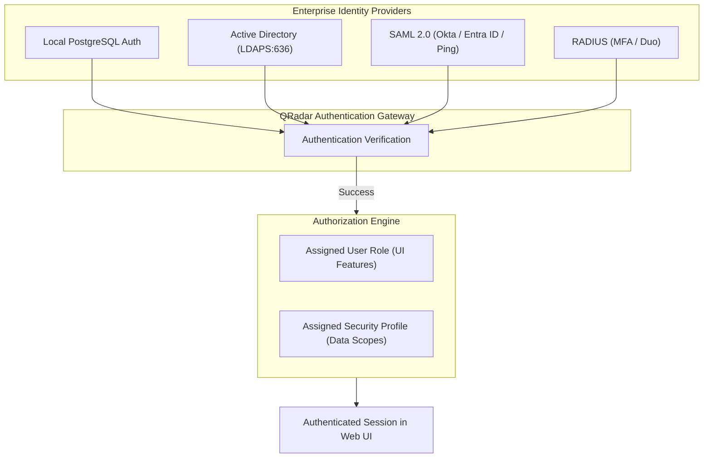

# 📖 Chapter 20: User Administration, RBAC & Security Profiles Masterclass

> **The IBM QRadar Administrator's Technical Guide** | Phase 2: Enterprise Installation & Deployment  
> **Target Audience:** 1.5-Year Administrators $\rightarrow$ Senior SIEM Engineers & Security Governance Leads  
> **Focus:** IAM Architecture, RBAC Matrices, User Roles vs Security Profiles, SAML 2.0 / LDAP, & Hands-on Lab 20

---

## 📸 1. Visual Overview: Enterprise RBAC, Security Profiles & Multi-Tenancy


*Figure 20.1: 3D Isometric View of the QRadar Identity & Access Management (IAM) Engine: Enterprise Directory Providers (Active Directory, SAML 2.0 / Okta) mapping into the Dual Authorization Matrix (User Roles defining UI Capabilities $\times$ Security Profiles bounding Data Scopes across Network CIDRs and Log Source Groups) (`![[15_network_hierarchy_domains_3d.jpg|1000]]`)*

---

## 2. The Dual-Axis Authorization Model: Roles $\times$ Profiles

In IBM QRadar, user permissions are decoupled into two distinct, orthogonal authorization dimensions:

```
┌────────────────────────────────────────────────────────────────────────┐
│ 👥 THE QRADAR DUAL-AXIS AUTHORIZATION EQUATION                         │
│                                                                        │
│                USER PERMISSIONS = USER ROLE  ×  SECURITY PROFILE       │
│                                                                        │
│ ┌──────────────────────────────────────┐ ┌───────────────────────────┐ │
│ │ 🛠️ USER ROLE (What can they DO?)     │ │ 🔍 SECURITY PROFILE       │ │
│ │                                      │ │    (What can they SEE?)   │ │
│ │ • Admin / Configuration Access       │ │ • Network Hierarchy CIDRs │ │
│ │ • Log Activity / Search Execution    │ │ • Log Source Groups       │ │
│ │ • Offense Management (Assign/Close)  │ │ • Multi-Tenant Domains    │ │
│ │ • Rules & Custom DSM Editing         │ │ • Raw Payload Visibility  │ │
│ └──────────────────────────────────────┘ └───────────────────────────┘ │
└────────────────────────────────────────────────────────────────────────┘
```

---

## 3. Enterprise Authentication Providers: LDAP, Active Directory & SAML 2.0

QRadar supports centralized enterprise authentication repositories:



### 📋 Authentication Configuration Best Practices
1. **LDAPS / Active Directory**:
   - Always enforce **LDAPS over Port 636** with trusted CA root certificates (Never use plaintext LDAP Port 389).
   - Configure dynamic group mapping: Map Active Directory Security Groups (e.g., `CN=SOC-Tier1-Analysts,OU=Groups,DC=corp`) directly to QRadar User Roles and Security Profiles.
2. **SAML 2.0 Single Sign-On (SSO)**:
   - Integrates with modern IdPs (Okta, Microsoft Entra ID / Azure AD, PingFederate).
   - Supports seamless Multi-Factor Authentication (MFA) and conditional access policies before allowing analysts into the SIEM.

---

## 4. Granular User Role Capability Breakdown

User Roles define administrative and analytical feature permissions:

| Permission Area | Capabilities Controlled | Recommended Assignment |
| :--- | :--- | :--- |
| **Admin** | Full system configuration, deployment, license management, backup restore. | SIEM Administrators & Architects Only |
| **Delegate Admin** | Manage log sources, users, and reference sets without system hardware access. | Senior SOC Leads / Incident Commanders |
| **Log Activity** | Execute AQL searches, save search templates, manage search results. | All SOC Analysts (Tier 1 - Tier 3) |
| **View Raw Payloads** | View raw unmasked packet/syslog strings (Contains PII/Sensitive data). | Restricted to Forensic Investigators |
| **Offenses** | Assign offenses, update magnitude, add analyst notes, close offenses. | SOC Tier 1, Tier 2 & Tier 3 Analysts |
| **Custom Rules** | Create, edit, tune, or disable CRE correlation rules and building blocks. | SIEM Engineers & Detection Engineers |
| **Vulnerabilities** | View vulnerability scan data and configure vulnerability scanner integrations. | Vulnerability Management Team |

---

## 5. Security Profiles & Data-Level Access Boundaries

A **Security Profile** establishes strict perimeter boundaries around the data an analyst can view during Log Activity searches and Offense investigations.

```
┌────────────────────────────────────────────────────────────────────────┐
│ 🛡️ SECURITY PROFILE FILTERING MECHANISMS                               │
│                                                                        │
│ 1. NETWORK HIERARCHY FILTERING:                                        │
│    • Restricts visibility to specific internal network segments.       │
│    • Example: An APAC analyst can only view events where Source or     │
│      Destination IP belongs to `APAC_Branch_Offices (10.40.0.0/16)`.   │
│ ├────────────────────────────────────────────────────────────────────┤
│ 2. LOG SOURCE GROUP FILTERING:                                         │
│    • Restricts visibility to designated log source categories.         │
│    • Example: An Identity team analyst can only search `Active Directory│
│      Domain Controllers` and `Okta Logs`, but cannot view Firewalls.   │
│ ├────────────────────────────────────────────────────────────────────┤
│ 3. DOMAIN RESTRICTIONS (MULTI-TENANT MSSP):                            │
│    • Completely isolates Tenant A data from Tenant B data.             │
└────────────────────────────────────────────────────────────────────────┘
```

---

## 6. Audit Logging & Compliance: Tracking Administrative Actions

All administrative operations, logon attempts, rule modifications, and user exports are recorded automatically in the **`SIM Audit-2`** internal log source.

```bash
# Query recent administrator privilege updates from the PostgreSQL audit tables
psql -U qradar -d qradar -c "
SELECT 
    timestamp, 
    username, 
    action, 
    target_user, 
    description 
FROM user_audit_log 
ORDER BY timestamp DESC 
LIMIT 10;
"
```

---

## 📌 7. Visual Mind Map & Sticky Notes (Chapter 20 Quick-Review)

### 🧠 Hierarchical Mind Map
```mermaid
mindmap
  root((RBAC & Security Profiles))
    Dual Authorization
      User Role: What you can DO (UI Features)
      Security Profile: What you can SEE (Data Scope)
    Authentication Providers
      Local DB: Emergency fallback admin
      LDAPS (Port 636): Active Directory Group Mapping
      SAML 2.0: SSO + MFA with Okta / Entra ID
    Security Profile Scopes
      Network Hierarchy: Restrict by CIDR
      Log Source Groups: Restrict by asset type
      Domains: MSSP Multi-Tenancy isolation
      Payload Masking: GDPR/PCI-DSS PII obfuscation
    Audit & Compliance
      SIM Audit-2: Internal audit log source
```

### 🗂️ Color-Coded Digital Sticky Notes

#### 🟨 Sticky Note 1: The Principle of Least Privilege
```text
┌─────────────────────────────────────────────────────────────┐
│ 📌 CONCEPT: LEAST PRIVILEGE RBAC                            │
│                                                             │
│ • Never give Tier 1 analysts full Admin roles!              │
│ • Restrict Tier 1 to: Log Activity + Offense View/Manage.   │
│ • Limit "View Raw Payloads" to compliance-approved analysts.│
└─────────────────────────────────────────────────────────────┘
```

#### 🟩 Sticky Note 2: Emergency Local Admin
```text
┌─────────────────────────────────────────────────────────────┐
│ 📌 GOLDEN RULE: LOCAL ADMIN SAFEGUARD                       │
│                                                             │
│ • Always maintain at least ONE local `admin` account with a │
│   strong password stored in a secure PAM vault.             │
│ • If Active Directory or SAML IdP goes down, local admin is │
│   the only way to log into the SIEM!                        │
└─────────────────────────────────────────────────────────────┘
```

#### 🟪 Sticky Note 3: Multi-Tenant MSSP Isolation
```text
┌─────────────────────────────────────────────────────────────┐
│ 📌 ARCHITECTURE: DOMAIN ISOLATION                           │
│                                                             │
│ • In multi-tenant environments, map Tenants to Domains.     │
│ • Security Profiles bound to Domain A can NEVER see events  │
│   or offenses generated by Domain B.                        │
└─────────────────────────────────────────────────────────────┘
```

#### 🟦 Sticky Note 4: Payload Obfuscation
```text
┌─────────────────────────────────────────────────────────────┐
│ 📌 COMPLIANCE: PII & PCI-DSS DATA PROTECTION                │
│                                                             │
│ • Use Security Profiles to disable "View Raw Payload".      │
│ • Analysts can see normalized fields (IP, Port, Username)   │
│   without seeing unencrypted credit card or password strings│
└─────────────────────────────────────────────────────────────┘
```

#### 🟧 Sticky Note 5: Interview Cheat Code (RBAC)
```text
┌─────────────────────────────────────────────────────────────┐
│ 📌 INTERVIEW CHEAT CODE: "EXPLAIN QRADAR'S ACCESS CONTROL"  │
│                                                             │
│ "QRadar separates authorization into User Roles, which      │
│ govern UI features and administrative capabilities, and     │
│ Security Profiles, which control data visibility based on   │
│ Network Hierarchy CIDRs, Log Source Groups, and Domains."   │
└─────────────────────────────────────────────────────────────┘
```

#### 🟥 Sticky Note 6: Critical Pitfall
```text
┌─────────────────────────────────────────────────────────────┐
│ ⚠️ CRITICAL PITFALL: UNRESTRICTED SEARCH OVERLOAD           │
│                                                             │
│ • Creating 50 analysts with unrestricted "All Networks" and │
│   "All Log Sources" profiles allows simultaneous queries    │
│   across full petabyte arrays, degrading cluster IOPS.      │
└─────────────────────────────────────────────────────────────┘
```

---

### ⚡ Rapid-Recall Flashcards

| # | Question (Front) | Answer (Back) |
| :-: | :--- | :--- |
| **01** | What is the difference between a User Role and a Security Profile in QRadar? | **User Role** defines *feature capabilities* (what you can do); **Security Profile** defines *data scope* (what you can see). |
| **02** | What port is used for secure Active Directory / LDAP authentication? | **LDAPS over TCP Port 636** (with SSL/TLS certificate). |
| **03** | How can an administrator restrict an analyst from seeing PCI-DSS server logs? | Place PCI servers into a **Log Source Group** and exclude that group from the analyst's **Security Profile**. |
| **04** | What internal log source records administrative and user activity in QRadar? | **`SIM Audit-2`**. |
| **05** | What Single Sign-On (SSO) protocol allows integration with Okta and Microsoft Entra ID? | **SAML 2.0**. |
| **06** | Why is maintaining a local fallback admin account critical? | To ensure **uninterrupted emergency access** if external LDAP/SAML IdP servers experience an outage. |

---

## 🧪 8. Hands-on Practice Lab 20: Provisioning Role-Based Access Controls & Security Profiles

### 🎯 Lab Objectives
1. Configure a custom SOC Analyst User Role with restricted administrative permissions.
2. Build a scoped Security Profile restricting Log Activity to specific Log Source Groups and Network CIDRs.
3. Test permission boundaries and raw payload masking.
4. Audit user logon events and permission updates via `SIM Audit-2`.

---

### 📋 Step-by-Step Practical Lab Procedures

#### Step 1: Query User Accounts and Security Roles in PostgreSQL
```bash
# Inspect all configured users and their assigned roles from the Console CLI
psql -U qradar -d qradar -c "
SELECT 
    u.id, 
    u.username, 
    u.email, 
    r.name AS user_role, 
    sp.name AS security_profile, 
    u.status 
FROM users u 
LEFT JOIN user_role r ON u.user_role_id = r.id 
LEFT JOIN security_profile sp ON u.security_profile_id = sp.id;
"
```

---

#### Step 2: Query Active Directory / LDAP Configuration
```bash
# Check LDAP authentication configuration parameters
psql -U qradar -d qradar -c "
SELECT 
    id, 
    name, 
    server, 
    port, 
    encryption_type, 
    base_dn 
FROM ldap_config;
"
```

---

#### Step 3: Audit Security Profile Network Restrictions
```bash
# Query the database to inspect network CIDR boundaries assigned to security profiles
psql -U qradar -d qradar -c "
SELECT 
    sp.name AS profile_name, 
    n.name AS network_name, 
    n.cidr 
FROM security_profile sp 
JOIN security_profile_network spn ON sp.id = spn.security_profile_id 
JOIN network n ON spn.network_id = n.id;
"
```

---

#### Step 4: Audit Administrative Actions in `SIM Audit-2`
Run an AQL search via the CLI to review recent administrative user changes:
```bash
/opt/qradar/bin/arielsql -p 32011 -q "
SELECT 
    DATEFORMAT(devicetime, 'yyyy-MM-dd HH:mm:ss') AS Timestamp, 
    username AS AdminUser, 
    qidname(qid) AS AuditAction, 
    sourceip AS SourceIP 
FROM events 
WHERE logsourceid = 2 
ORDER BY devicetime DESC 
LIMIT 10;
"
```
*Expected Output*: Displays the last 10 administrative actions recorded by `SIM Audit-2` (e.g., `User Created`, `Security Profile Updated`, `Rule Modified`).
