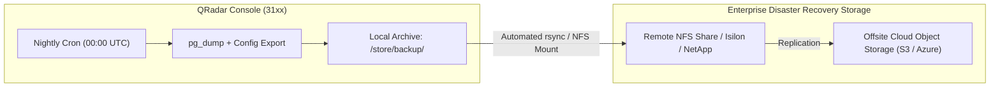
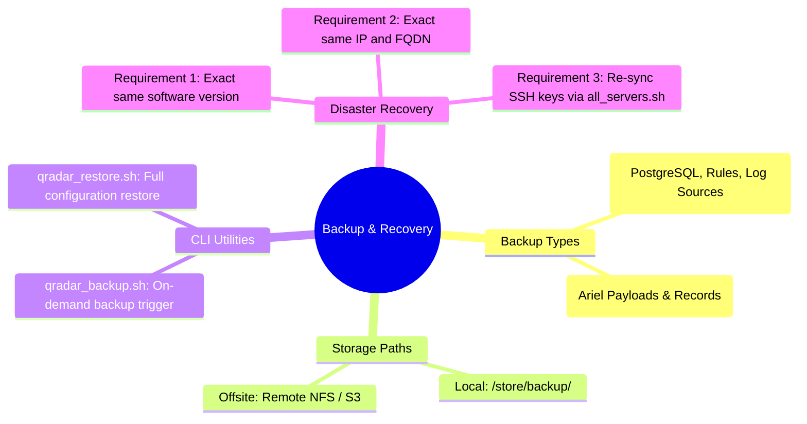

# 📖 Chapter 21: Enterprise Backup Architecture: Config vs Data Recovery Masterclass

> **The IBM QRadar Administrator's Technical Guide** | Phase 2: Enterprise Installation & Deployment  
> **Target Audience:** 1.5-Year Administrators $\rightarrow$ Senior SIEM Engineers & Disaster Recovery Architects  
> **Focus:** Configuration vs Data Backups, Offsite NFS Archiving, CLI Backup Utilities, Disaster Recovery Runbooks, & Hands-on Lab 21

---

## 📸 1. Visual Overview: Enterprise Backup Architecture & Recovery


*Figure 21.1: 3D Isometric View of the QRadar Enterprise Backup & Disaster Recovery Architecture: Automated Nightly Configuration Snapshots (PostgreSQL DB dumps, XML rules, building blocks, log source configurations) compressed into `/store/backup/`, offsite replication via NFS / S3 sync, and complete node reconstruction during disaster recovery (`![[03_ariel_storage_columnar_3d.jpg|1000]]`)*

---

## 2. Configuration Backup vs Data Backup: The Fundamental Decoupling

In enterprise SIEM engineering, backups are divided into two distinct tiers based on recovery time objective (RTO) and recovery point objective (RPO):

```
┌────────────────────────────────────────────────────────────────────────┐
│ 💾 QRADAR BACKUP TIERS COMPARISON                                      │
│                                                                        │
│ ┌──────────────────────────────────────┐ ┌───────────────────────────┐ │
│ │ ⚙️ CONFIGURATION BACKUP              │ │ 📦 DATA BACKUP            │ │
│ │ • Frequency: Nightly (Automated)     │ │ • Frequency: Weekly/SAN   │ │
│ │ • Size: 50 MB - 500 MB (.tgz)        │ │ • Size: 5 TB - 50+ TB     │ │
│ │ • Contains: PostgreSQL DBs (Rules,   │ │ • Contains: /store/ariel/ │ │
│ │   Log Sources, Users, Network Map,   │ │   Raw Payloads & Records  │ │
│ │   Authorized Services, Host Configs) │ │ • Storage: Offsite SAN /  │ │
│ │ • Storage: /store/backup/ + Offsite  │ │   NFS / Data Node Cluster │ │
│ └──────────────────────────────────────┘ └───────────────────────────┘ │
└────────────────────────────────────────────────────────────────────────┘
```

---

## 3. What is Inside a QRadar Configuration Backup?

When QRadar executes a configuration backup, the master engine packages the entire operational brain into a single timestamped archive:

```
┌────────────────────────────────────────────────────────────────────────┐
│ 🗄️ ANATOMY OF /store/backup/backup.config.<timestamp>.tgz              │
│                                                                        │
│ ├── postgres_db_qradar.dump    (Core Appliance Registry, Offense State)│
│ ├── postgres_db_dsm.dump       (Custom DSMs, QID Maps, Parsing Regex)  │
│ ├── postgres_db_conf.dump      (System Configuration & Host Tokens)    │
│ ├── rules_and_building_blocks/ (All CRE XML Rule Definitions)          │
│ ├── network_hierarchy.xml      (Internal/External IP Zone Maps)        │
│ ├── user_accounts_and_rbac/    (User Roles, Security Profiles, SAML)   │
│ ├── authorized_services/       (REST API Tokens & Permissions)         │
│ └── ssl_certificates_and_keys/ (Host SSL/TLS Certificates)             │
└────────────────────────────────────────────────────────────────────────┘
```

---

## 4. Automated Backup Scheduling & Offsite Archiving



### 📋 Enterprise Backup Policy Recommendations
1. **Daily Schedule**: Run Configuration Backups daily during low-activity windows (e.g., `00:00 UTC`).
2. **Local Retention**: Retain **7 to 14 days** of configuration backups locally in `/store/backup/` for rapid rollback.
3. **Offsite Synchronization**: Mount an external high-durability NFS share or execute a daily `rsync` cron script to transfer `.tgz` archives to an offsite disaster recovery facility.

---

## 5. The Disaster Recovery (DR) Node Reconstruction Runbook

If a primary Console appliance suffers catastrophic hardware failure (motherboard failure, RAID destruction, physical loss), follow this 5-step recovery procedure:

```
┌────────────────────────────────────────────────────────────────────────┐
│ 🚨 BARE-METAL DISASTER RECOVERY RUNBOOK                                │
│                                                                        │
│ 1. DEPLOY FRESH BASE APPLIANCE:                                        │
│    • Install fresh QRadar ISO of the EXACT SAME SFS PATCH VERSION!     │
│    • Assign the EXACT SAME IP address and FQDN.                        │
│ 2. COPY BACKUP ARCHIVE:                                                │
│    • Transfer the latest `backup.config.<timestamp>.tgz` from offsite  │
│      storage to `/store/backup/` on the new Console.                   │
│ 3. EXECUTE RESTORE UTILITY:                                            │
│    • Run: `/opt/qradar/bin/qradar_restore.sh -f /store/backup/<file>`  │
│ 4. RESYNCHRONIZE MANAGED HOSTS:                                        │
│    • Run: `/opt/qradar/support/all_servers.sh` to redistribute SSH     │
│      keys and host tokens to all remote EPs, ECs, and Data Nodes.      │
│ 5. EXECUTE FULL DEPLOYMENT:                                            │
│    • Log into Web UI ➔ Admin Tab ➔ Deploy Full Configuration.          │
└────────────────────────────────────────────────────────────────────────┘
```

> [!WARNING]
> **Version Matching Requirement**: A configuration backup can ONLY be restored onto a Console running the exact same software version and patch level (e.g., QRadar 7.5.0 UP8). Attempting to restore a 7.5.0 UP8 backup onto a 7.5.0 UP6 Console will corrupt the PostgreSQL database schema!

---

## 📌 6. Visual Mind Map & Sticky Notes (Chapter 21 Quick-Review)

### 🧠 Hierarchical Mind Map


### 🗂️ Color-Coded Digital Sticky Notes

#### 🟨 Sticky Note 1: Config vs Data Scope
```text
┌─────────────────────────────────────────────────────────────┐
│ 📌 CONCEPT: CONFIGURATION VS DATA                           │
│                                                             │
│ • Configuration Backups restore 100% of your rules, log     │
│   sources, DSMs, users, and dashboards.                     │
│ • They do NOT restore historical Ariel log events.          │
│ • Rebuilding SIEM detection logic takes only 30 minutes!    │
└─────────────────────────────────────────────────────────────┘
```

#### 🟩 Sticky Note 2: Version Parity Rule
```text
┌─────────────────────────────────────────────────────────────┐
│ 📌 GOLDEN RULE: EXACT PATCH LEVEL RESTORATION               │
│                                                             │
│ • Always record the exact SFS patch level in your DR notes. │
│ • Target recovery machine MUST be patched to the exact same │
│   build number before executing `qradar_restore.sh`!        │
└─────────────────────────────────────────────────────────────┘
```

#### 🟪 Sticky Note 3: Offsite Replication Mandate
```text
┌─────────────────────────────────────────────────────────────┐
│ 📌 ARCHITECTURE: 3-2-1 BACKUP RULE                          │
│                                                             │
│ • Keeping backups only in `/store/backup/` on the local     │
│   drive provides ZERO protection if the server disk dies!   │
│ • Always ship backups offsite via NFS or automated rsync.   │
└─────────────────────────────────────────────────────────────┘
```

#### 🟦 Sticky Note 4: Pre-Upgrade Snapshot
```text
┌─────────────────────────────────────────────────────────────┐
│ 📌 OPERATIONAL BEST PRACTICE: PRE-UPGRADE BACKUP            │
│                                                             │
│ • NEVER apply a QRadar SFS patch or upgrade without first   │
│   taking an on-demand Configuration Backup!                 │
│ • Run: `/opt/qradar/bin/qradar_backup.sh` before patching. │
└─────────────────────────────────────────────────────────────┘
```

#### 🟧 Sticky Note 5: Interview Cheat Code (Backup & DR)
```text
┌─────────────────────────────────────────────────────────────┐
│ 📌 INTERVIEW CHEAT CODE: "HOW DO YOU RECOVER A FAILED CONSOLE?"│
│                                                             │
│ "I install a fresh QRadar ISO on matching hardware, patch   │
│ to the exact same SFS version, assign the same IP/FQDN,     │
│ execute `/opt/qradar/bin/qradar_restore.sh` using the latest│
│ offsite config backup, and run `all_servers.sh` to resync." │
└─────────────────────────────────────────────────────────────┘
```

#### 🟥 Sticky Note 6: Critical Pitfall
```text
┌─────────────────────────────────────────────────────────────┐
│ ⚠️ CRITICAL PITFALL: DISK FULL BACKUP ABORTS                │
│                                                             │
│ • If `/store` or `/tmp` reaches 95%, backup creation fails  │
│   silently or creates a truncated 0-byte corrupt `.tgz`!    │
│ • Always verify backup file sizes after creation!           │
└─────────────────────────────────────────────────────────────┘
```

---

### ⚡ Rapid-Recall Flashcards

| # | Question (Front) | Answer (Back) |
| :-: | :--- | :--- |
| **01** | Where are QRadar configuration backups stored by default? | **`/store/backup/`** (in `.tar.gz` / `.tgz` format). |
| **02** | What data is excluded from a standard Configuration Backup? | Historical **Ariel event and flow records / payloads** (`/store/ariel/`). |
| **03** | What script triggers an on-demand configuration backup from the CLI? | **`/opt/qradar/bin/qradar_backup.sh`** (or via Admin Web UI). |
| **04** | What critical prerequisite must be met before restoring a backup to a new appliance? | The new appliance must run the **exact same software/patch version, IP address, and FQDN**. |
| **05** | How often should configuration backups be executed in an enterprise environment? | **Daily (Nightly at 00:00 UTC)**. |
| **06** | What script restores a configuration backup onto a QRadar Console? | **`/opt/qradar/bin/qradar_restore.sh`**. |

---

## 🧪 7. Hands-on Practice Lab 21: Configuration Backup Creation, Inspection & Restoration

### 🎯 Lab Objectives
1. Trigger an on-demand Configuration Backup from the Linux command line.
2. Inspect the internal structure, PostgreSQL database dumps, and XML files inside the backup archive.
3. Validate backup archive integrity and test offsite sync scripting.
4. Execute a simulated disaster recovery restoration procedure.

---

### 📋 Step-by-Step Practical Lab Procedures

#### Step 1: Trigger On-Demand Configuration Backup via CLI
Log into the Console via SSH as `root`:
```bash
# Execute on-demand configuration backup script
/opt/qradar/bin/qradar_backup.sh

# Check the generated backup archive in /store/backup/
ls -lh /store/backup/backup.config.*.tgz | tail -n 1
```
*Expected Output*: Confirms creation of a `.tgz` archive with non-zero size ($\approx 50\text{ MB to }500\text{ MB}$).

---

#### Step 2: Inspect Contents of the Backup Archive
```bash
LATEST_BACKUP=$(ls -t /store/backup/backup.config.*.tgz | head -n 1)
echo "[*] Inspecting Backup: $LATEST_BACKUP"

# View archive table of contents
tar -tzvf $LATEST_BACKUP | grep -E "dump|xml|conf" | head -n 20
```
*Expected Output*: Lists core database dumps (`postgres_db_qradar.dump`, `postgres_db_dsm.dump`) and XML configuration maps.

---

#### Step 3: Test Automated Offsite Rsync Backup Script
```bash
# Create an offsite backup synchronization script
cat << 'EOF' > /root/sync_offsite_backups.sh
#!/bin/bash
BACKUP_DIR="/store/backup"
DEST_HOST="dr-backup.corp.local"
DEST_PATH="/storage/qradar_backups/"

echo "[*] Starting QRadar Offsite Backup Synchronization..."
rsync -avz --include="backup.config.*.tgz" --exclude="*" $BACKUP_DIR/ root@$DEST_HOST:$DEST_PATH

if [ $? -eq 0 ]; then
    echo "[+] Offsite sync completed successfully."
else
    echo "[-] Offsite sync failed! Check network/SSH."
fi
EOF

chmod +x /root/sync_offsite_backups.sh
```

---

#### Step 4: Verify Restoration Utility Syntax
```bash
# Display qradar_restore.sh command line options
/opt/qradar/bin/qradar_restore.sh -h
```
*Expected Output*: Displays restore syntax options (e.g., `/opt/qradar/bin/qradar_restore.sh -f /store/backup/<archive_name>.tgz`).
