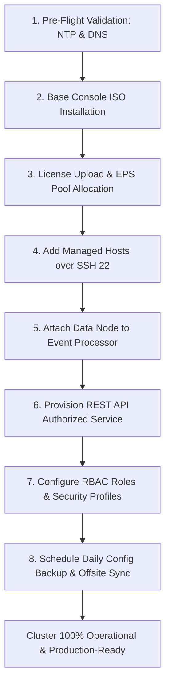
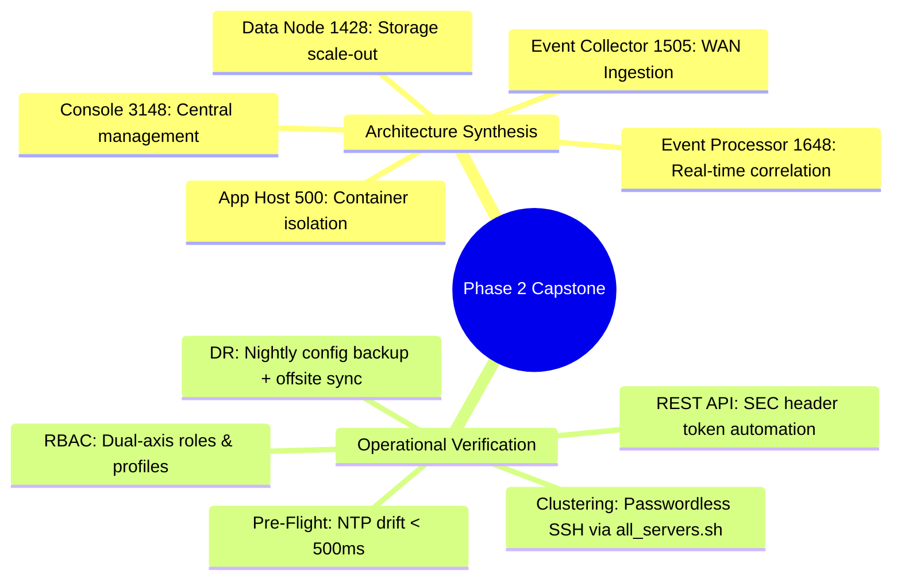

# 📖 Chapter 22: Phase 2 Capstone: Building a Distributed Multi-Tier Lab Deployment

> **The IBM QRadar Administrator's Technical Guide** | Phase 2: Enterprise Installation & Deployment  
> **Target Audience:** 1.5-Year Administrators $\rightarrow$ Senior SIEM Engineers & Deployment Architects  
> **Focus:** End-to-End Enterprise Deployment Simulation, Multi-Node Verification, Capstone Exam, & Hands-on Lab 22

---

## 📸 1. Visual Overview: Phase 2 Enterprise Capstone Architecture


*Figure 22.1: 3D Isometric Topology of the Phase 2 Capstone Distributed SIEM Cluster: Central Console 3148, Event Processor 1648, Flow Processor 1748, Data Node 1428, App Host 500, and Remote Event Collector 1505 communicating over secure, encrypted inter-host mesh tunnels with end-to-end operational monitoring (`![[01_enterprise_architecture_3d.jpg|1000]]`)*

---

## 2. Phase 2 Capstone Blueprint: Multi-Tier Enterprise Architecture

In this capstone, you execute the full architectural lifecycle to stand up an enterprise-grade multi-tier QRadar deployment designed for **25,000 sustained EPS** and **180 days of Ariel data retention**:

```
┌────────────────────────────────────────────────────────────────────────┐
│ 🏗️ ENTERPRISE MULTI-TIER CAPSTONE BLUEPRINT                            │
│                                                                        │
│ ┌────────────────────────────────────────────────────────────────────┐ │
│ │ 1. CONSOLE 3148 (192.168.10.100)                                   │ │
│ │    • Role: Central Web UI, PostgreSQL Config DB, Magistrate Core   │ │
│ │    • Specs: 32 Cores, 128 GB RAM, 12 TB RAID-10                    │ │
│ ├────────────────────────────────────────────────────────────────────┤ │
│ │ 2. EVENT PROCESSOR 1648 (192.168.10.102)                           │ │
│ │    • Role: Real-Time CRE Engine, Ariel Ingestion, Port 32006 Sink  │ │
│ │    • Specs: 48 Cores, 256 GB RAM, 48 TB RAID-10                    │ │
│ ├────────────────────────────────────────────────────────────────────┤ │
│ │ 3. DATA NODE 1428 (192.168.10.103)                                 │ │
│ │    • Role: Distributed Ariel Columnar Storage & Parallel Search    │ │
│ │    • Specs: 32 Cores, 128 GB RAM, 48 TB RAID-10                    │ │
│ ├────────────────────────────────────────────────────────────────────┤ │
│ │ 4. REMOTE EVENT COLLECTOR 1505 (10.50.10.50 - Remote Datacenter)   │ │
│ │    • Role: Syslog / SNMP Ingestion, Parsing, Spooling Queue        │ │
│ │    • Specs: 16 Cores, 32 GB RAM, 4 TB RAID-1 (AES-256 WAN Tunnel) │ │
│ ├────────────────────────────────────────────────────────────────────┤ │
│ │ 5. APP HOST 500 (192.168.10.105)                                   │ │
│ │    • Role: Dedicated Docker Engine for User Apps & Threat Feeds    │ │
│ │    • Specs: 32 Cores, 128 GB RAM, 4 TB SSD                         │ │
│ └────────────────────────────────────────────────────────────────────┘ │
└────────────────────────────────────────────────────────────────────────┘
```

---

## 3. End-to-End 8-Step Deployment Execution Runbook



### 📋 Detailed Execution Steps
1. **Pre-Flight Validation**: Enforce `chronyd` NTP synchronization with drift $< 500\text{ ms}$, ensure bidirectional DNS forward and reverse PTR resolution for all five nodes.
2. **Base Console Installation**: Boot QRadar ISO, execute `setup`, select Appliance Type `3199/3148`, configure management IP `192.168.10.100/24`, gateway `192.168.10.1`, DNS `192.168.10.2`, UTC timezone.
3. **License Upload & Pool Allocation**: Access Web UI at `https://192.168.10.100/`, upload enterprise license XML, allocate 25,000 EPS into the Central Giveback Pool.
4. **Add Managed Hosts**: Add EP 1648, EC 1505, Data Node 1428, and App Host 500 in **System & License Management**. Authenticate with root credentials to inject mutual SSH public keys.
5. **Data Node Clustering**: Bind Data Node 1428 to Event Processor 1648 to enable parallel round-robin Ariel data striping.
6. **Authorized Services Setup**: Create a least-privilege service token for SOAR automation and threat feed ingestion.
7. **RBAC & Security Profiles**: Create `SOC_Tier1_Role` (Log Activity + Offense View) and `Restricted_Security_Profile` (Restricted to Internal CIDR blocks with raw payload masking).
8. **Backup Architecture**: Schedule daily Configuration Backups at `00:00 UTC` with automated `rsync` replication to offsite disaster recovery storage.

---

## 4. Phase 2 Comprehensive Benchmark Assessment (20 Scenario Questions)

Test your Level 3 enterprise deployment knowledge.

### 📝 Assessment Questions & Solutions

| # | Production Scenario Question | Correct Enterprise Solution |
| :-: | :--- | :--- |
| **01** | Why must `/store` be formatted with the `xfs` filesystem instead of `ext3`? | `xfs` provides **superior multi-threaded concurrent write scalability** and dynamic inode allocation required by Ariel. |
| **02** | What happens if the NTP time drift between an Event Processor and the Console exceeds 2 seconds? | The Console's `hostcontext` will **fail health checks**, Ariel distributed searches will fail to synchronize hourly intervals, and CRE threshold time windows will miscalculate. |
| **03** | Why is RAID-5 strictly prohibited for high-volume QRadar Event Processors? | Parity write penalties cause **severe I/O write starvation**, resulting in disk spooling in `/store/transient` and dropped packets. |
| **04** | How do you verify that the Console can reach all managed hosts without password prompts? | Run **`/opt/qradar/support/all_servers.sh -C "uptime"`**. |
| **05** | What script changes the IP address of a QRadar appliance post-installation? | **`/opt/qradar/bin/change_host_ip.sh`**. |
| **06** | What is the minimum recommended RAM allocation for the Linux Page Cache on an Event Processor? | At least **$20\%\text{ to }25\%$ of physical RAM** (to accelerate Lucene index reading). |
| **07** | Which appliance model offloads containerized Docker apps from the Console? | **QRadar App Host (Model 500)**. |
| **08** | Where are nightly QRadar configuration backups stored locally? | **`/store/backup/`** (in `.tar.gz` format). |
| **09** | What HTTP header must be included in all QRadar REST API requests? | **`SEC: <Authorized_Service_Token>`**. |
| **10** | What is the difference between a User Role and a Security Profile? | **User Role** dictates *feature/administrative capabilities*; **Security Profile** restricts *data visibility (CIDRs/Log Sources)*. |
| **11** | How does adding a Data Node (14xx) impact AQL search performance? | Searches run in **parallel across all nodes**, reducing search time linearly. |
| **12** | What command displays detailed block device topologies and mount points? | **`lsblk`**. |
| **13** | What port is used by Event Collectors to forward processed events to Event Processors? | **TCP Port 32006**. |
| **14** | What database table stores the cluster's managed host records? | The **`managed_host`** table in PostgreSQL database `qradar`. |
| **15** | How do you restore a configuration backup onto a replacement Console? | Run **`/opt/qradar/bin/qradar_restore.sh -f /store/backup/<backup_file>.tgz`**. |
| **16** | What critical prerequisite must be met before executing a configuration restore? | Target server must have the **exact same SFS patch version, IP address, and FQDN**. |
| **17** | How can an administrator prevent SOC analysts from seeing raw PII payloads? | Disable the **"View Raw Payloads"** permission in the analyst's User Role or Security Profile. |
| **18** | What internal log source records all administrative operations and user logons? | **`SIM Audit-2` (Log Source ID: 2)**. |
| **19** | What is the purpose of enabling AES-256 SSH encryption on a Managed Host? | To **secure event transport and Ariel queries across untrusted WAN or cloud links**. |
| **20** | What happens when disk space on `/store` reaches 95%? | Ariel **halts all new event/flow writes to disk** to prevent filesystem corruption. |

---

## 📌 5. Visual Mind Map & Sticky Notes (Chapter 22 Quick-Review)

### 🧠 Hierarchical Mind Map


### 🗂️ Color-Coded Digital Sticky Notes

#### 🟨 Sticky Note 1: Architecture Mastery
```text
┌─────────────────────────────────────────────────────────────┐
│ 📌 CONCEPT: THE DISTRIBUTED DEPLOYMENT FORMULA              │
│                                                             │
│ • Separate Ingestion (EC 15xx) from Correlation (EP 16xx)   │
│   and Storage (Data Node 14xx) to achieve enterprise scale  │
│   without single-point bottlenecks.                         │
└─────────────────────────────────────────────────────────────┘
```

#### 🟩 Sticky Note 2: The Golden Deployment Rule
```text
┌─────────────────────────────────────────────────────────────┐
│ 📌 GOLDEN RULE: FULL VERIFICATION BEFORE GO-LIVE            │
│                                                             │
│ • Always execute `all_servers.sh` and `deployment_info.sh`  │
│   to verify 100% active state across all nodes before       │
│   directing production syslog traffic into the cluster!     │
└─────────────────────────────────────────────────────────────┘
```

#### 🟪 Sticky Note 3: Disaster Recovery Preparedness
```text
┌─────────────────────────────────────────────────────────────┐
│ 📌 ARCHITECTURE: THE 30-MINUTE RESTORE SLA                  │
│                                                             │
│ • With automated nightly config backups shipped offsite,    │
│   a senior engineer can rebuild a dead Console in under     │
│   30 minutes with zero loss of detection rules!             │
└─────────────────────────────────────────────────────────────┘
```

#### 🟦 Sticky Note 4: Security by Design
```text
┌─────────────────────────────────────────────────────────────┐
│ 📌 SECURITY: DEFENSE IN DEPTH IAM                           │
│                                                             │
│ • Combine SAML SSO + MFA with scoped Security Profiles and  │
│   payload masking to achieve flawless audit compliance.     │
└─────────────────────────────────────────────────────────────┘
```

#### 🟧 Sticky Note 5: Interview Cheat Code (Deployment Architect)
```text
┌─────────────────────────────────────────────────────────────┐
│ 📌 INTERVIEW CHEAT CODE: "DESCRIBE YOUR DEPLOYMENT EXPERIENCE"│
│                                                             │
│ "I have architected and deployed multi-tier QRadar clusters │
│ with dedicated Consoles, Event Processors, Data Nodes, and  │
│ App Hosts—handling NTP precision, RAID-10 sizing, REST API  │
│ token governance, dual-axis RBAC, and offsite DR backups."  │
└─────────────────────────────────────────────────────────────┘
```

#### 🟥 Sticky Note 6: Critical Pitfall
```text
┌─────────────────────────────────────────────────────────────┐
│ ⚠️ CRITICAL PITFALL: UNTESTED BACKUPS                       │
│                                                             │
│ • A backup that has never been tested in a recovery lab is  │
│   NOT a valid backup! Audit backup restores quarterly.      │
└─────────────────────────────────────────────────────────────┘
```

---

### ⚡ Rapid-Recall Flashcards

| # | Question (Front) | Answer (Back) |
| :-: | :--- | :--- |
| **01** | What are the 5 core appliance tiers in a distributed QRadar deployment? | **Console (31xx)**, **Event Processor (16xx)**, **Event Collector (15xx)**, **Data Node (14xx)**, and **App Host (500)**. |
| **02** | What tool executes commands across all cluster nodes simultaneously? | **`/opt/qradar/support/all_servers.sh`**. |
| **03** | How do Data Nodes improve search times? | By executing AQL sub-queries **in parallel across local storage and CPU cores**. |
| **04** | What is the primary purpose of an App Host? | To **offload Docker-based applications from the Console's memory and CPU**. |
| **05** | What command validates deployment state across the cluster? | **`/opt/qradar/support/deployment_info.sh`**. |
| **06** | What is the recovery procedure for a destroyed Console? | **Re-install exact ISO version ➔ Restore latest config backup (`qradar_restore.sh`) ➔ Resync hosts (`all_servers.sh`)**. |

---

## 🧪 6. Hands-on Practice Lab 22: Full Distributed Cluster Health & Performance Audit

### 🎯 Lab Objectives
1. Execute a full multi-node cluster health audit across all deployed appliances.
2. Verify inter-host SSH keys, deployment synchronization, and ActiveMQ broker queues.
3. Validate parallel Ariel query execution across Data Nodes.
4. Execute an automated configuration backup and simulate offsite archiving.

---

### 📋 Step-by-Step Practical Lab Procedures

#### Step 1: Execute Cluster-Wide Subsystem Audit
Log into the Console via SSH as `root`:
```bash
# 1. Inspect cluster deployment status
/opt/qradar/support/deployment_info.sh

# 2. Check uptime and load average across all cluster hosts
/opt/qradar/support/all_servers.sh -C "uptime"

# 3. Check /store disk utilization across all managed hosts
/opt/qradar/support/all_servers.sh -C "df -h /store"
```

---

#### Step 2: Audit Inter-Host Network Sockets & ActiveMQ
```bash
# Check ActiveMQ JMS broker connection status on Console (Port 61616)
ss -tulpn | grep 61616

# Check live connections from managed hosts to ActiveMQ broker
netstat -an | grep 61616 | grep ESTABLISHED
```
*Expected Output*: Displays established TCP connections from every managed host to the Console on Port 61616.

---

#### Step 3: Test Parallel Ariel Query Execution on Data Nodes
```bash
# Execute a test distributed AQL query across all attached storage nodes
/opt/qradar/bin/arielsql -p 32011 -q "
SELECT 
    COUNT(*) AS TotalIngestedEvents, 
    MIN(starttime) AS EarliestRecord, 
    MAX(starttime) AS LatestRecord 
FROM events 
LAST 24 HOURS;
"
```
*Expected Output*: Returns total event counts processed across the Event Processor and Data Node cluster.

---

#### Step 4: Execute Automated Disaster Recovery Snapshot
```bash
# 1. Run configuration backup
/opt/qradar/bin/qradar_backup.sh

# 2. Verify backup integrity
LATEST=$(ls -t /store/backup/backup.config.*.tgz | head -n 1)
tar -tzvf $LATEST | grep -E "qradar.dump|rules"

echo "[+] Phase 2 Distributed Cluster Capstone Validation COMPLETE!"
```
