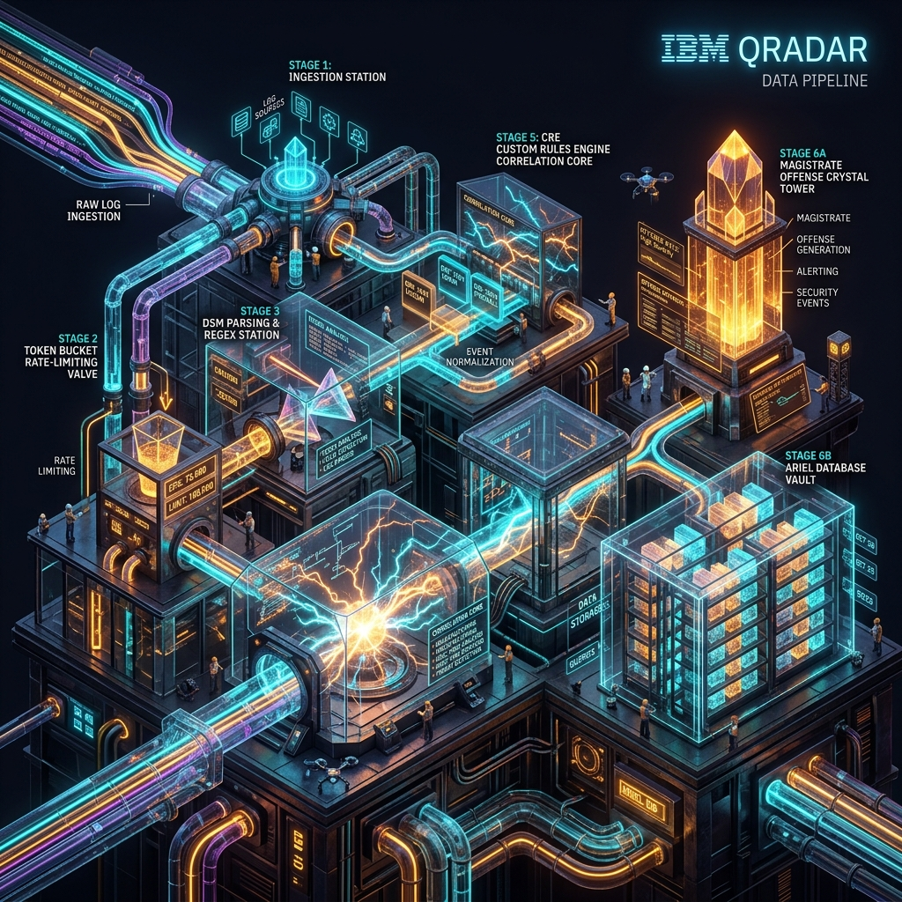
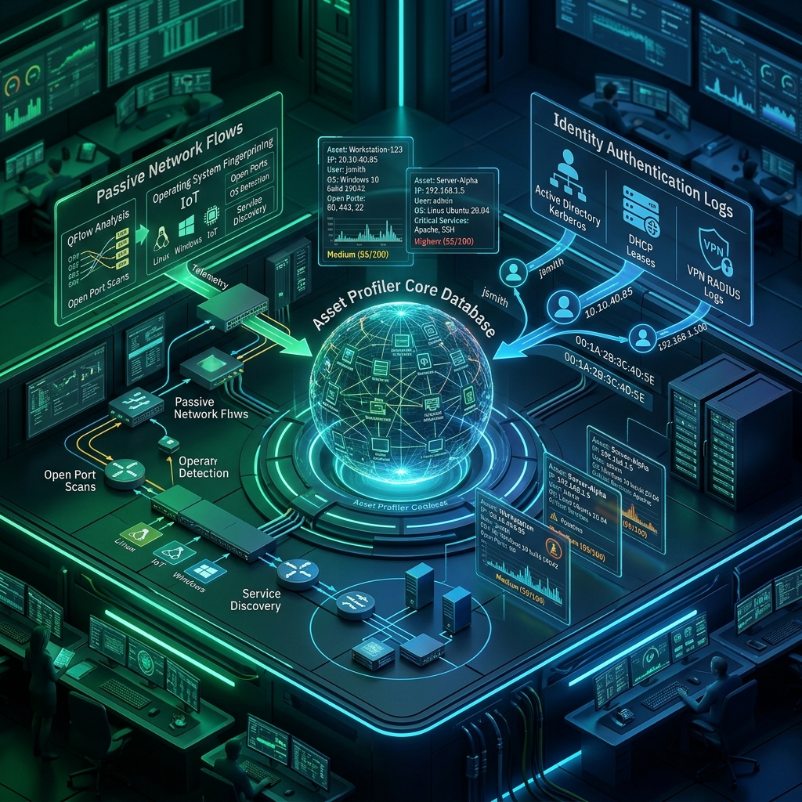

# 📥 Phase 3: Deep Log Source Onboarding & Integration

> **The IBM QRadar Administrator's Technical Masterclass**  
> **Timeline:** Days 23–35 | **Focus:** Multi-Protocol Ingestion (Syslog, WinCollect 10, Universal Cloud REST API, Linux Auditd, JDBC, NGFWs)  
> **Target Audience:** 1.5-Year Administrators $\rightarrow$ Senior SIEM Engineers & Integration Specialists

---

## 📸 Phase 3 Visual Gallery: Enterprise Ingestion Architecture

| Syslog Transport (UDP vs TCP vs TLS) | Core Daemons & Ingestion Pipeline |
| :---: | :---: |
|  |  |
| *Figure 3.1: Syslog Sockets & Transports (`![[stage1_log_transport_3d.jpg|500]]`)* | *Figure 3.2: Ingestion & Normalization (`![[02_data_pipeline_8stages_3d.jpg|500]]`)* |

| Active Directory & Identity Model | Troubleshooting & Packet Forensics |
| :---: | :---: |
|  |  |
| *Figure 3.3: Kerberos & Identity Profiling (`![[16_asset_profiler_identity_model_3d.jpg|500]]`)* | *Figure 3.4: 5-Phase Diagnostic Hierarchy (`![[19_system_health_monitoring_runbooks_3d.jpg|500]]`)* |

---

## 📚 Phase 3 Table of Contents & Hands-on Lab Matrix

| Chapter | Focus Area & Key Architectural Concepts | Embedded Practice Lab | Status |
| :--- | :--- | :---: | :---: |
| [Chapter 23: Log Source Core Anatomy & Ingestion Protocols](file:///home/venom/Documents/Study/Study/Qradar/03%20-%20Phase%203%20-%20Deep%20Log%20Source%20Onboarding%20and%20Integration/Chapter_23_Log_Source_Core_Anatomy_and_Ingestion_Protocols.md) | Log Source Identifier, Protocol Types, Matching Engine in `ecs-ec-ingress`, Coalescing rules (Enabled on Firewalls vs Disabled on DCs). | 🧪 **Lab 23** | ✅ Complete |
| [Chapter 24: Enterprise Syslog Ingestion: UDP vs TCP vs TLS](file:///home/venom/Documents/Study/Study/Qradar/03%20-%20Phase%203%20-%20Deep%20Log%20Source%20Onboarding%20and%20Integration/Chapter_24_Enterprise_Syslog_Ingestion_UDP_vs_TCP_vs_TLS.md) | RFC 3164 vs RFC 5424, Port 514 vs TLS Port 6514, Linux kernel socket buffer tuning (`rmem_max = 64MB`), Rsyslog & Syslog-ng configs. | 🧪 **Lab 24** | ✅ Complete |
| [Chapter 25: WinCollect Architecture & Standalone vs Managed Modes](file:///home/venom/Documents/Study/Study/Qradar/03%20-%20Phase%203%20-%20Deep%20Log%20Source%20Onboarding%20and%20Integration/Chapter_25_WinCollect_Architecture_and_Standalone_vs_Managed_Modes.md) | WinCollect 7 vs 10, Managed Mode (TCP 8413 Heartbeat) vs Standalone Mode (DMZs), Polling intervals, EPS rate limiting, local disk spooling. | 🧪 **Lab 25** | ✅ Complete |
| [Chapter 26: Advanced WinCollect: XPath Queries & Event Channels](file:///home/venom/Documents/Study/Study/Qradar/03%20-%20Phase%203%20-%20Deep%20Log%20Source%20Onboarding%20and%20Integration/Chapter_26_Advanced_WinCollect_XPath_Queries_and_Event_Channels.md) | Windows Crimson Channels (Sysmon, PowerShell 4104, TaskScheduler), XPath XML inclusive vs suppressive filtering, dropping EID 5156 in RAM. | 🧪 **Lab 26** | ✅ Complete |
| [Chapter 27: JDBC Protocol Ingestion & Database Polling](file:///home/venom/Documents/Study/Study/Qradar/03%20-%20Phase%203%20-%20Deep%20Log%20Source%20Onboarding%20and%20Integration/Chapter_27_JDBC_Protocol_Ingestion_and_Database_Polling.md) | Pull-based DB polling (Oracle 1521, MSSQL 1433, Postgres 5432), Driver jars in `/opt/qradar/jars/`, Numeric vs Timestamp watermarking, B-Tree index mandate. | 🧪 **Lab 27** | ✅ Complete |
| [Chapter 28: Universal Cloud REST API Protocol & Workflows](file:///home/venom/Documents/Study/Study/Qradar/03%20-%20Phase%203%20-%20Deep%20Log%20Source%20Onboarding%20and%20Integration/Chapter_28_Universal_Cloud_REST_API_Protocol_and_Workflows.md) | Workflow XML (`workflow.xml`), OAuth2 client credential tokens, API pagination models (Cursor, NextLink, Page), `<SetStatus>` bookmarks, Okta & AWS. | 🧪 **Lab 28** | ✅ Complete |
| [Chapter 29: Next-Gen Firewall Integration: Palo Alto, Fortinet & Check Point](file:///home/venom/Documents/Study/Study/Qradar/03%20-%20Phase%203%20-%20Deep%20Log%20Source%20Onboarding%20and%20Integration/Chapter_29_Next_Gen_Firewall_Integration_Palo_Alto_Fortinet_Check_Point.md) | Palo Alto CEF / LEEF, Fortinet Key-Value, Check Point `cp_log_export`, Traffic vs Threat logs, GlobalProtect VPN, Asymmetrical retention. | 🧪 **Lab 29** | ✅ Complete |
| [Chapter 30: Linux & Unix Server Ingestion: Auditd & Syslog](file:///home/venom/Documents/Study/Study/Qradar/03%20-%20Phase%203%20-%20Deep%20Log%20Source%20Onboarding%20and%20Integration/Chapter_30_Linux_and_Unix_Server_Ingestion_Auditd_and_Syslog.md) | Linux Kernel `auditd` framework, `audisp-syslog` dispatcher, Privilege escalation & SUDO monitoring, FIM rules, `auid` vs `euid` forensic attribution. | 🧪 **Lab 30** | ✅ Complete |
| [Chapter 31: Active Directory & Domain Controller Security Ingestion](file:///home/venom/Documents/Study/Study/Qradar/03%20-%20Phase%203%20-%20Deep%20Log%20Source%20Onboarding%20and%20Integration/Chapter_31_Active_Directory_and_Domain_Controller_Security_Ingestion.md) | Kerberos TGT (4768) & TGS (4769), Pre-auth failures (4771 + hex code 0x18), Kerberoasting RC4 (`0x17`), Domain Admin escalation (4728), Coalescing ban. | 🧪 **Lab 31** | ✅ Complete |
| [Chapter 32: Enterprise Network Infrastructure: Cisco IOS, Switches & VPNs](file:///home/venom/Documents/Study/Study/Qradar/03%20-%20Phase%203%20-%20Deep%20Log%20Source%20Onboarding%20and%20Integration/Chapter_32_Enterprise_Network_Infrastructure_Cisco_IOS_Switches_VPN.md) | Cisco `%FACILITY-SEVERITY-MNEMONIC` headers, Severity traps 0-5 (Ban on Severity 7 Debug), Cisco ASA VPN sessions, DHCP lease Asset Profiler binding. | 🧪 **Lab 32** | ✅ Complete |
| [Chapter 33: Log Source Autodetection Engine & Traffic Analysis](file:///home/venom/Documents/Study/Study/Qradar/03%20-%20Phase%203%20-%20Deep%20Log%20Source%20Onboarding%20and%20Integration/Chapter_33_Log_Source_Autodetection_Engine_and_Traffic_Analysis.md) | Traffic Analysis inside `ecs-ec-ingress`, 25-50 event threshold scoring, DSM collisions, manual override without data loss. | 🧪 **Lab 33** | ✅ Complete |
| [Chapter 34: Log Source Troubleshooting & Packet Forensics](file:///home/venom/Documents/Study/Study/Qradar/03%20-%20Phase%203%20-%20Deep%20Log%20Source%20Onboarding%20and%20Integration/Chapter_34_Log_Source_Troubleshooting_and_Packet_Forensics.md) | 5-Phase Triage Hierarchy (Wire $\rightarrow$ Socket $\rightarrow$ Service $\rightarrow$ Match $\rightarrow$ DSM), `tcpdump` wire capture, Identifier case-sensitivity, error logs. | 🧪 **Lab 34** | ✅ Complete |
| [Chapter 35: Phase 3 Capstone: Enterprise Multi-Protocol Onboarding](file:///home/venom/Documents/Study/Study/Qradar/03%20-%20Phase%203%20-%20Deep%20Log%20Source%20Onboarding%20and%20Integration/Chapter_35_Phase_3_Capstone_Enterprise_Multi_Protocol_Onboarding.md) | Multi-tier heterogeneous onboarding synthesis, 20-Question Benchmark Exam, Cluster-wide parsing efficiency audit ($>98\%$). | 🧪 **Lab 35** | ✅ Complete |

---

## 🎯 Phase 3 Core Competencies Mastered

By completing Phase 3, you possess the advanced operational skills of a **Senior QRadar SIEM Integration Engineer**:
1. **Multi-Protocol Fluency**: Onboarding Syslog (UDP/TCP/TLS), WinCollect 10, Universal Cloud REST API, JDBC, and Auditd.
2. **Endpoint Noise Reduction**: Authoring custom XPath XML queries in WinCollect to cut unnecessary EPS license consumption by up to 70%.
3. **Identity & Authentication Telemetry**: Detecting Kerberoasting (4769 RC4) and brute-force password attacks (4771 code 0x18) while maintaining zero coalescing.
4. **Cloud SaaS Telemetry**: Authoring declarative Workflow XML files with OAuth2 token refreshes and cursor-based bookmark persistence.
5. **Packet-Level Forensics**: Triaging broken log sources directly on the wire with `tcpdump` and verifying kernel socket buffer health (`rmem_max`).
