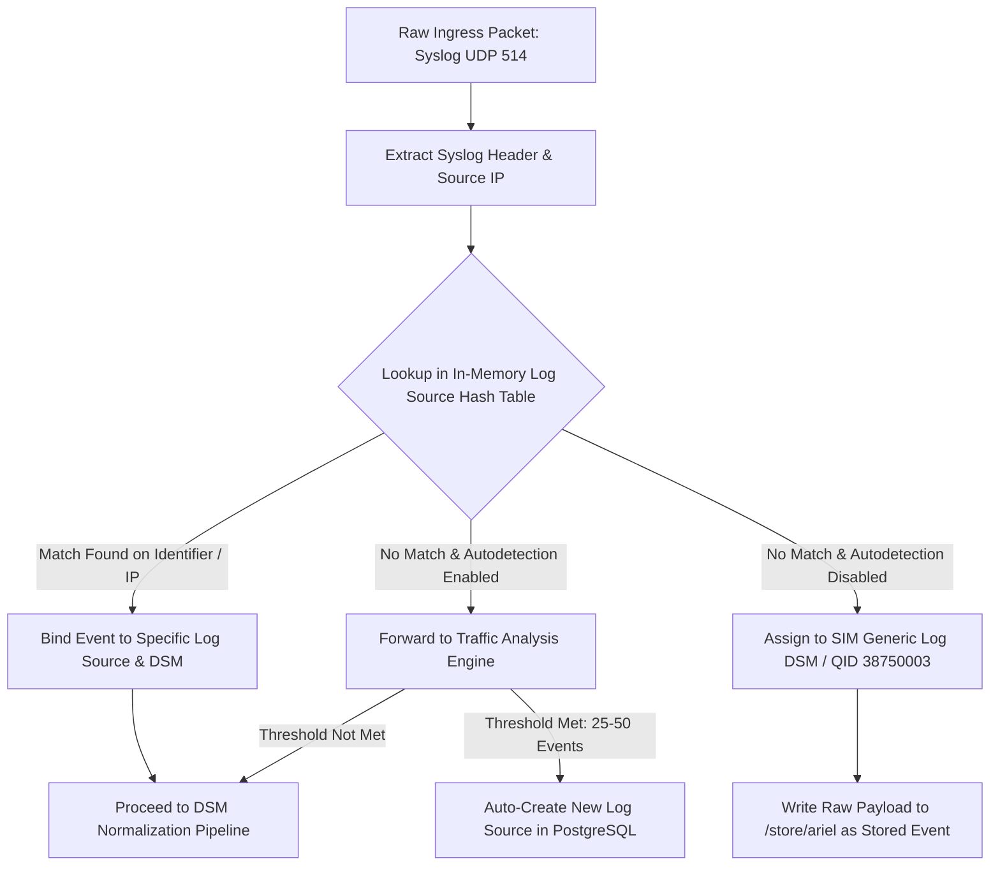
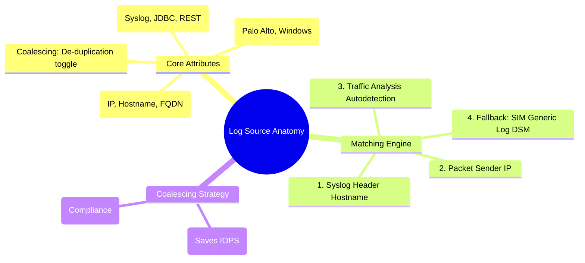

# 📖 Chapter 23: Log Source Core Anatomy & Ingestion Protocols Masterclass

> **The IBM QRadar Administrator's Technical Guide** | Phase 3: Deep Log Source Onboarding & Integration  
> **Target Audience:** 1.5-Year Administrators $\rightarrow$ Senior SIEM Engineers & Integration Specialists  
> **Focus:** Log Source Anatomy, Identifier Mechanics, Ingestion Protocols, Coalescing vs Raw Ingestion, & Hands-on Lab 23

---

## 📸 1. Visual Overview: Enterprise Log Source Ingestion Architecture


*Figure 23.1: 3D Isometric View of the QRadar Log Source Ingestion Subsystem: Heterogeneous Enterprise Data Producers (Firewalls, Domain Controllers, Cloud VPCs, Databases) streaming telemetry into the Event Collection Service (`ecs-ec-ingress`), traversing Protocol Drivers, Identifier Matchers, and the DSM Normalization Pipeline (`![[02_data_pipeline_8stages_3d.jpg|1000]]`)*

---

## 2. Anatomy of a QRadar Log Source

In IBM QRadar, a **Log Source** is a logical entity that defines how raw telemetry from an external device or service is collected, parsed, categorized, and attributed to an asset.

```
┌────────────────────────────────────────────────────────────────────────┐
│ 🧩 THE 5 CORE ATTRIBUTES OF A QRADAR LOG SOURCE                        │
│                                                                        │
│ 1. LOG SOURCE IDENTIFIER (The Primary Key / Matching Signature)        │
│    • The unique string in the event payload used by `ecs-ec-ingress`   │
│      to route the raw event to this specific Log Source configuration. │
│    • Examples: IP Address (`192.168.10.25`), FQDN (`dc01.corp.local`), │
│      Hostname (`fw-core-01`), or Cloud ARN (`arn:aws:...`).            │
│ ├────────────────────────────────────────────────────────────────────┤
│ 2. PROTOCOL TYPE (Collection Mechanism)                                │
│    • Defines HOW QRadar receives or fetches the data.                  │
│    • Examples: Syslog (Push), WinCollect (Push/Pull), JDBC (Pull),     │
│      Universal Cloud REST API (Pull), OPSEC LEA (Pull), TLS Syslog.    │
│ ├────────────────────────────────────────────────────────────────────┤
│ 3. LOG SOURCE TYPE / DSM (Device Support Module)                       │
│    • Defines HOW QRadar parses the raw payload into normalized fields. │
│    • Examples: `Palo Alto PA Series`, `Microsoft Windows Security`,    │
│      `Cisco IOS`, `Fortinet FortiGate`, `Universal DSM`.               │
│ ├────────────────────────────────────────────────────────────────────┤
│ 4. COALESCING CONFIGURATION (Event De-duplication Engine)              │
│    • Condenses high-frequency repetitive events into a single record   │
│      with an incremented `Event Count` to conserve license & storage.  │
│ ├────────────────────────────────────────────────────────────────────┤
│ 5. TARGET EVENT COLLECTOR / PROCESSOR (Routing Destination)            │
│    • The physical QRadar appliance assigned to ingest and process the  │
│      traffic (e.g., `Event Collector 1505` or `Console 3199`).         │
└────────────────────────────────────────────────────────────────────────┘
```

---

## 3. The Log Source Matching Engine: How `ecs-ec-ingress` Identifies Sources

When an event arrives at the network interface (e.g., Syslog UDP Port 514), `ecs-ec-ingress` executes a high-speed in-memory lookup to bind the raw packet to a registered Log Source:



### 📋 Identifier Matching Priority Rules
1. **Explicit Log Source Identifier**: `ecs-ec-ingress` checks if the hostname/IP inside the syslog header matches a configured `Log Source Identifier`.
2. **Packet Source IP Fallback**: If the syslog header does not contain a recognizable hostname, QRadar falls back to matching the sender's physical IP address from the IPv4/IPv6 packet header.
3. **Log Source Extension (LSX) Override**: Custom LSX XML files can override the identifier extraction logic using regex capture groups.

---

## 4. Coalescing Events: Performance vs Forensics Trade-off

**Event Coalescing** is an essential feature in high-volume enterprise deployments (e.g., firewall deny logs or repeated login attempts).

```
┌────────────────────────────────────────────────────────────────────────┐
│ ⚖️ EVENT COALESCING: ENABLED VS DISABLED                               │
│                                                                        │
│ 🟢 COALESCING ENABLED (Default for High-Volume Infrastructure)         │
│ • When 4 or more identical events occur within a 1-second window:      │
│   - Same Source IP, Destination IP, Low-Level Category, Log Source.    │
│ • QRadar writes 1 event record to Ariel with `Event Count = 4` (or N). │
│ • Saves up to 40% disk IOPS and storage space!                         │
│ ├────────────────────────────────────────────────────────────────────┤
│ 🔴 COALESCING DISABLED (Mandatory for Authentication & Audits)         │
│ • Every single event is written as an individual record with raw time. │
│ • MANDATORY for: Active Directory Domain Controllers, Identity         │
│   Providers, Endpoint Detection & Response (EDR), and Critical Servers.│
│ • Required for PCI-DSS & HIPAA compliance where every logon must have  │
│   an un-coalesced millisecond audit timestamp!                         │
└────────────────────────────────────────────────────────────────────────┘
```

---

## 5. Overview of QRadar Protocol Types Matrix

| Protocol Type | Push / Pull | Transport | Typical Data Sources | Network Port |
| :--- | :---: | :---: | :--- | :---: |
| **Syslog** | Push | UDP / TCP | Firewalls, Linux, Routers, Switches, Proxies | 514 |
| **TLS Syslog** | Push | TCP (TLS Encrypted) | Security Appliances, External Cloud Forwarders | 6514 / Custom |
| **WinCollect** | Push / Pull | HTTPS / TLS | Windows 10/11, Windows Server 2016-2022, DCs | 8413 / 443 |
| **JDBC** | Pull | Database TCP | Oracle, MS SQL, PostgreSQL, MySQL Audit Tables | 1433 / 1521 / 5432 |
| **Universal Cloud REST API** | Pull | HTTPS (REST) | AWS CloudTrail, Office 365, Azure Sentinel, Okta | 443 |
| **Log File Protocol (SFTP/SCP)**| Pull | SSH | Batch historical logs, Web server access logs | 22 |
| **SNMPv2 / SNMPv3 Traps** | Push | UDP | Network infrastructure traps, UPS, Environmental | 162 |

---

## 📌 6. Visual Mind Map & Sticky Notes (Chapter 23 Quick-Review)

### 🧠 Hierarchical Mind Map


### 🗂️ Color-Coded Digital Sticky Notes

#### 🟨 Sticky Note 1: Identifier Uniqueness
```text
┌─────────────────────────────────────────────────────────────┐
│ 📌 CONCEPT: THE LOG SOURCE IDENTIFIER                       │
│                                                             │
│ • The Log Source Identifier is the UNIQUE string that binds │
│   incoming packets to a specific configuration.             │
│ • If two devices send logs with the same identifier, their  │
│   events will be mixed into the same log source!            │
└─────────────────────────────────────────────────────────────┘
```

#### 🟩 Sticky Note 2: When to Disable Coalescing
```text
┌─────────────────────────────────────────────────────────────┐
│ 📌 GOLDEN RULE: COALESCING COMPLIANCE                       │
│                                                             │
│ • ALWAYS disable Coalescing on Windows Domain Controllers   │
│   and Identity logs.                                        │
│ • Auditors will fail compliance if brute-force login bursts │
│   are bundled into a single coalesced record!               │
└─────────────────────────────────────────────────────────────┘
```

#### 🟪 Sticky Note 3: The `ecs-ec-ingress` Hash Table
```text
┌─────────────────────────────────────────────────────────────┐
│ 📌 ARCHITECTURE: IN-MEMORY MATCHING                         │
│                                                             │
│ • `ecs-ec-ingress` stores all active Log Source Identifiers │
│   in an in-memory hash table.                               │
│ • Lookups occur in $O(1)$ constant time (microsecond match).│
└─────────────────────────────────────────────────────────────┘
```

#### 🟦 Sticky Note 4: Coalescing Storage Savings
```text
┌─────────────────────────────────────────────────────────────┐
│ 📌 VALUE: COALESCING ON FIREWALLS                           │
│                                                             │
│ • Enabling coalescing on perimeter firewall deny rules can  │
│   reduce storage consumption by 30-50% during DDoS attacks! │
└─────────────────────────────────────────────────────────────┘
```

#### 🟧 Sticky Note 5: Interview Cheat Code (Log Sources)
```text
┌─────────────────────────────────────────────────────────────┐
│ 📌 INTERVIEW CHEAT CODE: "HOW DOES QRADAR IDENTIFY A SOURCE?"│
│                                                             │
│ "When an event arrives, ecs-ec-ingress extracts the hostname│
│ from the syslog header or sender IP, queries its in-memory  │
│ hash table for a matching Log Source Identifier, and routes │
│ the payload to the corresponding DSM for normalization."    │
└─────────────────────────────────────────────────────────────┘
```

#### 🟥 Sticky Note 6: Critical Pitfall
```text
┌─────────────────────────────────────────────────────────────┐
│ ⚠️ CRITICAL PITFALL: MISCONFIGURED IDENTIFIER               │
│                                                             │
│ • If a device sends logs with its short hostname (e.g. `dc01`)│
│   but the Log Source is configured with FQDN (`dc01.corp`), │
│   QRadar will fail to match and route logs to SIM Generic!  │
└─────────────────────────────────────────────────────────────┘
```

---

### ⚡ Rapid-Recall Flashcards

| # | Question (Front) | Answer (Back) |
| :-: | :--- | :--- |
| **01** | What component in QRadar matches incoming packets to configured Log Sources? | The **`ecs-ec-ingress`** event collection service. |
| **02** | What is the primary key used to identify incoming log traffic? | The **Log Source Identifier** (IP, Hostname, or FQDN). |
| **03** | What does Event Coalescing do? | **Combines identical repetitive events** within a 1-second window into 1 record with an incremented event count. |
| **04** | On which log sources should Coalescing ALWAYS be disabled? | **Active Directory Domain Controllers**, **Authentication Systems**, and **PCI-DSS scoped hosts**. |
| **05** | What DSM is assigned when QRadar receives logs from an unrecognized device? | **`SIM Generic Log DSM` (QID 38750003: Unknown Event)**. |
| **06** | What protocol is used to ingest telemetry from database audit tables? | **JDBC (Java Database Connectivity)**. |

---

## 🧪 7. Hands-on Practice Lab 23: Log Source Management & CLI Ingestion Inspection

### 🎯 Lab Objectives
1. Inspect registered log sources and identifiers in the PostgreSQL database via CLI.
2. Query active protocol types and DSM mapping tables.
3. Test event ingestion and verify coalescing behavior in real-time.
4. Identify unparsed events arriving as `SIM Generic Log DSM`.

---

### 📋 Step-by-Step Practical Lab Procedures

#### Step 1: Query Log Source Registry in PostgreSQL
Log into the QRadar Console via SSH as `root`:
```bash
# Query the top 15 configured log sources, identifiers, and protocols
psql -U qradar -d qradar -x -c "
SELECT 
    sensordevice.id, 
    sensordevice.devicename AS LogSourceName, 
    sensordevice.deviceip AS Identifier, 
    devicetype.devicetypename AS DSM_Type, 
    sensordevice.coalescing_events AS CoalescingEnabled, 
    sensordevice.status 
FROM sensordevice 
JOIN devicetype ON sensordevice.devicetypeid = devicetype.id 
ORDER BY sensordevice.id ASC 
LIMIT 15;
"
```

---

#### Step 2: Audit Event Coalescing Configuration Across Deployment
```bash
# Check how many log sources have coalescing enabled vs disabled
psql -U qradar -d qradar -c "
SELECT 
    coalescing_events, 
    count(*) AS TotalLogSources 
FROM sensordevice 
GROUP BY coalescing_events;
"
```

---

#### Step 3: Test Live Syslog Transmission with Custom Identifier
From a remote Linux server (or Console), inject test syslog messages with an explicit identifier:
```bash
# Send test syslog packet to QRadar Event Collector on Port 514
logger -n 192.168.10.100 -P 514 -d -t "sshd" "Accepted publickey for admin from 10.0.0.50 port 52410 ssh2"
```

---

#### Step 4: Audit Unparsed / SIM Generic Events via AQL
```bash
/opt/qradar/bin/arielsql -p 32011 -q "
SELECT 
    logsourceid, 
    qidname(qid) AS EventName, 
    sourceip, 
    COUNT(*) AS EventCount 
FROM events 
WHERE qid = 38750003 
GROUP BY logsourceid, EventName, sourceip 
LAST 2 HOURS;
"
```
*Expected Output*: Returns list of unparsed events requiring custom DSM mapping or Log Source Identifier corrections.
