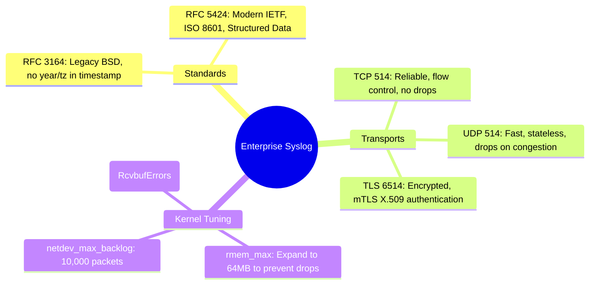

# 📖 Chapter 24: Enterprise Syslog Ingestion: UDP vs TCP vs TLS Masterclass

> **The IBM QRadar Administrator's Technical Guide** | Phase 3: Deep Log Source Onboarding & Integration  
> **Target Audience:** 1.5-Year Administrators $\rightarrow$ Senior SIEM Engineers & Network Security Engineers  
> **Focus:** RFC 3164 vs RFC 5424, UDP / TCP / TLS (Port 6514), Linux Kernel Socket Tuning (`rmem`), & Hands-on Lab 24

---

## 📸 1. Visual Overview: Enterprise Syslog Transport Architecture


*Figure 24.1: 3D Isometric View of the Syslog Ingestion Architecture: Comparing UDP 514 (Fire-and-forget streaming), TCP 514 (Stateful 3-way handshake with flow control), and TLS 6514 (mTLS encrypted tunnel with X.509 certificate validation) arriving at the Linux Kernel Socket and `ecs-ec-ingress` thread pools (`![[stage1_log_transport_3d.jpg|1000]]`)*

---

## 2. Syslog Standards: RFC 3164 (BSD) vs RFC 5424 (IETF)

Syslog telemetry is formatted according to two standard RFC specifications:

```
┌────────────────────────────────────────────────────────────────────────┐
│ 📜 SYSLOG RFC FORMAT COMPARISON                                        │
│                                                                        │
│ 1. RFC 3164 (Legacy BSD Syslog Format)                                 │
│    `<34>Oct 11 22:14:15 mymachine su: 'su root' failed for lonvick`    │
│    • PRI: `<34>` (Facility: auth, Severity: crit)                      │
│    • Timestamp: `Oct 11 22:14:15` (No Year, No Timezone, No Sub-sec!)  │
│    • Hostname: `mymachine`                                             │
│    • Message: `su: 'su root' failed for lonvick`                       │
│ ├────────────────────────────────────────────────────────────────────┤
│ 2. RFC 5424 (Modern IETF Syslog Standard)                              │
│    `<165>1 2026-09-25T18:15:00.123Z host.corp.local app 1234 ID47     │
│     [exampleSDID@32473 iut="3" eventSource="App"] User login failed`   │
│    • PRI + VERSION: `<165>1`                                           │
│    • ISO 8601 Timestamp: Millisecond precision + UTC `Z` offset       │
│    • Structured Data (SD-ELEMENT): Key-value pairs for instant parsing │
└────────────────────────────────────────────────────────────────────────┘
```

---

## 3. Transport Protocol Comparison: UDP vs TCP vs TLS

```
┌────────────────────────────────────────────────────────────────────────┐
│ 🚀 TRANSPORT PROTOCOL SELECTION MATRIX                                 │
│                                                                        │
│ 📡 UDP 514 (Stateless / Unreliable)                                    │
│ • Pros: Minimal CPU/RAM overhead, zero connection state.               │
│ • Cons: Packets dropped silently during network congestion; spoofable. │
│ • Best For: Non-critical high-volume network telemetry (NetFlow/DNS).  │
│ ├────────────────────────────────────────────────────────────────────┤
│ 🔗 TCP 514 (Stateful / Reliable Stream)                                │
│ • Pros: Guaranteed delivery, flow control backpressure, no drops.      │
│ • Cons: Memory overhead for TCP sockets; sender buffers if SIEM lags.  │
│ • Best For: Internal firewalls, Linux servers, core proxies.           │
│ ├────────────────────────────────────────────────────────────────────┤
│ 🔒 TLS SYSLOG 6514 (Encrypted & Authenticated)                         │
│ • Pros: Mutual X.509 authentication, AES-256 wire encryption.          │
│ • Cons: TLS handshake cryptographic CPU overhead.                      │
│ • Best For: Cloud-to-Ground forwarders, WAN links, PCI-DSS compliance. │
└────────────────────────────────────────────────────────────────────────┘
```

---

## 4. Linux Kernel Socket Tuning for High-Volume Syslog Ingestion

When an Event Collector ingests **30,000+ EPS over UDP**, default Linux kernel socket buffers will overflow, causing silent kernel packet drops before `ecs-ec-ingress` can read the socket!

```mermaid
flowchart LR
    NIC[10GbE Network Card] -->|DMA Ring Buffer| KERNEL[Linux Kernel Socket Buffer: rmem_max]
    KERNEL -->|Fast read()| ECS[ecs-ec-ingress Thread Pool]
    
    KERNEL -.->|If rmem_max is too small (< 2MB)| DROP[🔴 Silent Packet Drops: netstat -su]
```

### ⚙️ Production Kernel Parameters (`/etc/sysctl.conf`)

To prevent kernel-level UDP packet drops during traffic spikes, configure:

```bash
# Maximum socket receive buffer size (64 MB)
net.core.rmem_max = 67108864

# Default socket receive buffer size (32 MB)
net.core.rmem_default = 33554432

# Maximum packets queued on NIC before kernel processing
net.core.netdev_max_backlog = 10000

# TCP socket buffer parameters (min, default, max)
net.ipv4.tcp_rmem = 4096 87380 67108864
```

Apply immediately without rebooting:
```bash
sysctl -p
```

---

## 5. Enterprise Client Forwarder Configurations

### 🐧 Rsyslog Configuration (`/etc/rsyslog.d/50-qradar.conf`)
```text
# Forward all logs over reliable TCP to QRadar Event Collector
*.* @@192.168.10.100:514

# Forward over encrypted TLS with certificate validation
$DefaultNetstreamDriverCAFile /etc/ssl/certs/qradar-ca.crt
$ActionSendStreamDriver gtls
$ActionSendStreamDriverMode 1
$ActionSendStreamDriverAuthMode x509/name
*.* @@192.168.10.100:6514
```

### 🦎 Syslog-ng Configuration (`/etc/syslog-ng/conf.d/qradar.conf`)
```text
destination d_qradar_tcp {
    network("192.168.10.100" port(514) transport("tcp"));
};
log { source(s_sys); destination(d_qradar_tcp); };
```

---

## 📌 6. Visual Mind Map & Sticky Notes (Chapter 24 Quick-Review)

### 🧠 Hierarchical Mind Map


### 🗂️ Color-Coded Digital Sticky Notes

#### 🟨 Sticky Note 1: Timestamp Precision
```text
┌─────────────────────────────────────────────────────────────┐
│ 📌 CONCEPT: RFC 5424 TIMESTAMP ADVANTAGE                    │
│                                                             │
│ • RFC 5424 includes year, milliseconds, and UTC offset.     │
│ • Eliminates ambiguous cross-timezone event sorting during  │
│   incident response investigations!                         │
└─────────────────────────────────────────────────────────────┘
```

#### 🟩 Sticky Note 2: UDP Packet Drop Detection
```text
┌─────────────────────────────────────────────────────────────┐
│ 📌 GOLDEN RULE: AUDITING UDP DROPS                          │
│                                                             │
│ • Run `netstat -su | grep "buffer errors"` on Collectors.   │
│ • Any incrementing count indicates the Linux kernel socket  │
│   buffer (`rmem_max`) is overflowing!                       │
└─────────────────────────────────────────────────────────────┘
```

#### 🟪 Sticky Note 3: Port 6514 Standard
```text
┌─────────────────────────────────────────────────────────────┐
│ 📌 ARCHITECTURE: TLS SYSLOG PORT ASSIGNMENT                 │
│                                                             │
│ • Port 6514 is the official IANA port for TLS Syslog.       │
│ • Always enforce TLS Syslog when forwarding logs across     │
│   public clouds or untrusted corporate subnets.             │
└─────────────────────────────────────────────────────────────┘
```

#### 🟦 Sticky Note 4: Flow Control with TCP
```text
┌─────────────────────────────────────────────────────────────┐
│ 📌 VALUE: TCP BACKPRESSURE                                  │
│                                                             │
│ • When QRadar throttles ingestion due to license limits,    │
│   TCP automatically signals senders to buffer logs locally, │
│   guaranteeing ZERO event data loss!                        │
└─────────────────────────────────────────────────────────────┘
```

#### 🟧 Sticky Note 5: Interview Cheat Code (Syslog Protocols)
```text
┌─────────────────────────────────────────────────────────────┐
│ 📌 INTERVIEW CHEAT CODE: "UDP VS TCP FOR ENTERPRISE SYSLOG?"│
│                                                             │
│ "TCP is required for compliance and critical server logging │
│ because it guarantees delivery and provides backpressure.   │
│ UDP is acceptable for high-volume network telemetry, but    │
│ requires kernel socket tuning (rmem_max=64MB) to stop drops."│
└─────────────────────────────────────────────────────────────┘
```

#### 🟥 Sticky Note 6: Critical Pitfall
```text
┌─────────────────────────────────────────────────────────────┐
│ ⚠️ CRITICAL PITFALL: MID-PATH UDP FRAGMENTATION             │
│                                                             │
│ • If a syslog payload exceeds MTU (1500 bytes) over UDP,    │
│   packets fragment. Firewalls frequently drop fragmented    │
│   UDP packets, leading to truncated corrupt logs!           │
└─────────────────────────────────────────────────────────────┘
```

---

### ⚡ Rapid-Recall Flashcards

| # | Question (Front) | Answer (Back) |
| :-: | :--- | :--- |
| **01** | What is the official IANA port for encrypted TLS Syslog? | **TCP Port 6514**. |
| **02** | What command detects Linux kernel UDP socket buffer receive errors? | **`netstat -su`** (inspecting `packet receive errors` or `RcvbufErrors`). |
| **03** | What kernel parameter governs the maximum socket receive buffer size? | **`net.core.rmem_max`**. |
| **04** | What syslog standard includes ISO 8601 timestamps with millisecond precision? | **RFC 5424**. |
| **05** | What happens to UDP syslog packets if the network interface buffer fills up? | Packets are **silently dropped by the kernel with zero notification to the sender**. |
| **06** | How does TCP transport protect against log loss during ingestion spikes? | Via **TCP Window Flow Control / Backpressure**, causing the sender to buffer locally until the receiver recovers. |

---

## 🧪 7. Hands-on Practice Lab 24: Syslog Socket Optimization & Protocol Diagnostics

### 🎯 Lab Objectives
1. Inspect and tune Linux kernel socket parameters (`rmem_max`, `netdev_max_backlog`).
2. Audit active UDP and TCP syslog listening sockets on `ecs-ec-ingress`.
3. Generate synthetic RFC 3164 and RFC 5424 syslog bursts using `logger` and Python.
4. Verify UDP socket drop statistics in real time.

---

### 📋 Step-by-Step Practical Lab Procedures

#### Step 1: Audit Current Kernel Socket Buffers & UDP Drops
```bash
# 1. Inspect current socket buffer limits
sysctl net.core.rmem_max net.core.rmem_default net.core.netdev_max_backlog

# 2. Check for historical UDP buffer errors
netstat -su | grep -E "packet receive errors|buffer errors|receive buffer errors"
```

---

#### Step 2: Apply Enterprise Kernel Optimization Parameters
```bash
# Set high-throughput socket buffers
cat << 'EOF' > /etc/sysctl.d/99-qradar-syslog.conf
net.core.rmem_max = 67108864
net.core.rmem_default = 33554432
net.core.netdev_max_backlog = 10000
EOF

# Apply live
sysctl -p /etc/sysctl.d/99-qradar-syslog.conf
```

---

#### Step 3: Inspect Active Syslog Listening Sockets
```bash
# Check listening state of Port 514 and Port 6514 on ecs-ec-ingress
ss -tulpn | grep -E "514|6514"
```
*Expected Output*: Confirms `ecs-ec-ingress` is listening on `0.0.0.0:514` (UDP and TCP).

---

#### Step 4: Inject High-Speed RFC 5424 Syslog Burst
```bash
python3 -c "
import socket
import datetime
import time

QRADAR_IP = '127.0.0.1'
PORT = 514
sock = socket.socket(socket.AF_INET, socket.SOCK_DGRAM)

print('[*] Injecting 500 RFC 5424 Syslog Events...')
for i in range(500):
    now = datetime.datetime.now(datetime.timezone.utc).isoformat()
    msg = f'<134>1 {now} host-srv01.corp.local auditd 4512 ID99 [security@32473 action=\"login\" status=\"success\"] User admin authenticated successfully from 10.0.0.{i%250}'
    sock.sendto(msg.encode(), (QRADAR_IP, PORT))

print('[+] Burst complete. Verify in Log Activity tab.')
"
```
