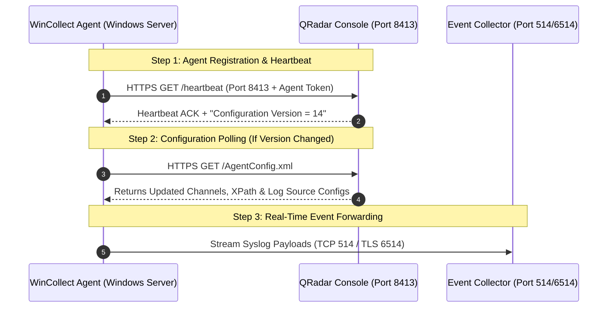
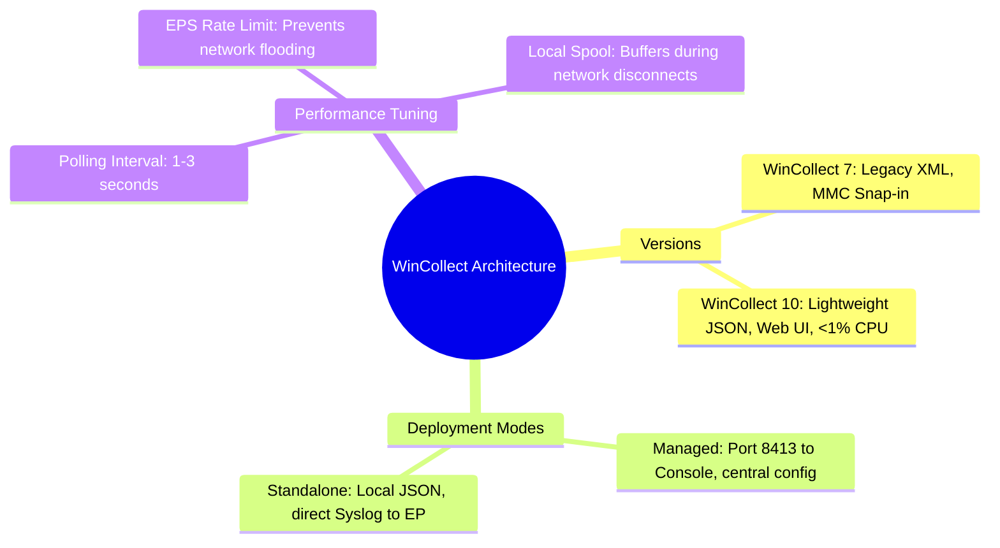

# 📖 Chapter 25: WinCollect Architecture & Standalone vs Managed Modes Masterclass

> **The IBM QRadar Administrator's Technical Guide** | Phase 3: Deep Log Source Onboarding & Integration  
> **Target Audience:** 1.5-Year Administrators $\rightarrow$ Senior SIEM Engineers & Windows Infrastructure Architects  
> **Focus:** WinCollect 7 vs 10, Managed Mode (Port 8413) vs Standalone Mode, Agent Tuning, & Hands-on Lab 25

---

## 📸 1. Visual Overview: WinCollect Agent Architecture & Modes


*Figure 25.1: 3D Isometric View of the WinCollect Endpoint Ingestion Architecture: Comparing Managed Mode (Centralized heartbeat polling and configuration orchestration over TCP Port 8413 from the Console) vs Standalone Mode (Autonomous local JSON/XML configuration streaming Syslog over TLS 6514 to Event Collectors) (`![[06_core_components_3d_breakdown.jpg|1000]]`)*

---

## 2. WinCollect 7 vs WinCollect 10: The Evolution of Endpoint Collection

IBM WinCollect is a purpose-built Windows Event Log collection agent designed specifically for QRadar SIEM.

```
┌────────────────────────────────────────────────────────────────────────┐
│ 🔄 WINCOLLECT 7 VS WINCOLLECT 10 ARCHITECTURE COMPARISON               │
│                                                                        │
│ 👴 WINCOLLECT 7 (Legacy Architecture)                                  │
│ • Architecture: Heavyweight monolithic Windows service.                │
│ • Configuration: Complex nested XML files (`AgentConfig.xml`).         │
│ • Resource Consumption: 3% - 8% CPU during high event bursts.          │
│ • Management: Managed via Console or Microsoft MMC Snap-in.            │
│ ├────────────────────────────────────────────────────────────────────┤
│ 🚀 WINCOLLECT 10 (Modern Next-Gen Architecture)                        │
│ • Architecture: Lightweight asynchronous microservice engine.          │
│ • Configuration: Clean, human-readable JSON / YAML configurations.     │
│ • Resource Consumption: < 1% CPU with native Windows EVTX API hooks.   │
│ • Management: Built-in local Web Console UI (Port 3000) or Console.    │
│ • Throughput: Sustains up to 10,000+ EPS per agent on high-load DCs.   │
└────────────────────────────────────────────────────────────────────────┘
```

---

## 3. Managed Mode vs Standalone Mode: Enterprise Architectural Decision

```
┌────────────────────────────────────────────────────────────────────────┐
│ ⚖️ MANAGED MODE VS STANDALONE MODE                                     │
│                                                                        │
│ 🌐 MANAGED MODE (Centralized Enterprise Orchestration)                 │
│ • Heartbeat & Config Polling: Communicates with Console on TCP 8413.   │
│ • Log Source Provisioning: Created and tuned centrally in QRadar UI.   │
│ • Auto-Patching: Console pushes SFS agent updates automatically.       │
│ • Best For: Internal corporate domain controllers and member servers.  │
│ ├────────────────────────────────────────────────────────────────────┤
│ 🛡️ STANDALONE MODE (Autonomous DMZ / Isolated Environments)            │
│ • Zero Console Dependency: Operates completely autonomously.           │
│ • Direct Syslog Output: Forwards raw Syslog (TCP/TLS 514/6514) to EPs. │
│ • Configuration: Managed locally via Web UI or automated via Ansible.  │
│ • Best For: DMZ servers, air-gapped subnets, MSSP client environments. │
└────────────────────────────────────────────────────────────────────────┘
```

---

## 4. Managed Mode Communication Protocol (Port 8413)



---

## 5. WinCollect Agent Tuning & Performance Governance

To prevent WinCollect from consuming server resources or overwhelming network bandwidth:

```
┌────────────────────────────────────────────────────────────────────────┐
│ ⚙️ WINCOLLECT AGENT PERFORMANCE TUNING PARAMETERS                     │
│                                                                        │
│ 1. POLLING INTERVAL (Default: 3000 ms / 3 seconds):                    │
│    • High-Load Domain Controllers: Lower to 1000 ms (Near real-time).  │
│    • Low-Priority Workstations: Increase to 10,000 ms (Conserve CPU).  │
│ ├────────────────────────────────────────────────────────────────────┤
│ 2. EPS THROTTLING / RATE LIMITING:                                     │
│    • Set max sustained EPS per agent (e.g., `Max EPS = 1,500`).        │
│    • If event generation exceeds limit, agent spools to local disk:    │
│      `C:\Program Files\IBM\WinCollect\logs\spool\`                     │
│ ├────────────────────────────────────────────────────────────────────┤
│ 3. EVENT LOG CHANNELS (Selective Collection):                          │
│    • Never collect standard "Application" or "System" logs unless      │
│      specifically required! Focus 95% on "Security" + "Sysmon".       │
└────────────────────────────────────────────────────────────────────────┘
```

---

## 📌 6. Visual Mind Map & Sticky Notes (Chapter 25 Quick-Review)

### 🧠 Hierarchical Mind Map


### 🗂️ Color-Coded Digital Sticky Notes

#### 🟨 Sticky Note 1: Port 8413 Architecture
```text
┌─────────────────────────────────────────────────────────────┐
│ 📌 CONCEPT: PORT 8413 PURPOSE                               │
│                                                             │
│ • Port 8413 is ONLY used for heartbeat and config sync.     │
│ • Log events are NEVER sent over Port 8413! Log events are  │
│   sent directly to Event Collectors over Port 514 / 6514.   │
└─────────────────────────────────────────────────────────────┘
```

#### 🟩 Sticky Note 2: Standalone Mode for DMZ
```text
┌─────────────────────────────────────────────────────────────┐
│ 📌 GOLDEN RULE: DMZ WINDOWS FORWARDING                      │
│                                                             │
│ • NEVER open Port 8413 from the external DMZ into Console!  │
│ • Deploy WinCollect in Standalone Mode in the DMZ and push  │
│   encrypted Syslog over TLS Port 6514.                      │
└─────────────────────────────────────────────────────────────┘
```

#### 🟪 Sticky Note 3: WinCollect 10 Performance
```text
┌─────────────────────────────────────────────────────────────┐
│ 📌 ARCHITECTURE: WINCOLLECT 10 ADVANTAGE                    │
│                                                             │
│ • WinCollect 10 utilizes native Windows EVTX memory pointers│
│   instead of string parsing, cutting CPU usage by over 70%! │
└─────────────────────────────────────────────────────────────┘
```

#### 🟦 Sticky Note 4: Local Disk Spooling
```text
┌─────────────────────────────────────────────────────────────┐
│ 📌 RELIABILITY: ENDPOINT SPOOL SAFETY                       │
│                                                             │
│ • If the network link between Windows server and SIEM drops,│
│   WinCollect automatically spools events to local disk.     │
│ • Resumes streaming without event loss once link recovers!  │
└─────────────────────────────────────────────────────────────┘
```

#### 🟧 Sticky Note 5: Interview Cheat Code (WinCollect Modes)
```text
┌─────────────────────────────────────────────────────────────┐
│ 📌 INTERVIEW CHEAT CODE: "MANAGED VS STANDALONE WINCOLLECT?"│
│                                                             │
│ "Managed mode connects to the Console via Port 8413 for     │
│ centralized configuration and auto-updates across the fleet.│
│ Standalone mode runs autonomously, pushing Syslog directly  │
│ to collectors—ideal for DMZs and isolated subnets."         │
└─────────────────────────────────────────────────────────────┘
```

#### 🟥 Sticky Note 6: Critical Pitfall
```text
┌─────────────────────────────────────────────────────────────┐
│ ⚠️ CRITICAL PITFALL: UNTHROTTLED DESKTOP COLLECTION         │
│                                                             │
│ • Deploying WinCollect across 5,000 laptops without EPS     │
│   throttling will overwhelm QRadar ingestion licenses during│
│   morning 9:00 AM user boot bursts!                         │
└─────────────────────────────────────────────────────────────┘
```

---

### ⚡ Rapid-Recall Flashcards

| # | Question (Front) | Answer (Back) |
| :-: | :--- | :--- |
| **01** | What port does a Managed WinCollect agent use to communicate with the Console? | **TCP Port 8413** (HTTPS Heartbeat & Config sync). |
| **02** | Are log events transmitted over Port 8413? | **No**. Port 8413 is for management; events are sent over **Port 514 / 6514** to Event Collectors. |
| **03** | When should Standalone WinCollect be chosen over Managed Mode? | In **DMZ networks, air-gapped subnets, or MSSP environments** where Port 8413 access to the Console is prohibited. |
| **04** | What major improvement does WinCollect 10 provide over WinCollect 7? | **Lightweight engine ($< 1\%$ CPU)**, **native EVTX API hooks**, and **local Web Console UI**. |
| **05** | Where does WinCollect spool events if downstream Event Collectors are unreachable? | To **local disk storage on the Windows host** (`C:\Program Files\IBM\WinCollect\logs\spool\`). |
| **06** | What is the default polling interval for WinCollect agents? | **3000 milliseconds (3 seconds)**. |

---

## 🧪 7. Hands-on Practice Lab 25: WinCollect Agent Management & Health Auditing

### 🎯 Lab Objectives
1. Audit managed WinCollect agents and registration tokens in the QRadar PostgreSQL database.
2. Verify TCP Port 8413 listening sockets and heartbeat connectivity.
3. Inspect WinCollect configuration payloads and agent status reports.
4. Troubleshoot agent communication timeouts and disk spool backlogs.

---

### 📋 Step-by-Step Practical Lab Procedures

#### Step 1: Query WinCollect Agents in PostgreSQL
Log into the QRadar Console via SSH as `root`:
```bash
# Query all registered WinCollect agents and their active status
psql -U qradar -d qradar -x -c "
SELECT 
    id, 
    name, 
    ip, 
    version, 
    status, 
    last_heartbeat, 
    eps_rate_limit 
FROM wincollect_agent 
ORDER BY id ASC;
"
```

---

#### Step 2: Verify Port 8413 Listening Socket
```bash
# Check that the WinCollect management service is actively listening on Port 8413
ss -tulpn | grep 8413
```
*Expected Output*: Confirms `tomcat` or `wincollect-server` is listening on `0.0.0.0:8413`.

---

#### Step 3: Check WinCollect System Logs for Heartbeat Errors
```bash
# Inspect QRadar logs for WinCollect agent connection errors
grep -i "wincollect" /var/log/qradar.log | tail -n 25
```

---

#### Step 4: Validate Agent Communication via Simulated Heartbeat
From a remote test host, verify HTTPS handshake to Port 8413:
```bash
curl -k -v https://192.168.10.100:8413/
```
*Expected Output*: Returns SSL handshake details and HTTP response confirming Port 8413 is reachable.
