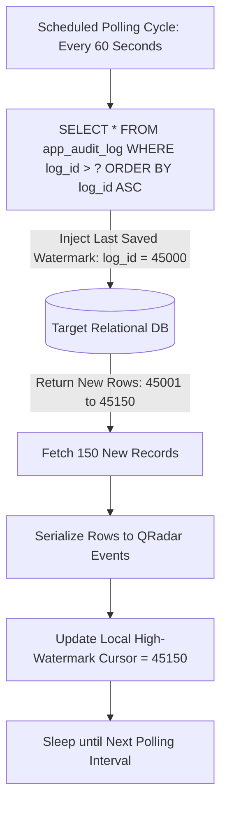
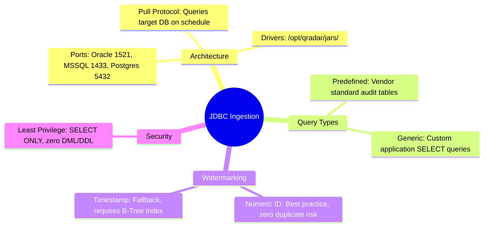

# 📖 Chapter 27: JDBC Protocol Ingestion & Database Polling Masterclass

> **The IBM QRadar Administrator's Technical Guide** | Phase 3: Deep Log Source Onboarding & Integration  
> **Target Audience:** 1.5-Year Administrators $\rightarrow$ Senior SIEM Engineers & Database Security Architects  
> **Focus:** JDBC Protocol Architecture, Database Polling, Timestamp/ID Watermarking, Driver Jar Management, & Hands-on Lab 27

---

## 📸 1. Visual Overview: JDBC Database Polling Architecture


*Figure 27.1: 3D Isometric View of the QRadar JDBC Protocol Ingestion Engine: `ecs-ec-ingress` executing scheduled SQL polling against external enterprise databases (Oracle, MS SQL, PostgreSQL), tracking high-watermark state (`log_id > ?` or `timestamp > ?`), and formatting tabular rows into normalized SIEM events (`![[03_ariel_storage_columnar_3d.jpg|1000]]`)*

---

## 2. JDBC Protocol Ingestion Foundations

The **JDBC (Java Database Connectivity) Protocol** is a pull-based collection mechanism used to extract audit trails, transactions, and security logs stored in relational database tables.

```
┌────────────────────────────────────────────────────────────────────────┐
│ 🗄️ JDBC INGESTION LIFECYCLE                                            │
│                                                                        │
│ 1. Driver Loading: `ecs-ec-ingress` loads database driver JAR from:    │
│    `/opt/qradar/jars/` (e.g., `ojdbc8.jar`, `mssql-jdbc.jar`).         │
│ 2. Authenticated Connection: Connects to target DB over TCP port       │
│    (Oracle: 1521, MS SQL: 1433, PostgreSQL: 5432, MySQL: 3306).       │
│ 3. Query Execution: Executes parameterized SQL query with watermark.  │
│ 4. Result Serialization: Converts SQL result set rows into Syslog/LEEF.│
│ 5. High-Watermark Update: Persists highest retrieved ID/timestamp.    │
└────────────────────────────────────────────────────────────────────────┘
```

---

## 3. Query Types: Predefined vs Generic SQL Queries

```
┌────────────────────────────────────────────────────────────────────────┐
│ ⚖️ PREDEFINED VS GENERIC SQL QUERIES                                   │
│                                                                        │
│ 📦 PREDEFINED DATABASE QUERIES                                         │
│ • Uses built-in vendor queries designed by IBM.                        │
│ • Optimized for standard DB audit features (e.g., Oracle Unified Audit,│
│   MS SQL C2/Trace Auditing, MS SQL Server Audit Specifications).       │
│ • Zero SQL coding required; select predefined template from dropdown.  │
│ ├────────────────────────────────────────────────────────────────────┤
│ 🛠️ GENERIC DATABASE QUERIES (Custom Application Tables)                │
│ • Allows administrators to write custom SQL `SELECT` statements.       │
│ • Used for in-house financial apps, custom audit tables, or DB views.  │
│ • Requires explicit definition of the **Compare Field (Watermark)**.   │
└────────────────────────────────────────────────────────────────────────┘
```

---

## 4. Watermarking Strategies: Preventing Duplicate & Missing Records

A **Watermark** is the tracking cursor that tells QRadar where it stopped reading during the previous polling cycle.



### 📋 Comparison of Watermark Types

| Watermark Type | Comparison Clause | Strengths | Critical Pitfalls |
| :--- | :--- | :--- | :--- |
| **Sequential Numeric ID** *(Recommended)* | `WHERE log_id > ? ORDER BY log_id ASC` | **100% Deterministic**. Immune to system clock adjustments and sub-second transaction collisions. | Requires table to have an auto-incrementing Primary Key (`IDENTITY` / `SERIAL` / `SEQUENCE`). |
| **Timestamp Field** | `WHERE event_time > ? ORDER BY event_time ASC` | Works on tables without numeric IDs. | Sub-second row bursts with identical timestamps may be missed if clock drifts or if query uses strict `>`. |

> [!IMPORTANT]
> **Index on Watermark Column**: The watermark column (`log_id` or `event_time`) MUST have a **B-Tree Index** on the target database table! Polling an unindexed 50-million-row audit table every 60 seconds will cause severe database CPU spikes and query timeouts.

---

## 5. JDBC Driver Installation & File System Paths

Third-party JDBC drivers must be installed on the Event Collector or Console:

```bash
# 1. Directory for JDBC Drivers in QRadar
ls -lh /opt/qradar/jars/

# Supported common drivers:
# • Oracle Database:         /opt/qradar/jars/ojdbc8.jar
# • Microsoft SQL Server:    /opt/qradar/jars/mssql-jdbc.jar
# • PostgreSQL Database:     /opt/qradar/jars/postgresql.jar
# • MySQL Database:          /opt/qradar/jars/mysql-connector-java.jar
```

---

## 📌 6. Visual Mind Map & Sticky Notes (Chapter 27 Quick-Review)

### 🧠 Hierarchical Mind Map


### 🗂️ Color-Coded Digital Sticky Notes

#### 🟨 Sticky Note 1: Watermarking Fundamentals
```text
┌─────────────────────────────────────────────────────────────┐
│ 📌 CONCEPT: THE WATERMARK CURSOR                            │
│                                                             │
│ • The watermark persists the highest ID/timestamp queried.  │
│ • Prevents QRadar from re-ingesting old historical data on  │
│   every 60-second polling cycle!                            │
└─────────────────────────────────────────────────────────────┘
```

#### 🟩 Sticky Note 2: Database Indexing Requirement
```text
┌─────────────────────────────────────────────────────────────┐
│ 📌 GOLDEN RULE: MANDATORY B-TREE INDEX                      │
│                                                             │
│ • ALWAYS ensure the watermark column is indexed on the DB.  │
│ • Without an index, the database executes a FULL TABLE SCAN │
│   every minute, degrading production database performance!  │
└─────────────────────────────────────────────────────────────┘
```

#### 🟪 Sticky Note 3: Dedicated Driver Directory
```text
┌─────────────────────────────────────────────────────────────┐
│ 📌 ARCHITECTURE: JAR PLACEMENT PATH                         │
│                                                             │
│ • JDBC drivers must reside in `/opt/qradar/jars/`.          │
│ • Permissions must be set to `chmod 755 /opt/qradar/jars/*` │
│   for the `qradar` daemon user to load the class.           │
└─────────────────────────────────────────────────────────────┘
```

#### 🟦 Sticky Note 4: Principle of Least Privilege
```text
┌─────────────────────────────────────────────────────────────┐
│ 📌 SECURITY: DATABASE USER PRIVILEGES                       │
│                                                             │
│ • Grant `SELECT` ONLY on specific audit views.              │
│ • NEVER grant `INSERT`, `UPDATE`, `DELETE`, or `DROP` to    │
│   the QRadar SIEM service account!                          │
└─────────────────────────────────────────────────────────────┘
```

#### 🟧 Sticky Note 5: Interview Cheat Code (JDBC Polling)
```text
┌─────────────────────────────────────────────────────────────┐
│ 📌 INTERVIEW CHEAT CODE: "HOW DOES JDBC INGESTION WORK?"    │
│                                                             │
│ "QRadar uses JDBC drivers in `/opt/qradar/jars/` to execute │
│ scheduled SQL queries using a watermarked comparison clause │
│ (`WHERE id > ? ORDER BY id ASC`), converting database rows │
│ into normalized SIEM events while tracking state in memory."│
└─────────────────────────────────────────────────────────────┘
```

#### 🟥 Sticky Note 6: Critical Pitfall
```text
┌─────────────────────────────────────────────────────────────┐
│ ⚠️ CRITICAL PITFALL: UNORDERED RESULT SETS                  │
│                                                             │
│ • Writing a generic JDBC query without `ORDER BY <Watermark>`│
│   causes QRadar to advance the watermark prematurely,       │
│   permanently skipping lower unread rows!                   │
└─────────────────────────────────────────────────────────────┘
```

---

### ⚡ Rapid-Recall Flashcards

| # | Question (Front) | Answer (Back) |
| :-: | :--- | :--- |
| **01** | Where are external database JDBC driver JAR files stored in QRadar? | In **`/opt/qradar/jars/`**. |
| **02** | What is the purpose of a Watermark in JDBC log sources? | To **track the last retrieved record ID or timestamp**, preventing duplicates and data loss. |
| **03** | Why should a generic JDBC query always include an `ORDER BY` clause? | To ensure **records are processed sequentially** so the watermark advances monotonically. |
| **04** | What database permissions should be granted to the QRadar JDBC user? | **`SELECT` permission ONLY** on the required audit tables or views. |
| **05** | What is the preferred watermark type: Sequential Numeric ID or Timestamp? | **Sequential Numeric ID** (immune to clock drift and sub-second collisions). |
| **06** | What standard port does Microsoft SQL Server use for JDBC connections? | **TCP Port 1433**. |

---

## 🧪 7. Hands-on Practice Lab 27: JDBC Protocol Configuration & Driver Management

### 🎯 Lab Objectives
1. Inspect installed JDBC driver JAR files in `/opt/qradar/jars/`.
2. Query registered JDBC log sources in the PostgreSQL database.
3. Construct a production-grade watermarked generic SQL query.
4. Troubleshoot common JDBC connection and authentication errors.

---

### 📋 Step-by-Step Practical Lab Procedures

#### Step 1: Audit Installed JDBC Driver JAR Files
Log into the QRadar Console via SSH as `root`:
```bash
# Check installed database drivers in the jars directory
ls -la /opt/qradar/jars/
```
*Expected Output*: Displays driver JAR files with read permissions for the `qradar` service account.

---

#### Step 2: Query Active JDBC Log Sources in PostgreSQL
```bash
# Query JDBC log sources and their configured polling intervals
psql -U qradar -d qradar -x -c "
SELECT 
    sd.id, 
    sd.devicename, 
    sd.deviceip, 
    sd.devicetypeid, 
    sp.name AS protocol_name 
FROM sensordevice sd 
JOIN sensorprotocol sp ON sd.sensorprotocolid = sp.id 
WHERE sp.name ILIKE '%JDBC%' 
LIMIT 10;
"
```

---

#### Step 3: Author Production Generic JDBC Polling Query
```sql
-- Production Generic JDBC Query Template with Numeric Watermark
SELECT 
    audit_id, 
    event_time, 
    db_user, 
    client_ip, 
    action_type, 
    schema_name, 
    table_name, 
    statement_text, 
    return_code 
FROM enterprise_db_audit_log 
WHERE audit_id > ? 
ORDER BY audit_id ASC;
```

---

#### Step 4: Audit JDBC Ingestion Errors in System Logs
```bash
# Inspect system logs for JDBC connection failures or query exceptions
grep -i "jdbc" /var/log/qradar.error | tail -n 25
```
