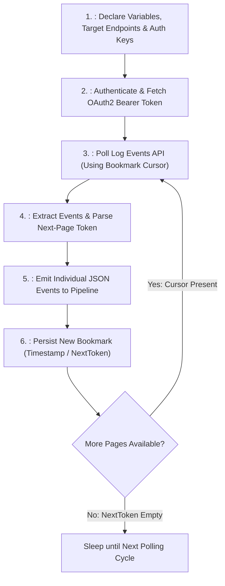
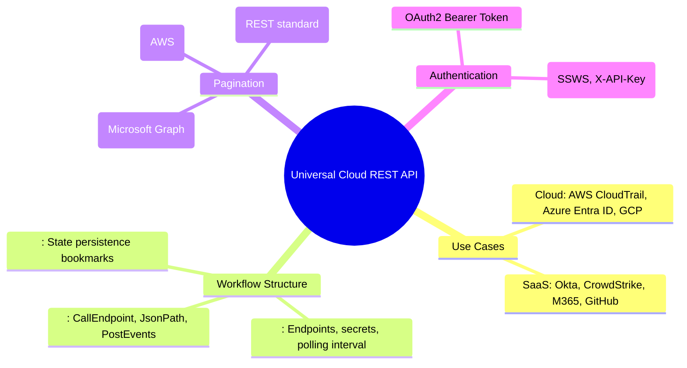

# 📖 Chapter 28: Universal Cloud REST API Protocol & Workflows Masterclass

> **The IBM QRadar Administrator's Technical Guide** | Phase 3: Deep Log Source Onboarding & Integration  
> **Target Audience:** 1.5-Year Administrators $\rightarrow$ Senior SIEM Engineers & Cloud Security Architects  
> **Focus:** Universal Cloud REST API (UCDSM), Workflow XML Architecture, OAuth2 Bearer Auth, Cloud SaaS Ingestion, & Hands-on Lab 28

---

## 📸 1. Visual Overview: Universal Cloud REST API Ingestion


*Figure 28.1: 3D Isometric View of Cloud Telemetry Ingestion via Universal Cloud REST API: QRadar executing authenticated HTTPS API workflows against AWS CloudTrail, Microsoft Graph API, and Okta, performing OAuth2 token exchanges, parsing JSON response pages with cursor bookmarks, and emitting normalized events into the SIEM pipeline (`![[01_enterprise_architecture_3d.jpg|1000]]`)*

---

## 2. Why Universal Cloud REST API (UCDSM) is the Modern Cloud Standard

Modern cloud environments (AWS, Microsoft Azure, Google Cloud Platform) and enterprise SaaS platforms (Okta, CrowdStrike, Salesforce, GitHub, Slack) do not emit traditional UDP syslog. Instead, they expose **RESTful HTTPS APIs** with JSON payloads and OAuth2 authentication.

```
┌────────────────────────────────────────────────────────────────────────┐
│ ☁️ UNIVERSAL CLOUD REST API PROTOCOL ADVANTAGES                        │
│                                                                        │
│ • Declarative XML Workflow Engine: Define entire API polling pipelines │
│   in an extensible XML configuration (`workflow.xml`).                 │
│ • Dynamic OAuth2 Token Lifecycle: Handles client credential token      │
│   exchanges and automatic refreshing before token expiration.          │
│ • State Persistence (Bookmarks): Persists cursor/timestamp bookmarks   │
│   so restarting QRadar services never causes duplicate or skipped logs!│
│ • Native JSON Array Unpacking: Splits multi-event JSON arrays into     │
│   individual QRadar event records in memory.                           │
└────────────────────────────────────────────────────────────────────────┘
```

---

## 3. Anatomy of a QRadar `workflow.xml` File

A Universal Cloud REST API workflow is structured into 4 logical blocks:



---

## 4. Real-World Enterprise Workflow Example: Ingesting Okta Audit Logs

Below is an enterprise workflow for polling the Okta System Log API using ISO 8601 timestamp bookmarks:

```xml
<Workflow>
  <Parameters>
    <Parameter Name="okta_domain" Target="okta_domain" DefaultValue="corp.okta.com" />
    <Parameter Name="api_token" Target="api_token" Secret="true" />
  </Parameters>

  <Actions>
    <!-- 1. Initialize Bookmark on First Run (Past 24 Hours) -->
    <Initialize Status="current_bookmark" Value="${time() - 86400000}" />

    <!-- 2. Poll Okta API with Timestamp Filter -->
    <CallEndpoint Url="https://${okta_domain}/api/v1/logs?since=${current_bookmark}" Method="GET" Target="okta_response">
      <RequestHeader Name="Authorization" Value="SSWS ${api_token}" />
      <RequestHeader Name="Accept" Value="application/json" />
    </CallEndpoint>

    <!-- 3. Extract JSON Array of Audit Events -->
    <JsonPath Expression="$.[*]" Source="${okta_response.body}" Target="event_records" />

    <!-- 4. Post Events to QRadar Pipeline -->
    <PostEvents Source="${event_records}" />

    <!-- 5. Update High-Watermark Bookmark with Latest Event Timestamp -->
    <JsonPath Expression="$.[-1].published" Source="${okta_response.body}" Target="latest_timestamp" />
    <SetStatus Key="current_bookmark" Value="${latest_timestamp}" />
  </Actions>
</Workflow>
```

---

## 5. API Pagination Strategies in Cloud Telemetry

Cloud APIs return large datasets in paginated batches. UCDSM handles all 3 major cloud pagination models:

```
┌────────────────────────────────────────────────────────────────────────┐
│ 📄 CLOUD API PAGINATION MODELS                                         │
│                                                                        │
│ 1. CURSOR / TOKEN-BASED PAGINATION (AWS CloudTrail / GuardDuty):       │
│    • Query: `GET /events?NextToken=abc123xyz`                          │
│    • Response includes `NextToken`. Workflow loops until `NextToken`   │
│      is `null`.                                                        │
│ ├────────────────────────────────────────────────────────────────────┤
│ 2. NEXT-LINK URL PAGINATION (Microsoft Graph API / Office 365):        │
│    • Response contains `@odata.nextLink: "https://graph.microsoft..."` │
│    • Workflow executes `<CallEndpoint Url="${response['@odata.nextLink']}">`│
│ ├────────────────────────────────────────────────────────────────────┤
│ 3. PAGE NUMBER PAGINATION (CrowdStrike / SaaS):                        │
│    • Query: `GET /alerts?page=${page_counter}&limit=500`               │
│    • Increments counter until response length $< 500$.                 │
└────────────────────────────────────────────────────────────────────────┘
```

---

## 📌 6. Visual Mind Map & Sticky Notes (Chapter 28 Quick-Review)

### 🧠 Hierarchical Mind Map


### 🗂️ Color-Coded Digital Sticky Notes

#### 🟨 Sticky Note 1: The Bookmark Mechanism
```text
┌─────────────────────────────────────────────────────────────┐
│ 📌 CONCEPT: STATE PERSISTENCE BOOKMARKS                     │
│                                                             │
│ • UCDSM persists bookmarks in the PostgreSQL database.      │
│ • If QRadar restarts, the workflow picks up exactly from the│
│   last queried timestamp without re-fetching old logs!      │
└─────────────────────────────────────────────────────────────┘
```

#### 🟩 Sticky Note 2: Secret Parameter Flag
```text
┌─────────────────────────────────────────────────────────────┐
│ 📌 GOLDEN RULE: SECRET MASKING IN WORKFLOWS                 │
│                                                             │
│ • Always mark authentication tokens with `Secret="true"`.   │
│ • Masks API keys in the Web UI and prevents secrets from    │
│   being dumped in `/var/log/qradar.log` debugging files!    │
└─────────────────────────────────────────────────────────────┘
```

#### 🟪 Sticky Note 3: Rate Limiting & Backoff
```text
┌─────────────────────────────────────────────────────────────┐
│ 📌 ARCHITECTURE: HANDLING HTTP 429                          │
│                                                             │
│ • Cloud APIs enforce rate limits (e.g. 100 requests/sec).   │
│ • UCDSM includes built-in exponential backoff retry logic   │
│   when receiving HTTP 429 Too Many Requests responses.      │
└─────────────────────────────────────────────────────────────┘
```

#### 🟦 Sticky Note 4: Native JSON Unpacking
```text
│ 📌 VALUE: MULTI-EVENT UNPACKING                             │
│                                                             │
│ • A single API response can contain a batch of 500 events.  │
│ • `<PostEvents>` automatically splits the JSON array and    │
│   submits 500 individual discrete records to the CRE!       │
└─────────────────────────────────────────────────────────────┘
```

#### 🟧 Sticky Note 5: Interview Cheat Code (Cloud API Ingestion)
```text
┌─────────────────────────────────────────────────────────────┐
│ 📌 INTERVIEW CHEAT CODE: "HOW DO YOU INGEST CLOUD/SAAS LOGS?"│
│                                                             │
│ "I use the Universal Cloud REST API protocol with custom    │
│ Workflow XMLs to handle OAuth2 bearer token generation,     │
│ query paginated REST endpoints, parse JSON payloads via     │
│ JsonPath, and persist high-watermark cursor bookmarks."     │
└─────────────────────────────────────────────────────────────┘
```

#### 🟥 Sticky Note 6: Critical Pitfall
```text
┌─────────────────────────────────────────────────────────────┐
│ ⚠️ CRITICAL PITFALL: INFINITE PAGINATION LOOPS              │
│                                                             │
│ • If a workflow fails to clear or validate the `NextToken`  │
│   condition, it will loop indefinitely against the API,     │
│   exhausting corporate API quotas within minutes!           │
└─────────────────────────────────────────────────────────────┘
```

---

### ⚡ Rapid-Recall Flashcards

| # | Question (Front) | Answer (Back) |
| :-: | :--- | :--- |
| **01** | What protocol in QRadar is used to ingest telemetry from cloud REST APIs? | The **Universal Cloud REST API Protocol (UCDSM)**. |
| **02** | What file format defines the API collection logic in UCDSM? | **Workflow XML (`workflow.xml`)**. |
| **03** | What XML tag is used to submit parsed JSON events into the QRadar pipeline? | **`<PostEvents Source="${...}" />`**. |
| **04** | How does UCDSM prevent re-ingesting duplicate historical logs across restarts? | Via **State Persistence Bookmarks (`<SetStatus>`)** stored in the database. |
| **05** | What XML tag marks sensitive API keys to prevent them from being logged in plaintext? | **`Secret="true"`** in the `<Parameter>` declaration. |
| **06** | What HTTP status code signals API rate limiting? | **HTTP 429 (Too Many Requests)**. |

---

## 🧪 7. Hands-on Practice Lab 28: Universal Cloud REST API Workflow Validation

### 🎯 Lab Objectives
1. Inspect installed Universal Cloud REST API workflows on the QRadar Console.
2. Query active cloud log sources and status bookmarks in PostgreSQL.
3. Validate Workflow XML syntax against cloud API response formats.
4. Troubleshoot cloud API authentication errors and pagination loops.

---

### 📋 Step-by-Step Practical Lab Procedures

#### Step 1: Query Universal Cloud REST API Log Sources in PostgreSQL
Log into the QRadar Console via SSH as `root`:
```bash
# Query active Universal Cloud REST API log sources and their status
psql -U qradar -d qradar -x -c "
SELECT 
    sd.id, 
    sd.devicename, 
    sd.deviceip, 
    dt.devicetypename, 
    sp.name AS protocol 
FROM sensordevice sd 
JOIN devicetype dt ON sd.devicetypeid = dt.id 
JOIN sensorprotocol sp ON sd.sensorprotocolid = sp.id 
WHERE sp.name ILIKE '%Universal Cloud REST API%' 
LIMIT 10;
"
```

---

#### Step 2: Inspect Cloud Workflow Configuration Directory
```bash
# View installed workflow XML definitions
ls -la /opt/qradar/dsm/
```

---

#### Step 3: Test Cloud API Connectivity via `curl`
Test pulling security alerts from a cloud REST endpoint:
```bash
API_URL="https://api.github.com/orgs/my-enterprise-org/audit-log"
API_TOKEN="ghp_demo1234567890abcdef"

curl -s -X GET \
  -H "Authorization: Bearer $API_TOKEN" \
  -H "Accept: application/vnd.github+json" \
  "$API_URL?per_page=5" | python3 -m json.tool
```

---

#### Step 4: Audit Universal Cloud REST API Debug Logs
```bash
# Monitor live UCDSM execution logs and bookmark updates
tail -n 30 /var/log/qradar.log | grep -i "UniversalCloudRESTAPI"
```
