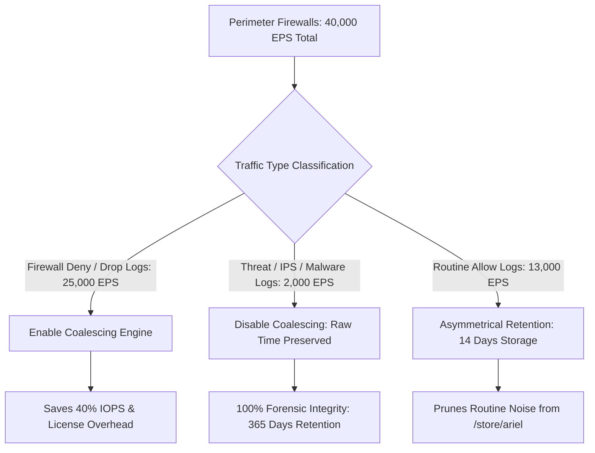
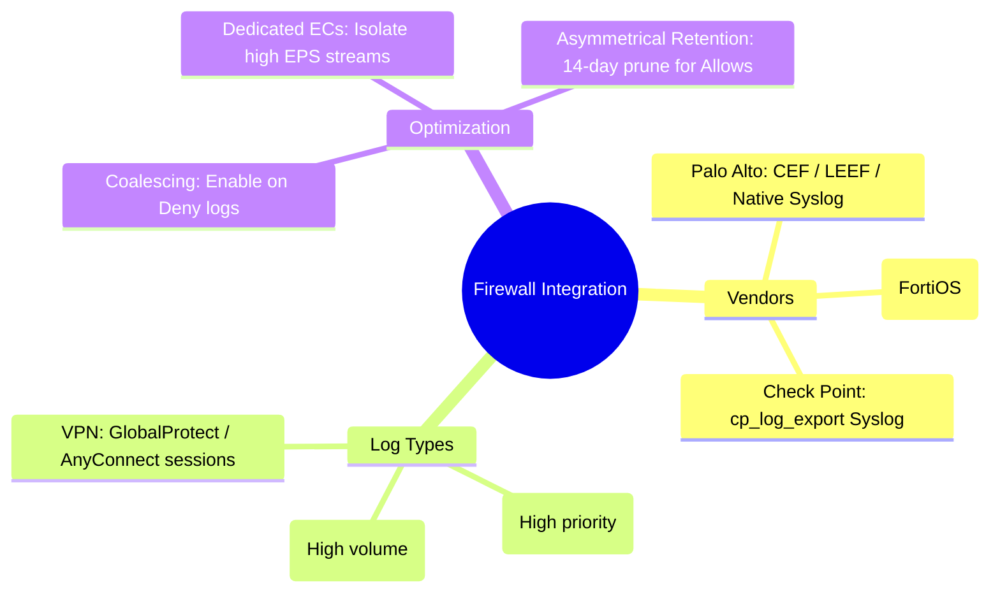

# 📖 Chapter 29: Next-Gen Firewall Integration: Palo Alto, Fortinet & Check Point Masterclass

> **The IBM QRadar Administrator's Technical Guide** | Phase 3: Deep Log Source Onboarding & Integration  
> **Target Audience:** 1.5-Year Administrators $\rightarrow$ Senior SIEM Engineers & Perimeter Security Architects  
> **Focus:** Palo Alto Networks CEF/LEEF, Fortinet FortiGate Key-Value, Check Point Syslog, Ingestion Tuning, & Hands-on Lab 29

---

## 📸 1. Visual Overview: Enterprise Next-Gen Firewall Telemetry


*Figure 29.1: 3D Isometric View of Enterprise Firewall Telemetry Ingestion: Perimeter and Datacenter NGFWs (Palo Alto Networks, Fortinet FortiGate, Check Point) streaming high-speed Traffic, Threat, and VPN sessions into dedicated QRadar Event Collectors over high-throughput 10GbE Syslog interfaces (`![[15_network_hierarchy_domains_3d.jpg|1000]]`)*

---

## 2. Next-Gen Firewall Integration Comparison: The Big Three

Perimeter firewalls represent **$40\%\text{ to }65\%$ of total SIEM event volume** in an enterprise.

```
┌────────────────────────────────────────────────────────────────────────┐
│ 🛡️ ENTERPRISE NGFW LOGGING FORMATS & PROTOCOLS                         │
│                                                                        │
│ 1. PALO ALTO NETWORKS (PAN-OS PA-Series & VM-Series)                   │
│    • Format: CEF (Common Event Format) or LEEF or Native CSV Syslog.   │
│    • Ingestion: Syslog over TCP/UDP 514 or TLS 6514.                   │
│    • Log Streams: Traffic (Allow/Deny), Threat (IPS/AV), GlobalProtect.│
│ ├────────────────────────────────────────────────────────────────────┤
│ 2. FORTINET FORTIGATE (FortiOS)                                        │
│    • Format: Native Key-Value Pair Syslog: `date=2026-09-25 type=...`  │
│    • Ingestion: Syslog over UDP 514 or Reliable TCP 514.               │
│    • Log Streams: Traffic (Forward), UTM Security (IPS, AV, WebFilter).│
│ ├────────────────────────────────────────────────────────────────────┤
│ 3. CHECK POINT FIREWALL (Gaia OS / Quantum)                            │
│    • Format: Syslog (Modern standard) or OPSEC LEA (Legacy Pull 18184).│
│    • Ingestion: Syslog via `cp_log_export` utility over TCP 514.       │
│    • Log Streams: Firewall Kernel Drops, SmartDefense IPS, Identity.   │
└────────────────────────────────────────────────────────────────────────┘
```

---

## 3. Log Anatomy: Palo Alto CEF vs Fortinet Key-Value

### 🌲 1. Palo Alto Networks CEF Syslog Payload
```text
CEF:0|Palo Alto Networks|PAN-OS|10.2.0|TRAFFIC|drop|1|deviceExternalId=001801000001 src=198.51.100.25 dst=10.10.20.50 spt=48210 dpt=445 proto=tcp act=deny cs1=Trust-Zone cs2=Untrust-Zone app=ms-ds-smb cn1=0 cn2=0
```
- **Normalized Fields**: `src` $\rightarrow$ Source IP, `dst` $\rightarrow$ Destination IP, `dpt` $\rightarrow$ Destination Port, `act=deny` $\rightarrow$ Blocked Action, `app=ms-ds-smb` $\rightarrow$ Application Name.

---

### 🏰 2. Fortinet FortiGate Key-Value Syslog Payload
```text
date=2026-09-25 time=18:15:00 devname="FGT-CORP-FW01" devid="FGT60E4Q16000000" type="traffic" subtype="forward" level="warning" action="deny" srcip=203.0.113.88 dstip=10.20.30.100 srcport=51234 dstport=3389 proto=6 service="RDP" policyid=12 app="RDP"
```
- **Normalized Fields**: `srcip` $\rightarrow$ Source IP, `dstip` $\rightarrow$ Destination IP, `dstport=3389` $\rightarrow$ Port, `action="deny"` $\rightarrow$ Blocked Action, `service="RDP"` $\rightarrow$ Low-Level Category.

---

## 4. Firewall Ingestion Optimization & Retention Strategy

Because firewalls emit massive event bursts, enterprise SIEM architects enforce two crucial optimizations:



### 📋 Optimization Best Practices:
1. **Enable Coalescing on Deny Logs**: Condenses identical drops within 1 second into a single record.
2. **Dedicated Event Collectors**: Route perimeter firewall traffic to dedicated Event Collectors (15xx) so firewall bursts do not starve critical domain controller or endpoint streams.
3. **Asymmetrical Retention (Ariel Routing)**: Configure QRadar storage retention to purge routine firewall allow logs after **14 to 30 days**, while preserving Threat, IPS, and Authentication logs for **365 days**.

---

## 📌 5. Visual Mind Map & Sticky Notes (Chapter 29 Quick-Review)

### 🧠 Hierarchical Mind Map


### 🗂️ Color-Coded Digital Sticky Notes

#### 🟨 Sticky Note 1: CEF / LEEF Standard
```text
┌─────────────────────────────────────────────────────────────┐
│ 📌 CONCEPT: STRUCTURED FIREWALL FORMATS                     │
│                                                             │
│ • CEF and LEEF standardize key names (`src`, `dst`, `act`). │
│ • Normalizes 10x faster in DSM parsing than custom unmapped │
│   CSV or unstructured text!                                 │
└─────────────────────────────────────────────────────────────┘
```

#### 🟩 Sticky Note 2: Coalesce Drops, Not Threats
```text
┌─────────────────────────────────────────────────────────────┐
│ 📌 GOLDEN RULE: SELECTIVE COALESCING                        │
│                                                             │
│ • Coalesce high-frequency firewall drop/deny logs.          │
│ • NEVER coalesce Threat/IPS logs—every vulnerability exploit│
│   signature must have an exact, un-coalesced event record!  │
└─────────────────────────────────────────────────────────────┘
```

#### 🟪 Sticky Note 3: Dedicated Network Interfaces
```text
┌─────────────────────────────────────────────────────────────┐
│ 📌 ARCHITECTURE: 10GbE INGESTION SINK                       │
│                                                             │
│ • High-volume firewalls (> 20k EPS) should connect to a     │
│   dedicated 10GbE NIC on the Event Collector.               │
│ • Prevents management SSH and console sync starvation!      │
└─────────────────────────────────────────────────────────────┘
```

#### 🟦 Sticky Note 4: Asymmetrical Retention
```text
┌─────────────────────────────────────────────────────────────┐
│ 📌 STORAGE: ASYMMETRICAL RETENTION VALUE                    │
│                                                             │
│ • Firewall allow logs consume 60% of disk space.            │
│ • Pruning allow logs after 30 days saves terabytes of disk  │
│   while keeping high-value threat logs for a full year!     │
└─────────────────────────────────────────────────────────────┘
```

#### 🟧 Sticky Note 5: Interview Cheat Code (Firewall Onboarding)
```text
┌─────────────────────────────────────────────────────────────┐
│ 📌 INTERVIEW CHEAT CODE: "HOW DO YOU ONBOARD ENTERPRISE FWS?"│
│                                                             │
│ "I configure firewalls to emit CEF or key-value syslog over │
│ TCP 514 to dedicated Event Collectors, enable coalescing on │
│ deny logs, and apply asymmetrical retention to retain threat│
│ events for 365 days while pruning routine allows at 30 days."│
└─────────────────────────────────────────────────────────────┘
```

#### 🟥 Sticky Note 6: Critical Pitfall
```text
┌─────────────────────────────────────────────────────────────┐
│ ⚠️ CRITICAL PITFALL: UNMAPPED LOG SOURCE IDENTIFIER         │
│                                                             │
│ • If Palo Alto sends logs using its serial number as the ID │
│   but QRadar expects the Management IP, logs will route to  │
│   `SIM Generic Log DSM`! Always match the identifier.       │
└─────────────────────────────────────────────────────────────┘
```

---

### ⚡ Rapid-Recall Flashcards

| # | Question (Front) | Answer (Back) |
| :-: | :--- | :--- |
| **01** | What log format is recommended for Palo Alto Networks integration with QRadar? | **CEF (Common Event Format)** or **LEEF (Log Event Extended Format)**. |
| **02** | What log format does Fortinet FortiGate emit natively? | **Key-Value Pair Syslog** (`key=value`). |
| **03** | How should firewall deny logs be handled to save SIEM storage and IOPS? | Enable **Event Coalescing** on the firewall log source. |
| **04** | What tool exports Check Point logs as Syslog in Gaia OS? | The **`cp_log_export`** utility. |
| **05** | What is Asymmetrical Retention? | Retaining **high-value threat/auth logs longer (e.g., 365 days)** than **noisy firewall allow logs (e.g., 14–30 days)**. |
| **06** | What VPN log stream from Palo Alto captures user session logins? | **GlobalProtect Logs**. |

---

## 🧪 6. Hands-on Practice Lab 29: Firewall Telemetry Onboarding & Metric Auditing

### 🎯 Lab Objectives
1. Inspect registered Palo Alto, Fortinet, and Check Point log sources in PostgreSQL.
2. Inject synthetic CEF and Key-Value firewall telemetry payloads via CLI.
3. Validate field extraction (Source IP, Destination IP, Destination Port, Action, Application).
4. Run AQL forensic queries to analyze top blocked traffic ports and IPs.

---

### 📋 Step-by-Step Practical Lab Procedures

#### Step 1: Query Firewall Log Sources in PostgreSQL
Log into the QRadar Console via SSH as `root`:
```bash
# Query all configured firewall log sources and their DSM types
psql -U qradar -d qradar -x -c "
SELECT 
    sd.id, 
    sd.devicename, 
    sd.deviceip, 
    dt.devicetypename, 
    sd.coalescing_events, 
    sd.status 
FROM sensordevice sd 
JOIN devicetype dt ON sd.devicetypeid = dt.id 
WHERE dt.devicetypename ILIKE '%Palo Alto%' 
   OR dt.devicetypename ILIKE '%Fortinet%' 
   OR dt.devicetypename ILIKE '%Check Point%';
"
```

---

#### Step 2: Inject Synthetic Palo Alto CEF Test Payload
```bash
logger -n 127.0.0.1 -P 514 -t "CEF" "0|Palo Alto Networks|PAN-OS|10.2.0|TRAFFIC|drop|1|deviceExternalId=001801000001 src=198.51.100.25 dst=10.10.20.50 spt=48210 dpt=445 proto=tcp act=deny cs1=Trust-Zone cs2=Untrust-Zone app=ms-ds-smb"
```

---

#### Step 3: Inject Synthetic Fortinet Key-Value Test Payload
```bash
logger -n 127.0.0.1 -P 514 -t "date=2026-09-25" "time=18:15:00 devname=\"FGT-CORP-FW01\" devid=\"FGT60E4Q16000000\" type=\"traffic\" subtype=\"forward\" level=\"warning\" action=\"deny\" srcip=203.0.113.88 dstip=10.20.30.100 srcport=51234 dstport=3389 proto=6 service=\"RDP\" policyid=12 app=\"RDP\""
```

---

#### Step 4: Audit Normalized Firewall Drop Events via AQL
```bash
/opt/qradar/bin/arielsql -p 32011 -q "
SELECT 
    sourceip AS AttackerIP, 
    destinationip AS TargetIP, 
    destinationport AS TargetPort, 
    Application AS AppName, 
    COUNT(*) AS BlockCount 
FROM events 
WHERE Action = 'deny' OR Action = 'drop' 
GROUP BY AttackerIP, TargetIP, TargetPort, AppName 
ORDER BY BlockCount DESC 
LAST 1 HOURS;
"
```
*Expected Output*: Returns tabular breakdown of blocked firewall connections with fully extracted IP, port, and application names.
