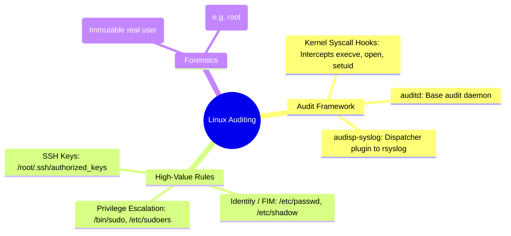

# 📖 Chapter 30: Linux & Unix Server Ingestion: Auditd & Syslog Masterclass

> **The IBM QRadar Administrator's Technical Guide** | Phase 3: Deep Log Source Onboarding & Integration  
> **Target Audience:** 1.5-Year Administrators $\rightarrow$ Senior SIEM Engineers & Linux Security Specialists  
> **Focus:** Linux Kernel Audit Subsystem (`auditd`), `audispd` Syslog Dispatcher, SUDO Auditing, FIM, & Hands-on Lab 30

---

## 📸 1. Visual Overview: Linux Kernel Auditing & Ingestion Architecture


*Figure 30.1: 3D Isometric View of Linux Host Security Ingestion: Linux Kernel System Calls (`execve`, `setuid`, `open`) intercepted by `auditd`, routed through `audisp-syslog`, forwarded across encrypted TLS 6514, and normalized by QRadar's Linux OS / Auditd DSMs (`![[10_daemons_process_hierarchy_3d.jpg|1000]]`)*

---

## 2. The Linux Audit Framework: Kernel Syscall Interception

Standard syslog on Linux only records what userland applications voluntarily log. To catch attackers, rootkits, and unauthorized privilege escalation, administrators must deploy the **Linux Audit Subsystem (`auditd`)**, which intercepts operations directly inside the Linux kernel.

```
┌────────────────────────────────────────────────────────────────────────┐
│ 🐧 LINUX KERNEL AUDIT PIPELINE                                         │
│                                                                        │
│ [ Userland Application / Attacker Shell ]                              │
│       │ (Executes `sudo -i` or modifies `/etc/shadow`)                 │
│ ┌─────▼──────────────────────────────────────────────────────────────┐ │
│ │ LINUX KERNEL (Syscall Hook Layer)                                  │ │
│ │ • Intercepts `execve()`, `setuid()`, `openat()`, `unlinkat()`       │ │
│ │ • Records original `auid` (Audit UID) to defeat SUDO masking!      │ │
│ └─────┬──────────────────────────────────────────────────────────────┘ │
│       │ (Raw Netlink Socket Stream)                                    │
│ ┌─────▼──────────────────────────────────────────────────────────────┐ │
│ │ auditd Daemon ➔ audispd / audisp-syslog Dispatcher Plugin          │ │
│ └─────┬──────────────────────────────────────────────────────────────┘ │
│       │ (Syslog RFC 5424 over TCP/TLS)                                 │
│ ┌─────▼──────────────────────────────────────────────────────────────┐ │
│ │ QRadar Event Collector (`ecs-ec-ingress` ➔ Linux OS Auditd DSM)     │ │
│ └────────────────────────────────────────────────────────────────────┘ │
└────────────────────────────────────────────────────────────────────────┘
```

---

## 3. High-Value Enterprise Linux Audit Rules (`/etc/audit/rules.d/audit.rules`)

To capture security events without drowning in noise, deploy these hardened enterprise audit rules:

```text
# 1. Self-Protection: Make Audit Configuration Immutable (Requires Reboot to Change)
-e 2

# 2. Monitor Privilege Escalation Tools (Sudo, SU, SUID Binaries)
-w /bin/sudo -p x -k privileged_escalation
-w /usr/bin/sudo -p x -k privileged_escalation
-w /bin/su -p x -k privileged_escalation
-w /etc/sudoers -p wa -k sudoers_modification
-w /etc/sudoers.d/ -p wa -k sudoers_modification

# 3. File Integrity Monitoring (FIM): User & Credential Storage
-w /etc/passwd -p wa -k identity_changes
-w /etc/shadow -p wa -k identity_changes
-w /etc/group -p wa -k identity_changes
-w /etc/gshadow -p wa -k identity_changes
-w /etc/security/ -p wa -k security_config_changes

# 4. Monitor SSH Authentication Keys & Authorized Keys
-w /root/.ssh/ -p wa -k root_ssh_keys
-w /etc/ssh/sshd_config -p wa -k sshd_config_change

# 5. Syscall Auditing: Process Execution by Non-System Users (UID >= 1000)
-a always,exit -F arch=b64 -S execve -F auid>=1000 -F auid!=4294967295 -k user_commands
```

---

## 4. Forwarding Audit Logs to QRadar via `audisp-syslog`

Configure the audit dispatcher plugin (`/etc/audit/plugins.d/syslog.conf` or `/etc/audisp/plugins.d/syslog.conf`):

```text
active = yes
direction = out
path = /sbin/audisp-syslog
type = builtin
args = LOG_LOCAL6
format = string
```

Then configure Rsyslog (`/etc/rsyslog.d/50-audit-forward.conf`) to forward `local6.*` to QRadar:
```text
local6.* @@192.168.10.100:514
```

Restart services:
```bash
augenrules --load
systemctl restart auditd
systemctl restart rsyslog
```

---

## 5. Normalization: The Power of `auid` vs `euid`

When an attacker logs in as regular user `alice` (`uid=1001`) and runs `sudo su` to become `root` (`uid=0`), standard logs only show `root` executing subsequent commands.

```
┌────────────────────────────────────────────────────────────────────────┐
│ 🔍 AUID VS EUID FORENSIC IDENTIFICATION                                │
│                                                                        │
│ • `auid` (Audit UID / Login UID): The immutable user ID assigned       │
│   during initial login (e.g. `1001` = alice). Cannot be changed by sudo!│
│ • `euid` (Effective UID): The current operational UID (e.g. `0` = root).│
│ • QRadar extracts `auid` into the **`Username`** field so offenses are  │
│   indexed against `alice` rather than generic `root`!                  │
└────────────────────────────────────────────────────────────────────────┘
```

---

## 📌 6. Visual Mind Map & Sticky Notes (Chapter 30 Quick-Review)

### 🧠 Hierarchical Mind Map


### 🗂️ Color-Coded Digital Sticky Notes

#### 🟨 Sticky Note 1: Kernel vs Syslog
```text
┌─────────────────────────────────────────────────────────────┐
│ 📌 CONCEPT: KERNEL-LEVEL AUDITING                           │
│                                                             │
│ • Syslog only logs what apps want to log.                   │
│ • `auditd` intercepts system calls inside the Linux kernel, │
│   making it impossible for attackers to hide executed commands!│
└─────────────────────────────────────────────────────────────┘
```

#### 🟩 Sticky Note 2: The `auid` Attribution Rule
```text
┌─────────────────────────────────────────────────────────────┐
│ 📌 GOLDEN RULE: AUDIT UID ATTRIBUTION                       │
│                                                             │
│ • Always rely on `auid` (Audit UID) to identify who executed│
│   a malicious command.                                      │
│ • `auid` remains pinned to the initial login identity even  │
│   after running `sudo su` or `sudo bash`!                   │
└─────────────────────────────────────────────────────────────┘
```

#### 🟪 Sticky Note 3: Immutable Rules Flag (`-e 2`)
```text
┌─────────────────────────────────────────────────────────────┐
│ 📌 ARCHITECTURE: IMMUTABILITY ENFORCEMENT                   │
│                                                             │
│ • The `-e 2` rule locks auditd configuration in kernel memory.│
│ • Even root cannot disable audit logging without rebooting  │
│   the entire physical server!                               │
└─────────────────────────────────────────────────────────────┘
```

#### 🟦 Sticky Note 4: File Integrity Monitoring (FIM)
```text
┌─────────────────────────────────────────────────────────────┐
│ 📌 VALUE: BUILT-IN LINUX FIM                                │
│                                                             │
│ • Adding `-w /etc/ -p wa -k etc_changes` turns auditd into  │
│   a high-speed File Integrity Monitoring agent for PCI-DSS! │
└─────────────────────────────────────────────────────────────┘
```

#### 🟧 Sticky Note 5: Interview Cheat Code (Linux SIEM Ingestion)
```text
┌─────────────────────────────────────────────────────────────┐
│ 📌 INTERVIEW CHEAT CODE: "HOW DO YOU AUDIT LINUX IN QRADAR?"│
│                                                             │
│ "I deploy hardened kernel audit rules in `/etc/audit/rules.d/`│
│ to track privilege escalation, sudoers changes, and FIM on  │
│ `/etc/shadow`, forward events via `audisp-syslog`, and map  │
│ immutable `auid` values to hold real users accountable."    │
└─────────────────────────────────────────────────────────────┘
```

#### 🟥 Sticky Note 6: Critical Pitfall
```text
┌─────────────────────────────────────────────────────────────┐
│ ⚠️ CRITICAL PITFALL: UNFILTERED `execve` AUDITING           │
│                                                             │
│ • Auditing `execve` system calls for system daemons         │
│   (`auid < 1000`) creates massive log floods (10,000+ EPS),  │
│   exhausting disk space and crashing rsyslog!               │
└─────────────────────────────────────────────────────────────┘
```

---

### ⚡ Rapid-Recall Flashcards

| # | Question (Front) | Answer (Back) |
| :-: | :--- | :--- |
| **01** | What Linux daemon intercepts system calls at the kernel level? | **`auditd`**. |
| **02** | What plugin forwards `auditd` events to the local Syslog daemon? | **`audisp-syslog`** (part of `audispd`). |
| **03** | What is the forensic difference between `auid` and `euid`? | **`auid`** is the immutable original login user; **`euid`** is the current effective user (e.g., `root`). |
| **04** | What auditd rule parameter makes the audit configuration immutable until reboot? | **`-e 2`**. |
| **05** | What auditd flag sets a watch on a file or directory? | **`-w <path> -p <permissions> -k <key_name>`**. |
| **06** | What command compiles and loads new audit rules into the kernel? | **`augenrules --load`**. |

---

## 🧪 7. Hands-on Practice Lab 30: Linux Kernel Auditing & Sudo Telemetry Ingestion

### 🎯 Lab Objectives
1. Inspect active Linux kernel audit rules using `auditctl`.
2. Configure `audisp-syslog` to forward security events to QRadar over Syslog.
3. Trigger monitored privilege escalation and FIM modification events.
4. Verify event normalization and `auid` user attribution in QRadar.

---

### 📋 Step-by-Step Practical Lab Procedures

#### Step 1: Inspect Active Kernel Audit Rules
Log into a monitored Linux server via SSH:
```bash
# View active kernel audit rules and status
auditctl -l
auditctl -s
```

---

#### Step 2: Inject Test Linux Audit Rules for Sudo & FIM
```bash
# Append security audit rules to audit.rules
cat << 'EOF' >> /etc/audit/rules.d/audit.rules
-w /etc/sudoers -p wa -k sudoers_modification
-w /bin/su -p x -k privileged_su_execution
-w /etc/passwd -p wa -k identity_changes
EOF

# Load rules into kernel live
augenrules --load
```

---

#### Step 3: Trigger Monitored Security Events
```bash
# 1. Trigger file modification watch on /etc/passwd (read/write check)
touch /etc/passwd

# 2. View generated audit record locally
ausearch -k identity_changes --raw | tail -n 5
```

---

#### Step 4: Audit Normalized Linux Events in QRadar via AQL
From the QRadar Console CLI, run:
```bash
/opt/qradar/bin/arielsql -p 32011 -q "
SELECT 
    DATEFORMAT(starttime, 'yyyy-MM-dd HH:mm:ss') AS Timestamp, 
    username AS RealUser, 
    qidname(qid) AS EventName, 
    sourceip AS HostIP 
FROM events 
WHERE devicetypeid = 11 OR devicetypeid = 72 
ORDER BY starttime DESC 
LIMIT 10;
"
```
*Expected Output*: Returns normalized Linux security events showing the actual user identity attributed from `auid`.
