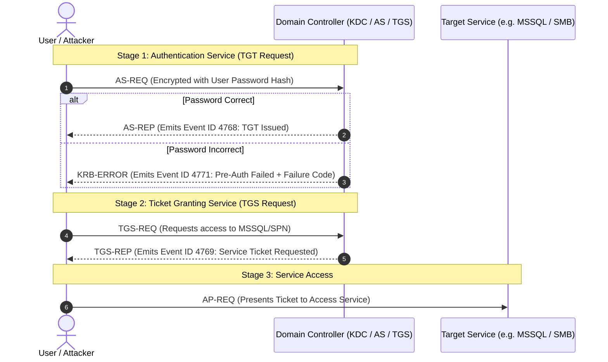
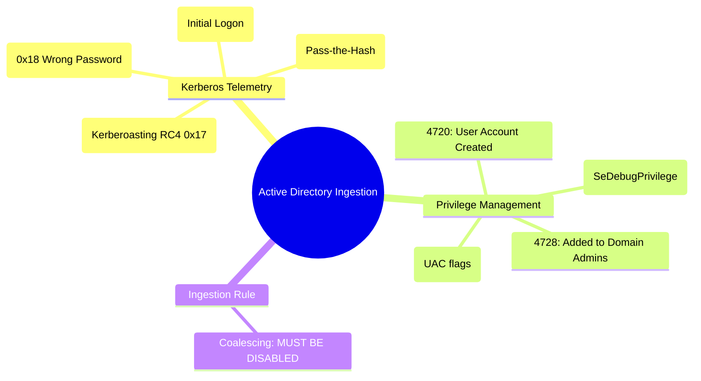

# 📖 Chapter 31: Active Directory & Domain Controller Security Ingestion Masterclass

> **The IBM QRadar Administrator's Technical Guide** | Phase 3: Deep Log Source Onboarding & Integration  
> **Target Audience:** 1.5-Year Administrators $\rightarrow$ Senior SIEM Engineers & Active Directory Security Specialists  
> **Focus:** Kerberos (4768, 4769, 4771), Account Management (4720, 4728), NTLM Auditing, Attack Indicators, & Hands-on Lab 31

---

## 📸 1. Visual Overview: Active Directory & Kerberos Ingestion


*Figure 31.1: 3D Isometric View of Active Directory Domain Controller Security Ingestion: Windows Domain Controllers emitting Kerberos TGT/TGS requests, NTLM validations, and Group Policy modifications into QRadar's Microsoft Windows Security DSM, feeding the Asset Identity Model and the Real-Time Correlation Engine (`![[16_asset_profiler_identity_model_3d.jpg|1000]]`)*

---

## 2. Active Directory: The Crown Jewels of Identity Telemetry

In enterprise networks, Active Directory Domain Controllers (DCs) authenticate every user, computer, service, and administrative request.

```
┌────────────────────────────────────────────────────────────────────────┐
│ 👑 THE ACTIVE DIRECTORY DETECTION PILLARS                              │
│                                                                        │
│ 1. KERBEROS PROTOCOL EVENTS (Authentication & Ticket Requests)         │
│    • Tracks Initial Logon (TGT), Service Access (TGS), and Failures.   │
│ ├────────────────────────────────────────────────────────────────────┤
│ 2. USER & GROUP MANAGEMENT (Privilege Escalation & Persistence)        │
│    • Tracks user creation, password resets, and Domain Admin adds.     │
│ ├────────────────────────────────────────────────────────────────────┤
│ 3. ACTIVE DIRECTORY OBJECT AUDITING (Directory Modifications)          │
│    • Tracks modifications to Group Policy Objects (GPOs) and ACLs.     │
│ ├────────────────────────────────────────────────────────────────────┤
│ 4. NTLM FALLBACK & PASS-THE-HASH (Legacy Authentication)               │
│    • Identifies unencrypted NTLMv1/v2 authentications across the domain.│
└────────────────────────────────────────────────────────────────────────┘
```

---

## 3. Kerberos Event Lifecycle & Threat Indicator Mapping

Kerberos authentication operates in a 2-stage ticketing flow:



### 📋 Critical Kerberos Event IDs & Hex Failure Codes

| Event ID | Event Description | Threat Context / Attack Detection |
| :--- | :--- | :--- |
| **`4768`** | A Kerberos authentication ticket (TGT) was requested | Initial domain logon. Look for unusual logon times or non-standard workstations. |
| **`4769`** | A Kerberos service ticket (TGS) was requested | **Kerberoasting Detection!** Look for Ticket Encryption Type `0x17` (RC4) requested for Service Principal Names (SPNs). |
| **`4771`** | Kerberos pre-authentication failed | **Password Guessing / Brute Force / AS-REP Roasting!** |
| **`4776`** | The domain controller validated NTLM credentials | NTLM authentication fallback or **Pass-the-Hash** lateral movement. |

#### 🔑 Kerberos Event ID 4771 Failure Code Matrix
- **`0x18`**: Client credential (password) is incorrect. (Standard failed password attempt).
- **`0x12`**: Client account is locked, disabled, or expired.
- **`0x25`**: Workstation clock skew is greater than 5 minutes relative to the DC.
- **`0x6`**: Username does not exist in Active Directory (User enumeration probe).

---

## 4. User Account & Privileged Group Management Telemetry

When an attacker gains a foothold, they frequently create backdoor accounts or add themselves to `Domain Admins`.

| Event ID | Event Name | Detection Logic in QRadar CRE |
| :--- | :--- | :--- |
| **`4720`** | A user account was created | Correlate with off-hours activity or non-standard naming conventions. |
| **`4726`** | A user account was deleted | Rapid user create + delete pattern indicates temporary attacker access. |
| **`4738`** | A user account was modified | Password set without requirement, or `DontExpirePassword` flag enabled. |
| **`4728`** | Member added to security global group | **High Severity!** Trigger offense whenever user added to `Domain Admins`. |
| **`4732`** | Member added to security local group | Trigger offense when added to `Administrators` or `Remote Desktop Users`. |
| **`4672`** | Special privileges assigned to new logon | Detects user logging in with `SeDebugPrivilege` or `SeBackupPrivilege`. |

---

## 5. Domain Controller Ingestion Best Practice: Zero Coalescing

```
┌────────────────────────────────────────────────────────────────────────┐
│ ⚠️ CRITICAL RULE: DISABLE COALESCING ON DOMAIN CONTROLLERS             │
│                                                                        │
│ • By default, QRadar enables Event Coalescing on new log sources.      │
│ • On Domain Controllers, you MUST explicitly DISABLE coalescing!       │
│ • If coalescing is enabled, a brute-force attack of 50 failed logins   │
│   within 1 second will be bundled into a single record, destroying the │
│   millisecond forensic timeline required for compliance!               │
└────────────────────────────────────────────────────────────────────────┘
```

---

## 📌 6. Visual Mind Map & Sticky Notes (Chapter 31 Quick-Review)

### 🧠 Hierarchical Mind Map


### 🗂️ Color-Coded Digital Sticky Notes

#### 🟨 Sticky Note 1: Kerberoasting Detection (4769)
```text
┌─────────────────────────────────────────────────────────────┐
│ 📌 CONCEPT: KERBEROASTING DETECTION                         │
│                                                             │
│ • Kerberoasting queries Service Tickets with RC4 encryption.│
│ • Rule Test: `Event ID = 4769 AND Encryption Type = 0x17    │
│   AND Service Name != krbtgt`                               │
└─────────────────────────────────────────────────────────────┘
```

#### 🟩 Sticky Note 2: Failure Code 0x18 vs 0x6
```text
┌─────────────────────────────────────────────────────────────┐
│ 📌 GOLDEN RULE: KERBEROS FAILURE CODES                      │
│                                                             │
│ • Code `0x18`: Wrong password (Attacker guessed password).  │
│ • Code `0x6`: User doesn't exist (Attacker enumerating user │
│   accounts across the directory!).                          │
└─────────────────────────────────────────────────────────────┘
```

#### 🟪 Sticky Note 3: Group 4728 Escalation
```text
┌─────────────────────────────────────────────────────────────┐
│ 📌 ARCHITECTURE: DOMAIN ADMIN SURVEILLANCE                  │
│                                                             │
│ • Event ID 4728 for "Domain Admins" should ALWAYS generate  │
│   an immediate high-magnitude (10/10) offense and email!    │
└─────────────────────────────────────────────────────────────┘
```

#### 🟦 Sticky Note 4: Disable Coalescing
```text
┌─────────────────────────────────────────────────────────────┐
│ 📌 COMPLIANCE: ZERO COALESCING MANDATE                      │
│                                                             │
│ • Never coalesce Domain Controller authentication events.   │
│ • Exact event timestamps are mandatory for legal audits.    │
└─────────────────────────────────────────────────────────────┘
```

#### 🟧 Sticky Note 5: Interview Cheat Code (Active Directory)
```text
┌─────────────────────────────────────────────────────────────┐
│ 📌 INTERVIEW CHEAT CODE: "HOW DO YOU DETECT AD ATTACKS?"    │
│                                                             │
│ "I monitor Kerberos 4768 (TGT), 4771 (Pre-auth fails with   │
│ hex code 0x18 for brute force), 4769 (RC4 0x17 tickets for  │
│ Kerberoasting), and 4728 for unauthorized Domain Admin group│
│ modifications while keeping Coalescing strictly disabled."  │
└─────────────────────────────────────────────────────────────┘
```

#### 🟥 Sticky Note 6: Critical Pitfall
```text
┌─────────────────────────────────────────────────────────────┐
│ ⚠️ CRITICAL PITFALL: NTLM BLIND SPOT                        │
│                                                             │
│ • Forgetting to collect Event ID 4776 leaves the SIEM blind │
│   to legacy NTLM brute-force and Pass-the-Hash attacks!     │
└─────────────────────────────────────────────────────────────┘
```

---

### ⚡ Rapid-Recall Flashcards

| # | Question (Front) | Answer (Back) |
| :-: | :--- | :--- |
| **01** | Which Windows event records a failed Kerberos pre-authentication attempt? | **Event ID 4771**. |
| **02** | What does Kerberos failure code `0x18` indicate? | **Wrong password** provided by the user. |
| **03** | Which event ID and encryption type detects Kerberoasting attacks? | **Event ID 4769** with **Ticket Encryption Type `0x17` (RC4)**. |
| **04** | Which Windows event records an account being added to a Global Security Group? | **Event ID 4728**. |
| **05** | What Windows event captures a new user account being created? | **Event ID 4720**. |
| **06** | Why must Coalescing be disabled on Domain Controller log sources? | To **preserve individual millisecond timestamps for all authentication attempts** for audit and forensic integrity. |

---

## 🧪 7. Hands-on Practice Lab 31: Active Directory Security Telemetry & Attack Forensics

### 🎯 Lab Objectives
1. Inspect registered Domain Controller log sources in PostgreSQL and verify Coalescing is disabled.
2. Query Kerberos authentication failures (Event ID 4771) and extract failure codes.
3. Detect potential Kerberoasting queries (Event ID 4769 with RC4 encryption).
4. Run AQL forensic audits for privileged group modifications (Event ID 4728).

---

### 📋 Step-by-Step Practical Lab Procedures

#### Step 1: Verify Domain Controller Coalescing Status in PostgreSQL
```bash
# Query Domain Controller log sources to ensure coalescing is FALSE
psql -U qradar -d qradar -x -c "
SELECT 
    id, 
    devicename, 
    deviceip, 
    coalescing_events 
FROM sensordevice 
WHERE devicename ILIKE '%DC%' OR devicename ILIKE '%Domain Controller%';
"
```

---

#### Step 2: Query Kerberos Pre-Authentication Failures (4771) via AQL
```bash
/opt/qradar/bin/arielsql -p 32011 -q "
SELECT 
    DATEFORMAT(starttime, 'yyyy-MM-dd HH:mm:ss') AS Timestamp, 
    username AS TargetUser, 
    sourceip AS WorkstationIP, 
    \"Pre-Authentication Type\" AS FailureCode, 
    COUNT(*) AS FailCount 
FROM events 
WHERE qid = 5000854 OR UTF8(payload) ILIKE '%4771%' 
GROUP BY Timestamp, TargetUser, WorkstationIP, FailureCode 
ORDER BY FailCount DESC 
LAST 2 HOURS;
"
```

---

#### Step 3: Hunt for Kerberoasting Indicators (Event ID 4769 + RC4)
```bash
/opt/qradar/bin/arielsql -p 32011 -q "
SELECT 
    username AS RequestingUser, 
    \"Service Name\" AS TargetSPN, 
    \"Ticket Encryption Type\" AS EncryptionType, 
    sourceip AS ClientIP 
FROM events 
WHERE UTF8(payload) ILIKE '%4769%' AND UTF8(payload) ILIKE '%0x17%' 
LAST 24 HOURS;
"
```
*Expected Output*: Displays non-standard service ticket requests requesting weak RC4 (`0x17`) encryption hashes for offline cracking.

---

#### Step 4: Audit Privileged Group Membership Additions (4728)
```bash
/opt/qradar/bin/arielsql -p 32011 -q "
SELECT 
    DATEFORMAT(starttime, 'yyyy-MM-dd HH:mm:ss') AS Timestamp, 
    username AS TargetAccount, 
    \"Target Group Name\" AS GroupName, 
    \"SubjectUserName\" AS AdminWhoAdded 
FROM events 
WHERE UTF8(payload) ILIKE '%4728%' OR qid = 5000865 
ORDER BY starttime DESC 
LAST 24 HOURS;
"
```
