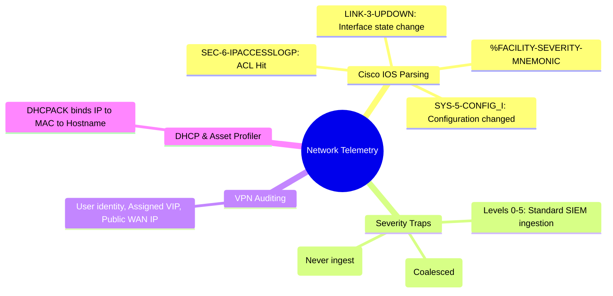

# 📖 Chapter 32: Enterprise Network Infrastructure: Cisco IOS, Switches & VPNs Masterclass

> **The IBM QRadar Administrator's Technical Guide** | Phase 3: Deep Log Source Onboarding & Integration  
> **Target Audience:** 1.5-Year Administrators $\rightarrow$ Senior SIEM Engineers & Network Security Operations Leads  
> **Focus:** Cisco IOS Mnemonic Parsing, VPN Remote Access Telemetry, DHCP Lease Identity Mapping, & Hands-on Lab 32

---

## 📸 1. Visual Overview: Enterprise Network Infrastructure Ingestion


*Figure 32.1: 3D Isometric View of Core Network Telemetry Ingestion: Core Routers, Data Center Switches, VPN Concentrators, and DHCP Servers streaming Syslog over UDP/TCP 514, driving the QRadar Asset Profiler and Network Anomaly Rules Engine (`![[13_network_ports_security_matrix_3d.jpg|1000]]`)*

---

## 2. Cisco IOS & Network Equipment Telemetry Architecture

Enterprise network devices (Cisco Catalyst, Cisco Nexus, Cisco IOS-XE, Juniper, Arista) format syslog using structured facility mnemonics:

```
┌────────────────────────────────────────────────────────────────────────┐
│ 📡 ANATOMY OF A CISCO IOS SYSLOG HEADER                                │
│                                                                        │
│ `timestamp: %FACILITY-SEVERITY-MNEMONIC: Message-text`                 │
│                                                                        │
│ • Example 1 (Admin Config Change):                                     │
│   `Sep 25 18:15:00.123 UTC: %SYS-5-CONFIG_I: Configured from console by│
│    admin on vty0 (10.0.0.50)`                                          │
│ • Example 2 (Interface State Change):                                  │
│   `Sep 25 18:15:02.456 UTC: %LINK-3-UPDOWN: Interface GigabitEthernet0/1│
│    changed state to down`                                              │
│ • Example 3 (Access-List Security Hit):                                │
│   `Sep 25 18:15:05.789 UTC: %SEC-6-IPACCESSLOGP: list 101 denied tcp   │
│    198.51.100.4(41230) -> 10.10.20.5(445), 1 packet`                   │
└────────────────────────────────────────────────────────────────────────┘
```

---

## 3. Cisco IOS Severity Levels & Ingestion Filtering

Network switches can generate millions of debug packets. SIEM engineers must configure appropriate logging traps:

| Severity Level | Name | Description | Recommended SIEM Ingestion |
| :---: | :--- | :--- | :---: |
| **0** | Emergency | System is completely unusable | ✅ Ingest (Critical) |
| **1** | Alert | Immediate action required | ✅ Ingest (Critical) |
| **2** | Critical | Critical hardware/protocol failure | ✅ Ingest (Critical) |
| **3** | Error | Error conditions (Interface down) | ✅ Ingest (High) |
| **4** | Warning | Warning conditions (High CPU/Memory)| ✅ Ingest (Medium) |
| **5** | Notification | Normal but significant (Config changed)| ✅ Ingest (Medium) |
| **6** | Informational | Routine operational messages (ACL hits)| ⚠️ Ingest with Coalescing |
| **7** | Debug | Verbose debugging messages | ❌ NEVER INGEST TO SIEM! |

### 🛠️ Cisco IOS Switch Configuration Template
```text
logging host 192.168.10.100 transport udp port 514
logging source-interface GigabitEthernet0/0
logging trap notifications
logging facility local7
logging rate-limit 1000 except 0-4
service timestamps log datetime msec show-timezone
```

---

## 4. Remote Access VPN Telemetry & Attack Surface

VPN concentrators (Cisco AnyConnect / Secure Client, GlobalProtect, Pulse Secure) provide remote perimeter access:

```mermaid
flowchart LR
    USER[Remote User / Attacker on Public Internet: 203.0.113.50] -->|TLS / DTLS Tunnel| VPN[VPN Concentrator (Cisco ASA)]
    VPN -->|Emit Session Syslog: %ASA-6-722022| QRADAR[QRadar SIEM]
    
    subgraph Extracted["Extracted VPN Telemetry Fields"]
        F1["User: jsmith"]
        F2["Assigned Virtual IP: 10.100.5.25"]
        F3["Public WAN Source IP: 203.0.113.50"]
        F4["Duration & Bytes Transferred"]
    end

    QRADAR --> Extracted
    Extracted --> CRE[CRE Rule: Impossible Travel / Geolocation Anomaly]
```

---

## 5. DHCP Lease Telemetry & Asset Profiler Identity Resolution

In dynamic enterprise environments, laptop IP addresses change multiple times per week via DHCP.

```
┌────────────────────────────────────────────────────────────────────────┐
│ 🔄 DHCP TO ASSET PROFILER IDENTITY MAPPING                             │
│                                                                        │
│ 1. DHCP Server logs lease assignment:                                  │
│    `DHCPACK on 10.20.30.55 to 00:1A:2B:3C:4D:5E (LAPTOP-FINANCE-04)`  │
│ 2. QRadar Microsoft DHCP Server DSM parses:                            │
│    • IP: `10.20.30.55`                                                 │
│    • MAC Address: `00:1A:2B:3C:4D:5E`                                  │
│    • NetBIOS Hostname: `LAPTOP-FINANCE-04`                             │
│ 3. Asset Profiler updates the Asset Database:                          │
│    • Binds the dynamic IP to the permanent MAC and Hostname.           │
│    • When an offense fires 3 days later on `10.20.30.55`, QRadar       │
│      accurately tags the offender as `LAPTOP-FINANCE-04`!              │
└────────────────────────────────────────────────────────────────────────┘
```

---

## 📌 6. Visual Mind Map & Sticky Notes (Chapter 32 Quick-Review)

### 🧠 Hierarchical Mind Map


### 🗂️ Color-Coded Digital Sticky Notes

#### 🟨 Sticky Note 1: Severity 7 Ban
```text
┌─────────────────────────────────────────────────────────────┐
│ 📌 CONCEPT: THE DEBUG TRAP BAN                              │
│                                                             │
│ • Never send Cisco Severity 7 (Debug) logs to QRadar!       │
│ • Debug logs can exceed 50,000 EPS from a single switch,    │
│   crashing collector queues within seconds!                 │
└─────────────────────────────────────────────────────────────┘
```

#### 🟩 Sticky Note 2: Millisecond Timestamps
```text
┌─────────────────────────────────────────────────────────────┐
│ 📌 GOLDEN RULE: SERVICE TIMESTAMPS                          │
│                                                             │
│ • Always configure `service timestamps log datetime msec`   │
│   on Cisco network devices.                                 │
│ • Guarantees microsecond ordering for switch port flaps!    │
└─────────────────────────────────────────────────────────────┘
```

#### 🟪 Sticky Note 3: DHCP Identity Bridge
```text
┌─────────────────────────────────────────────────────────────┐
│ 📌 ARCHITECTURE: DHCP ASSET LINKING                         │
│                                                             │
│ • Ingesting DHCP logs is mandatory for dynamic DHCP zones.  │
│ • Allows analysts to search historical events by MAC or     │
│   Hostname even if the IP address has changed 10 times!     │
└─────────────────────────────────────────────────────────────┘
```

#### 🟦 Sticky Note 4: Rate Limiting on Switches
```text
┌─────────────────────────────────────────────────────────────┐
│ 📌 VALUE: SWITCH LOG RATE LIMITING                          │
│                                                             │
│ • Use `logging rate-limit 1000` on edge access switches.    │
│ • Prevents physical cable disconnects from flooding 100,000│
│   interface flap logs to the SIEM!                          │
└─────────────────────────────────────────────────────────────┘
```

#### 🟧 Sticky Note 5: Interview Cheat Code (Network Logs)
```text
┌─────────────────────────────────────────────────────────────┐
│ 📌 INTERVIEW CHEAT CODE: "HOW DO YOU INGEST NETWORK LOGS?"  │
│                                                             │
│ "I configure Cisco devices with severity 0-5 traps, rate-   │
│ limiting, and millisecond timestamps, parse standard Cisco  │
│ mnemonics (%SYS-5-CONFIG_I), monitor VPN sessions, and feed │
│ DHCPACK logs to the Asset Profiler for IP-to-MAC tracking." │
└─────────────────────────────────────────────────────────────┘
```

#### 🟥 Sticky Note 6: Critical Pitfall
```text
┌─────────────────────────────────────────────────────────────┐
│ ⚠️ CRITICAL PITFALL: SWITCH CLOCK SKEW                      │
│                                                             │
│ • Switches running on unsynchronized local clocks (e.g. 1993│
│   or UTC offsets) will cause Ariel to write logs into the   │
│   wrong historical partitions! Always enforce NTP on gear.  │
└─────────────────────────────────────────────────────────────┘
```

---

### ⚡ Rapid-Recall Flashcards

| # | Question (Front) | Answer (Back) |
| :-: | :--- | :--- |
| **01** | What is the format of a standard Cisco IOS log header? | **`%FACILITY-SEVERITY-MNEMONIC: message_text`**. |
| **02** | What Cisco IOS severity level corresponds to verbose debugging? | **Severity 7 (Debug)** — which should never be sent to a SIEM. |
| **03** | Why are DHCP lease logs critical for the QRadar Asset Profiler? | They bind dynamic **IP addresses to physical MAC addresses and NetBIOS hostnames** over time. |
| **04** | What Cisco command adds millisecond precision and timezone to log messages? | **`service timestamps log datetime msec show-timezone`**. |
| **05** | What Cisco mnemonic indicates an administrative configuration change? | **`%SYS-5-CONFIG_I`**. |
| **06** | What Cisco ASA syslog message captures VPN remote access tunnel establishment? | **`%ASA-6-722022`** (or `%ASA-6-722051`). |

---

## 🧪 7. Hands-on Practice Lab 32: Network Telemetry Parsing & Asset Identity Auditing

### 🎯 Lab Objectives
1. Inspect configured Cisco and network log sources in the QRadar database.
2. Inject synthetic Cisco IOS and Cisco ASA VPN syslog messages.
3. Verify field extraction for Cisco facility mnemonics and VPN session parameters.
4. Verify DHCPACK lease ingestion and asset identity updates.

---

### 📋 Step-by-Step Practical Lab Procedures

#### Step 1: Query Cisco Network Log Sources in PostgreSQL
```bash
psql -U qradar -d qradar -x -c "
SELECT 
    sd.id, 
    sd.devicename, 
    sd.deviceip, 
    dt.devicetypename 
FROM sensordevice sd 
JOIN devicetype dt ON sd.devicetypeid = dt.id 
WHERE dt.devicetypename ILIKE '%Cisco%' 
   OR dt.devicetypename ILIKE '%Juniper%';
"
```

---

#### Step 2: Inject Synthetic Cisco IOS Admin Change & Interface Flap
```bash
# 1. Inject %SYS-5-CONFIG_I message
logger -n 127.0.0.1 -P 514 -t "Sep 25 18:15:00.123 UTC: %SYS-5-CONFIG_I" "Configured from console by netadmin on vty0 (10.0.0.50)"

# 2. Inject %LINK-3-UPDOWN message
logger -n 127.0.0.1 -P 514 -t "Sep 25 18:15:02.456 UTC: %LINK-3-UPDOWN" "Interface GigabitEthernet0/1, changed state to down"
```

---

#### Step 3: Inject Synthetic Cisco ASA VPN Connection
```bash
logger -n 127.0.0.1 -P 514 -t "%ASA-6-722022" "Group <Corp-VPN> User <jsmith> IP <203.0.113.50> IPv4 Address <10.100.5.25> Assigned to session"
```

---

#### Step 4: Audit Extracted Network & VPN Events via AQL
```bash
/opt/qradar/bin/arielsql -p 32011 -q "
SELECT 
    DATEFORMAT(starttime, 'yyyy-MM-dd HH:mm:ss') AS Timestamp, 
    sourceip AS SourceIP, 
    destinationip AS DestIP, 
    username AS VPNUser, 
    qidname(qid) AS EventName 
FROM events 
WHERE UTF8(payload) ILIKE '%CONFIG_I%' OR UTF8(payload) ILIKE '%ASA-6-722022%' 
ORDER BY starttime DESC 
LIMIT 10;
"
```
