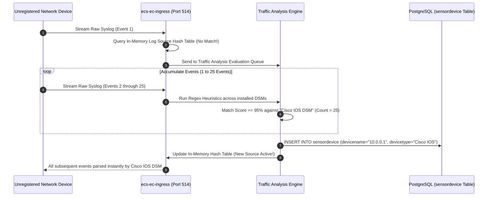
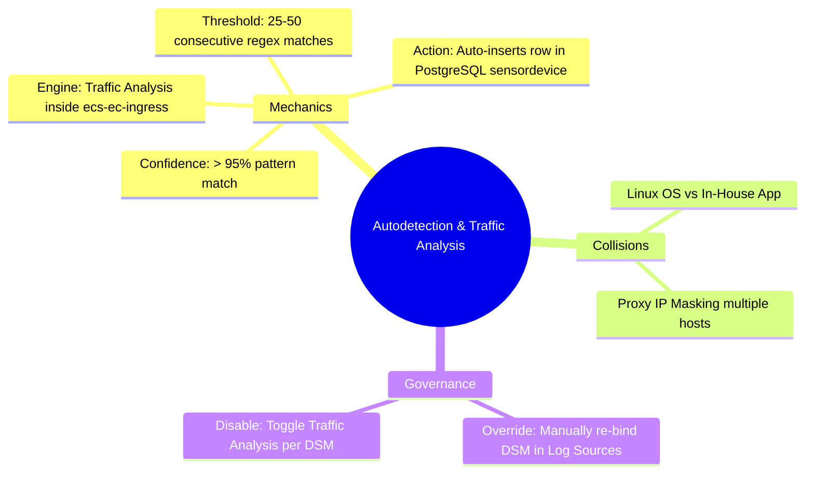

# 📖 Chapter 33: Log Source Autodetection Engine & Traffic Analysis Masterclass

> **The IBM QRadar Administrator's Technical Guide** | Phase 3: Deep Log Source Onboarding & Integration  
> **Target Audience:** 1.5-Year Administrators $\rightarrow$ Senior SIEM Engineers & Log Source Specialists  
> **Focus:** Traffic Analysis Mechanics, Autodetection Thresholds (25-50 Events), DSM Collisions, & Hands-on Lab 33

---

## 📸 1. Visual Overview: Traffic Analysis & Autodetection Engine


*Figure 33.1: 3D Isometric View of the Traffic Analysis Autodetection Pipeline: Unmatched raw Syslog arriving at `ecs-ec-ingress`, evaluated against heuristic DSM regex patterns in memory, accumulating detection scores, and automatically registering verified Log Sources into PostgreSQL (`![[stage5_6_parsing_qid_3d.jpg|1000]]`)*

---

## 2. The Autodetection Lifecycle in `ecs-ec-ingress`

When an unconfigured device sends syslog traffic to QRadar, the **Traffic Analysis Engine** attempts to identify the device and automatically create a Log Source:



---

## 3. Autodetection Thresholds & Heuristic Scoring

To prevent false classifications from random text strings, QRadar requires a threshold of consistent, recognizable events:

```
┌────────────────────────────────────────────────────────────────────────┐
│ 🎚️ TRAFFIC ANALYSIS THRESHOLD PARAMETERS                              │
│                                                                        │
│ • Detection Threshold: Default is 25 to 50 consecutive valid events.   │
│ • Heuristic Confidence Score: Must exceed 95% pattern match against a  │
│   specific DSM's header and payload regular expressions.               │
│ • Temporary Storage: Unmatched events are stored as `Stored Events`    │
│   (QID 38750003) until the threshold is reached.                       │
│ • Once auto-created, all subsequent events are parsed and normalized.  │
└────────────────────────────────────────────────────────────────────────┘
```

---

## 4. Autodetection Collisions & Race Conditions

While autodetection is powerful, it can misclassify devices in heterogeneous environments:

```
┌────────────────────────────────────────────────────────────────────────┐
│ ⚠️ COMMON AUTODETECTION RACE CONDITIONS                                │
│                                                                        │
│ 1. LINUX OS VS PROPRIETARY APPLICATION COLLISION:                      │
│    • A Linux server running an in-house banking app sends logs with a  │
│      standard syslog header (`Sep 25 18:00:00 server01 app: ...`).     │
│    • Traffic Analysis matches the syslog header and auto-creates a     │
│      `Linux OS DSM` $\rightarrow$ The banking app payload remains unparsed! │
│ ├────────────────────────────────────────────────────────────────────┤
│ 2. REVERSE PROXY / LOAD BALANCER IP MASKING:                           │
│    • Multiple web servers forward logs through a central NGINX proxy.  │
│    • Traffic Analysis sees all logs originating from the proxy IP      │
│      (`10.0.0.50`) and creates ONE massive shared log source!          │
└────────────────────────────────────────────────────────────────────────┘
```

---

## 5. Disabling & Overriding Autodetection

### 🛠️ How to Manually Override an Autodetected Log Source
1. Open **Admin Tab $\rightarrow$ Log Sources**.
2. Locate the incorrectly autodetected log source.
3. Edit the log source:
   - Change **Log Source Type** to the correct DSM (or Custom DSM).
   - Verify the **Log Source Identifier** matches the exact header string.
4. Click **Save** and execute **Deploy Changes**.
5. QRadar updates its in-memory routing table; subsequent events are immediately normalized under the new DSM without data loss.

---

## 📌 6. Visual Mind Map & Sticky Notes (Chapter 33 Quick-Review)

### 🧠 Hierarchical Mind Map


### 🗂️ Color-Coded Digital Sticky Notes

#### 🟨 Sticky Note 1: The 25-Event Rule
```text
┌─────────────────────────────────────────────────────────────┐
│ 📌 CONCEPT: THE THRESHOLD ACCUMULATOR                       │
│                                                             │
│ • QRadar will not auto-create a log source on a single log! │
│ • It requires 25 to 50 consistently recognizable events to  │
│   prevent rogue or malformed packets from creating sources. │
└─────────────────────────────────────────────────────────────┘
```

#### 🟩 Sticky Note 2: Manual Creation for Critical Assets
```text
┌─────────────────────────────────────────────────────────────┐
│ 📌 GOLDEN RULE: MANUAL LOG SOURCE PROVISIONING              │
│                                                             │
│ • NEVER rely on autodetection for critical infrastructure   │
│   (Domain Controllers, Core Firewalls, Proxy Fleets).       │
│ • Pre-create log sources manually to ensure exact naming,   │
│   group assignment, and coalescing settings!                │
└─────────────────────────────────────────────────────────────┘
```

#### 🟪 Sticky Note 3: Instant In-Memory Routing
```text
┌─────────────────────────────────────────────────────────────┐
│ 📌 ARCHITECTURE: HASH TABLE REGISTRATION                    │
│                                                             │
│ • When Traffic Analysis creates a source, it updates the    │
│   `ecs-ec-ingress` in-memory hash table dynamically.        │
│ • Zero service restart required for autodetection!          │
└─────────────────────────────────────────────────────────────┘
```

#### 🟦 Sticky Note 4: Custom DSM Priority
```text
┌─────────────────────────────────────────────────────────────┐
│ 📌 PERFORMANCE: CUSTOM DSM EXTENSION OVERRIDE               │
│                                                             │
│ • If a custom Log Source Extension (LSX) is assigned, it    │
│   takes 100% priority over system Traffic Analysis rules!   │
└─────────────────────────────────────────────────────────────┘
```

#### 🟧 Sticky Note 5: Interview Cheat Code (Autodetection)
```text
┌─────────────────────────────────────────────────────────────┐
│ 📌 INTERVIEW CHEAT CODE: "HOW DOES AUTODETECTION WORK?"     │
│                                                             │
│ "Traffic Analysis inspects unmatched ingress payloads       │
│ against installed DSM regex patterns, requiring 25 to 50    │
│ consecutive high-confidence matches before automatically    │
│ registering the source in PostgreSQL and the memory table." │
└─────────────────────────────────────────────────────────────┘
```

#### 🟥 Sticky Note 6: Critical Pitfall
```text
┌─────────────────────────────────────────────────────────────┐
│ ⚠️ CRITICAL PITFALL: REVERSE PROXY MERGE                    │
│                                                             │
│ • Allowing Traffic Analysis on logs forwarded through a     │
│   Syslog-NG forwarder will merge 500 servers into a single  │
│   log source! Always use unique Log Source Identifiers.     │
└─────────────────────────────────────────────────────────────┘
```

---

### ⚡ Rapid-Recall Flashcards

| # | Question (Front) | Answer (Back) |
| :-: | :--- | :--- |
| **01** | What component in QRadar performs log source autodetection? | The **Traffic Analysis Engine** within `ecs-ec-ingress`. |
| **02** | How many recognizable events are typically required before a log source is auto-created? | **25 to 50 consecutive events**. |
| **03** | What status are unrecognized events assigned before autodetection completes? | **Stored Events (QID 38750003: SIM Generic Log DSM)**. |
| **04** | What database table stores newly auto-created log sources? | The **`sensordevice`** table in PostgreSQL. |
| **05** | Why should critical log sources be pre-created manually rather than autodetected? | To guarantee **correct naming conventions, log source groups, and coalescing configurations**. |
| **06** | Does auto-creating a log source require a "Deploy Full Configuration" restart? | **No**, `ecs-ec-ingress` dynamically registers the new identifier in its in-memory lookup table. |

---

## 🧪 7. Hands-on Practice Lab 33: Autodetection Inspection & Manual Override

### 🎯 Lab Objectives
1. Query autodetected vs manually created log sources in PostgreSQL.
2. Trigger the Traffic Analysis engine with synthetic unconfigured syslog bursts.
3. Inspect live log source registration in `ecs-ec-ingress`.
4. Execute a manual DSM override on an autodetected source.

---

### 📋 Step-by-Step Practical Lab Procedures

#### Step 1: Query Autodetected Log Sources in PostgreSQL
Log into the QRadar Console via SSH as `root`:
```bash
# Query all autodetected log sources (auto_discovered = true)
psql -U qradar -d qradar -x -c "
SELECT 
    sd.id, 
    sd.devicename, 
    sd.deviceip, 
    dt.devicetypename, 
    sd.auto_discovered, 
    sd.creation_date 
FROM sensordevice sd 
JOIN devicetype dt ON sd.devicetypeid = dt.id 
WHERE sd.auto_discovered = TRUE 
ORDER BY sd.creation_date DESC 
LIMIT 10;
"
```

---

#### Step 2: Inject 30 Synthetic Cisco IOS Packets to Trigger Autodetection
```bash
python3 -c "
import socket
import time

sock = socket.socket(socket.AF_INET, socket.SOCK_DGRAM)
target_ip = '127.0.0.1'
port = 514

print('[*] Injecting 35 recognizable Cisco IOS events to trigger Traffic Analysis...')
for i in range(35):
    msg = f'<189>Sep 25 18:20:{i:02d} switch-core-09.corp.local: %SYS-5-CONFIG_I: Configured from vty0 by admin{i}'
    sock.sendto(msg.encode(), (target_ip, port))
    time.sleep(0.05)

print('[+] Injection complete. Check Log Sources for auto-created switch-core-09.')
"
```

---

#### Step 3: Monitor Traffic Analysis Logs in Real Time
```bash
grep -i "traffic analysis" /var/log/qradar.log | tail -n 25
```

---

#### Step 4: Verify Autodetected Log Source Registration
```bash
psql -U qradar -d qradar -c "
SELECT id, devicename, deviceip, devicetypeid FROM sensordevice WHERE devicename ILIKE '%switch-core-09%' OR deviceip = '127.0.0.1';
"
```
