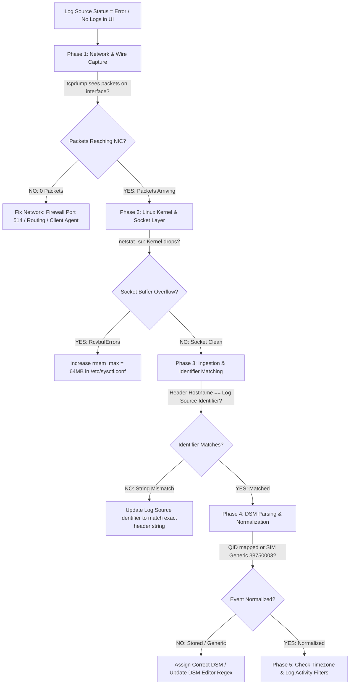
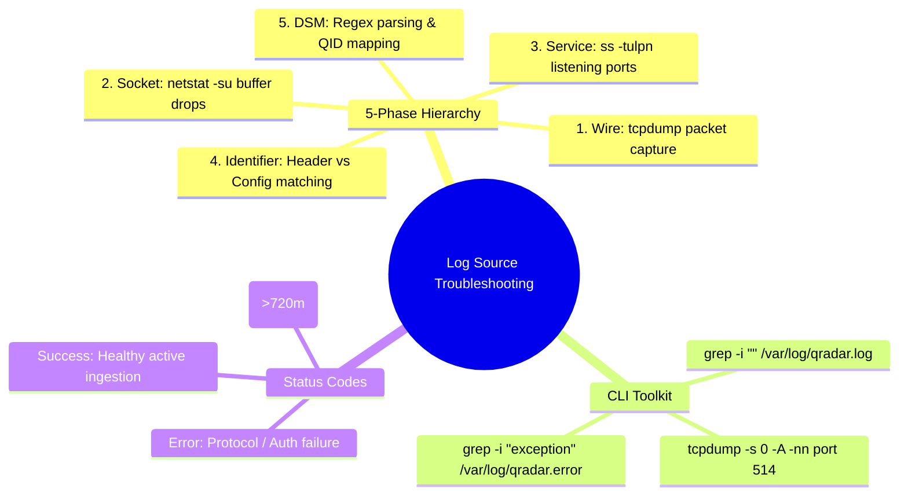

# 📖 Chapter 34: Log Source Troubleshooting & Packet Forensics Masterclass

> **The IBM QRadar Administrator's Technical Guide** | Phase 3: Deep Log Source Onboarding & Integration  
> **Target Audience:** 1.5-Year Administrators $\rightarrow$ Senior SIEM Engineers & Production Support Leads  
> **Focus:** 5-Phase Diagnostic Hierarchy, `tcpdump` Wire Sniffing, Identifier Mismatch Remediation, & Hands-on Lab 34

---

## 📸 1. Visual Overview: Log Source Diagnostics & Packet Forensics


*Figure 34.1: 3D Isometric View of the SIEM Diagnostics War Room: Step-by-step triage of broken ingestion pipelines from physical network interfaces (`tcpdump`) through Linux socket queues, `ecs-ec-ingress` thread pools, and DSM regex matchers to Ariel storage (`![[19_system_health_monitoring_runbooks_3d.jpg|1000]]`)*

---

## 2. The 5-Phase Diagnostic Hierarchy: Finding Missing Logs

When a critical log source stops sending data or displays `Status: Error`, follow this rigorous layer-by-layer troubleshooting hierarchy:



---

## 3. Layer-by-Layer Diagnostic Commands Matrix

| Phase | Diagnostic Objective | Primary Linux CLI Command | Expected Output / Root Cause Indicator |
| :--- | :--- | :--- | :--- |
| **Phase 1: Wire** | Verify packets are arriving at the network card | `tcpdump -nnXXi any port 514 and host <Source_IP>` | Displays raw hexadecimal/ASCII payload. If 0 packets arrive, issue is upstream network routing or firewall block. |
| **Phase 2: Socket** | Check for kernel-level socket queue buffer drops | `netstat -su \| grep "receive buffer errors"` | If count is incrementing, Linux socket buffer is too small (`sysctl -w net.core.rmem_max=67108864`). |
| **Phase 3: Sockets** | Verify QRadar daemon is listening on the port | `ss -tulpn \| grep -E "514\|6514\|8413"` | Confirms `ecs-ec-ingress` or `tomcat` is bound to `0.0.0.0:<Port>`. |
| **Phase 4: Match** | Check for identifier matching in logs | `grep -i "<Source_IP>" /var/log/qradar.log` | Reveals if `ecs-ec-ingress` rejected the packet or routed it to `SIM Generic Log DSM`. |
| **Phase 5: Error** | Inspect backend protocol exceptions | `grep -i "exception" /var/log/qradar.error` | Displays Java stack traces, JDBC connection timeouts, or TLS certificate validation failures. |

---

## 4. Troubleshooting Common Log Source Status Codes

```
┌────────────────────────────────────────────────────────────────────────┐
│ 🚥 LOG SOURCE STATUS CODE REMEDIATION RUNBOOK                          │
│                                                                        │
│ 🔴 STATUS: ERROR (Protocol Level Failure)                              │
│ • Root Causes: Bad credentials (JDBC/REST), expired TLS certificate,  │
│   target database port unreachable, or WinCollect agent disconnected.  │
│ • Immediate Action: Inspect `/var/log/qradar.error` for exception.     │
│ ├────────────────────────────────────────────────────────────────────┤
│ 🟡 STATUS: WARN / N/A (Inactivity Timeout Exceeded)                    │
│ • Root Causes: No events received within the configured timeout window │
│   (Default: 720 minutes / 12 hours). Common on quiet low-volume servers│
│ • Immediate Action: Verify client device is running; send test syslog. │
│ ├────────────────────────────────────────────────────────────────────┤
│ 🟢 STATUS: SUCCESS / ACTIVE (Healthy Streaming)                        │
│ • Events are actively arriving, identifiers match, and DSM is parsing. │
└────────────────────────────────────────────────────────────────────────┘
```

---

## 5. Live Packet Forensics with `tcpdump`

When diagnosing an unparsed or missing log source, capture live traffic directly on the QRadar network interface:

```bash
# Sniff live Syslog UDP packets from a specific firewall in readable ASCII format
tcpdump -s 0 -A -nn -i ens192 "udp port 514 and host 198.51.100.25" -c 10
```

### 🔍 Analyzing the Captured Payload
```text
18:15:00.123456 IP 198.51.100.25.514 > 192.168.10.100.514: UDP, length 240
E..p..@.@.o.a...c...."...2..<14>Sep 25 18:15:00 FW-CORP-EDGE01 traffic: allow src=10.0.0.5 dst=8.8.8.8
```
- **Packet Sender IP**: `198.51.100.25`
- **Syslog Header Hostname**: `FW-CORP-EDGE01`
- **Diagnosis**: If the Log Source was created with identifier `198.51.100.25`, but the header sends `FW-CORP-EDGE01`, update the **Log Source Identifier** to `FW-CORP-EDGE01`!

---

## 📌 6. Visual Mind Map & Sticky Notes (Chapter 34 Quick-Review)

### 🧠 Hierarchical Mind Map


### 🗂️ Color-Coded Digital Sticky Notes

#### 🟨 Sticky Note 1: Start at the Wire
```text
┌─────────────────────────────────────────────────────────────┐
│ 📌 CONCEPT: THE WIRE-FIRST RULE                             │
│                                                             │
│ • ALWAYS run `tcpdump` first before touching QRadar configs!│
│ • If packets aren't hitting the network card, changing DSM  │
│   settings will never fix the problem!                      │
└─────────────────────────────────────────────────────────────┘
```

#### 🟩 Sticky Note 2: Identifier Case-Sensitivity
```text
┌─────────────────────────────────────────────────────────────┐
│ 📌 GOLDEN RULE: IDENTIFIER CASE SENSITIVITY                 │
│                                                             │
│ • Log Source Identifiers are CASE-SENSITIVE in QRadar!      │
│ • `DC-PROD-01` does NOT match `dc-prod-01`.                 │
│ • Always copy the exact case directly from the raw payload! │
└─────────────────────────────────────────────────────────────┘
```

#### 🟪 Sticky Note 3: Timezone Search Trap
```text
┌─────────────────────────────────────────────────────────────┐
│ 📌 ARCHITECTURE: THE TIMEZONE SEARCH ILLUSION               │
│                                                             │
│ • Logs arriving with incorrect timestamps (e.g. UTC-5 vs UTC)│
│   will be stored in future or past Ariel partitions.        │
│ • Search `Last 24 Hours` or `Quick Filter` to find them!    │
└─────────────────────────────────────────────────────────────┘
```

#### 🟦 Sticky Note 4: Inactivity Warnings
```text
┌─────────────────────────────────────────────────────────────┐
│ 📌 VALUE: INACTIVITY TIMEOUT TUNING                         │
│                                                             │
│ • Low-volume backup appliances legitimately send 0 logs/day.│
│ • Increase the Log Source "Target Internal Inactivity"      │
│   timeout to prevent false yellow warning banners!          │
└─────────────────────────────────────────────────────────────┘
```

#### 🟧 Sticky Note 5: Interview Cheat Code (Troubleshooting Runbook)
```text
┌─────────────────────────────────────────────────────────────┐
│ 📌 INTERVIEW CHEAT CODE: "LOGS ARE MISSING. HOW DO YOU FIX?"│
│                                                             │
│ "I follow a 5-phase triage: 1. Sniff interface via tcpdump  │
│ for wire packets; 2. Check netstat for socket buffer drops; │
│ 3. Match the exact header string against Log Source ID;     │
│ 4. Check /var/log/qradar.log for DSM parsing; 5. Verify time│
│ zone offsets in Ariel search filters."                      │
└─────────────────────────────────────────────────────────────┘
```

#### 🟥 Sticky Note 6: Critical Pitfall
```text
┌─────────────────────────────────────────────────────────────┐
│ ⚠️ CRITICAL PITFALL: LOCAL IPTABLES BLOCK                   │
│                                                             │
│ • Forgetting that local Linux `iptables` or `firewalld` is  │
│   blocking a custom port (e.g., TCP 6514) on the Collector! │
│ • Check: `iptables -L -n -v | grep 6514`.                   │
└─────────────────────────────────────────────────────────────┘
```

---

### ⚡ Rapid-Recall Flashcards

| # | Question (Front) | Answer (Back) |
| :-: | :--- | :--- |
| **01** | What command captures live Syslog packets with readable ASCII payloads? | **`tcpdump -s 0 -A -nn -i any port 514`**. |
| **02** | What causes a log source to display `Status: Warning (Yellow)`? | **Inactivity Timeout Exceeded** (no logs received within the timeout window). |
| **03** | Are Log Source Identifiers case-sensitive in QRadar? | **Yes**, `SERVER01` will not match `server01`. |
| **04** | Where are QRadar Java exceptions and backend connection errors logged? | **`/var/log/qradar.error`**. |
| **05** | What does an incrementing count in `netstat -su` packet receive errors indicate? | The **Linux kernel socket buffer is overflowing** during high-EPS traffic bursts. |
| **06** | What script gathers full diagnostic system logs for IBM Support? | **`/opt/qradar/support/get_logs.sh -a`**. |

---

## 🧪 7. Hands-on Practice Lab 34: Live Wire Sniffing & Identifier Troubleshooting

### 🎯 Lab Objectives
1. Execute live packet sniffing on network interfaces using `tcpdump`.
2. Troubleshoot a simulated broken log source suffering from an Identifier string mismatch.
3. Verify kernel socket drop metrics using `netstat -su`.
4. Restore live event normalization and verify recovery in Log Activity.

---

### 📋 Step-by-Step Practical Lab Procedures

#### Step 1: Execute Live Interface Sniffing via `tcpdump`
Log into the QRadar Console or Collector via SSH as `root`:
```bash
# Sniff incoming UDP 514 traffic in human-readable ASCII
tcpdump -s 0 -A -nn -i any "udp port 514" -c 5
```

---

#### Step 2: Inject Test Syslog with Mismatched Hostname Identifier
```bash
# Inject packet where sender IP is 127.0.0.1 but header hostname is 'PROD-FW-VIRGINIA'
logger -n 127.0.0.1 -P 514 -t "PROD-FW-VIRGINIA" "traffic: deny src=203.0.113.10 dst=10.0.0.1 spt=44321 dpt=22"
```

---

#### Step 3: Inspect `/var/log/qradar.log` for Ingestion Routing
```bash
grep -i "PROD-FW-VIRGINIA" /var/log/qradar.log | tail -n 10
```
*Expected Output*: Displays event routed to `SIM Generic Log DSM` due to unmatched identifier.

---

#### Step 4: Remediate Identifier via CLI / PostgreSQL
```bash
# Update Log Source Identifier in database to match exact header string
psql -U qradar -d qradar -c "
UPDATE sensordevice 
SET deviceip = 'PROD-FW-VIRGINIA' 
WHERE devicename ILIKE '%Virginia Firewall%';
"
```

---

#### Step 5: Verify Event Normalization Recovery via AQL
```bash
/opt/qradar/bin/arielsql -p 32011 -q "
SELECT 
    logsourceid, 
    qidname(qid) AS EventName, 
    sourceip, 
    destinationip, 
    Action 
FROM events 
WHERE UTF8(payload) ILIKE '%PROD-FW-VIRGINIA%' 
LAST 15 MINUTES;
"
```
*Expected Output*: Returns successfully normalized event with extracted Source IP, Destination IP, and Action = `deny`.
