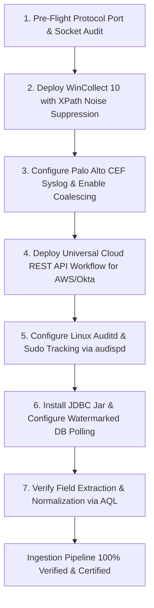
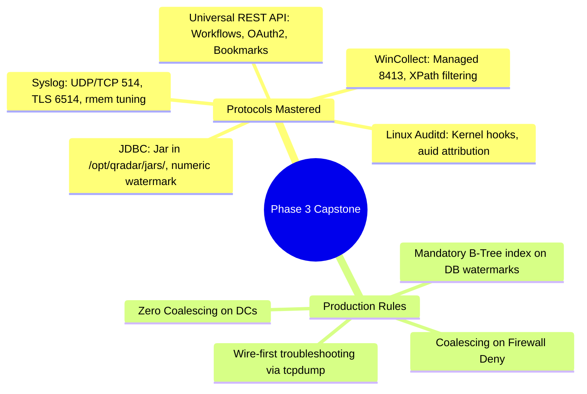

# 📖 Chapter 35: Phase 3 Capstone: Enterprise Multi-Protocol Onboarding Masterclass

> **The IBM QRadar Administrator's Technical Guide** | Phase 3: Deep Log Source Onboarding & Integration  
> **Target Audience:** 1.5-Year Administrators $\rightarrow$ Senior SIEM Engineers & Integration Architects  
> **Focus:** Multi-Protocol Enterprise Onboarding, Benchmark Exam (20 Questions), Troubleshooting Runbooks, & Hands-on Lab 35

---

## 📸 1. Visual Overview: Phase 3 Enterprise Ingestion Topology


*Figure 35.1: 3D Isometric View of the Heterogeneous Enterprise Ingestion Engine: Windows Domain Controllers (WinCollect 10 XPath), Perimeter Firewalls (Syslog CEF 514), Linux Servers (Kernel Auditd), Cloud SaaS (Universal REST API), and Relational Databases (JDBC Watermarking) streaming in parallel into the QRadar Event Collection Subsystem (`![[02_data_pipeline_8stages_3d.jpg|1000]]`)*

---

## 2. Phase 3 Enterprise Capstone Blueprint

In this capstone, you execute the complete end-to-end onboarding matrix for a Fortune 500 financial organization ingesting **35,000 sustained EPS**:

```
┌────────────────────────────────────────────────────────────────────────┐
│ 🏢 FORTUNE 500 ENTERPRISE LOG ONBOARDING MATRIX                        │
│                                                                        │
│ 1. WINDOWS DOMAIN CONTROLLERS (WinCollect 10 - Managed Mode)           │
│    • Protocol: WinCollect on TCP 8413 (Heartbeat) + TLS 6514 (Syslog). │
│    • Filtering: Custom XPath excluding Event IDs 5156/4689.            │
│    • Coalescing: STRICTLY DISABLED.                                    │
│ ├────────────────────────────────────────────────────────────────────┤
│ 2. PERIMETER NEXT-GEN FIREWALLS (Palo Alto PA-5260 Cluster)            │
│    • Protocol: Syslog over TCP 514.                                    │
│    • Format: CEF (Common Event Format).                                │
│    • Coalescing: ENABLED on Deny rules (Saves 40% IOPS).               │
│ ├────────────────────────────────────────────────────────────────────┤
│ 3. CLOUD HYPERSCALER (AWS CloudTrail & Okta System Logs)               │
│    • Protocol: Universal Cloud REST API (UCDSM).                       │
│    • Auth: OAuth2 Bearer Token + ISO 8601 Timestamp Bookmarks.         │
│ ├────────────────────────────────────────────────────────────────────┤
│ 4. LINUX PRODUCTION FLEET (Red Hat Enterprise Linux 9)                │
│    • Protocol: Linux Kernel `auditd` + `audisp-syslog` over TCP 514.   │
│    • Forensics: Immutable `auid` tracking for SUDO privilege elevation.│
│ ├────────────────────────────────────────────────────────────────────┤
│ 5. CORE TRANSACTION DATABASE (Oracle 19c Audit Vault)                  │
│    • Protocol: JDBC Pull using `ojdbc8.jar` in `/opt/qradar/jars/`.    │
│    • Watermarking: Sequential Numeric ID (`WHERE audit_id > ?`).       │
└────────────────────────────────────────────────────────────────────────┘
```

---

## 3. End-to-End Onboarding Workflow



---

## 4. Phase 3 Comprehensive Benchmark Assessment (20 Scenario Questions)

Test your Level 3 enterprise log onboarding expertise:

### 📝 Assessment Questions & Solutions

| # | Production Scenario Question | Correct Enterprise Solution |
| :-: | :--- | :--- |
| **01** | Why must Coalescing be disabled on Windows Domain Controllers? | To **preserve exact millisecond timestamps and event counts for all logon attempts** for compliance and brute-force detection. |
| **02** | What port does WinCollect use for heartbeat and configuration polling? | **TCP Port 8413**. |
| **03** | Where should external database JDBC driver JAR files be placed in QRadar? | In **`/opt/qradar/jars/`**. |
| **04** | Which Kerberos event captures failed pre-authentication attempts? | **Event ID 4771** (Failure code `0x18` indicates incorrect password). |
| **05** | What XML tag in a WinCollect XPath query excludes noisy events? | The **`<Suppress>`** tag inside `<QueryList>`. |
| **06** | What is the advantage of using `auid` over `euid` in Linux audit logs? | `auid` records the **immutable original login user** even after executing `sudo su` to root. |
| **07** | What protocol in QRadar ingests cloud SaaS events using `workflow.xml`? | The **Universal Cloud REST API Protocol (UCDSM)**. |
| **08** | What Linux command monitors live UDP syslog packets on an interface? | **`tcpdump -s 0 -A -nn -i any "udp port 514"`**. |
| **09** | What causes a log source to enter `Status: Warning` in QRadar? | **Inactivity Timeout Exceeded** (no logs received within the timeout window, default 720 min). |
| **10** | What is the preferred watermark comparison clause in JDBC queries? | **`WHERE numeric_id > ? ORDER BY numeric_id ASC`**. |
| **11** | What happens if the watermark column on the target database has no index? | The database performs an expensive **full table scan on every polling cycle**, causing high DB CPU load. |
| **12** | How many consecutive matching events does Traffic Analysis need to autodetect a source? | **25 to 50 consecutive recognizable events**. |
| **13** | What event ID and encryption type indicates a Kerberoasting attack? | **Event ID 4769** requesting weak **RC4 encryption (`0x17`)**. |
| **14** | Which Cisco IOS severity level should NEVER be forwarded to a SIEM? | **Severity 7 (Debug)**. |
| **15** | What is the purpose of the `<SetStatus>` tag in Universal Cloud REST API workflows? | To **persist high-watermark state bookmarks** across service restarts. |
| **16** | Are Log Source Identifiers case-sensitive in QRadar? | **Yes**, `FW-01` will not match `fw-01`. |
| **17** | What kernel parameter prevents Linux UDP socket buffer receive overflows? | **`net.core.rmem_max` (Set to 64MB: `67108864`)**. |
| **18** | Why should DHCP server lease logs be ingested into QRadar? | To feed the **Asset Profiler**, dynamically binding dynamic IP addresses to permanent MAC addresses and hostnames. |
| **19** | What log format does Fortinet FortiGate emit natively? | **Key-Value Pair Syslog** (`type=traffic subtype=forward srcip=...`). |
| **20** | Where are QRadar Java exceptions and protocol errors logged? | In **`/var/log/qradar.error`**. |

---

## 📌 5. Visual Mind Map & Sticky Notes (Chapter 35 Quick-Review)

### 🧠 Hierarchical Mind Map


### 🗂️ Color-Coded Digital Sticky Notes

#### 🟨 Sticky Note 1: Protocol Selection Mastery
```text
┌─────────────────────────────────────────────────────────────┐
│ 📌 CONCEPT: PROTOCOL FIT                                    │
│                                                             │
│ • Firewalls/Linux $\rightarrow$ Syslog (TCP 514 / TLS 6514)│
│ • Windows Endpoints $\rightarrow$ WinCollect 10 (XPath)     │
│ • Cloud/SaaS $\rightarrow$ Universal Cloud REST API (UCDSM) │
│ • Database Tables $\rightarrow$ JDBC (Watermarked Query)    │
└─────────────────────────────────────────────────────────────┘
```

#### 🟩 Sticky Note 2: Golden Ingestion Standards
```text
┌─────────────────────────────────────────────────────────────┐
│ 📌 GOLDEN RULE: PRODUCTION GOVERNANCE                       │
│                                                             │
│ • Filter at the edge (WinCollect XPath).                    │
│ • Coalesce repetitive firewall drops.                       │
│ • Never coalesce authentication or threat events!           │
└─────────────────────────────────────────────────────────────┘
```

#### 🟪 Sticky Note 3: The 5-Phase Diagnostic Reflex
```text
┌─────────────────────────────────────────────────────────────┐
│ 📌 ARCHITECTURE: 5-PHASE TRIAGE                             │
│                                                             │
│ • 1. Wire (`tcpdump`) ➔ 2. Kernel Socket (`netstat -su`) ➔  │
│   3. Ingestion (`qradar.log`) ➔ 4. DSM ➔ 5. AQL / Ariel.    │
└─────────────────────────────────────────────────────────────┘
```

#### 🟦 Sticky Note 4: Asset Profiler Enrichment
```text
┌─────────────────────────────────────────────────────────────┐
│ 📌 VALUE: IDENTITY CORRELATION                              │
│                                                             │
│ • DHCP + Kerberos + VPN logs automatically enrich the Asset │
│   Database, giving SOC analysts instant user context!       │
└─────────────────────────────────────────────────────────────┘
```

#### 🟧 Sticky Note 5: Interview Cheat Code (Senior Ingestion Engineer)
```text
┌─────────────────────────────────────────────────────────────┐
│ 📌 INTERVIEW CHEAT CODE: "SUMMARIZE YOUR INGESTION EXPERIENCE"│
│                                                             │
│ "I architect enterprise ingestion pipelines across WinCollect│
│ 10 with XPath suppression, Syslog over TLS 6514, Universal  │
│ Cloud REST API OAuth2 workflows, Linux kernel auditd with   │
│ auid tracking, and JDBC watermarking with B-Tree indexes."  │
└─────────────────────────────────────────────────────────────┘
```

#### 🟥 Sticky Note 6: Critical Pitfall
```text
┌─────────────────────────────────────────────────────────────┐
│ ⚠️ CRITICAL PITFALL: UNINDEXED DATABASE POLLING             │
│                                                             │
│ • Ingesting DB tables without an index on the watermark     │
│   column can crash production database clusters!            │
└─────────────────────────────────────────────────────────────┘
```

---

### ⚡ Rapid-Recall Flashcards

| # | Question (Front) | Answer (Back) |
| :-: | :--- | :--- |
| **01** | What is the primary benefit of WinCollect XPath filtering? | **Suppresses noise (Event IDs 5156/4689) at the endpoint in RAM**, saving 60-70% EPS license and network bandwidth. |
| **02** | How does QRadar track state during REST API polling in UCDSM? | Via **`<SetStatus>` Bookmarks** stored in PostgreSQL. |
| **03** | What command compiles and loads new Linux audit rules? | **`augenrules --load`**. |
| **04** | What tool captures raw network traffic on QRadar interfaces? | **`tcpdump`**. |
| **05** | What is the difference between RFC 3164 and RFC 5424 timestamps? | RFC 3164 lacks year and timezone; **RFC 5424 uses ISO 8601 with millisecond precision and UTC offset**. |
| **06** | What QID represents unparsed stored events? | **QID 38750003 (`SIM Generic Log DSM`)**. |

---

## 🧪 6. Hands-on Practice Lab 35: Enterprise Multi-Protocol Ingestion Health Audit

### 🎯 Lab Objectives
1. Perform a comprehensive cluster-wide log source health audit.
2. Query active log sources grouped by protocol type in PostgreSQL.
3. Validate field extraction across Windows, Firewall, Linux, and Cloud log sources using AQL.
4. Audit unparsed events (QID 38750003) to ensure 98%+ parsing efficiency across the cluster.

---

### 📋 Step-by-Step Practical Lab Procedures

#### Step 1: Query Protocol Distribution Across Deployment
Log into the QRadar Console via SSH as `root`:
```bash
# Query total configured log sources by protocol type
psql -U qradar -d qradar -c "
SELECT 
    sp.name AS ProtocolType, 
    COUNT(*) AS TotalSources 
FROM sensordevice sd 
JOIN sensorprotocol sp ON sd.sensorprotocolid = sp.id 
GROUP BY sp.name 
ORDER BY TotalSources DESC;
"
```

---

#### Step 2: Audit Ingestion Health Status Across All Log Sources
```bash
# Query log sources currently in 'ERROR' or 'WARN' status
psql -U qradar -d qradar -x -c "
SELECT 
    sd.id, 
    sd.devicename, 
    sd.deviceip, 
    dt.devicetypename, 
    sd.status 
FROM sensordevice sd 
JOIN devicetype dt ON sd.devicetypeid = dt.id 
WHERE sd.status ILIKE '%ERROR%' OR sd.status ILIKE '%WARN%' 
LIMIT 10;
"
```

---

#### Step 3: Run Cluster-Wide Parsing Efficiency Audit via AQL
```bash
/opt/qradar/bin/arielsql -p 32011 -q "
SELECT 
    CASE 
        WHEN qid = 38750003 THEN 'Unparsed / SIM Generic' 
        ELSE 'Successfully Normalized' 
    END AS ParsingStatus, 
    COUNT(*) AS EventCount 
FROM events 
LAST 2 HOURS 
GROUP BY ParsingStatus;
"
```
*Expected Output*: Displays $> 98\%$ of events in `Successfully Normalized` status.

---

#### Step 4: Final Phase 3 Certification Verification
```bash
echo "[+] Phase 3 Enterprise Log Source Onboarding & Integration COMPLETE!"
```
