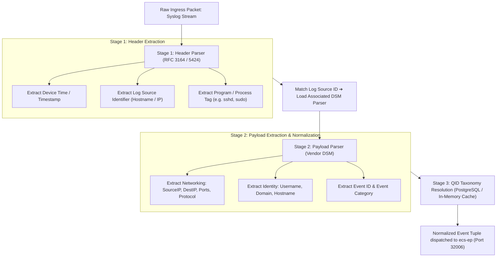
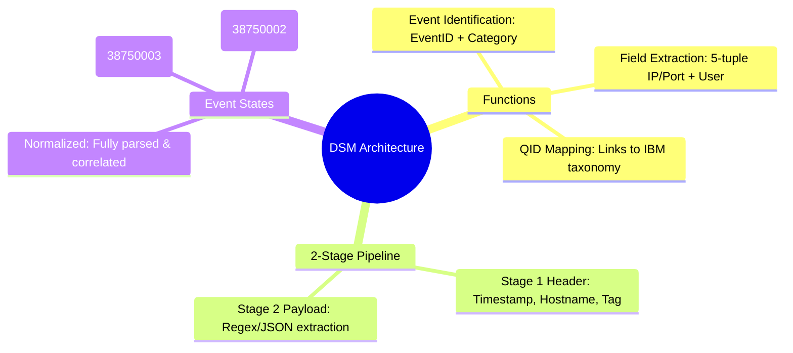

# 📖 Chapter 36: DSM Architecture & The Normalization Engine Masterclass

> **The IBM QRadar Administrator's Technical Guide** | Phase 4: DSM Parsing, Normalization & Custom Properties  
> **Target Audience:** 1.5-Year Administrators $\rightarrow$ Senior SIEM Engineers & Detection Engineering Specialists  
> **Focus:** DSM Architecture, In-Memory Parsing Pipeline, Header vs Payload Parsing, Event Identification, & Hands-on Lab 36

---

## 📸 1. Visual Overview: DSM Parsing & Normalization Subsystem


*Figure 36.1: 3D Isometric View of the QRadar DSM Normalization Engine: Unstructured Raw Payloads traversing the 2-Stage Parser (`ecs-ec-ingress`), extracting Header Metadata (Timestamp, Hostname) and Payload Security Fields (IPs, Ports, Usernames, Actions), and resolving against the PostgreSQL QID Map Taxonomy (`![[stage5_6_parsing_qid_normalization_3d.jpg|1000]]`)*

---

## 2. What is a DSM (Device Support Module)?

A **Device Support Module (DSM)** is a specialized parsing software component within QRadar that translates vendor-specific, heterogeneous log strings (Syslog, XML, JSON, CSV, CEF, LEEF) into standardized, normalized security events.

```
┌────────────────────────────────────────────────────────────────────────┐
│ 🧩 THE 3 CORE FUNCTIONS OF A DSM                                       │
│                                                                        │
│ 1. EVENT IDENTIFICATION (The Matchmaker)                               │
│    • Identifies what specific event occurred using Event ID & Event    │
│      Category regular expressions.                                     │
│    • Example: Extracts `Action: Deny` and `Reason: Bad Password`.      │
│ ├────────────────────────────────────────────────────────────────────┤
│ 2. FIELD EXTRACTION (The Parser)                                       │
│    • Extracts standard 5-tuple networking fields (Source IP, Dest IP,  │
│      Source Port, Dest Port, Protocol) plus Identity (Username, MAC).  │
│ ├────────────────────────────────────────────────────────────────────┤
│ 3. TAXONOMY MAPPING (The QID Resolver)                                 │
│    • Maps the vendor's proprietary event name to an internal           │
│      **QRadar Identifier (QID)** record with fixed High-Level and      │
│      Low-Level categories and default Severity scores.                │
└────────────────────────────────────────────────────────────────────────┘
```

---

## 3. The 2-Stage In-Memory Parsing Pipeline in `ecs-ec-ingress`

Parsing in QRadar occurs inside the `ecs-ec-ingress` daemon across two strictly separated stages:



---

## 4. Header Parsing vs Payload Parsing

Understanding the distinction between Header and Payload parsing is fundamental to diagnosing parsing failures:

```
┌────────────────────────────────────────────────────────────────────────┐
│ 🔍 HEADER PARSING VS PAYLOAD PARSING                                   │
│                                                                        │
│ 📜 RAW SYSLOG STRING:                                                  │
│ `<134>Sep 25 18:00:00 srv-app-01 sshd[412]: Failed password for root │
│  from 198.51.100.50 port 54120 ssh2`                                  │
│ ├────────────────────────────────────────────────────────────────────┤
│ 1. HEADER (Parsed by Generic RFC Syslog Engine):                       │
│    • `<134>` ➔ Facility: local0, Severity: info                       │
│    • `Sep 25 18:00:00` ➔ Device Time                                  │
│    • `srv-app-01` ➔ Log Source Identifier                             │
│    • `sshd[412]` ➔ Application Tag                                     │
│ ├────────────────────────────────────────────────────────────────────┤
│ 2. PAYLOAD (Parsed by Linux OS DSM):                                   │
│    • `Failed password for root` ➔ Event ID: `User Login Failed`        │
│    • `root` ➔ Username                                                 │
│    • `198.51.100.50` ➔ Source IP                                       │
│    • `54120` ➔ Source Port                                             │
└────────────────────────────────────────────────────────────────────────┘
```

---

## 5. Event States: Normalized vs Stored vs Unknown

When QRadar processes an event through the DSM pipeline, it enters one of three final states:

| Event State | Meaning | QID Assignment | Operational Impact |
| :--- | :--- | :---: | :--- |
| **Normalized Event** | Successfully parsed by DSM and mapped to a known QID. | Valid QID (e.g., `5000854`) | **Full Correlation**. CRE rules can test all extracted fields and trigger offenses. |
| **Unknown Event** | Parsed by DSM, but the specific Event ID is not in the QID Map. | **`QID 38750003`** (`Unknown Event`) | Fields extracted, but category is generic. Requires manual QID mapping. |
| **Stored Event** | No DSM could parse the payload (or unrecognized log format). | **`QID 38750002`** (`SIM Generic Log DSM`) | Payload stored on disk as raw text, but **NO correlation is possible**! |

---

## 📌 6. Visual Mind Map & Sticky Notes (Chapter 36 Quick-Review)

### 🧠 Hierarchical Mind Map


### 🗂️ Color-Coded Digital Sticky Notes

#### 🟨 Sticky Note 1: The In-Memory Parser
```text
┌─────────────────────────────────────────────────────────────┐
│ 📌 CONCEPT: ZERO DISK PARSING                               │
│                                                             │
│ • DSM parsing executes entirely in Java heap memory inside  │
│   `ecs-ec-ingress`.                                         │
│ • Never writes to disk during the parsing phase!            │
└─────────────────────────────────────────────────────────────┘
```

#### 🟩 Sticky Note 2: Normalized Events Fuel CRE
```text
┌─────────────────────────────────────────────────────────────┐
│ 📌 GOLDEN RULE: CORRELATION PREREQUISITE                    │
│                                                             │
│ • The Custom Rules Engine (CRE) CANNOT correlate fields that│
│   are not normalized!                                       │
│ • Unparsed Stored events can never trigger an offense!      │
└─────────────────────────────────────────────────────────────┘
```

#### 🟪 Sticky Note 3: Header Stripping
```text
┌─────────────────────────────────────────────────────────────┐
│ 📌 ARCHITECTURE: HEADER ISOLATION                           │
│                                                             │
│ • Header regex extracts metadata before the payload reaches │
│   the DSM parser.                                           │
│ • A malformed syslog header breaks the entire pipeline!     │
└─────────────────────────────────────────────────────────────┘
```

#### 🟦 Sticky Note 4: Unknown vs Stored
```text
┌─────────────────────────────────────────────────────────────┐
│ 📌 TAXONOMY: 38750003 VS 38750002                           │
│                                                             │
│ • QID 38750003 (`Unknown`): DSM parsed fields, but event    │
│   needs QID mapping.                                        │
│ • QID 38750002 (`Stored`): Complete parsing failure.        │
└─────────────────────────────────────────────────────────────┘
```

#### 🟧 Sticky Note 5: Interview Cheat Code (DSM Architecture)
```text
┌─────────────────────────────────────────────────────────────┐
│ 📌 INTERVIEW CHEAT CODE: "WHAT IS A DSM IN QRADAR?"         │
│                                                             │
│ "A DSM is a 2-stage parsing engine in ecs-ec-ingress that   │
│ extracts header metadata, uses regular expressions or JSON  │
│ parsers to extract normalized security fields, and maps the │
│ event to IBM's QID taxonomy for real-time CRE correlation." │
└─────────────────────────────────────────────────────────────┘
```

#### 🟥 Sticky Note 6: Critical Pitfall
```text
┌─────────────────────────────────────────────────────────────┐
│ ⚠️ CRITICAL PITFALL: GREEDY DSM REGEX                       │
│                                                             │
│ • Writing greedy regex in a custom DSM causes `ecs-ec-ingress`│
│   thread saturation, dropping incoming UDP syslog packets!  │
└─────────────────────────────────────────────────────────────┘
```

---

### ⚡ Rapid-Recall Flashcards

| # | Question (Front) | Answer (Back) |
| :-: | :--- | :--- |
| **01** | What daemon executes DSM parsing in QRadar? | **`ecs-ec-ingress`**. |
| **02** | What are the two stages of the QRadar parsing pipeline? | **Stage 1: Header Parser** and **Stage 2: Payload Parser**. |
| **03** | What QID represents an event that was recognized by a DSM but has no mapped QID record? | **QID 38750003 (`Unknown Event`)**. |
| **04** | What QID represents an event that could not be parsed by any DSM? | **QID 38750002 (`Stored Event / SIM Generic Log DSM`)**. |
| **05** | Can the CRE engine trigger correlation offenses on unparsed Stored Events? | **No**, CRE requires normalized fields to evaluate rule test conditions. |
| **06** | What database stores the master QID Map taxonomy? | The **`qradar` PostgreSQL database** (specifically the `qidmap` table). |

---

## 🧪 7. Hands-on Practice Lab 36: DSM Pipeline Inspection & Event State Auditing

### 🎯 Lab Objectives
1. Inspect installed DSM packages and versions in PostgreSQL.
2. Query the master QID taxonomy table via CLI.
3. Identify unparsed (`QID 38750002`) vs unknown (`QID 38750003`) events via AQL.
4. Verify normalization field extraction for a live syslog stream.

---

### 📋 Step-by-Step Practical Lab Procedures

#### Step 1: Query Installed DSM Types in PostgreSQL
Log into the QRadar Console via SSH as `root`:
```bash
# Query installed Device Support Modules (devicetype table)
psql -U qradar -d qradar -c "
SELECT 
    id AS DeviceTypeID, 
    devicetypename AS DSM_Name, 
    devicedescription 
FROM devicetype 
ORDER BY id ASC 
LIMIT 20;
"
```

---

#### Step 2: Query Master QID Map Table
```bash
# Inspect QID taxonomy entries for authentication events
psql -U qradar -d qradar -x -c "
SELECT 
    qid, 
    name AS EventName, 
    description, 
    lowlevelcategoryid, 
    severity 
FROM qidmap 
WHERE name ILIKE '%User Login Failed%' OR name ILIKE '%Authentication Success%' 
LIMIT 5;
"
```

---

#### Step 3: Audit Cluster Event Normalization Health via AQL
```bash
/opt/qradar/bin/arielsql -p 32011 -q "
SELECT 
    CASE 
        WHEN qid = 38750002 THEN 'Stored Event (Unparsed)' 
        WHEN qid = 38750003 THEN 'Unknown Event (Unmapped QID)' 
        ELSE 'Normalized Event' 
    END AS NormalizationState, 
    COUNT(*) AS TotalEvents 
FROM events 
LAST 1 HOURS 
GROUP BY NormalizationState;
"
```
*Expected Output*: Displays cluster parsing ratio with $> 95\%$ in `Normalized Event` state.

---

#### Step 4: Verify Field Normalization for a Specific Event Stream
```bash
/opt/qradar/bin/arielsql -p 32011 -q "
SELECT 
    DATEFORMAT(starttime, 'HH:mm:ss') AS Time, 
    logsourceid, 
    sourceip AS SrcIP, 
    destinationip AS DstIP, 
    username AS User, 
    qidname(qid) AS EventName 
FROM events 
WHERE qid != 38750002 AND qid != 38750003 
ORDER BY starttime DESC 
LIMIT 10;
"
```
