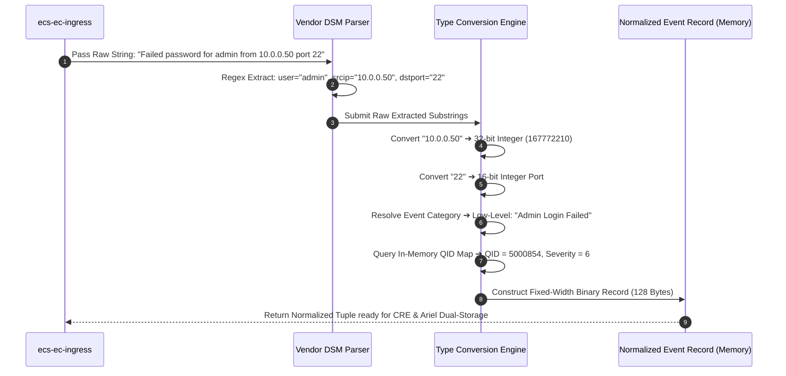
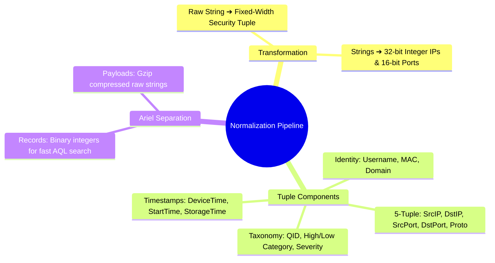

# 📖 Chapter 37: The Normalization Pipeline: Raw String to Security Tuple Masterclass

> **The IBM QRadar Administrator's Technical Guide** | Phase 4: DSM Parsing, Normalization & Custom Properties  
> **Target Audience:** 1.5-Year Administrators $\rightarrow$ Senior SIEM Engineers & Detection Engineers  
> **Focus:** Raw String Tokenization, The Normalized Security Tuple, Type Conversion, & Hands-on Lab 37

---

## 📸 1. Visual Overview: The Raw-to-Normalized Tuple Transformation


*Figure 37.1: 3D Isometric View of the Normalization Transformation: Unstructured ASCII Syslog Strings being parsed, type-converted (Strings $\rightarrow$ 32-bit Integer IPs, Binary Ports, Epoch Timestamps), and packaged into the structured QRadar Security Tuple before entering the CRE engine (`![[02_data_pipeline_8stages_3d.jpg|1000]]`)*

---

## 2. The Normalization Engine: Why SIEMs Require Uniform Schemas

In an enterprise network, an authentication failure arrives in dozens of conflicting formats:
- **Windows**: `An account failed to log on. Account Name: admin. Failure Reason: Unknown user name or bad password.`
- **Linux**: `Failed password for root from 198.51.100.25 port 52140 ssh2`
- **Palo Alto**: `TRAFFIC,drop,...,src=198.51.100.25,dst=10.0.0.1,act=deny`
- **Cisco ASA**: `%ASA-6-106015: Deny TCP (no-connection) from 198.51.100.25/52140 to 10.0.0.1/22`

The **Normalization Pipeline** transforms these disparate strings into a **single, unified object model**:

```
┌────────────────────────────────────────────────────────────────────────┐
│ 🧬 THE STANDARD QRADAR NORMALIZED SECURITY TUPLE                       │
│                                                                        │
│ ┌──────────────────────┬──────────────────────┬──────────────────────┐ │
│ │ 🌐 5-TUPLE NETWORK   │ 👤 IDENTITY & ASSET  │ 🏷️ TAXONOMY & STATUS  │ │
│ │ • Source IP (uint32) │ • Username (String)  │ • QID (uint32)       │ │
│ │ • Dest IP (uint32)   │ • Domain (String)    │ • Event Name         │ │
│ │ • Source Port (uint16│ • Source MAC (EUI-48)│ • High-Level Cat     │ │
│ │ • Dest Port (uint16) │ • Hostname (String)  │ • Low-Level Cat      │ │
│ │ • Protocol (uint8)   │ • Identity Extracted │ • Severity (1-10)    │ │
│ ├──────────────────────┼──────────────────────┼──────────────────────┤ │
│ │ ⏱️ TIMESTAMPS (Epoch)│ ⚙️ PIPELINE ROUTING  │ 📦 RAW PAYLOAD       │ │
│ │ • Device Time (msec) │ • Log Source ID      │ • Raw Byte Array     │ │
│ │ • Start Time (Ingress│ • Event Collector ID│   (UTF-8 / Hex)      │ │
│ │ • Storage Time (Disk)│ • Domain ID (Tenant) │ • Retained in Ariel  │ │
│ └──────────────────────┴──────────────────────┴──────────────────────┘ │
└────────────────────────────────────────────────────────────────────────┘
```

---

## 3. Step-by-Step Normalization Execution Flow



---

## 4. Binary Record vs Raw Payload Separation in Ariel

To maintain extreme search speeds, QRadar decouples normalized fields from the raw syslog payload:

```
┌────────────────────────────────────────────────────────────────────────┐
│ 🗄️ DUAL-STORAGE ARCHITECTURE IN ARIEL                                  │
│                                                                        │
│ 1. NORMALIZED RECORD (`/store/ariel/events/records/`):                 │
│    • Fixed-width columnar binary format.                               │
│    • Stores parsed integers (IPs, Ports, QID, Epoch Timestamps).       │
│    • Ultra-fast scanning: AQL queries like `WHERE sourceip = ...`      │
│      scan millions of binary integer records per second!               │
│ ├────────────────────────────────────────────────────────────────────┤
│ 2. RAW PAYLOAD (`/store/ariel/events/payloads/`):                      │
│    • Gzip-compressed raw ASCII/UTF-8 log strings.                      │
│    • Only decompressed and loaded when an analyst clicks an event to   │
│      view the raw payload in the Web UI!                               │
└────────────────────────────────────────────────────────────────────────┘
```

---

## 📌 5. Visual Mind Map & Sticky Notes (Chapter 37 Quick-Review)

### 🧠 Hierarchical Mind Map


### 🗂️ Color-Coded Digital Sticky Notes

#### 🟨 Sticky Note 1: Integer IP Conversion
```text
┌─────────────────────────────────────────────────────────────┐
│ 📌 CONCEPT: BINARY INTEGER ENCODING                         │
│                                                             │
│ • QRadar converts IPv4 strings (e.g. `10.0.0.1`) into       │
│   32-bit unsigned integers in memory.                       │
│ • Integer comparisons are 100x faster in CPU registers than │
│   comparing raw string characters!                          │
└─────────────────────────────────────────────────────────────┘
```

#### 🟩 Sticky Note 2: StartTime vs DeviceTime
```text
┌─────────────────────────────────────────────────────────────┐
│ 📌 GOLDEN RULE: TIMESTAMP RECONCILIATION                    │
│                                                             │
│ • `DeviceTime`: Time recorded by the remote logging device. │
│ • `StartTime`: Exact millisecond the packet hit QRadar NIC. │
│ • If `StartTime - DeviceTime > 5 min`, device has clock skew│
└─────────────────────────────────────────────────────────────┘
```

#### 🟪 Sticky Note 3: The 128-Byte Binary Record
```text
┌─────────────────────────────────────────────────────────────┐
│ 📌 ARCHITECTURE: ARIEL RECORD COMPACTNESS                   │
│                                                             │
│ • Normalized records are fixed-width binary blocks.         │
│ • Allows Ariel to seek directly to byte offsets during      │
│   high-speed parallel AQL scans!                            │
└─────────────────────────────────────────────────────────────┘
```

#### 🟦 Sticky Note 4: Payload Decompression on Demand
```text
┌─────────────────────────────────────────────────────────────┐
│ 📌 VALUE: ZERO PAYLOAD SCANNING OVERHEAD                    │
│                                                             │
│ • AQL searches on standard fields (IP, Port, Username)      │
│   NEVER decompress raw payloads.                            │
│ • Decompression only occurs for `TEXT SEARCH` or `PAYLOAD`. │
└─────────────────────────────────────────────────────────────┘
```

#### 🟧 Sticky Note 5: Interview Cheat Code (Normalization Engine)
```text
┌─────────────────────────────────────────────────────────────┐
│ 📌 INTERVIEW CHEAT CODE: "HOW DOES NORMALIZATION OCCUR?"     │
│                                                             │
│ "Normalization tokenizes raw strings via DSM regex, converts│
│ strings into compact binary types (32-bit integer IPs,      │
│ 16-bit ports), maps QIDs and categories, and separates the  │
│ 128-byte binary record from the compressed raw payload."    │
└─────────────────────────────────────────────────────────────┘
```

#### 🟥 Sticky Note 6: Critical Pitfall
```text
┌─────────────────────────────────────────────────────────────┐
│ ⚠️ CRITICAL PITFALL: UNPARSED USERNAME TRAP                 │
│                                                             │
│ • If a custom DSM fails to extract `Username`, CRE rules    │
│   that test `Username in Reference Set` or index by User    │
│   will completely fail to detect user-based attacks!        │
└─────────────────────────────────────────────────────────────┘
```

---

### ⚡ Rapid-Recall Flashcards

| # | Question (Front) | Answer (Back) |
| :-: | :--- | :--- |
| **01** | What data type does QRadar use to store IPv4 addresses internally? | **32-bit Unsigned Integer** (for high-speed CPU comparison). |
| **02** | What is the difference between `DeviceTime` and `StartTime`? | **`DeviceTime`** is from the syslog header; **`StartTime`** is the receipt time on the QRadar interface. |
| **03** | Where are parsed binary fields stored on disk? | In **`/store/ariel/events/records/`**. |
| **04** | Where are raw compressed syslog payloads stored on disk? | In **`/store/ariel/events/payloads/`**. |
| **05** | Do standard AQL queries (e.g. `WHERE sourceip = ...`) decompress raw payloads? | **No**, they scan the binary record files directly without payload decompression overhead. |
| **06** | What component resolves extracted Event IDs into QIDs? | The in-memory **QID Map Cache** (backed by PostgreSQL). |

---

## 🧪 6. Hands-on Practice Lab 37: Inspecting the Normalized Security Tuple via CLI

### 🎯 Lab Objectives
1. Trace raw incoming syslog strings to normalized binary records in Ariel.
2. Query extracted 5-tuple networking fields and identity parameters via AQL.
3. Validate time delta between `DeviceTime`, `StartTime`, and `StorageTime`.
4. Inspect Ariel binary column records on the local filesystem.

---

### 📋 Step-by-Step Practical Lab Procedures

#### Step 1: Query Full Normalized Tuple Fields via AQL
Log into the QRadar Console via SSH as `root`:
```bash
/opt/qradar/bin/arielsql -p 32011 -q "
SELECT 
    sourceip AS SourceIP, 
    destinationip AS DestIP, 
    sourceport AS SrcPort, 
    destinationport AS DstPort, 
    protocolid AS Protocol, 
    username AS User, 
    qidname(qid) AS EventName, 
    categoryname(category) AS LowLevelCategory, 
    highlevelcategoryname(highlevelcategory) AS HighLevelCategory, 
    severity AS Severity, 
    DATEFORMAT(devicetime, 'yyyy-MM-dd HH:mm:ss.SSS') AS DeviceTime, 
    DATEFORMAT(starttime, 'yyyy-MM-dd HH:mm:ss.SSS') AS IngressTime 
FROM events 
WHERE qid != 38750002 
ORDER BY starttime DESC 
LIMIT 5;
"
```

---

#### Step 2: Audit Time Delays between Ingress and Storage
```bash
/opt/qradar/bin/arielsql -p 32011 -q "
SELECT 
    sourceip, 
    qidname(qid) AS EventName, 
    (starttime - devicetime) / 1000 AS ClockSkewSeconds, 
    (storagetime - starttime) / 1000 AS PipelineLatencySeconds 
FROM events 
ORDER BY starttime DESC 
LIMIT 10;
"
```
*Expected Output*: `PipelineLatencySeconds` should be $< 2\text{ seconds}$ under normal load.

---

#### Step 3: Inspect Ariel Binary Record Directories
```bash
# View hourly Ariel record partitions for today
CURRENT_HOUR=$(date +%Y/%m/%d/%H)
ls -lh /store/ariel/events/records/$CURRENT_HOUR/
ls -lh /store/ariel/events/payloads/$CURRENT_HOUR/
```
*Expected Output*: Confirms existence of separate columnar index files (`records`) and compressed payload tarballs (`payloads`).
