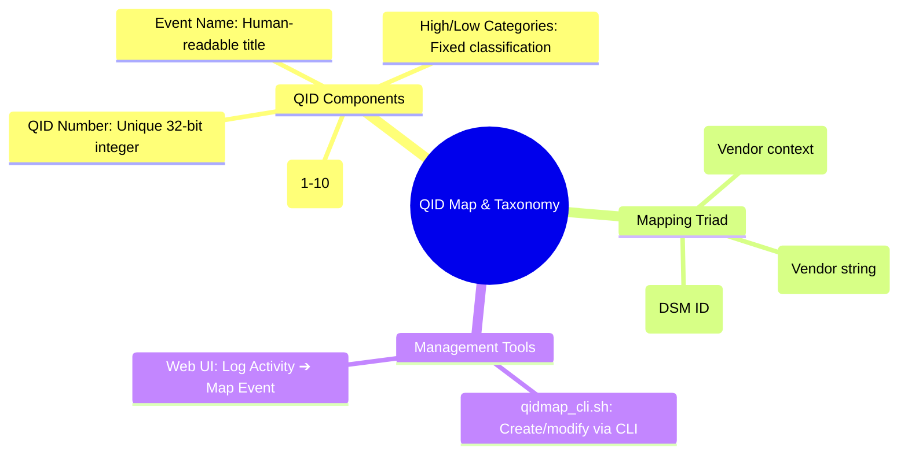

# 📖 Chapter 38: QID Map & Event Mapping Architecture Masterclass

> **The IBM QRadar Administrator's Technical Guide** | Phase 4: DSM Parsing, Normalization & Custom Properties  
> **Target Audience:** 1.5-Year Administrators $\rightarrow$ Senior SIEM Engineers & Detection Engineers  
> **Focus:** QID Map Taxonomy, Event Mapping Triad, `qidmap_cli.sh`, High/Low Categories, & Hands-on Lab 38

---

## 📸 1. Visual Overview: QID Map & Taxonomy Resolution Engine


*Figure 38.1: 3D Isometric View of the QID Map Taxonomy Subsystem: Vendor Event IDs (`LOGIN_FAIL`, `4625`, `DENY`) entering the Event Mapping Resolver, querying the in-memory QID Map Hash Table, and binding to standardized IBM QIDs, High/Low Level Categories, and Base Severity Scores (`![[stage5_6_parsing_qid_3d.jpg|1000]]`)*

---

## 2. What is a QID (QRadar Identifier)?

A **QRadar Identifier (QID)** is a unique 32-bit integer that represents a standardized security event definition within the global QRadar event taxonomy.

```
┌────────────────────────────────────────────────────────────────────────┐
│ 🏷️ ANATOMY OF A QID TAXONOMY RECORD                                    │
│                                                                        │
│ • QID Number:              `5000854`                                   │
│ • Event Name:              `User Login Failed`                         │
│ • Description:             `Authentication failed due to bad password` │
│ • High-Level Category:     `Authentication`                            │
│ • Low-Level Category:      `User Login Failure`                        │
│ • Base Severity:           `6` (Scale: 1 to 10)                        │
└────────────────────────────────────────────────────────────────────────┘
```

---

## 3. The Event Mapping Triad: How QRadar Binds Events to QIDs

To map thousands of proprietary vendor formats without collisions, QRadar resolves events using a **3-Key Composite Triad**:

```mermaid
flowchart LR
    subgraph Ingress["Extracted from Ingress Event"]
        EID["1. Event ID: 'LOGIN_FAIL'"]
        ECAT["2. Event Category: 'AUTH'"]
        DSM["3. Log Source Type ID: 12 (Linux OS)"]
    end

    subgraph Resolver["In-Memory QID Resolver"]
        TRIAD["Composite Key: [LOGIN_FAIL + AUTH + 12]"]
    end

    subgraph Taxonomy["PostgreSQL / In-Memory QID Map"]
        QID_RECORD["QID 5000854: User Login Failed<br>High-Level: Authentication<br>Low-Level: User Login Failure<br>Severity: 6"]
    end

    EID --> TRIAD
    ECAT --> TRIAD
    DSM --> TRIAD
    TRIAD -->|O(1) Hash Table Lookup| QID_RECORD
    QID_RECORD --> CRE["Normalized Tuple sent to CRE"]
```

### 📋 The Triad Keys Explained:
1. **Event ID**: The primary event identifier string extracted by the DSM (e.g., `4625` on Windows, `%SEC-6-IPACCESSLOGP` on Cisco, or `deny` on Firewalls).
2. **Event Category**: An optional sub-classification or context string (e.g., `Authentication`, `System`, `Traffic`).
3. **Log Source Type ID**: The internal ID of the DSM (e.g., `12` = Linux OS, `18` = Cisco IOS, `67` = Palo Alto PA Series).

---

## 4. The QRadar Category Hierarchy

Every QID belongs to a rigid two-tier category hierarchy:

```
┌────────────────────────────────────────────────────────────────────────┐
│ 🌳 QRADAR TAXONOMY CATEGORY TREE                                      │
│                                                                        │
│ 📁 HIGH-LEVEL CATEGORY: Authentication                                 │
│    ├── 📄 Low-Level: Admin Login Success                               │
│    ├── 📄 Low-Level: Admin Login Failure                               │
│    ├── 📄 Low-Level: User Login Success                                │
│    ├── 📄 Low-Level: User Login Failure                                │
│    └── 📄 Low-Level: Account Locked Out                                │
│ ├────────────────────────────────────────────────────────────────────┤
│ 📁 HIGH-LEVEL CATEGORY: Access / Policy                                │
│    ├── 📄 Low-Level: Firewall Permit                                   │
│    ├── 📄 Low-Level: Firewall Drop / Deny                              │
│    └── 📄 Low-Level: Port Scan Detected                                │
│ ├────────────────────────────────────────────────────────────────────┤
│ 📁 HIGH-LEVEL CATEGORY: Malware / Exploit                              │
│    ├── 📄 Low-Level: Trojan Detected                                   │
│    ├── 📄 Low-Level: Ransomware Activity                               │
│    └── 📄 Low-Level: Buffer Overflow Attempt                           │
└────────────────────────────────────────────────────────────────────────┘
```

---

## 5. Managing QIDs via the CLI: `/opt/qradar/bin/qidmap_cli.sh`

QRadar provides a dedicated command-line utility to query, create, and modify QID mappings directly:

```bash
# 1. Search for existing QIDs by name
/opt/qradar/bin/qidmap_cli.sh -l -n "Login Failed"

# 2. Create a custom QID for an in-house banking application
/opt/qradar/bin/qidmap_cli.sh -c \
  --qname "CoreBanking Wire Transfer Exceeded Limit" \
  --qdescription "User attempted wire transfer exceeding daily authorization limit" \
  --severity 8 \
  --lowlevelcategoryid 1005

# 3. Create the event mapping entry (binding Triad to the new QID)
/opt/qradar/bin/qidmap_cli.sh -m \
  --eventid "WIRE_LIMIT_EXCEEDED" \
  --eventcategory "FINANCIAL_FRAUD" \
  --devicetypeid 1050 \
  --qid 2000001
```

---

## 📌 6. Visual Mind Map & Sticky Notes (Chapter 38 Quick-Review)

### 🧠 Hierarchical Mind Map


### 🗂️ Color-Coded Digital Sticky Notes

#### 🟨 Sticky Note 1: The Triad Concept
```text
┌─────────────────────────────────────────────────────────────┐
│ 📌 CONCEPT: THE 3-KEY MAPPING TRIAD                         │
│                                                             │
│ • Event ID alone is not unique across vendors.              │
│ • QRadar binds `Event ID` + `Event Category` + `DSM ID`     │
│   together to guarantee zero cross-vendor collisions!       │
└─────────────────────────────────────────────────────────────┘
```

#### 🟩 Sticky Note 2: Category Rules Power
```text
┌─────────────────────────────────────────────────────────────┐
│ 📌 GOLDEN RULE: CATEGORY-BASED CRE RULES                    │
│                                                             │
│ • CRE rules frequently test `Low-Level Category`.           │
│ • If an event is mapped to `User Login Failure`, it         │
│   automatically triggers brute-force rules regardless of DSM!│
└─────────────────────────────────────────────────────────────┘
```

#### 🟪 Sticky Note 3: Custom QID Range (2,000,000+)
```text
┌─────────────────────────────────────────────────────────────┐
│ 📌 ARCHITECTURE: CUSTOM QID NAMESPACE                       │
│                                                             │
│ • IBM system QIDs occupy ranges below `2,000,000`.          │
│ • Custom user-created QIDs are created in the `2,000,000+`  │
│   range to prevent IBM patch overwrite collisions!          │
└─────────────────────────────────────────────────────────────┘
```

#### 🟦 Sticky Note 4: In-Memory QID Cache
```text
┌─────────────────────────────────────────────────────────────┐
│ 📌 PERFORMANCE: ZERO DB LOOKUP AT INGESTION                 │
│                                                             │
│ • The entire QID map is loaded into an in-memory Java hash  │
│   table inside `ecs-ec-ingress`.                            │
│ • Resolves 100,000+ events/second with zero PostgreSQL lag! │
└─────────────────────────────────────────────────────────────┘
```

#### 🟧 Sticky Note 5: Interview Cheat Code (QID Mapping)
```text
┌─────────────────────────────────────────────────────────────┐
│ 📌 INTERVIEW CHEAT CODE: "HOW DOES EVENT MAPPING WORK?"     │
│                                                             │
│ "QRadar resolves incoming events using the Triad of Event ID,│
│ Event Category, and Log Source Type ID, matching them in an │
│ in-memory hash table to a standardized QID with defined High│
│ and Low Level Categories and base Severity scores."         │
└─────────────────────────────────────────────────────────────┘
```

#### 🟥 Sticky Note 6: Critical Pitfall
```text
┌─────────────────────────────────────────────────────────────┐
│ ⚠️ CRITICAL PITFALL: UNMAPPED EVENT FLOODS                  │
│                                                             │
│ • Leaving high-volume logs as `Unknown Event (38750003)`    │
│   means CRE category rules never evaluate them, leaving the │
│   organization completely blind to active attacks!          │
└─────────────────────────────────────────────────────────────┘
```

---

### ⚡ Rapid-Recall Flashcards

| # | Question (Front) | Answer (Back) |
| :-: | :--- | :--- |
| **01** | What three keys constitute the QRadar Event Mapping Triad? | **1. Event ID**, **2. Event Category**, and **3. Log Source Type ID (DSM ID)**. |
| **02** | What CLI utility manages QID creation and event mapping in QRadar? | **`/opt/qradar/bin/qidmap_cli.sh`**. |
| **03** | What numerical ID range is reserved for custom user-created QIDs? | QID values of **`2,000,000` and above**. |
| **04** | Why are Low-Level Categories critical for the Custom Rules Engine (CRE)? | CRE rules can trigger on **generic categories (e.g. `User Login Failure`)** across all log sources without custom per-device rules. |
| **05** | Where is the QID Map stored in PostgreSQL? | In the **`qidmap`** table. |
| **06** | How does `ecs-ec-ingress` achieve microsecond QID lookups under heavy load? | By caching the entire QID taxonomy in an **in-memory Java hash table**. |

---

## 🧪 7. Hands-on Practice Lab 38: Custom QID Creation & Event Mapping via CLI

### 🎯 Lab Objectives
1. Query and search the master QID taxonomy using `qidmap_cli.sh`.
2. Create a custom QID record for an in-house application alert.
3. Map an unidentified Event ID to the newly created QID.
4. Verify category resolution and severity scoring via AQL.

---

### 📋 Step-by-Step Practical Lab Procedures

#### Step 1: Search Existing QID Map via `qidmap_cli.sh`
Log into the QRadar Console via SSH as `root`:
```bash
# Search for all QIDs related to "Password"
/opt/qradar/bin/qidmap_cli.sh -l -n "Password" | head -n 15
```

---

#### Step 2: Query High-Level & Low-Level Categories in PostgreSQL
```bash
# View available category IDs for mapping
psql -U qradar -d qradar -c "
SELECT 
    h.id AS HighLevelID, 
    h.name AS HighLevelCategory, 
    l.id AS LowLevelID, 
    l.name AS LowLevelCategory 
FROM lowlevelcategory l 
JOIN highlevelcategory h ON l.highlevelcategoryid = h.id 
WHERE h.name ILIKE '%Auth%' OR h.name ILIKE '%Policy%' 
LIMIT 15;
"
```

---

#### Step 3: Create a Custom QID for a Banking Application
```bash
# Create custom QID in the 2,000,000+ namespace
/opt/qradar/bin/qidmap_cli.sh -c \
  --qname "Banking Fraud: Unauthorized Fund Transfer" \
  --qdescription "Suspicious fund transfer attempt flagged by anti-fraud AI" \
  --severity 9 \
  --lowlevelcategoryid 1005
```

---

#### Step 4: Map the Vendor Triad to the New Custom QID
```bash
# Map Event ID 'FRAUD_ALERT_01' from custom DSM (DeviceTypeID 1050) to the new QID
/opt/qradar/bin/qidmap_cli.sh -m \
  --eventid "FRAUD_ALERT_01" \
  --eventcategory "SUSPICIOUS_TRANSACTION" \
  --devicetypeid 1050 \
  --qid 2000001
```

---

#### Step 5: Verify New Mapping in PostgreSQL
```bash
psql -U qradar -d qradar -x -c "
SELECT 
    qm.qid, 
    qm.name AS EventName, 
    em.eventid, 
    em.eventcategory, 
    em.devicetypeid, 
    qm.severity 
FROM qidmap qm 
JOIN eventmap em ON qm.qid = em.qid 
WHERE qm.qid = 2000001;
"
```
*Expected Output*: Displays the custom QID bound to `FRAUD_ALERT_01` with Severity `9`.
