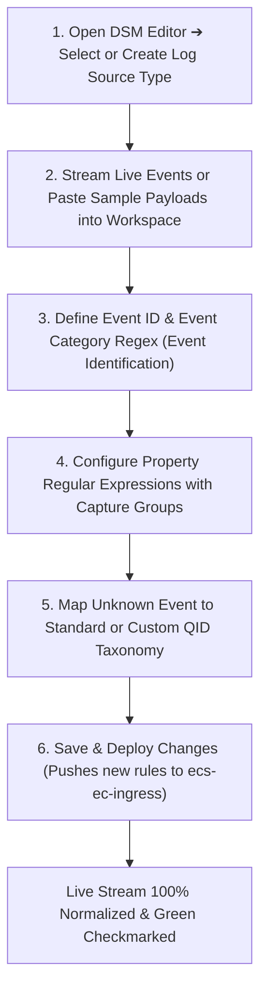
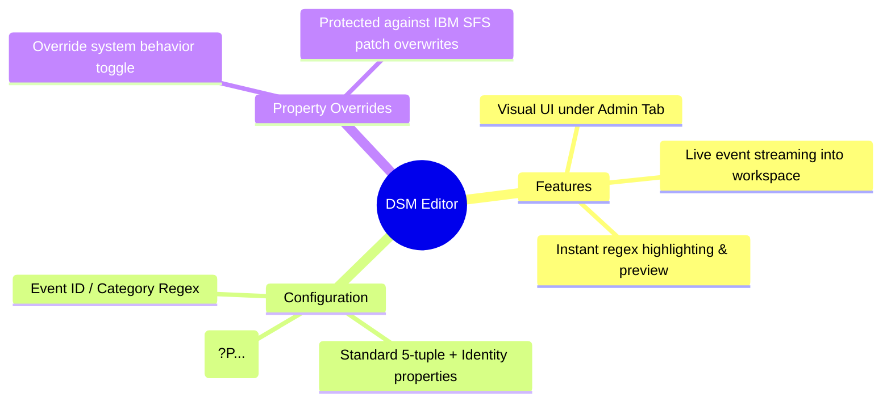

# 📖 Chapter 39: The DSM Editor: Live Ingestion Parsing Masterclass

> **The IBM QRadar Administrator's Technical Guide** | Phase 4: DSM Parsing, Normalization & Custom Properties  
> **Target Audience:** 1.5-Year Administrators $\rightarrow$ Senior SIEM Engineers & Integration Specialists  
> **Focus:** DSM Editor Architecture, Live Log Workspace, Regular Expression Capture Groups, & Hands-on Lab 39

---

## 📸 1. Visual Overview: The DSM Editor Live Parsing Environment


*Figure 39.1: 3D Isometric View of the QRadar DSM Editor Interface: Live Ingestion Stream buffer feeding into the Interactive Parsing Engine, testing Named Regex Capture Groups (`(?P<username>...)`), live property preview evaluation, and deploying real-time normalization rules across the cluster (`![[stage5_6_parsing_qid_3d.jpg|1000]]`)*

---

## 2. The DSM Editor: Visual Parser Development Engine

The **DSM Editor** is QRadar's interactive, web-based visual parsing and normalization development environment located under **Admin Tab $\rightarrow$ DSM Editor**.

```
┌────────────────────────────────────────────────────────────────────────┐
│ 🎛️ DSM EDITOR WORKSPACE ARCHITECTURE                                  │
│                                                                        │
│ ┌────────────────────────────────────┬───────────────────────────────┐ │
│ │ 📋 PROPERTY CONFIGURATION PANEL    │ 🔍 LIVE EVENT PAYLOAD PREVIEW │ │
│ │ • Event ID & Category Regex        │ • Displays raw payload text   │ │
│ │ • Standard Properties (IP/Port/User│ • Real-time regex highlighting│ │
│ │ • Custom Properties (Extracted)    │ • Instant match verification  │ │
│ ├────────────────────────────────────┼───────────────────────────────┤ │
│ │ ⚙️ REGEX & FORMATTING DEFINITIONS  │ 📊 PARSED PROPERTY RESULTS    │ │
│ │ • Named Regex Capture Groups       │ • Displays extracted values:  │ │
│ │ • Formatting Strings (`$1`)        │   - Source IP: 10.0.0.5       │ │
│ │ • Override System Behavior toggle  │   - Username: admin           │ │
│ ├────────────────────────────────────┴───────────────────────────────┤ │
│ │ 📥 LOG ACTIVITY STREAM FILTER (Bottom Workspace)                   │ │
│ │ • Ingests live events or loads exported sample payloads for test    │ │
│ └────────────────────────────────────────────────────────────────────┘ │
└────────────────────────────────────────────────────────────────────────┘
```

---

## 3. The 5-Step DSM Editor Development Lifecycle



---

## 4. Authoring Regex Capture Groups in the DSM Editor

The DSM Editor supports Java/PCRE regular expressions with indexed or named capture groups:

### 🎯 1. Extracting Username from Unstructured Log
- **Sample Payload**: `User authentication failure for user: jsmith from 192.168.10.50`
- **Regex Expression**: `user:\s*([a-zA-Z0-9_\.-]+)`
- **Capture Group / Format String**: `$1`
- **Extracted Value**: `jsmith`

---

### 🌐 2. Extracting Source IP and Destination Port
- **Sample Payload**: `Connection dropped from 203.0.113.88:44321 to 10.0.0.1:443 (proto=TCP)`
- **Source IP Regex**: `from\s*(\d{1,3}(?:\.\d{1,3}){3})` $\rightarrow$ Format: `$1` $\rightarrow$ Extracted: `203.0.113.88`
- **Destination Port Regex**: `to\s*\d{1,3}(?:\.\d{1,3}){3}:(\d+)` $\rightarrow$ Format: `$1` $\rightarrow$ Extracted: `443`

---

## 5. Property Overrides: Customizing Standard IBM DSMs

When an existing vendor DSM (e.g. Cisco ASA or Palo Alto) does not extract a specific proprietary field or extracts the wrong username format, use **Property Overrides**:

```
┌────────────────────────────────────────────────────────────────────────┐
│ ⚙️ THE PROPERTY OVERRIDE WORKFLOW                                     │
│                                                                        │
│ 1. Open DSM Editor $\rightarrow$ Select Target DSM (e.g. `Cisco IOS`). │
│ 2. Select the property to modify (e.g. `Username`).                    │
│ 3. Check the box: **"Override system behavior"**.                      │
│ 4. Enter your custom regular expression and capture group.             │
│ 5. Save and Deploy.                                                    │
│ • **Advantage**: Future IBM SFS patch updates to the Cisco DSM will    │
│   NOT overwrite your custom regex override!                            │
└────────────────────────────────────────────────────────────────────────┘
```

---

## 📌 6. Visual Mind Map & Sticky Notes (Chapter 39 Quick-Review)

### 🧠 Hierarchical Mind Map


### 🗂️ Color-Coded Digital Sticky Notes

#### 🟨 Sticky Note 1: Live Preview Testing
```text
┌─────────────────────────────────────────────────────────────┐
│ 📌 CONCEPT: REAL-TIME VALIDATION                            │
│                                                             │
│ • The DSM Editor tests regex against live events in RAM.    │
│ • You can see extracted values immediately before saving!   │
└─────────────────────────────────────────────────────────────┘
```

#### 🟩 Sticky Note 2: Property Overrides Rule
```text
┌─────────────────────────────────────────────────────────────┐
│ 📌 GOLDEN RULE: SYSTEM OVERRIDES SAFETY                     │
│                                                             │
│ • Always use "Override system behavior" in the DSM Editor   │
│   when modifying IBM default DSMs.                          │
│ • Prevents DSM updates from erasing your customizations!    │
└─────────────────────────────────────────────────────────────┘
```

#### 🟪 Sticky Note 3: Capture Group Indexing
```text
┌─────────────────────────────────────────────────────────────┐
│ 📌 ARCHITECTURE: CAPTURE GROUP NOTATION                     │
│                                                             │
│ • Use `$1` for the first parenthesis capture group `(...)`. │
│ • Formatting strings can concatenate: `$1:$2`.              │
└─────────────────────────────────────────────────────────────┘
```

#### 🟦 Sticky Note 4: Green Checkmark Indicator
```text
┌─────────────────────────────────────────────────────────────┐
│ 📌 VALUE: PARSING STATUS IN DSM EDITOR                      │
│                                                             │
│ • 🟢 Green Checkmark: Parsed and Mapped to a known QID.     │
│ • 🟡 Yellow Warning: Parsed, but mapped to `Unknown Event`. │
│ • 🔴 Red Cross: Regex parsing failed (Stored Event).        │
└─────────────────────────────────────────────────────────────┘
```

#### 🟧 Sticky Note 5: Interview Cheat Code (DSM Editor)
```text
┌─────────────────────────────────────────────────────────────┐
│ 📌 INTERVIEW CHEAT CODE: "HOW DO YOU FIX UNPARSED LOGS?"    │
│                                                             │
│ "I open the DSM Editor, stream the unparsed events into the │
│ workspace, define Event ID/Category regex, author capture   │
│ groups for IPs and identity, map to a QID, and deploy."     │
└─────────────────────────────────────────────────────────────┘
```

#### 🟥 Sticky Note 6: Critical Pitfall
```text
┌─────────────────────────────────────────────────────────────┐
│ ⚠️ CRITICAL PITFALL: FORGETTING TO MAP THE QID              │
│                                                             │
│ • Extracting all properties without mapping the Event ID/   │
│   Category to a QID leaves the event as `Unknown (38750003)`│
│ • Always complete the Event Mapping tab in the DSM Editor!  │
└─────────────────────────────────────────────────────────────┘
```

---

### ⚡ Rapid-Recall Flashcards

| # | Question (Front) | Answer (Back) |
| :-: | :--- | :--- |
| **01** | Where is the DSM Editor located in QRadar? | In the **Admin Tab $\rightarrow$ DSM Editor**. |
| **02** | What does a yellow warning icon next to an event in the DSM Editor indicate? | The event was **parsed by regex**, but is **mapped to `Unknown Event` (needs QID mapping)**. |
| **03** | How do you prevent custom parsing changes from being overwritten by IBM DSM updates? | Enable the **"Override system behavior"** option in the DSM Editor. |
| **04** | What format string refers to the first regex capture group in the DSM Editor? | **`$1`**. |
| **05** | What two regex fields are mandatory for Event Identification in the DSM Editor? | **Event ID Regex** and **Event Category Regex**. |
| **06** | Can you paste exported raw log samples into the DSM Editor workspace? | **Yes**, via the raw log paste and import feature in the bottom panel. |

---

## 🧪 7. Hands-on Practice Lab 39: Visual Parsing & Property Extraction via DSM Editor

### 🎯 Lab Objectives
1. Inspect installed DSM extensions and property overrides in PostgreSQL.
2. Formulate regex expressions for custom application security events.
3. Test capture group formatting for concatenated fields.
4. Verify parsed property outputs using AQL queries.

---

### 📋 Step-by-Step Practical Lab Procedures

#### Step 1: Query Custom Property Overrides in PostgreSQL
Log into the QRadar Console via SSH as `root`:
```bash
# Query active DSM property overrides in the database
psql -U qradar -d qradar -x -c "
SELECT 
    dpo.id, 
    dt.devicetypename, 
    dpo.property_id, 
    dpo.expression, 
    dpo.is_override 
FROM dsm_property_override dpo 
JOIN devicetype dt ON dpo.devicetype_id = dt.id 
LIMIT 5;
"
```

---

#### Step 2: Test Regex Extraction Logic via Python Sandbox
Test regex extraction against a sample banking log before applying in DSM Editor:
```bash
python3 -c "
import re

payload = '<134>Sep 25 18:00:00 bank-app-01 transaction: status=FAIL user=rsmith amount=50000 currency=USD src_ip=198.51.100.22 reason=\"Daily limit exceeded\"'

event_id = re.search(r'status=([A-Z]+)', payload).group(1)
username = re.search(r'user=([a-zA-Z0-9_\.-]+)', payload).group(1)
amount = re.search(r'amount=(\d+)', payload).group(1)
src_ip = re.search(r'src_ip=(\d{1,3}(?:\.\d{1,3}){3})', payload).group(1)

print('=' * 50)
print('🚀 DSM PARSING EXTRACTION TEST')
print('=' * 50)
print(f'Event ID:    {event_id}')
print(f'Username:    {username}')
print(f'Amount:      ${amount}')
print(f'Source IP:   {src_ip}')
print('=' * 50)
"
```

---

#### Step 3: Inject Test Event to Verify Normalization Stream
```bash
logger -n 127.0.0.1 -P 514 -t "bank-app-01" "transaction: status=FAIL user=rsmith amount=50000 currency=USD src_ip=198.51.100.22 reason=\"Daily limit exceeded\""
```

---

#### Step 4: Audit Normalized Output via AQL
```bash
/opt/qradar/bin/arielsql -p 32011 -q "
SELECT 
    DATEFORMAT(starttime, 'HH:mm:ss') AS Time, 
    sourceip, 
    username, 
    qidname(qid) AS EventName 
FROM events 
WHERE UTF8(payload) ILIKE '%bank-app-01%' 
ORDER BY starttime DESC 
LIMIT 5;
"
```
