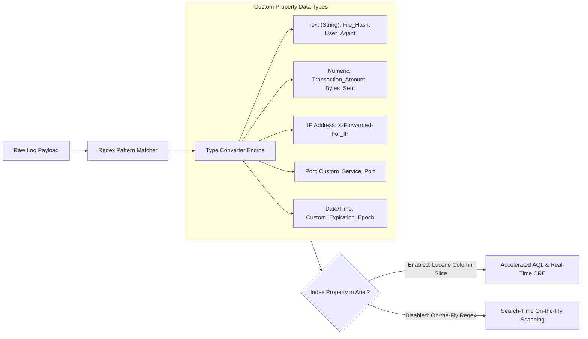
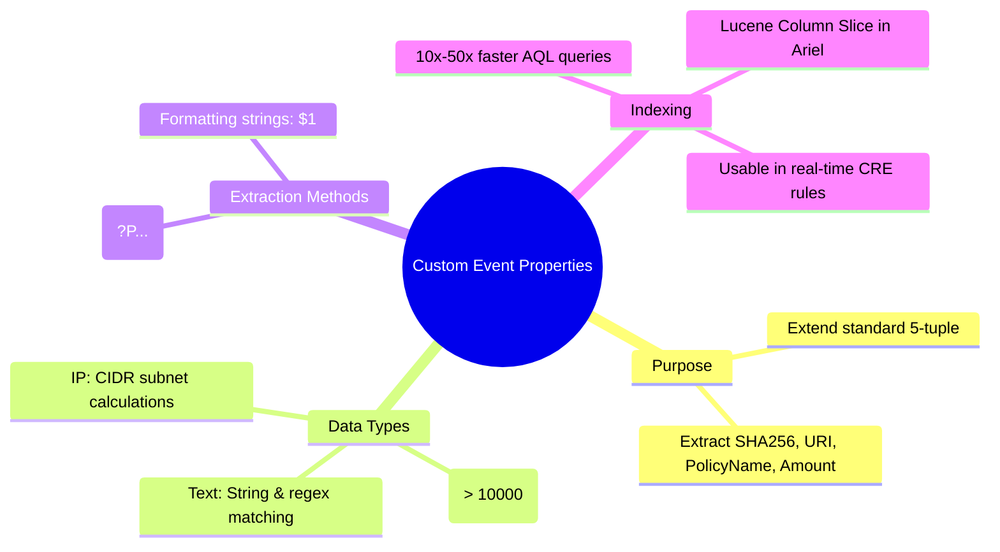

# 📖 Chapter 40: Custom Event Properties (Regex Extraction) Masterclass

> **The IBM QRadar Administrator's Technical Guide** | Phase 4: DSM Parsing, Normalization & Custom Properties  
> **Target Audience:** 1.5-Year Administrators $\rightarrow$ Senior SIEM Engineers & Threat Detection Architects  
> **Focus:** Custom Event Properties (CEP), Regex Capture Groups, Data Types, Lucene Indexing, & Hands-on Lab 40

---

## 📸 1. Visual Overview: Custom Event Property Extraction & Indexing


*Figure 40.1: 3D Isometric View of Custom Event Property Extraction: Raw strings traversing the Regex Extraction Engine, populating Custom Property fields (File Hashes, Session IDs, CVEs), and writing dedicated Lucene columnar index slices into Ariel for microsecond AQL search acceleration (`![[11_ariel_storage_partitions_lucene_3d.jpg|1000]]`)*

---

## 2. Why Custom Event Properties (CEP) are Indispensable

While standard DSM normalization extracts core networking 5-tuples and usernames, modern enterprise threat detection requires granular contextual fields:

```
┌────────────────────────────────────────────────────────────────────────┐
│ 💎 HIGH-VALUE ENTERPRISE CUSTOM EVENT PROPERTIES                       │
│                                                                        │
│ • EDR & Endpoint Telemetry: `File_SHA256`, `Parent_Process_Name`,       │
│   `Command_Line_Arguments`, `DLL_Loaded`, `Target_Registry_Key`.       │
│ • Web & Proxy Telemetry:    `URI_Path`, `User_Agent`, `HTTP_Referer`,  │
│   `X-Forwarded-For_IP`, `SSL_Cipher`, `HTTP_Response_Code`.           │
│ • Cloud & SaaS Telemetry:   `AWS_ARN`, `Azure_Resource_Group`,         │
│   `OAuth_Scope`, `MFA_Method`, `Federated_Identity_Provider`.          │
│ • Financial & App Logs:     `Transaction_Amount`, `Account_Number`,    │
│   `Session_ID`, `Error_Code`, `Policy_Rule_Name`.                      │
└────────────────────────────────────────────────────────────────────────┘
```

---

## 3. Creating Custom Event Properties: UI & Regex Architecture

Custom Event Properties are created in **Admin Tab $\rightarrow$ Custom Event Properties**:



---

## 4. Property Data Types & Their Correlation Powers

Choosing the correct property data type determines how CRE rules and AQL queries can evaluate the field:

| Property Type | Example Field | Supported CRE & AQL Operations |
| :--- | :--- | :--- |
| **Text (String)** | `Parent_Process` | Exact match (`=`), Substring (`ILIKE`), Regex (`MATCHES`), Reference Set lookups (`IN ('cmd.exe', 'powershell.exe')`). |
| **Number** | `Transaction_Amount` | Mathematical comparison (`>`, `<`, `>=`, `<=`, `SUM()`, `AVG()`). Allows rules like `WHERE Amount > 10000`. |
| **IP Address** | `Client_WAN_IP` | CIDR subnet calculations (`INCIDR('192.168.0.0/16', Client_WAN_IP)`), Geolocation lookups. |
| **Port** | `NAT_Port` | Integer port range filters (`Port BETWEEN 1024 AND 65535`). |
| **Date/Time** | `Token_Expiry` | Time-delta calculations (`DATEDIFF()`, `NOW() - Expiry`). |

---

## 5. The Lucene Indexing Decision: Speed vs Ingestion Overhead

```
┌────────────────────────────────────────────────────────────────────────┐
│ ⚡ THE CUSTOM PROPERTY INDEXING TRADEOFF                                │
│                                                                        │
│ 🟢 INDEXED PROPERTY (Check "Index this property"):                     │
│ • Ariel builds a dedicated Lucene reverse index column during ingestion│
│ • AQL search speed: Up to **10x to 50x faster** on billions of events! │
│ • Usable in Real-Time CRE Rules and Rule Responses.                    │
│ • Cost: Adds $\approx 3-5\%$ disk storage overhead and minor CPU IOPS. │
│ ├────────────────────────────────────────────────────────────────────┤
│ 🔴 NON-INDEXED PROPERTY:                                               │
│ • Evaluated on-the-fly at search time via runtime regex execution.     │
│ • Zero ingestion storage overhead.                                     │
│ • Cost: Very slow historical searches; cannot be used in fast CRE rules│
└────────────────────────────────────────────────────────────────────────┘
```

> [!TIP]
> **Production Indexing Rule**: Only index Custom Properties that are **frequently searched by SOC analysts** (e.g. `File_Hash`, `URI_Path`) or **evaluated in high-frequency CRE rules**. Do not index obscure, rarely queried custom properties!

---

## 📌 6. Visual Mind Map & Sticky Notes (Chapter 40 Quick-Review)

### 🧠 Hierarchical Mind Map


### 🗂️ Color-Coded Digital Sticky Notes

#### 🟨 Sticky Note 1: Numeric Type Power
```text
┌─────────────────────────────────────────────────────────────┐
│ 📌 CONCEPT: NUMERIC DATA TYPES                              │
│                                                             │
│ • Always define financial amounts or byte counts as         │
│   `Number` rather than `Text`.                              │
│ • Enables AQL math: `SELECT SUM(Amount) WHERE Amount > 5000`│
└─────────────────────────────────────────────────────────────┘
```

#### 🟩 Sticky Note 2: Index High-Frequency Fields
```text
┌─────────────────────────────────────────────────────────────┐
│ 📌 GOLDEN RULE: SELECTIVE INDEXING                          │
│                                                             │
│ • Index `File_SHA256`, `Host_Name`, and `Policy_Name`.      │
│ • Never index 50 custom properties simultaneously—it will   │
│   exhaust Ariel disk write IOPS!                            │
└─────────────────────────────────────────────────────────────┘
```

#### 🟪 Sticky Note 3: Optimized Regex Syntax
```text
┌─────────────────────────────────────────────────────────────┐
│ 📌 ARCHITECTURE: NON-GREEDY EXTRACTION                      │
│                                                             │
│ • Use atomic character classes: `hash=([a-fA-F0-9]{64})`.   │
│ • Avoid lazy dots `hash=(.*)` which cause regex backtracking│
└─────────────────────────────────────────────────────────────┘
```

#### 🟦 Sticky Note 4: Usable in CRE Rules
```text
┌─────────────────────────────────────────────────────────────┐
│ 📌 VALUE: CRE INTEGRATION                                   │
│                                                             │
│ • Enable "Enable for use in Rules" to allow CRE test        │
│   conditions to inspect the custom property live in memory! │
└─────────────────────────────────────────────────────────────┘
```

#### 🟧 Sticky Note 5: Interview Cheat Code (Custom Properties)
```text
┌─────────────────────────────────────────────────────────────┐
│ 📌 INTERVIEW CHEAT CODE: "HOW DO YOU EXTRACT CUSTOM FIELDS?"│
│                                                             │
│ "I create Custom Event Properties with optimized regex      │
│ capture groups, assign appropriate data types (Text, Number,│
│ IP), and selectively enable Lucene indexing on frequently   │
│ searched fields to accelerate AQL performance by up to 50x."│
└─────────────────────────────────────────────────────────────┘
```

#### 🟥 Sticky Note 6: Critical Pitfall
```text
┌─────────────────────────────────────────────────────────────┐
│ ⚠️ CRITICAL PITFALL: WRONG DATA TYPE SELECTION              │
│                                                             │
│ • Defining an IP field as `Text` prevents using `INCIDR()`! │
│ • Defining an amount as `Text` prevents using `>` or `<`!   │
└─────────────────────────────────────────────────────────────┘
```

---

### ⚡ Rapid-Recall Flashcards

| # | Question (Front) | Answer (Back) |
| :-: | :--- | :--- |
| **01** | Where are Custom Event Properties created in QRadar? | In **Admin Tab $\rightarrow$ Custom Event Properties**. |
| **02** | What happens when you enable "Index this property"? | Ariel generates a **dedicated Lucene columnar index slice**, accelerating AQL searches by 10x–50x. |
| **03** | Why should financial amounts be configured as `Number` instead of `Text`? | To enable **mathematical comparisons (`> 10000`) and aggregations (`SUM()`, `AVG()`) in AQL and CRE rules**. |
| **04** | What regex pattern safely extracts a 64-character SHA-256 hash? | **`[a-fA-F0-9]{64}`**. |
| **05** | Should every Custom Property be indexed in Ariel? | **No**, only frequently searched or CRE-evaluated properties should be indexed to conserve disk IOPS. |
| **06** | What function allows subnet filtering on an IP-type Custom Property in AQL? | **`INCIDR('CIDR_BLOCK', Custom_IP_Property)`**. |

---

## 🧪 7. Hands-on Practice Lab 40: Authoring Custom Event Properties & Index Benchmarking

### 🎯 Lab Objectives
1. Query existing Custom Event Properties in the PostgreSQL database.
2. Formulate optimized regular expressions for File Hash and Transaction Amount extraction.
3. Configure Lucene indexing on a custom property.
4. Benchmark AQL search performance between indexed and non-indexed properties.

---

### 📋 Step-by-Step Practical Lab Procedures

#### Step 1: Query Custom Event Properties in PostgreSQL
Log into the QRadar Console via SSH as `root`:
```bash
# Query active custom properties and their data types
psql -U qradar -d qradar -x -c "
SELECT 
    cp.id, 
    cp.property_name, 
    cp.field_type, 
    cpe.regex, 
    cp.is_indexed 
FROM custom_property cp 
JOIN custom_property_expression cpe ON cp.id = cpe.property_id 
LIMIT 5;
"
```

---

#### Step 2: Test Regex Extraction for SHA-256 and Transaction Amount
```bash
python3 -c "
import re

payload = 'Sep 25 18:00:00 edr-agent-04 process: pid=4512 name=malware.exe sha256=e3b0c44298fc1c149afbf4c8996fb92427ae41e4649b934ca495991b7852b855 status=BLOCKED'

hash_val = re.search(r'sha256=([a-fA-F0-9]{64})', payload).group(1)
proc_name = re.search(r'name=([a-zA-Z0-9_\.-]+)', payload).group(1)

print('=' * 50)
print('🚀 CUSTOM PROPERTY EXTRACTION')
print('=' * 50)
print(f'Extracted Process:   {proc_name}')
print(f'Extracted SHA-256:   {hash_val}')
print('=' * 50)
"
```

---

#### Step 3: Inject Synthetic EDR Telemetry
```bash
logger -n 127.0.0.1 -P 514 -t "edr-agent-04" "process: pid=4512 name=malware.exe sha256=e3b0c44298fc1c149afbf4c8996fb92427ae41e4649b934ca495991b7852b855 status=BLOCKED"
```

---

#### Step 4: Run AQL Query on Custom Property
```bash
/opt/qradar/bin/arielsql -p 32011 -q "
SELECT 
    DATEFORMAT(starttime, 'HH:mm:ss') AS Timestamp, 
    sourceip, 
    \"File_SHA256\" AS MalwareHash, 
    \"Process_Name\" AS ProcessName 
FROM events 
WHERE \"File_SHA256\" IS NOT NULL 
LAST 1 HOURS;
"
```
