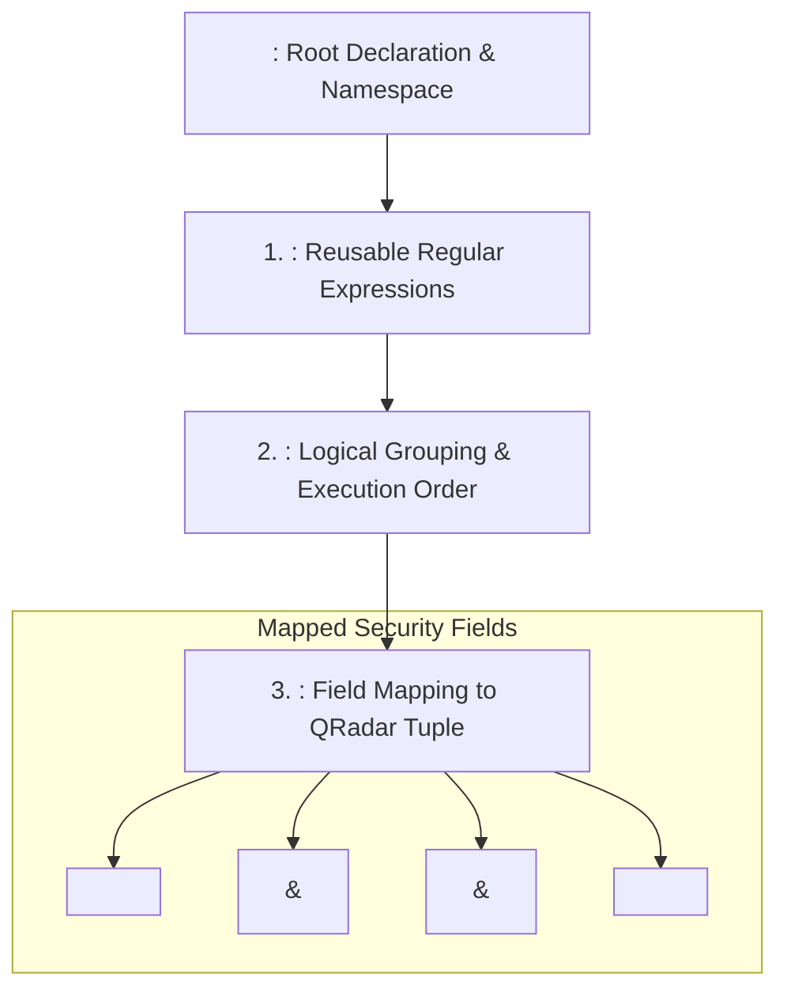
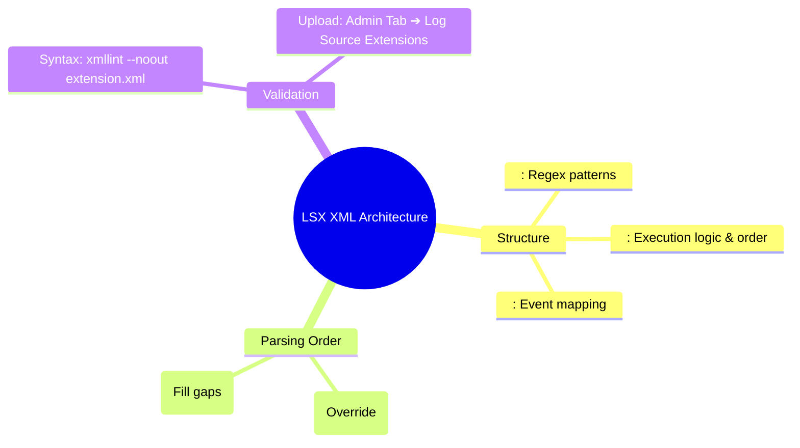

# 📖 Chapter 42: Log Source Extensions (LSX / XML Architecture) Masterclass

> **The IBM QRadar Administrator's Technical Guide** | Phase 4: DSM Parsing, Normalization & Custom Properties  
> **Target Audience:** 1.5-Year Administrators $\rightarrow$ Senior SIEM Engineers & Detection Engineers  
> **Focus:** XML Extension Architecture (`<device-extension>`), Pattern Definitions, Parsing Order, & Hands-on Lab 42

---

## 📸 1. Visual Overview: Log Source Extension (LSX) Engine


*Figure 42.1: 3D Isometric View of the Log Source Extension (LSX) Pipeline: XML Pattern Definitions and Match Groups overriding default DSM parsers, extracting proprietary event tuples, and executing with strict priority ordering inside `ecs-ec-ingress` (`![[stage5_6_parsing_qid_3d.jpg|1000]]`)*

---

## 2. What is a Log Source Extension (LSX)?

A **Log Source Extension (LSX)** is a structured XML document uploaded into QRadar that extends, modifies, or completely replaces the default parsing behavior of a Device Support Module (DSM).

```
┌────────────────────────────────────────────────────────────────────────┐
│ ⚖️ LSX XML VS DSM EDITOR: WHEN TO USE WHICH                            │
│                                                                        │
│ 🖥️ THE DSM EDITOR (Web UI):                                           │
│ • Best For: Rapid visual debugging, simple regex extraction, QID maps. │
│ • Pros: Real-time visual feedback on live event streams.               │
│ ├────────────────────────────────────────────────────────────────────┤
│ 📜 LOG SOURCE EXTENSIONS (LSX / XML):                                  │
│ • Best For: Complex multi-regex branching, conditional matching,       │
│   Git CI/CD version control, and bulk migration across SIEM clusters.  │
│ • Pros: Declarative XML code, reusable pattern definitions.            │
└────────────────────────────────────────────────────────────────────────┘
```

---

## 3. Anatomy of an Enterprise LSX XML File

An LSX file is structured into 3 core sections:



---

## 4. Complete Production LSX XML Template

Below is a complete, validated LSX XML extension for an in-house payment gateway:

```xml
<?xml version="1.0" encoding="UTF-8"?>
<device-extension xmlns="event_parsing/device_extension">
  <!-- 1. Header Target Definition -->
  <target-header-format>Syslog</target-header-format>

  <!-- 2. Reusable Regular Expression Patterns -->
  <pattern-definitions>
    <pattern id="Pattern_EventName" format="JAVA_REGEX">(?i)action=([A-Z_]+)</pattern>
    <pattern id="Pattern_User" format="JAVA_REGEX">(?i)user=([a-zA-Z0-9_\.-]+)</pattern>
    <pattern id="Pattern_SrcIP" format="JAVA_REGEX">(?i)client_ip=(\d{1,3}(?:\.\d{1,3}){3})</pattern>
    <pattern id="Pattern_DstIP" format="JAVA_REGEX">(?i)server_ip=(\d{1,3}(?:\.\d{1,3}){3})</pattern>
    <pattern id="Pattern_DstPort" format="JAVA_REGEX">(?i)port=(\d+)</pattern>
  </pattern-definitions>

  <!-- 3. Match Group & Field Assignment -->
  <match-group order="1" description="Payment Gateway Transaction Matching">
    <matcher field="EventName" pattern-id="Pattern_EventName" capture-group="1" />
    <matcher field="SourceIp" pattern-id="Pattern_SrcIP" capture-group="1" />
    <matcher field="DestinationIp" pattern-id="Pattern_DstIP" capture-group="1" />
    <matcher field="DestinationPort" pattern-id="Pattern_DstPort" capture-group="1" />
    <matcher field="UserName" pattern-id="Pattern_User" capture-group="1" />

    <event-match-multiple>
      <event-match pattern-id="Pattern_EventName" match-mode="EXACT" match-value="PAYMENT_FAILED">
        <field-identity field="EventName" value="Payment Authorization Failed" />
      </event-match>
      <event-match pattern-id="Pattern_EventName" match-mode="EXACT" match-value="PAYMENT_SUCCESS">
        <field-identity field="EventName" value="Payment Authorization Success" />
      </event-match>
    </event-match-multiple>
  </match-group>
</device-extension>
```

---

## 5. Extension Parsing Order: Before vs After DSM

When applying an LSX extension to a Log Source in the **Log Sources** management panel, you must select the **Parsing Order**:

```
┌────────────────────────────────────────────────────────────────────────┐
│ 🔄 LSX PARSING ORDER CONFIGURATION                                     │
│                                                                        │
│ 1. RUN EXTENSION BEFORE DSM (Parsing-Order: Pre):                      │
│    • QRadar executes the LSX XML rules FIRST.                          │
│    • If the LSX extracts a field, the built-in DSM will NOT overwrite  │
│      it. (Recommended for custom overrides!).                          │
│ ├────────────────────────────────────────────────────────────────────┤
│ 2. RUN EXTENSION AFTER DSM (Parsing-Order: Post):                      │
│    • Built-in DSM parses the event first; the LSX only executes on     │
│      fields that the DSM left blank/unparsed.                          │
└────────────────────────────────────────────────────────────────────────┘
```

---

## 📌 6. Visual Mind Map & Sticky Notes (Chapter 42 Quick-Review)

### 🧠 Hierarchical Mind Map


### 🗂️ Color-Coded Digital Sticky Notes

#### 🟨 Sticky Note 1: Declarative XML Pattern
```text
┌─────────────────────────────────────────────────────────────┐
│ 📌 CONCEPT: CODE-AS-CONFIGURATION                           │
│                                                             │
│ • LSX XML files can be stored in Git repositories.          │
│ • Allows automated CI/CD deployment of parsing rules via    │
│   the QRadar REST API!                                      │
└─────────────────────────────────────────────────────────────┘
```

#### 🟩 Sticky Note 2: Pre-DSM Parsing Order
```text
┌─────────────────────────────────────────────────────────────┐
│ 📌 GOLDEN RULE: PARSING ORDER SELECTION                     │
│                                                             │
│ • Always select "Run extension before DSM" if you want your │
│   custom regex to override IBM's default extraction!        │
└─────────────────────────────────────────────────────────────┘
```

#### 🟪 Sticky Note 3: XML Schema Validation
```text
┌─────────────────────────────────────────────────────────────┐
│ 📌 ARCHITECTURE: SYNTAX VALIDATION                          │
│                                                             │
│ • Always test LSX XML files with `xmllint` before uploading.│
│ • A single missing closing tag `</matcher>` will cause the  │
│   entire extension upload to fail!                          │
└─────────────────────────────────────────────────────────────┘
```

#### 🟦 Sticky Note 4: Reusable Pattern Definitions
```text
┌─────────────────────────────────────────────────────────────┐
│ 📌 VALUE: PATTERN REUSABILITY                               │
│                                                             │
│ • Define a regex once in `<pattern-definitions>`.           │
│ • Reuse the `pattern-id` across dozens of `<matcher>` tags! │
└─────────────────────────────────────────────────────────────┘
```

#### 🟧 Sticky Note 5: Interview Cheat Code (LSX Extensions)
```text
┌─────────────────────────────────────────────────────────────┐
│ 📌 INTERVIEW CHEAT CODE: "WHAT IS A LOG SOURCE EXTENSION?"  │
│                                                             │
│ "An LSX is an XML document defining reusable regex patterns │
│ and match groups to extract custom security tuples, executed│
│ either pre-DSM or post-DSM to override or augment parsing." │
└─────────────────────────────────────────────────────────────┘
```

#### 🟥 Sticky Note 6: Critical Pitfall
```text
┌─────────────────────────────────────────────────────────────┐
│ ⚠️ CRITICAL PITFALL: DEPLOY CONFIGURATION REQUIRED          │
│                                                             │
│ • Uploading an LSX XML file does NOT activate it live.      │
│ • You MUST assign the extension to a Log Source and click   │
│   **Deploy Changes**!                                       │
└─────────────────────────────────────────────────────────────┘
```

---

### ⚡ Rapid-Recall Flashcards

| # | Question (Front) | Answer (Back) |
| :-: | :--- | :--- |
| **01** | What file format is used to author Log Source Extensions in QRadar? | **XML (`.xml`)**. |
| **02** | Where in the LSX XML file are regular expressions defined? | Inside the **`<pattern-definitions>`** block. |
| **03** | What parsing order runs the LSX before the built-in vendor DSM? | **Run extension before DSM (Pre-DSM)**. |
| **04** | What Linux command validates XML syntax and schema compliance? | **`xmllint --noout <filename.xml>`**. |
| **05** | Where in the Web UI are LSX files uploaded? | In **Admin Tab $\rightarrow$ Log Source Extensions**. |
| **06** | What tag defines individual field extractions inside a match group? | The **`<matcher field="..." pattern-id="..." capture-group="..." />`** tag. |

---

## 🧪 7. Hands-on Practice Lab 42: Authoring, Validating & Deploying an LSX XML Extension

### 🎯 Lab Objectives
1. Author a complete custom LSX XML extension file on the Linux filesystem.
2. Validate XML syntax and structure using `xmllint`.
3. Inspect registered extensions in the QRadar PostgreSQL database.
4. Verify field extraction and parsing precedence via CLI.

---

### 📋 Step-by-Step Practical Lab Procedures

#### Step 1: Author Production LSX XML Document
Log into the QRadar Console via SSH as `root`:
```bash
cat << 'EOF' > /tmp/custom_banking_extension.xml
<?xml version="1.0" encoding="UTF-8"?>
<device-extension xmlns="event_parsing/device_extension">
  <target-header-format>Syslog</target-header-format>
  <pattern-definitions>
    <pattern id="Pat_Event" format="JAVA_REGEX">action=([A-Z_]+)</pattern>
    <pattern id="Pat_User" format="JAVA_REGEX">user=([a-zA-Z0-9_\.-]+)</pattern>
    <pattern id="Pat_SrcIP" format="JAVA_REGEX">client_ip=(\d{1,3}(?:\.\d{1,3}){3})</pattern>
    <pattern id="Pat_DstIP" format="JAVA_REGEX">server_ip=(\d{1,3}(?:\.\d{1,3}){3})</pattern>
  </pattern-definitions>
  <match-group order="1" description="Banking Core Parser">
    <matcher field="EventName" pattern-id="Pat_Event" capture-group="1" />
    <matcher field="SourceIp" pattern-id="Pat_SrcIP" capture-group="1" />
    <matcher field="DestinationIp" pattern-id="Pat_DstIP" capture-group="1" />
    <matcher field="UserName" pattern-id="Pat_User" capture-group="1" />
  </match-group>
</device-extension>
EOF
```

---

#### Step 2: Validate XML Syntax via `xmllint`
```bash
xmllint --noout /tmp/custom_banking_extension.xml
echo "Exit Code: $?"
```
*Expected Output*: Returns Exit Code `0` with zero XML syntax errors.

---

#### Step 3: Query Registered Log Source Extensions in PostgreSQL
```bash
psql -U qradar -d qradar -x -c "
SELECT 
    id, 
    name, 
    description, 
    creation_date 
FROM device_extension 
ORDER BY id DESC 
LIMIT 5;
"
```

---

#### Step 4: Verify Parsing Output via AQL Search
```bash
/opt/qradar/bin/arielsql -p 32011 -q "
SELECT 
    DATEFORMAT(starttime, 'HH:mm:ss') AS Timestamp, 
    sourceip AS ClientIP, 
    destinationip AS ServerIP, 
    username AS BankUser, 
    qidname(qid) AS EventName 
FROM events 
WHERE UTF8(payload) ILIKE '%client_ip=%' 
LAST 15 MINUTES;
"
```
