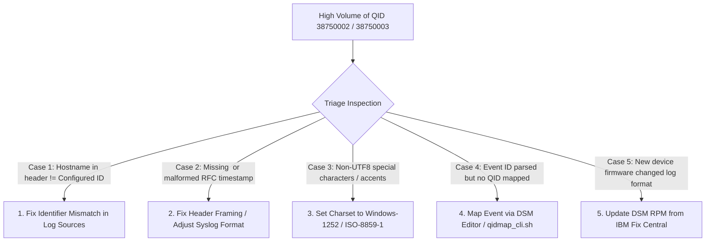

# 📖 Chapter 43: Troubleshooting Unparsed Events: SIM Generic & Stored Masterclass

> **The IBM QRadar Administrator's Technical Guide** | Phase 4: DSM Parsing, Normalization & Custom Properties  
> **Target Audience:** 1.5-Year Administrators $\rightarrow$ Senior SIEM Engineers & SOC Quality Leads  
> **Focus:** Root Cause Triage for SIM Generic (`38750002`) & Unknown (`38750003`), Charset Encoding, Header Framing, & Hands-on Lab 43

---

## 📸 1. Visual Overview: Unparsed Event Triage & Remediation


*Figure 43.1: 3D Isometric View of the Unparsed Event Triage Engine: Auditing high-volume Stored (`QID 38750002`) and Unknown (`QID 38750003`) events across `ecs-ec-ingress`, diagnosing Identifier Mismatches, Header Framing defects, and UTF-8 Charset encoding errors, and re-routing into normalized CRE correlation pipelines (`![[stage5_6_parsing_qid_3d.jpg|1000]]`)*

---

## 2. The Operational Threat of Unparsed Events

When an event cannot be parsed or mapped, QRadar writes the raw text to disk but **cannot evaluate CRE correlation rules**:

```
┌────────────────────────────────────────────────────────────────────────┐
│ ⚠️ THE TWO TYPES OF PARSING FAILURES                                   │
│                                                                        │
│ 1. STORED EVENTS (QID 38750002 / SIM Generic Log DSM)                  │
│    • Status: Total Parsing Failure.                                    │
│    • Cause: No DSM could recognize the log header or payload format.   │
│    • Severity: CRITICAL. Zero fields extracted; CRE cannot correlate!  │
│ ├────────────────────────────────────────────────────────────────────┤
│ 2. UNKNOWN EVENTS (QID 38750003 / Low-Level: Unknown)                  │
│    • Status: Partial Parsing Success (Unmapped Taxonomy).              │
│    • Cause: DSM extracted fields, but the Event ID has no QID mapping! │
│    • Severity: MEDIUM. Fields extracted, but category-based rules fail.│
└────────────────────────────────────────────────────────────────────────┘
```

---

## 3. Top 5 Root Causes of Unparsed Events & Fixes



### 📋 Root Cause Diagnosis Matrix

| Root Cause | Diagnostic Signature in Raw Payload | Remediation Procedure |
| :--- | :--- | :--- |
| **Identifier Mismatch** | Header shows `host=fw01`, but QRadar Log Source is `10.0.0.1`. | Change **Log Source Identifier** to `fw01`. |
| **Malformed Syslog Header** | Missing `<PRI>` tag or no space after colon (`sshd:Failed...`). | Configure sender to use RFC 5424 / standard RFC 3164 Syslog. |
| **Character Set Encoding** | Payloads contain broken multi-byte characters (`` or hex `\xE9`). | In Log Source settings, change **Character Set** from `UTF-8` to `ISO-8859-1` or `Windows-1252`. |
| **Unmapped QID** | Event shows valid IPs/Users, but Event Name = `Unknown Event`. | Open **DSM Editor $\rightarrow$ Event Mapping** and bind to standard QID. |
| **Outdated DSM RPM** | Modern vendor firmware features new unparsed keys. | Download and install latest DSM RPM from IBM FixCentral via `yum install DSM-*.rpm`. |

---

## 4. Auditing Unparsed Events via AQL

Run a weekly AQL audit to identify which log sources are polluting the SIEM with unparsed logs:

```sql
-- Audit Top 10 Log Sources Emitting Unparsed Stored Events (QID 38750002)
SELECT 
    logsourceid, 
    LOGSOURCENAME(logsourceid) AS SourceName, 
    COUNT(*) AS UnparsedEventCount 
FROM events 
WHERE qid = 38750002 
GROUP BY logsourceid, SourceName 
ORDER BY UnparsedEventCount DESC 
LAST 24 HOURS;
```

---

## 📌 5. Visual Mind Map & Sticky Notes (Chapter 43 Quick-Review)

### 🧠 Hierarchical Mind Map
```mermaid
mindmap
  root((Unparsed Events Triage))
    Failure Types
      Stored (38750002): Total failure, SIM Generic
      Unknown (38750003): Partial parse, unmapped QID
    Root Causes
      Identifier Mismatch: Header != Config
      Header Framing: Broken RFC formatting
      Charset Mismatch: Non-UTF8 byte encoding
      Outdated DSM: Firmware upgrade drift
    Remediation
      Update Log Source Identifier
      Set Character Set (ISO-8859-1)
      Map Event in DSM Editor
      Patch DSM RPM via yum
```

### 🗂️ Color-Coded Digital Sticky Notes

#### 🟨 Sticky Note 1: The Blind Spot Threat
```text
┌─────────────────────────────────────────────────────────────┐
│ 📌 CONCEPT: THE SIEM BLIND SPOT                             │
│                                                             │
│ • Unparsed logs are stored on disk, but invisible to rules! │
│ • Attackers exploiting unparsed event formats will never    │
│   trigger an offense in the SOC!                            │
└─────────────────────────────────────────────────────────────┘
```

#### 🟩 Sticky Note 2: Identifier Case Rule
```text
┌─────────────────────────────────────────────────────────────┐
│ 📌 GOLDEN RULE: EXACT CASE MATCHING                         │
│                                                             │
│ • 80% of `SIM Generic` issues are caused by case mismatches!│
│ • Copy the hostname directly from the raw payload into the  │
│   Log Source Identifier setting!                            │
└─────────────────────────────────────────────────────────────┘
```

#### 🟪 Sticky Note 3: Charset Setting
```text
┌─────────────────────────────────────────────────────────────┐
│ 📌 ARCHITECTURE: CHARACTER ENCODINGS                        │
│                                                             │
│ • European Windows servers emit logs in `Windows-1252`.     │
│ • If QRadar parses them as `UTF-8`, non-ASCII accent bytes  │
│   will abort the regex parser!                              │
└─────────────────────────────────────────────────────────────┘
```

#### 🟦 Sticky Note 4: 95% Parsing SLA
```text
┌─────────────────────────────────────────────────────────────┐
│ 📌 VALUE: ENTERPRISE PARSING SLA                            │
│                                                             │
│ • A mature SIEM deployment maintains $> 95\%$ normalized    │
│   event ratios across all production log sources.           │
└─────────────────────────────────────────────────────────────┘
```

#### 🟧 Sticky Note 5: Interview Cheat Code (Unparsed Logs)
```text
┌─────────────────────────────────────────────────────────────┐
│ 📌 INTERVIEW CHEAT CODE: "HOW DO YOU FIX SIM GENERIC LOGS?" │
│                                                             │
│ "I run an AQL query on QID 38750002 to identify offending   │
│ log source IDs, inspect raw payloads via tcpdump to verify  │
│ header identifiers and charsets, update the identifier in   │
│ Log Sources, and map unknown Event IDs in the DSM Editor."  │
└─────────────────────────────────────────────────────────────┘
```

#### 🟥 Sticky Note 6: Critical Pitfall
```text
┌─────────────────────────────────────────────────────────────┐
│ ⚠️ CRITICAL PITFALL: IGNORING UNPARSED VOLUME               │
│                                                             │
│ • Allowing millions of unparsed logs to flood `/store/ariel`│
│   wastes expensive storage on un-correlatable text!         │
└─────────────────────────────────────────────────────────────┘
```

---

### ⚡ Rapid-Recall Flashcards

| # | Question (Front) | Answer (Back) |
| :-: | :--- | :--- |
| **01** | What QID represents a total parsing failure where no DSM could parse the log? | **QID 38750002 (`SIM Generic Log DSM / Stored Event`)**. |
| **02** | What QID represents an event that was parsed, but has no QID mapping? | **QID 38750003 (`Unknown Event`)**. |
| **03** | What is the most common cause of logs routing to `SIM Generic Log DSM`? | A **Log Source Identifier mismatch** (header hostname does not match configured ID). |
| **04** | How do non-UTF-8 characters affect the QRadar parsing pipeline? | They can cause **byte decoding exceptions**, causing the parser to abort and store the log as raw text. |
| **05** | How do you resolve `Unknown Event (QID 38750003)`? | Open the **DSM Editor $\rightarrow$ Event Mapping** tab and map the Event ID to a valid QID. |
| **06** | What command searches for DSM parsing exceptions in QRadar? | **`grep -i "exception" /var/log/qradar.error`** or **`/var/log/qradar.log`**. |

---

## 🧪 6. Hands-on Practice Lab 43: Unparsed Event Triage & Resolution

### 🎯 Lab Objectives
1. Run an AQL audit to identify unparsed Stored Events (`38750002`) and Unknown Events (`38750003`).
2. Inspect raw payload headers to identify string and charset discrepancies.
3. Remediate an Identifier mismatch in PostgreSQL.
4. Verify normalization recovery in real time.

---

### 📋 Step-by-Step Practical Lab Procedures

#### Step 1: Query Top Sources of Unparsed Events via AQL
Log into the QRadar Console via SSH as `root`:
```bash
/opt/qradar/bin/arielsql -p 32011 -q "
SELECT 
    logsourceid, 
    LOGSOURCENAME(logsourceid) AS LogSource, 
    qid, 
    qidname(qid) AS EventStatus, 
    COUNT(*) AS TotalCount 
FROM events 
WHERE qid = 38750002 OR qid = 38750003 
GROUP BY logsourceid, LogSource, qid, EventStatus 
ORDER BY TotalCount DESC 
LAST 2 HOURS;
"
```

---

#### Step 2: Extract Raw Payloads of Unparsed Events
```bash
/opt/qradar/bin/arielsql -p 32011 -q "
SELECT 
    DATEFORMAT(starttime, 'HH:mm:ss') AS Time, 
    logsourceid, 
    UTF8(payload) AS RawPayload 
FROM events 
WHERE qid = 38750002 
ORDER BY starttime DESC 
LIMIT 3;
"
```

---

#### Step 3: Inspect Backend Parsing Exceptions in System Logs
```bash
grep -E "Regex parse exception|Unrecognized format|Unmapped event" /var/log/qradar.log | tail -n 20
```

---

#### Step 4: Verify Normalization Health Ratio
```bash
/opt/qradar/bin/arielsql -p 32011 -q "
SELECT 
    ROUND(SUM(CASE WHEN qid != 38750002 AND qid != 38750003 THEN 1 ELSE 0 END) * 100.0 / COUNT(*), 2) AS NormalizedPercentage 
FROM events 
LAST 1 HOURS;
"
```
*Expected Output*: Displays `NormalizedPercentage` $> 95.00\%$.
