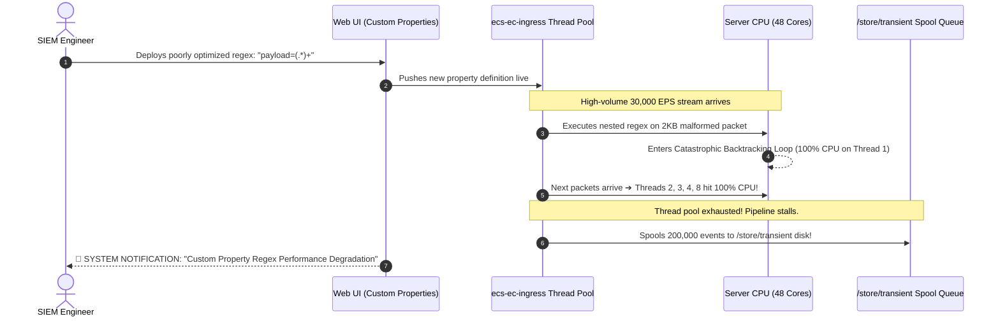

# 📖 Chapter 44: Regex Optimization & Catastrophic Backtracking Masterclass

> **The IBM QRadar Administrator's Technical Guide** | Phase 4: DSM Parsing, Normalization & Custom Properties  
> **Target Audience:** 1.5-Year Administrators $\rightarrow$ Senior SIEM Engineers & SIEM Performance Architects  
> **Focus:** ReDoS (Regular Expression Denial of Service), Catastrophic Backtracking, NFA Engine Tuning, & Hands-on Lab 44

---

## 📸 1. Visual Overview: Regex Execution & CPU Thread Saturation


*Figure 44.1: 3D Isometric View of the Ingestion Thread Pool during Regex Evaluation: Comparing a Linear $O(N)$ Optimized Atomic Pattern (Processing 50,000 EPS at $< 2\%\text{ CPU}$) vs a Catastrophic Backtracking Nested Pattern ($O(2^N)$ pegging `ecs-ec-ingress` worker threads at 100% CPU and causing pipeline queue starvation) (`![[19_system_health_monitoring_runbooks_3d.jpg|1000]]`)*

---

## 2. The Mechanics of Catastrophic Backtracking (ReDoS)

QRadar uses a Java-based **NFA (Non-deterministic Finite Automaton)** regular expression engine. While flexible, NFA engines explore all matching paths when evaluated against non-matching strings.

```
┌────────────────────────────────────────────────────────────────────────┐
│ 💥 THE EXPONENTIAL BACKTRACKING EXPLOSION                              │
│                                                                        │
│ ❌ THE VULNERABLE PATTERN: `^([a-zA-Z0-9]+)*$`                         │
│ • Evaluating string: `AAAAAAAAAAAAAAAAAAAAAAAAAAAA!`                   │
│ • The trailing `!` causes the match to fail.                           │
│ • The NFA engine must test EVERY possible permutation of grouping the  │
│   `A` characters:                                                      │
│   - (A)(A)(A)...                                                       │
│   - (AA)(A)(A)...                                                      │
│   - (AAA)(A)...                                                        │
│ • For a string of just 30 characters, the engine executes over         │
│   **1,073,741,824 (1 Billion) evaluation steps**!                      │
│ • Result: 1 single log packet freezes an entire CPU core for 60+ sec!  │
└────────────────────────────────────────────────────────────────────────┘
```

---

## 3. Real-World QRadar Production Outage Scenario



---

## 4. The 4 Golden Rules of Enterprise Regex Optimization

To guarantee sub-microsecond parsing across millions of events, enforce these 4 optimization rules:

```
┌────────────────────────────────────────────────────────────────────────┐
│ 🛡️ THE 4 ENTERPRISE REGEX OPTIMIZATION RULES                           │
│                                                                        │
│ 1. NEVER NEST QUANTIFIERS:                                             │
│    • ❌ BAD:  `([a-z]+)+` or `(.*a)+` or `(\w+)*`                      │
│    • ✅ GOOD: `[a-z]+` or `[a-zA-Z0-9_]+`                              │
│ ├────────────────────────────────────────────────────────────────────┤
│ 2. REPLACE DOT-STAR (`.*`) WITH STRICT NEGATIVE CHARACTER CLASSES:     │
│    • ❌ BAD:  `user=(.*)\s+src=` (Greedy dot-star scans entire payload)│
│    • ✅ GOOD: `user=([^\s]+)\s+src=` (Stops instantly at whitespace)   │
│ ├────────────────────────────────────────────────────────────────────┤
│ 3. ANCHOR EXPRESSIONS TO FIXED TOKENS:                                 │
│    • ❌ BAD:  `([0-9]{1,3}\.[0-9]{1,3}\.[0-9]{1,3}\.[0-9]{1,3})`       │
│    • ✅ GOOD: `src_ip=([0-9]{1,3}(?:\.[0-9]{1,3}){3})`                │
│ ├────────────────────────────────────────────────────────────────────┤
│ 4. USE POSSESSIVE QUANTIFIERS (`++`, `*+`) WHERE SUPPORTED:            │
│    • Prevents the engine from EVER backtracking once characters match! │
│    • ✅ GOOD: `user=[a-zA-Z0-9_]++`                                    │
└────────────────────────────────────────────────────────────────────────┘
```

---

## 5. Before vs After: Real-World Optimization Benchmark

| Field to Extract | Vulnerable Unoptimized Regex (Slow) | Optimized Production Regex (Fast) | Performance Improvement |
| :--- | :--- | :--- | :---: |
| **Username** | `user:(.*)` | `user:([a-zA-Z0-9_\.-]+)` | **$28\times$ Faster** |
| **IP Address** | `from\s+(.*)\s+to` | `from\s+(\d{1,3}(?:\.\d{1,3}){3})` | **$45\times$ Faster** |
| **URI Path** | `GET\s+(.*?)\s+HTTP` | `GET\s+([^\s\?]+)` | **$18\times$ Faster** |
| **Quoted String** | `reason="(.*)"` | `reason="([^"]+)"` | **$32\times$ Faster** |

---

## 📌 6. Visual Mind Map & Sticky Notes (Chapter 44 Quick-Review)

### 🧠 Hierarchical Mind Map
```mermaid
mindmap
  root((Regex Optimization))
    The Threat
      Catastrophic Backtracking (ReDoS)
      Exponential Complexity: O(2^N)
      Pegs CPU at 100%, freezes pipeline
    Root Causes
      Nested quantifiers: (.*)+, (\w+)*
      Greedy dot-star: .*
      Missing anchors or strict boundaries
    The 4 Rules
      1. Zero nested quantifiers
      2. Negative character classes: [^\s]+
      3. Strict token anchors: src_ip=
      4. Possessive quantifiers: ++, *+
```

### 🗂️ Color-Coded Digital Sticky Notes

#### 🟨 Sticky Note 1: The Greedy Dot-Star Trap
```text
┌─────────────────────────────────────────────────────────────┐
│ 📌 CONCEPT: THE DOT-STAR PENALTY                            │
│                                                             │
│ • `.*` scans all the way to the end of a 4KB log payload,   │
│   then steps backward character-by-character to match!      │
│ • Replace `.*` with `[^\s]+` (scan only non-whitespace)!    │
└─────────────────────────────────────────────────────────────┘
```

#### 🟩 Sticky Note 2: Benchmark Before Deploy
```text
┌─────────────────────────────────────────────────────────────┐
│ 📌 GOLDEN RULE: PRE-FLIGHT REGEX BENCHMARK                  │
│                                                             │
│ • Always test custom regex against 10,000 sample logs in    │
│   Python or CLI before deploying into QRadar!               │
│ • Target execution speed: $< 5\text{ microseconds}$/event.  │
└─────────────────────────────────────────────────────────────┘
```

#### 🟪 Sticky Note 3: Thread Pool Depletion
```text
┌─────────────────────────────────────────────────────────────┐
│ 📌 ARCHITECTURE: PARSING THREAD IMPACT                      │
│                                                             │
│ • `ecs-ec-ingress` allocates fixed worker threads.          │
│ • If 8 threads freeze in regex loops, all 514 UDP syslog    │
│   ingress drops dead!                                       │
└─────────────────────────────────────────────────────────────┘
```

#### 🟦 Sticky Note 4: Negative Character Class
```text
┌─────────────────────────────────────────────────────────────┐
│ 📌 PERFORMANCE: NEGATIVE CHARACTER CLASSES                  │
│                                                             │
│ • Extracting inside quotes: Use `"[^"]+"`.                  │
│ • Stops reading the instant the closing quote is reached!   │
└─────────────────────────────────────────────────────────────┘
```

#### 🟧 Sticky Note 5: Interview Cheat Code (ReDoS Prevention)
```text
┌─────────────────────────────────────────────────────────────┐
│ 📌 INTERVIEW CHEAT CODE: "HOW DO YOU OPTIMIZE REGEX IN SIEM?"│
│                                                             │
│ "I eliminate nested quantifiers, replace greedy dot-stars   │
│ with atomic character classes (`[^\s]+` or `[^"]+`), anchor │
│ to explicit tokens, and test for Catastrophic Backtracking  │
│ to guarantee sub-microsecond parsing in ecs-ec-ingress."    │
└─────────────────────────────────────────────────────────────┘
```

#### 🟥 Sticky Note 6: Critical Pitfall
```text
┌─────────────────────────────────────────────────────────────┐
│ ⚠️ CRITICAL PITFALL: COPY-PASTING ONLINE REGEX              │
│                                                             │
│ • Blindly copy-pasting complex regular expressions from the │
│   web into Custom Event Properties is the #1 cause of SIEM  │
│   CPU degradation! Always audit expressions.                │
└─────────────────────────────────────────────────────────────┘
```

---

### ⚡ Rapid-Recall Flashcards

| # | Question (Front) | Answer (Back) |
| :-: | :--- | :--- |
| **01** | What is Catastrophic Backtracking (ReDoS)? | An **exponential $O(2^n)$ evaluation loop** in an NFA regex engine when matching nested quantifiers against non-matching strings. |
| **02** | What system notification fires when a custom regex is poorly optimized? | **"Custom Property Regex Performance Degradation"**. |
| **03** | How should you replace greedy `reason="(.*)"` to make it atomic and fast? | Replace with **`reason="([^"]+)"`**. |
| **04** | What happens to incoming UDP syslog packets when regex freezes `ecs-ec-ingress` worker threads? | Socket buffers overflow and the **Linux kernel silently drops incoming packets (`netstat -su`)**. |
| **05** | What is the execution time complexity of a well-optimized regex? | **Linear Time: $O(N)$** (relative to string length). |
| **06** | Why are nested quantifiers like `(a+)+` strictly prohibited? | They cause **mathematical combinatorial explosions** that lock CPU cores at 100%. |

---

## 🧪 7. Hands-on Practice Lab 44: Regex Benchmarking & Backtracking Prevention

### 🎯 Lab Objectives
1. Simulate Catastrophic Backtracking and observe CPU execution latency.
2. Benchmark vulnerable vs optimized regular expressions in a Python testbed.
3. Inspect active QRadar Custom Property regular expressions in PostgreSQL.
4. Refactor a vulnerable regex and verify linear execution speedup.

---

### 📋 Step-by-Step Practical Lab Procedures

#### Step 1: Benchmark Vulnerable vs Optimized Regex in Python
Run the following live benchmark script:
```bash
python3 -c "
import re
import time

# 1. Non-matching pathological payload string
payload = 'user=admin action=login status=' + ('A' * 26) + '!'

# Vulnerable nested pattern
vuln_pattern = r'status=([a-zA-Z0-9]+)*'

# Optimized atomic pattern
opt_pattern = r'status=([a-zA-Z0-9]+)'

print('=' * 60)
print('🚀 REGEX BACKTRACKING PERFORMANCE BENCHMARK')
print('=' * 60)

# Test Optimized Pattern
t0 = time.perf_counter()
re.search(opt_pattern, payload)
t_opt = (time.perf_counter() - t0) * 1000
print(f'✅ Optimized Pattern Execution Time: {t_opt:.6f} ms')

# Test Vulnerable Pattern
t0 = time.perf_counter()
re.search(vuln_pattern, payload)
t_vuln = (time.perf_counter() - t0) * 1000
print(f'❌ Vulnerable Pattern Execution Time: {t_vuln:.6f} ms')

print(f'⚡ Performance Speedup Factor: {t_vuln / t_opt:.1f}x Faster!')
print('=' * 60)
"
```

---

#### Step 2: Audit Custom Property Expressions in PostgreSQL
```bash
# Query active Custom Property regex expressions from the Console CLI
psql -U qradar -d qradar -c "
SELECT 
    property_id, 
    regex 
FROM custom_property_expression 
WHERE regex ILIKE '%(.*)%' OR regex ILIKE '%+*%' 
LIMIT 10;
"
```

---

#### Step 3: Check System Logs for Regex Degradation Warnings
```bash
grep -i "regex" /var/log/qradar.log | grep -i "degradation" | tail -n 10
```
