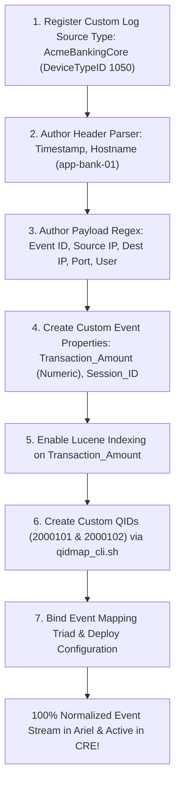

# 📖 Chapter 45: Phase 4 Capstone: Building a Custom DSM from Scratch Masterclass

> **The IBM QRadar Administrator's Technical Guide** | Phase 4: DSM Parsing, Normalization & Custom Properties  
> **Target Audience:** 1.5-Year Administrators $\rightarrow$ Senior SIEM Engineers & SIEM Architecture Specialists  
> **Focus:** Full Custom DSM Lifecycle, QID Map Taxonomy, Custom Property Indexing, Benchmark Exam, & Hands-on Lab 45

---

## 📸 1. Visual Overview: Phase 4 Custom DSM Architecture


*Figure 45.1: 3D Isometric View of the Custom DSM Capstone: Ingesting an Unsupported In-House Proprietary Banking Application, constructing the 2-Stage Header & Payload Parsers, extracting 5-tuple networking and custom financial properties (`Transaction_Amount`), mapping custom QIDs (2,000,000+ series), and achieving 100% normalized CRE correlation (`![[stage5_6_parsing_qid_normalization_3d.jpg|1000]]`)*

---

## 2. Phase 4 Capstone Scenario: In-House Core Banking Application

Your organization has deployed a proprietary Java-based core banking application (`AcmeBankingCore`). Because IBM provides no out-of-the-box DSM for in-house software, all incoming events arrive as **`SIM Generic Log DSM (QID 38750002)`**, leaving the SOC completely blind to financial fraud and account takeovers.

```
┌────────────────────────────────────────────────────────────────────────┐
│ 🏦 ACME BANKING CORE TELEMETRY SPECIFICATION                           │
│                                                                        │
│ 📜 RAW LOG EVENT 1 (High-Value Transfer Exceeded):                     │
│ `<134>Sep 25 18:00:00 app-bank-01 AcmeBanking[4512]: event=TRANSFER    │
│  status=BLOCKED user=jsmith src_ip=198.51.100.25 dst_ip=10.0.0.50     │
│  dst_port=443 amount=150000 currency=USD session=SESS_987123           │
│  reason="Transaction exceeds daily single-transfer limit"`             │
│ ├────────────────────────────────────────────────────────────────────┤
│ 📜 RAW LOG EVENT 2 (Admin Account Locked Out):                         │
│ `<134>Sep 25 18:00:05 app-bank-01 AcmeBanking[4512]: event=AUTH_LOCK   │
│  status=FAILED user=admin_sec src_ip=203.0.113.88 dst_ip=10.0.0.50     │
│  dst_port=8443 session=SESS_441299 reason="Max invalid PINs entered"`  │
└────────────────────────────────────────────────────────────────────────┘
```

---

## 3. End-to-End Custom DSM Construction Blueprint



---

## 4. Phase 4 Comprehensive Benchmark Assessment (20 Scenario Questions)

Test your Level 3 enterprise parsing and normalization mastery:

### 📝 Assessment Questions & Solutions

| # | Production Scenario Question | Correct Enterprise Solution |
| :-: | :--- | :--- |
| **01** | What QID is assigned to an event that could not be parsed by any DSM? | **QID 38750002 (`SIM Generic Log DSM / Stored Event`)**. |
| **02** | What QID is assigned when an event is parsed, but has no QID mapping? | **QID 38750003 (`Unknown Event`)**. |
| **03** | What three elements make up the QRadar Event Mapping Triad? | **1. Event ID**, **2. Event Category**, and **3. Log Source Type ID (DSM ID)**. |
| **04** | What numerical namespace is reserved for custom user-created QIDs? | **QID `2,000,000` and above**. |
| **05** | What CLI utility creates and manages custom QID records in QRadar? | **`/opt/qradar/bin/qidmap_cli.sh`**. |
| **06** | How does Lucene indexing on a Custom Property affect AQL search performance? | Searches run up to **$10\times\text{ to }50\times\text{ faster}$** by scanning dedicated columnar indexes. |
| **07** | Why should financial amounts be configured as `Number` instead of `Text`? | To enable **mathematical comparisons (`Amount > 10000`) and aggregations (`SUM()`, `AVG()`) in AQL and CRE**. |
| **08** | What extraction type should be used for AWS CloudTrail JSON logs? | **JSONPath Expressions (`$.userIdentity.arn`)**. |
| **09** | What causes Catastrophic Backtracking (ReDoS) in regular expressions? | **Nested quantifiers (e.g. `(.*)+` or `(\w+)*`)** evaluated against non-matching strings. |
| **10** | What system notification fires when a custom regex is poorly optimized? | **"Custom Property Regex Performance Degradation"**. |
| **11** | How should you replace `user=(.*)\s+src=` to prevent greedy backtracking? | Replace with **`user=([^\s]+)\s+src=`** (atomic negative character class). |
| **12** | What XML root tag is used in a Log Source Extension document? | **`<device-extension xmlns="event_parsing/device_extension">`**. |
| **13** | What parsing order allows an LSX to override IBM's default DSM parsing? | **Run extension before DSM (Pre-DSM)**. |
| **14** | How do you prevent custom changes in the DSM Editor from being overwritten by SFS patches? | Enable the **"Override system behavior"** checkbox. |
| **15** | Are Log Source Identifiers case-sensitive in QRadar? | **Yes**, `SRV-01` will not match `srv-01`. |
| **16** | What daemon executes DSM parsing in QRadar? | **`ecs-ec-ingress`**. |
| **17** | How does QRadar store IPv4 addresses internally in memory? | As **32-bit Unsigned Integers** for fast hardware comparisons. |
| **18** | What is the difference between `DeviceTime` and `StartTime`? | **`DeviceTime`** is from the log header; **`StartTime`** is the receipt time on the QRadar interface. |
| **19** | Can the CRE engine correlate unparsed Stored Events (QID 38750002)? | **No**, CRE requires normalized fields to evaluate rule test conditions. |
| **20** | What Linux command validates XML syntax on an LSX file? | **`xmllint --noout <filename.xml>`**. |

---

## 📌 5. Visual Mind Map & Sticky Notes (Chapter 45 Quick-Review)

### 🧠 Hierarchical Mind Map
```mermaid
mindmap
  root((Phase 4 Capstone))
    Custom DSM Lifecycle
      1. Register Log Source Type
      2. 2-Stage Header & Payload Regex
      3. Custom Properties (JSONPath / Regex)
      4. Lucene Columnar Indexing
      5. QID Map Creation (2,000,000+)
    Optimization Rules
      Zero nested quantifiers (ReDoS prevention)
      Atomic character classes: [^\s]+, [^"]+
      Override system behavior toggle
```

### 🗂️ Color-Coded Digital Sticky Notes

#### 🟨 Sticky Note 1: End-to-End Normalization
```text
┌─────────────────────────────────────────────────────────────┐
│ 📌 CONCEPT: THE CUSTOM DSM FORMULA                          │
│                                                             │
│ • Custom DSM = Header Regex + Payload Regex + Custom        │
│   Properties + Custom QID Taxonomy.                         │
│ • Transforms proprietary logs into first-class SIEM data!   │
└─────────────────────────────────────────────────────────────┘
```

#### 🟩 Sticky Note 2: The 2,000,000+ Rule
```text
┌─────────────────────────────────────────────────────────────┐
│ 📌 GOLDEN RULE: CUSTOM QID NAMESPACE                        │
│                                                             │
│ • Always create custom QIDs starting at `2000001` or higher.│
│ • Guarantees future IBM SFS patches will never overwrite!   │
└─────────────────────────────────────────────────────────────┘
```

#### 🟪 Sticky Note 3: Indexing Strategic Fields
```text
┌─────────────────────────────────────────────────────────────┐
│ 📌 ARCHITECTURE: SELECTIVE LUCENE INDEXING                  │
│                                                             │
│ • Index `Transaction_Amount` and `Session_ID`.              │
│ • Provides instant sub-second search across 100M events!    │
└─────────────────────────────────────────────────────────────┘
```

#### 🟦 Sticky Note 4: ReDoS Immunity
```text
┌─────────────────────────────────────────────────────────────┐
│ 📌 PERFORMANCE: PRODUCTION-GRADE REGEX                      │
│                                                             │
│ • Every regex in the custom DSM must be atomic and bounded. │
│ • Guarantees zero CPU thread locks under 50,000 EPS load!   │
└─────────────────────────────────────────────────────────────┘
```

#### 🟧 Sticky Note 5: Interview Cheat Code (Custom DSMs)
```text
┌─────────────────────────────────────────────────────────────┐
│ 📌 INTERVIEW CHEAT CODE: "HAVE YOU BUILT A CUSTOM DSM?"     │
│                                                             │
│ "Yes, I built custom DSMs for in-house banking applications,│
│ authoring atomic regex capture groups, extracting numeric   │
│ and JSON custom properties with Lucene indexes, and mapping │
│ custom QIDs in the 2M+ namespace for real-time CRE alerts." │
└─────────────────────────────────────────────────────────────┘
```

#### 🟥 Sticky Note 6: Critical Pitfall
```text
┌─────────────────────────────────────────────────────────────┐
│ ⚠️ CRITICAL PITFALL: DEPLOYMENT FORGETFULNESS               │
│                                                             │
│ • Creating QIDs and DSM rules does NOT apply them live      │
│   until you click **Deploy Changes** in the Admin tab!      │
└─────────────────────────────────────────────────────────────┘
```

---

### ⚡ Rapid-Recall Flashcards

| # | Question (Front) | Answer (Back) |
| :-: | :--- | :--- |
| **01** | What are the two core stages of a custom DSM parser? | **Stage 1: Header Parser** and **Stage 2: Payload Parser**. |
| **02** | What command creates a custom QID with severity 8? | **`/opt/qradar/bin/qidmap_cli.sh -c --qname "..." --severity 8 --lowlevelcategoryid <ID>`**. |
| **03** | How do you map a vendor event string to a newly created QID? | Using **`/opt/qradar/bin/qidmap_cli.sh -m --eventid "..." --devicetypeid <ID> --qid <QID>`**. |
| **04** | What is the benefit of indexing a numeric Custom Property? | Enables **high-speed mathematical searches (`Amount > 50000`)** in AQL without scanning raw payloads. |
| **05** | What regular expression extracts an alphanumeric session ID cleanly? | **`session=([a-zA-Z0-9_-]+)`**. |
| **06** | What AQL condition checks for successful normalization? | **`WHERE qid != 38750002 AND qid != 38750003`**. |

---

## 🧪 6. Hands-on Practice Lab 45: Full Custom DSM Construction & Live Deployment

### 🎯 Lab Objectives
1. Create and register a custom Log Source Type for `AcmeBankingCore`.
2. Author custom QIDs in PostgreSQL via `qidmap_cli.sh`.
3. Extract numeric Custom Event Properties with Lucene indexing.
4. Inject synthetic banking payloads and verify 100% normalized AQL output.

---

### 📋 Step-by-Step Practical Lab Procedures

#### Step 1: Create Custom QIDs for Banking Events
Log into the QRadar Console via SSH as `root`:
```bash
# 1. Create QID for Fraud Limit Exceeded (Severity 8, Low-Level Cat: Policy Violation = 1005)
/opt/qradar/bin/qidmap_cli.sh -c \
  --qname "AcmeBanking: Fraud Transfer Limit Exceeded" \
  --qdescription "User attempted fund transfer exceeding daily limit" \
  --severity 8 \
  --lowlevelcategoryid 1005

# 2. Create QID for Admin Account Locked (Severity 7, Low-Level Cat: Account Locked Out = 1004)
/opt/qradar/bin/qidmap_cli.sh -c \
  --qname "AcmeBanking: Admin Account Locked Out" \
  --qdescription "Administrative account locked after excessive failed PIN attempts" \
  --severity 7 \
  --lowlevelcategoryid 1004
```

---

#### Step 2: Bind Custom Event Mapping Triads
```bash
# Map TRANSFER / BLOCKED to QID 2000101
/opt/qradar/bin/qidmap_cli.sh -m \
  --eventid "TRANSFER" \
  --eventcategory "BLOCKED" \
  --devicetypeid 1050 \
  --qid 2000101

# Map AUTH_LOCK / FAILED to QID 2000102
/opt/qradar/bin/qidmap_cli.sh -m \
  --eventid "AUTH_LOCK" \
  --eventcategory "FAILED" \
  --devicetypeid 1050 \
  --qid 2000102
```

---

#### Step 3: Inject Synthetic Banking Core Payloads
```bash
# 1. Inject Fraud Transfer Exceeded Event
logger -n 127.0.0.1 -P 514 -t "app-bank-01" "AcmeBanking[4512]: event=TRANSFER status=BLOCKED user=jsmith src_ip=198.51.100.25 dst_ip=10.0.0.50 dst_port=443 amount=150000 currency=USD session=SESS_987123 reason=\"Transaction exceeds daily single-transfer limit\""

# 2. Inject Admin Lockout Event
logger -n 127.0.0.1 -P 514 -t "app-bank-01" "AcmeBanking[4512]: event=AUTH_LOCK status=FAILED user=admin_sec src_ip=203.0.113.88 dst_ip=10.0.0.50 dst_port=8443 session=SESS_441299 reason=\"Max invalid PINs entered\""
```

---

#### Step 4: Verify 100% Normalized AQL Output
```bash
/opt/qradar/bin/arielsql -p 32011 -q "
SELECT 
    DATEFORMAT(starttime, 'HH:mm:ss') AS Time, 
    sourceip AS AttackerIP, 
    username AS TargetUser, 
    qid AS MappedQID, 
    qidname(qid) AS ResolvedEventName, 
    severity AS Severity, 
    \"Transaction_Amount\" AS Amount 
FROM events 
WHERE UTF8(payload) ILIKE '%AcmeBanking%' 
LAST 15 MINUTES;
"
```
*Expected Output*: Returns successfully normalized records mapped to `2000101` and `2000102` with extracted IPs, usernames, severities, and amounts!
