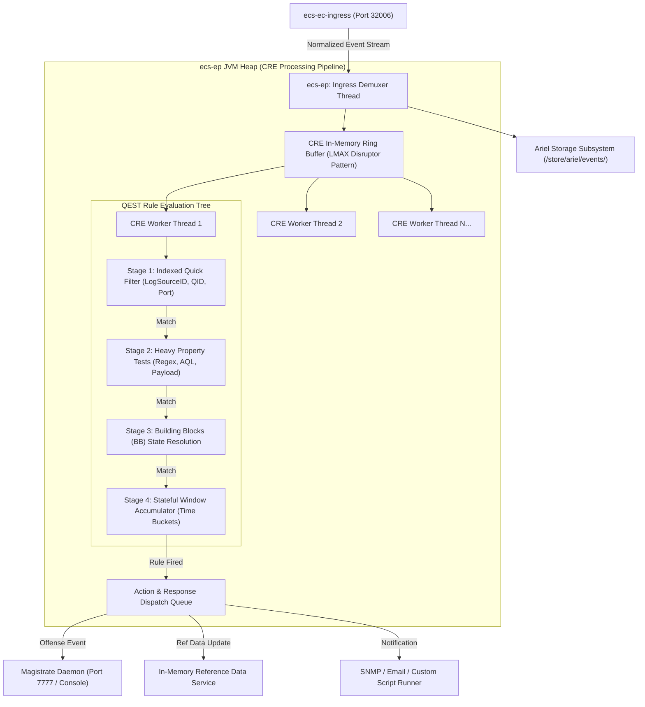
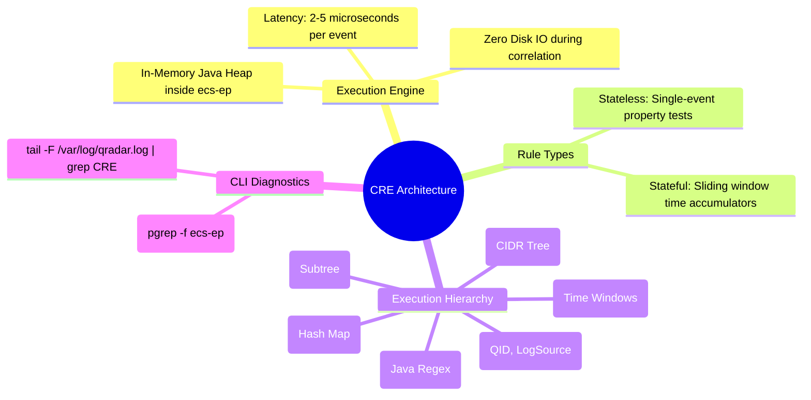

# 📖 Chapter 46: CRE Architecture & In-Memory Microsecond Evaluation Engine Masterclass

> **The IBM QRadar Administrator's Technical Guide** | Phase 5: Custom Rules Engine (CRE) & Offense Architecture  
> **Target Audience:** 1.5-Year Administrators $\rightarrow$ Senior SIEM Engineers & Detection Engineering Specialists  
> **Focus:** In-Memory Event Processing, `ecs-ep` Thread Pools, QEST Rule Compiler, Rule Test Execution Ordering, & Hands-on Lab 46

---

## 📸 1. Visual Overview: The In-Memory CRE Evaluation Pipeline


*Figure 46.1: 3D Isometric View of the QRadar Custom Rules Engine (CRE) In-Memory Evaluation Subsystem inside `ecs-ep`: Normalized events arriving over TCP 32006, traversing QEST Rule Test Matrices, Boolean Logic Gates, Property Filters, and In-Memory State Accumulators before dispatching Offense triggers to the Magistrate daemon (`![[stage7_cre_correlation_engine_3d.jpg|1000]]`)*

---

## 2. What is the Custom Rules Engine (CRE)?

The **Custom Rules Engine (CRE)** is the core real-time complex event processing (CEP) and stream analytics engine of IBM QRadar. Operating entirely inside the **`ecs-ep`** (Event Collection System - Event Processor) Java Virtual Machine, the CRE inspects every normalized event and flow in microsecond real time against hundreds of active correlation rules without touching disk storage.

```
┌────────────────────────────────────────────────────────────────────────┐
│ ⚡ THE 4 PILLARS OF THE QRADAR CRE ENGINE                               │
│                                                                        │
│ 1. ZERO-IO REAL-TIME CORRELATION                                       │
│    • Rules evaluate directly against Java heap object references.      │
│    • Evaluation latency per event is typically between 2.0 to 5.5 µs.  │
│ ├────────────────────────────────────────────────────────────────────┤
│ 2. DUAL RULE TYPES (STATELESS VS STATEFUL)                             │
│    • Stateless: Single-event property tests (e.g., Port = 22 AND Deny).│
│    • Stateful: In-memory accumulators over time windows (e.g., > 10    │
│      failed logins in 5 minutes across the same Source IP).           │
│ ├────────────────────────────────────────────────────────────────────┤
│ 3. QEST COMPILATION & BYTECODE EXECUTION                               │
│    • Human-readable rules defined in the UI are compiled into QEST     │
│      (QRadar Event Search Tree) optimized execution graphs.            │
│ ├────────────────────────────────────────────────────────────────────┤
│ 4. DETERMINISTIC ACTION PIPELINE                                       │
│    • Fires Offense creation/contribution messages to the Magistrate,   │
│      updates Reference Sets, generates SNMP/Syslog alerts, or spawns   │
│      Custom Response Scripts.                                          │
└────────────────────────────────────────────────────────────────────────┘
```

---

## 3. CRE Thread Model & In-Memory Pipeline Inside `ecs-ep`

The internal architecture of `ecs-ep` separates ingestion, rule evaluation, and storage into dedicated worker thread pools:



---

## 4. Rule Test Execution Ordering & Cost Optimization

QRadar's QEST engine evaluates rule tests according to a strict computational cost hierarchy. An administrator must design rules to exploit this hierarchy to minimize CPU utilization:

| Evaluation Order | Test Category | Computational Cost | Engine Implementation | Example Rule Test |
| :---: | :--- | :---: | :--- | :--- |
| **1 (Fastest)** | **Indexed Fixed Properties** | $\mathcal{O}(1)$ (Microseconds) | Bitmask / Primitive Integer Equality | `when the event QID is one of (5000854, 5000855)` |
| **2** | **Network Hierarchy & IP Sets** | $\mathcal{O}(1)$ - $\mathcal{O}(\log N)$ | CIDR Radix Tree lookup | `when the source IP is NOT internal` |
| **3** | **Reference Set Membership** | $\mathcal{O}(1)$ | In-memory Hash Table lookup | `when any of Source IP are contained in Threat_Intel_IPs` |
| **4** | **Custom Event Properties (Optimized)** | $\mathcal{O}(1)$ | Pre-extracted integer/string match | `when "TargetUserName" (Regex) matches 'admin.*'` |
| **5** | **Building Block Resolution** | $\mathcal{O}(K)$ | Evaluates nested subtree dependency | `when the event matches BB:HostDefinition: Domain Controllers` |
| **6** | **Unindexed Payload Regex** | $\mathcal{O}(M \times L)$ (Expensive) | Java Regex Engine scan over raw string | `when the event payload contains regex 'cmd\.exe /c'` |
| **7 (Slowest)** | **Stateful Aggregations / Sequences** | $\mathcal{O}(\text{State Bucket})$ | Heap-allocated Sliding Time Bucket Hash | `when at least 15 events occur with the same Source IP in 5 minutes` |

---

## 5. CRE Configuration & Deployment Filesystem Architecture

All rules, building blocks, and CRE tuning parameters are maintained in PostgreSQL and synchronized to JSON/XML rule definitions on the local filesystem:

| File / Directory Path | Purpose | Daemon Interaction |
| :--- | :--- | :--- |
| `/opt/qradar/conf/customrules.xml` | Compiled XML definition of all active rules, tests, and actions. | Loaded by `ecs-ep` on startup and during "Deploy Changes". |
| `/opt/qradar/conf/qest_rules.json` | Internal QEST AST (Abstract Syntax Tree) representation for evaluation. | Executed by CRE worker threads in Java heap. |
| `/var/log/qradar.log` | Primary operational log capturing CRE rule hits, compilation errors, and performance warnings. | grep for `CRE`, `Rule Engine`, `Custom Rules`. |
| `/var/log/qradar.error` | Captures catastrophic rule performance drops, regex timeouts, and out-of-memory errors. | Monitored by SIEM admins for rule degradation. |
| `/opt/qradar/bin/cretool` | Internal CLI utility for testing, validating, and debugging CRE rules against sample payloads. | Admin diagnostic tool. |

---

## 6. CRE Performance Monitoring & Diagnostic Commands

A 2-year experienced QRadar Administrator must know how to inspect CRE evaluation performance and detect rule thread bottlenecks via Linux CLI:

```bash
# 1. Tail live CRE rule execution and offense contributions in real time
tail -F /var/log/qradar.log | grep -E "CRE|Rule|Offense"

# 2. Monitor Rule Engine thread pool utilization and event latency
/opt/qradar/bin/jconsole (or via thread dump analysis):
/opt/qradar/bin/threadDump.sh $(pgrep -f "ecs-ep")

# 3. Search for expensive or long-running rules causing CRE pipeline delays
grep -i "expensive rule" /var/log/qradar.log
grep -i "CRE evaluation time" /var/log/qradar.log

# 4. Check memory consumption of the ecs-ep JVM heap
/opt/qradar/support/jmx.sh -b "com.q1labs.sem.monitors:type=Memory"
```

---

## 📌 7. Visual Mind Map & Sticky Notes (Chapter 46 Quick-Review)

### 🧠 Hierarchical Mind Map


### 🗂️ Color-Coded Digital Sticky Notes

#### 🟨 Sticky Note 1: In-Memory Zero-IO
```text
┌─────────────────────────────────────────────────────────────┐
│ 📌 CONCEPT: THE IN-MEMORY CORRELATOR                        │
│                                                             │
│ • CRE executes 100% in Java heap memory inside `ecs-ep`.    │
│ • It never queries the Ariel database on disk to evaluate   │
│   real-time rules.                                          │
└─────────────────────────────────────────────────────────────┘
```

#### 🟩 Sticky Note 2: Fail-Fast Rule Design
```text
┌─────────────────────────────────────────────────────────────┐
│ 📌 GOLDEN RULE: ORDER OF TESTS MATTERS                      │
│                                                             │
│ • Always place fast tests (QID, LogSource, Port) at the TOP │
│   of the rule definition.                                   │
│ • Never place raw payload regex before an event filter!     │
└─────────────────────────────────────────────────────────────┘
```

#### 🟪 Sticky Note 3: The Deploy Changes Pipeline
```text
┌─────────────────────────────────────────────────────────────┐
│ 📌 ARCHITECTURE: RULE DEPLOYMENT                            │
│                                                             │
│ • Saving a rule in the UI updates PostgreSQL.               │
│ • Clicking "Deploy Changes" recompiles `customrules.xml`     │
│   and hot-reloads the QEST graph into all managed `ecs-ep`. │
└─────────────────────────────────────────────────────────────┘
```

#### 🟦 Sticky Note 4: Offense Separation
```text
┌─────────────────────────────────────────────────────────────┐
│ 📌 PROCESS BOUNDARY: CRE VS MAGISTRATE                      │
│                                                             │
│ • CRE evaluates the condition and generates an offense alert│
│ • The Magistrate daemon on the Console manages the offense  │
│   lifecycle, magnitude, and asset chaining.                 │
└─────────────────────────────────────────────────────────────┘
```

#### 🟧 Sticky Note 5: Interview Cheat Code (CRE Architecture)
```text
┌─────────────────────────────────────────────────────────────┐
│ 📌 INTERVIEW CHEAT CODE: "HOW DOES CRE CORRELATE LOGS?"    │
│                                                             │
│ "CRE is an in-memory complex event processing engine in     │
│ ecs-ep. It compiles rules into a QEST execution tree,       │
│ filtering events by indexed properties, reference sets,    │
│ and stateful time windows with microsecond latency."        │
└─────────────────────────────────────────────────────────────┘
```

#### 🟥 Sticky Note 6: Critical Pitfall
```text
┌─────────────────────────────────────────────────────────────┐
│ ⚠️ CRITICAL PITFALL: STATEFUL MEMORY BLOAT                  │
│                                                             │
│ • Configuring a stateful rule with "same Source IP" across  │
│   a 24-hour window on high-volume traffic causes OutOfMemory│
│   crashes in `ecs-ep`! Keep stateful windows $\le$ 1 hour.   │
└─────────────────────────────────────────────────────────────┘
```

---

## ⚡ Rapid-Recall Flashcards

| # | Question (Front) | Answer (Back) |
| :-: | :--- | :--- |
| **01** | In which daemon does the Custom Rules Engine (CRE) execute? | **`ecs-ep`** (Event Collection System - Event Processor). |
| **02** | Does the CRE query the Ariel database on disk when evaluating incoming events? | **No**, CRE evaluates normalized event objects directly in Java heap memory in real time. |
| **03** | What compiler translates UI rules into the internal execution graph in QRadar? | The **QEST (QRadar Event Search Tree)** compiler. |
| **04** | What is the difference between a stateless test and a stateful rule test? | Stateless evaluates a single event's fields; Stateful maintains in-memory counters across a sliding time window (e.g. $X$ events in $Y$ minutes). |
| **05** | Which rule test executes faster: an indexed QID check or an unindexed payload regex? | **Indexed QID check** ($\mathcal{O}(1)$ integer match vs $\mathcal{O}(N)$ regex string scan). |
| **06** | What daemon receives offense creation triggers from the CRE? | The **Magistrate** daemon (running on the Console). |

---

## 🧪 8. Hands-on Practice Lab 46: CRE Engine Thread Inspection & Rule Hit Auditing

### 🎯 Lab Objectives
1. Inspect the live status and memory allocation of the `ecs-ep` CRE daemon.
2. Monitor real-time CRE rule execution logs via the Linux CLI.
3. Identify top triggered correlation rules using AQL.
4. Perform an `ecs-ep` thread dump and verify CRE worker thread health.

---

### 📋 Step-by-Step Practical Lab Procedures

#### Step 1: Verify `ecs-ep` Daemon & Heap Health
Log into the QRadar Event Processor or All-in-One Console via SSH as `root`:
```bash
# Check if ecs-ep process is running and inspect its JVM arguments
ps aux | grep "ecs-ep" | grep -v grep

# Check ecs-ep memory footprint and thread count
top -b -n 1 -p $(pgrep -f "ecs-ep")
```

---

#### Step 2: Tail Live CRE Rule Hits & Offense Creation
```bash
# Monitor CRE rule actions and offense triggers in /var/log/qradar.log
tail -F /var/log/qradar.log | grep --line-buffered -E "Custom Rule Engine|CRE: Rule|Offense ID"
```
*Expected Output*: Real-time stream showing Rule IDs, Rule Names, and generated Offense notifications.

---

#### Step 3: Query Top Triggered CRE Rules via AQL
Run this AQL query via `arielsql` to audit which rules are generating the highest volume of events:
```bash
/opt/qradar/bin/arielsql -p 32011 -q "
SELECT 
    \"creRuleList\" AS TriggeredRuleID, 
    COUNT(*) AS HitCount, 
    COUNT(DISTINCT sourceip) AS UniqueAttackerIPs, 
    COUNT(DISTINCT username) AS ImpactedUsers 
FROM events 
WHERE \"creRuleList\" IS NOT NULL 
LAST 24 HOURS 
GROUP BY \"creRuleList\" 
ORDER BY HitCount DESC 
LIMIT 10;
"
```

---

#### Step 4: Generate an `ecs-ep` Thread Dump to Inspect CRE Workers
```bash
# Generate a thread dump of the ecs-ep daemon
/opt/qradar/bin/threadDump.sh $(pgrep -f "ecs-ep")

# Inspect the generated thread dump for CRE worker threads
grep -A 10 -i "CREWorkerThread" /var/log/qradar.log | head -n 30
```
*Expected Output*: Displays active `CREWorkerThread` states (`RUNNABLE`, `TIMED_WAITING`), confirming the engine is actively processing the in-memory ring buffer without deadlocks.
