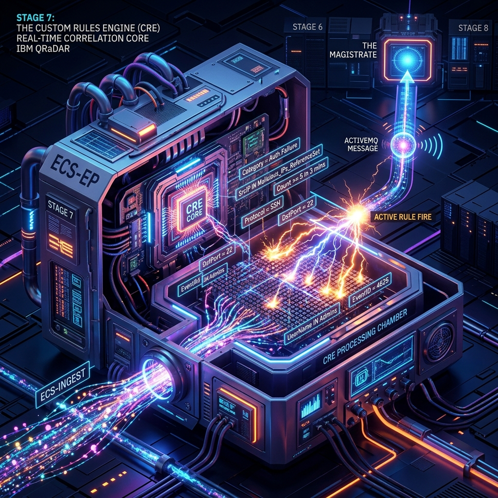
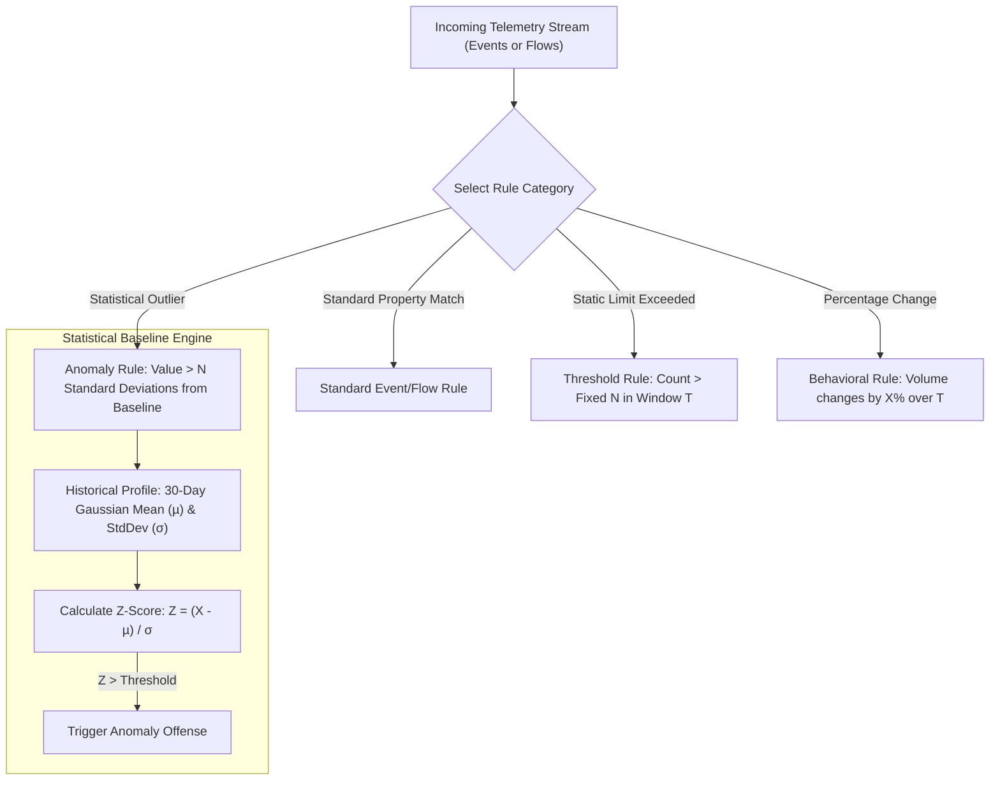
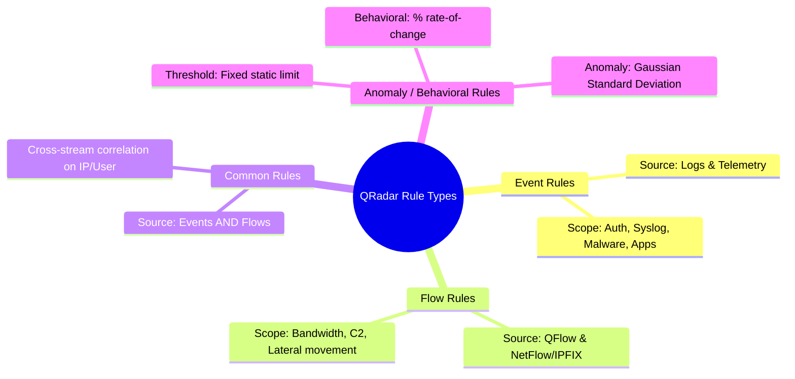

# 📖 Chapter 47: Rule Types: Event Rules, Flow Rules, Common Rules & Anomaly Rules Masterclass

> **The IBM QRadar Administrator's Technical Guide** | Phase 5: Custom Rules Engine (CRE) & Offense Architecture  
> **Target Audience:** 1.5-Year Administrators $\rightarrow$ Senior SIEM Engineers & Detection Engineering Specialists  
> **Focus:** 4 Core Rule Types, Event vs Flow vs Common Engines, Anomaly Detection Algorithms, & Hands-on Lab 47

---

## 📸 1. Visual Overview: The 4 Core Rule Types & Engine Routing


*Figure 47.1: Architectural routing of Event, Flow, Common, and Behavioral/Anomaly Rules within the `ecs-ep` Custom Rules Engine (`![[stage7_cre_correlation_engine_3d.jpg|1000]]`)*

---

## 2. The 4 QRadar Rule Types: Architecture & Deep Comparison

QRadar categorizes correlation rules into four distinct operational types based on the input telemetry streams and the statistical algorithms applied:

```
┌────────────────────────────────────────────────────────────────────────┐
│ 🏛️ THE 4 QRADAR RULE TYPES                                             │
│                                                                        │
│ 1. EVENT RULES                                                         │
│    • Ingests: Normalized log events from ecs-ec-ingress.               │
│    • Scope: Authentication failures, firewall drops, malware logs.     │
│ ├────────────────────────────────────────────────────────────────────┤
│ 2. FLOW RULES                                                          │
│    • Ingests: Network flow records from QFlow / NetFlow / IPFIX.       │
│    • Scope: Bandwidth spikes, lateral movement, port scans, beaconing. │
│ ├────────────────────────────────────────────────────────────────────┤
│ 3. COMMON RULES (HYBRID EVENT + FLOW)                                  │
│    • Ingests: Simultaneous correlation of events AND network flows.    │
│    • Scope: Exploit event followed by internal data flow exfiltration. │
│ ├────────────────────────────────────────────────────────────────────┤
│ 4. ANOMALY / BEHAVIORAL / THRESHOLD RULES                              │
│    • Ingests: Historical statistical baselines vs live telemetry.      │
│    • Scope: Outliers, standard deviation shifts, baseline spikes.     │
└────────────────────────────────────────────────────────────────────────┘
```

---

## 3. Comprehensive Rule Type Matrix

| Rule Type | Telemetry Source | In-Memory Buffer | Evaluation Complexity | Primary Security Use Cases |
| :--- | :--- | :--- | :---: | :--- |
| **Event Rule** | Syslog, WinCollect, Cloud APIs, Database Audits | Event Ring Buffer (`ecs-ep`) | $\mathcal{O}(1)$ - $\mathcal{O}(K)$ | Brute Force, Priv Escalation, Policy Violations, Malware Detections. |
| **Flow Rule** | QFlow, NetFlow, IPFIX, J-Flow, sFlow | Flow Ring Buffer (`ecs-ep`) | $\mathcal{O}(1)$ - $\mathcal{O}(K)$ | Long-lived covert C2 channels, DDoS, High-volume SMB/RDP lateral transfer. |
| **Common Rule** | Both Events & Flows in parallel | Cross-Ring Correlation Queue | $\mathcal{O}(N \times M)$ (Moderate) | Malware Alert Event + immediate outbound Flow to non-standard external port. |
| **Anomaly Rule** | Time-series Event or Flow rates | Baseline Historical Profile Database | $\mathcal{O}(\text{Statistical Model})$ | Traffic $> 3$ standard deviations above seasonal baseline for a subnet. |

---

## 4. Anomaly, Threshold & Behavioral Rules Deep Dive

QRadar provides specialized statistical engines under the Anomaly category:



### 1. Threshold Rules
- Compares volume against an **absolute static number**.
- *Example*: `when at least 100 failed login events occur in 5 minutes from the same Source IP`.

### 2. Behavioral Rules
- Compares volume against a **relative percentage change** over prior intervals.
- *Example*: `when the event volume for Log Source "Oracle DB" increases by 200% compared to the previous 1 hour`.

### 3. Anomaly Rules
- Compares live traffic against a **learned historical baseline** (learned over 7 to 30 days).
- Evaluates statistical deviation ($Z$-scores) rather than static limits.
- *Example*: `when network traffic to Subnet "PCI-Zone" exceeds 3 standard deviations above normal for Tuesday morning`.

---

## 5. Common Rules: The Event + Flow Correlation Architecture

Common Rules are among QRadar's most powerful capabilities, allowing an analyst to correlate endpoint or log evidence with actual network packet evidence:

```
┌────────────────────────────────────────────────────────────────────────┐
│ 🔬 ANATOMY OF A COMMON RULE USE CASE                                   │
│                                                                        │
│ 🎯 SCENARIO: Compromised Workstation Lateral Propagation               │
│                                                                        │
│ • EVENT COMPONENT:                                                     │
│   Windows Security Event 4624 (Type 3 Network Logon) on Workstation A  │
│   from User `svc_backup`.                                              │
│                                                                        │
│ • FLOW COMPONENT:                                                      │
│   Immediately followed (within 60 seconds) by an outbound network      │
│   flow from Workstation A to Server B over Port 445 (SMB) with data    │
│   transfer $> 500 \text{ MB}$.                                         │
│                                                                        │
│ • CORRELATION KEY:                                                     │
│   `Source IP = 10.100.4.15` matches across both Event and Flow streams.│
│                                                                        │
│ • OUTCOME:                                                             │
│   Single High-Magnitude Offense: "Malicious Lateral SMB Exfiltration" │
└────────────────────────────────────────────────────────────────────────┘
```

---

## 📌 6. Visual Mind Map & Sticky Notes (Chapter 47 Quick-Review)

### 🧠 Hierarchical Mind Map


### 🗂️ Color-Coded Digital Sticky Notes

#### 🟨 Sticky Note 1: Choosing Rule Types
```text
┌─────────────────────────────────────────────────────────────┐
│ 📌 CONCEPT: TELEMETRY ALIGNMENT                             │
│                                                             │
│ • If your detection requires packet sizes/bytes: Flow Rule. │
│ • If it requires user IDs/error codes: Event Rule.          │
│ • If it requires both: Common Rule.                         │
└─────────────────────────────────────────────────────────────┘
```

#### 🟩 Sticky Note 2: Baseline Warm-Up Period
```text
┌─────────────────────────────────────────────────────────────┐
│ 📌 GOLDEN RULE: ANOMALY RULES REQUIRE TIME                  │
│                                                             │
│ • Anomaly rules require a minimum of 7 to 14 days of        │
│   continuous traffic baseline learning before enabling      │
│   offense generation, otherwise false positives spike!      │
└─────────────────────────────────────────────────────────────┘
```

#### 🟪 Sticky Note 3: Common Rule Memory Cost
```text
┌─────────────────────────────────────────────────────────────┐
│ 📌 ARCHITECTURE: CROSS-BUFFER JOIN COST                     │
│                                                             │
│ • Common rules hold state across both Event and Flow ring   │
│   buffers.                                                  │
│ • Keep correlation time windows short ($\le 5$ minutes).    │
└─────────────────────────────────────────────────────────────┘
```

#### 🟦 Sticky Note 4: Threshold vs Behavioral
```text
┌─────────────────────────────────────────────────────────────┐
│ 📌 DISTINCTION: STATIC VS DYNAMIC LIMITS                    │
│                                                             │
│ • Threshold = Absolute static count (e.g., $> 50$ events).  │
│ • Behavioral = Relative % shift (e.g., $+200\%$ vs 1 hr ago)│
└─────────────────────────────────────────────────────────────┘
```

#### 🟧 Sticky Note 5: Interview Cheat Code (Rule Types)
```text
┌─────────────────────────────────────────────────────────────┐
│ 📌 INTERVIEW CHEAT CODE: "EXPLAIN COMMON RULES"             │
│                                                             │
│ "A Common Rule in QRadar correlates event logs and network  │
│ flows simultaneously in ecs-ep, verifying that a log-based  │
│ indicator is confirmed by actual network traffic evidence." │
└─────────────────────────────────────────────────────────────┘
```

#### 🟥 Sticky Note 6: Critical Pitfall
```text
┌─────────────────────────────────────────────────────────────┐
│ ⚠️ CRITICAL PITFALL: UNTRAINED ANOMALY RULES                │
│                                                             │
│ • Deploying an Anomaly rule on day 1 of a new deployment    │
│   floods the Magistrate with thousands of junk offenses     │
│   because standard deviation ($\sigma$) is undefined!       │
└─────────────────────────────────────────────────────────────┘
```

---

## ⚡ Rapid-Recall Flashcards

| # | Question (Front) | Answer (Back) |
| :-: | :--- | :--- |
| **01** | What are the 4 fundamental rule types in QRadar? | **Event Rules**, **Flow Rules**, **Common Rules**, and **Anomaly/Behavioral Rules**. |
| **02** | What is the primary difference between an Event Rule and a Flow Rule? | Event Rules correlate log messages; Flow Rules correlate network session metadata (bytes, packets, ports, durations). |
| **03** | How does a Common Rule correlate events and flows? | By joining an event record with a flow record matching a shared property (such as Source IP) within a defined time window. |
| **04** | How does a Behavioral Rule evaluate traffic spikes? | By calculating the percentage rate-of-change compared against the immediately preceding time window. |
| **05** | How does an Anomaly Rule determine an abnormal spike? | By comparing live values against historical statistical baselines (mean $\mu$ and standard deviation $\sigma$). |
| **06** | What is the recommended minimum baseline training period before enabling Anomaly Rule offenses? | **7 to 14 days** of normal production traffic. |

---

## 🧪 7. Hands-on Practice Lab 47: Rule Type Auditing & Anomaly Baseline Inspection

### 🎯 Lab Objectives
1. Query active rules in QRadar PostgreSQL and categorize them by Rule Type.
2. Inspect rule evaluation stats across Event vs Flow vs Anomaly rules.
3. Identify top triggered Flow Rules vs Event Rules via AQL.
4. Review Anomaly rule baseline configuration files.

---

### 📋 Step-by-Step Practical Lab Procedures

#### Step 1: Query Rule Inventory by Type in PostgreSQL
```bash
# Connect to PostgreSQL and group rules by rule type
psql -U qradar -d qradar -c "
SELECT 
    ruletype, 
    CASE 
        WHEN ruletype = 0 THEN 'Event Rule' 
        WHEN ruletype = 1 THEN 'Flow Rule' 
        WHEN ruletype = 2 THEN 'Common Rule (Event + Flow)' 
        WHEN ruletype = 3 THEN 'Anomaly / Behavioral Rule' 
        ELSE 'Other / System' 
    END AS RuleTypeName, 
    COUNT(*) AS ActiveRuleCount 
FROM customrule 
WHERE enabled = true 
GROUP BY ruletype 
ORDER BY ActiveRuleCount DESC;
"
```

---

#### Step 2: List Top 10 Active Flow-Based Correlation Rules
```bash
psql -U qradar -d qradar -c "
SELECT 
    id AS RuleID, 
    name AS RuleName, 
    severity, 
    enabled 
FROM customrule 
WHERE ruletype = 1 AND enabled = true 
LIMIT 10;
"
```

---

#### Step 3: AQL Telemetry Audit: Flow Rule Hits vs Event Rule Hits
```bash
/opt/qradar/bin/arielsql -p 32011 -q "
SELECT 
    hasoffense, 
    COUNT(*) AS EventHits 
FROM events 
WHERE \"creRuleList\" IS NOT NULL 
LAST 12 HOURS 
GROUP BY hasoffense;
"
```

---

#### Step 4: Verify Anomaly Engine Baseline Directory
```bash
# Inspect historical anomaly baseline files and configuration
ls -la /opt/qradar/conf/baselines/ 2>/dev/null || ls -la /store/ariel/events/baselines/ 2>/dev/null
```
