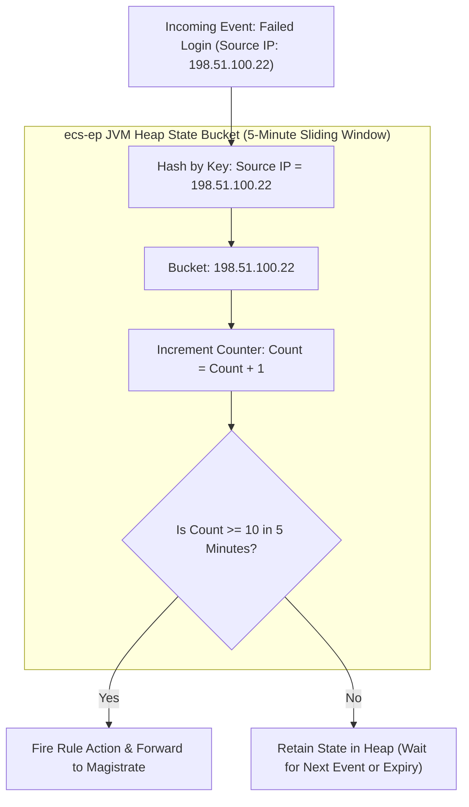
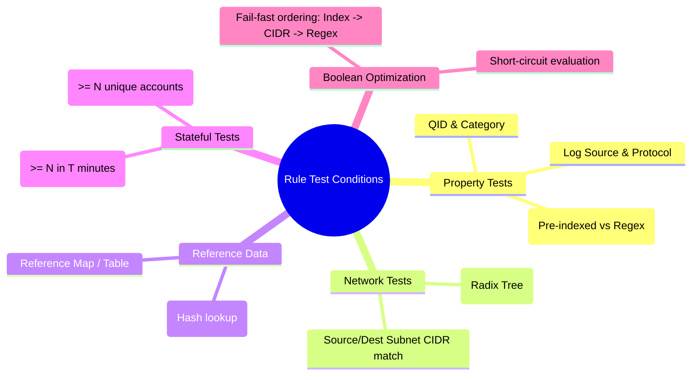

# 📖 Chapter 48: Rule Test Conditions: Property, IP/Port & Threshold Tests Masterclass

> **The IBM QRadar Administrator's Technical Guide** | Phase 5: Custom Rules Engine (CRE) & Offense Architecture  
> **Target Audience:** 1.5-Year Administrators $\rightarrow$ Senior SIEM Engineers & Detection Engineering Specialists  
> **Focus:** Rule Test Taxonomy, Boolean Logic Grouping, Property & Regex Tests, Stateful Threshold Tests, & Hands-on Lab 48

---

## 📸 1. Visual Overview: Rule Test Evaluation Matrix & Boolean Tree


*Figure 48.1: Multi-Tiered Rule Test Evaluation Tree in `ecs-ep`: Normalized events filtered through Fast Property Tests, Network Hierarchy Radix Trees, Reference Set Hashes, and Stateful Time-Bucket Accumulators (`![[stage7_cre_correlation_engine_3d.jpg|1000]]`)*

---

## 2. The 5 Core Categories of Rule Test Conditions

In QRadar, rule tests represent individual boolean predicate expressions evaluated by the CRE engine. Every rule is composed of one or more tests joined by boolean operators:

```
┌────────────────────────────────────────────────────────────────────────┐
│ 🧪 THE 5 TEST FAMILIES IN QRADAR CRE                                   │
│                                                                        │
│ 1. PROPERTY & VALUE TESTS                                              │
│    • Matches normalized fields: `when the event QID is one of...`      │
│    • Matches regex/strings: `when "CommandLine" matches regex...`     │
│ ├────────────────────────────────────────────────────────────────────┤
│ 2. IP ADDRESS & NETWORK HIERARCHY TESTS                                │
│    • Matches network zones: `when the source IP is internal`           │
│    • Matches CIDRs: `when the destination IP is in 192.168.10.0/24`   │
│ ├────────────────────────────────────────────────────────────────────┤
│ 3. REFERENCE DATA TESTS                                                │
│    • Matches dynamic caches: `when any of Source IP are contained in   │
│      Threat_Intel_Malicious_IPs`                                       │
│ ├────────────────────────────────────────────────────────────────────┤
│ 4. STATEFUL COUNTER & THRESHOLD TESTS                                  │
│    • Matches frequency: `when at least 10 events occur with the same   │
│      Source IP in 5 minutes`                                           │
│ ├────────────────────────────────────────────────────────────────────┤
│ 5. BUILDING BLOCK (BB) TESTS                                           │
│    • Matches modular sub-logic: `when the event matches BB:Compliance: │
│      PCI Authentications`                                              │
└────────────────────────────────────────────────────────────────────────┘
```

---

## 3. Deep Dive: Key Rule Tests & Engine Execution Mechanics

### A. IP & Network Hierarchy Tests
- **Internal vs External**: Evaluates against the in-memory CIDR Radix tree loaded from Network Hierarchy (`/store/configservices/staging/globalroot/`).
- **Directionality**:
  - `when the source is internal and the destination is external` $\rightarrow$ Inbound / Outbound / Lateral identification.
  - Subnet matching executes in sub-microsecond time ($\mathcal{O}(\log N)$ prefix search).

### B. Property & Regex Match Tests
- **Exact vs Case-Insensitive**:
  - `when the event property matches regex 'pattern'` (Case sensitive).
  - `when the event property matches regex (case insensitive) 'pattern'`.
- **Pre-parsed vs On-The-Fly**: Pre-parsed Custom Event Properties (optimized with index) evaluate in $\mathcal{O}(1)$ time. On-the-fly unindexed regex scans the entire payload.

### C. Reference Set / Map / Table Tests
- Evaluates against Java `ConcurrentHashMap` in `ecs-ep` memory.
- Sub-microsecond execution time ($\mathcal{O}(1)$).
- Test syntax: `when any of <Property> are contained in <Reference Set>`.

### D. Stateful Aggregations (Threshold Tests)
Stateful tests create a transient state tracker in the JVM heap:



---

## 4. Boolean Grouping: AND vs OR vs AND NOT Logic

The logical combination of tests dictates both accuracy and computational efficiency:

```
┌────────────────────────────────────────────────────────────────────────┐
│ 🧠 BOOLEAN LOGIC ARCHITECTURE                                          │
│                                                                        │
│ • AND (Conjunction):                                                   │
│   ALL conditions must evaluate to TRUE. Short-circuits on first FALSE. │
│   Rule: Fast tests MUST be placed FIRST to abort non-matching traffic. │
│                                                                        │
│ • OR (Disjunction):                                                    │
│   ANY condition evaluating to TRUE satisfies the group.                │
│   Rule: Wrap multiple OR tests inside parentheses.                     │
│                                                                        │
│ • AND NOT (Negation / Whitelist Suppression):                          │
│   Excludes authorized traffic.                                         │
│   Example: `AND NOT when the source IP is contained in Scanner_IPs`    │
└────────────────────────────────────────────────────────────────────────┘
```

---

## 5. Test Optimization & Fail-Fast Ordering Rules

To prevent CRE thread exhaustion during high-volume DDoS or log spikes, tests inside a rule must follow the **Fail-Fast Hierarchy**:

```
❌ SLOW / UNOPTIMIZED RULE TEST ORDER:
1. when the event payload contains regex '(?i)select.*from.*users' (Heavy Regex - 100% of logs scanned!)
2. when the destination port is 1433
3. when the log source is Microsoft SQL Server

✅ FAST / OPTIMIZED FAIL-FAST ORDER:
1. when the log source is Microsoft SQL Server (Indexed LogSourceID - 99.9% rejected instantly!)
2. when the destination port is 1433 (Indexed Integer Equality)
3. when the event payload contains regex '(?i)select.*from.*users' (Evaluates on < 0.1% of logs!)
```

---

## 📌 6. Visual Mind Map & Sticky Notes (Chapter 48 Quick-Review)

### 🧠 Hierarchical Mind Map


### 🗂️ Color-Coded Digital Sticky Notes

#### 🟨 Sticky Note 1: Test Short-Circuiting
```text
┌─────────────────────────────────────────────────────────────┐
│ 📌 CONCEPT: JVM SHORT-CIRCUITING                            │
│                                                             │
│ • In an AND block, QRadar stops evaluation the moment a test│
│   evaluates to FALSE.                                       │
│ • Place high-selectivity tests first!                       │
└─────────────────────────────────────────────────────────────┘
```

#### 🟩 Sticky Note 2: Avoid Case-Insensitive Wildcards
```text
┌─────────────────────────────────────────────────────────────┐
│ 📌 GOLDEN RULE: REGEX EFFICIENCY                            │
│                                                             │
│ • Never use leading wildcards (`.*pattern`) in regex tests. │
│ • Anchor your regex (`^prefix`) and restrict to pre-parsed  │
│   custom properties.                                        │
└─────────────────────────────────────────────────────────────┘
```

#### 🟪 Sticky Note 3: Time Bucket Sliding Windows
```text
┌─────────────────────────────────────────────────────────────┐
│ 📌 ARCHITECTURE: SLIDING VS FIXED WINDOWS                   │
│                                                             │
│ • QRadar stateful rules use continuous sliding time windows,│
│   not rigid fixed clock-boundary buckets.                   │
└─────────────────────────────────────────────────────────────┘
```

#### 🟦 Sticky Note 4: Negation Placement
```text
┌─────────────────────────────────────────────────────────────┐
│ 📌 TUNING: AND NOT SUPPRESSIONS                             │
│                                                             │
│ • Place `AND NOT` suppression tests after positive filters  │
│   to prevent unnecessary whitelist lookups on unrelated logs│
└─────────────────────────────────────────────────────────────┘
```

#### 🟧 Sticky Note 5: Interview Cheat Code (Rule Test Ordering)
```text
┌─────────────────────────────────────────────────────────────┐
│ 📌 INTERVIEW CHEAT CODE: "HOW DO YOU OPTIMIZE RULE TESTS?"  │
│                                                             │
│ "I use the Fail-Fast approach: place indexed QID and Log    │
│ Source tests first, followed by Network Hierarchy and       │
│ Reference Sets, and place expensive regex and stateful      │
│ threshold accumulators at the very bottom."                 │
└─────────────────────────────────────────────────────────────┘
```

#### 🟥 Sticky Note 6: Critical Pitfall
```text
┌─────────────────────────────────────────────────────────────┐
│ ⚠️ CRITICAL PITFALL: UNCONSTRAINED STATE TRACKING           │
│                                                             │
│ • Writing a rule: "when at least 2 events occur with DIFFERENT│
│   Source IPs and DIFFERENT Dest IPs in 24 hours" exhausts    │
│   all JVM heap space! Keep tracking keys specific.          │
└─────────────────────────────────────────────────────────────┘
```

---

## ⚡ Rapid-Recall Flashcards

| # | Question (Front) | Answer (Back) |
| :-: | :--- | :--- |
| **01** | What happens when the first test in an AND-joined rule evaluates to FALSE? | The CRE **short-circuits** and immediately stops evaluating remaining tests for that event. |
| **02** | What data structure powers Network Hierarchy internal/external tests in QRadar? | An in-memory **CIDR Radix Tree** in `ecs-ep`. |
| **03** | Why are pre-parsed Custom Event Properties faster than raw payload regex tests? | Pre-parsed CEPs are extracted once during parsing ($\mathcal{O}(1)$), while raw payload regex executes on every event evaluation. |
| **04** | What is the time complexity of looking up an IP address in a Reference Set test? | **$\mathcal{O}(1)$** (constant time in-memory hash lookup). |
| **05** | Where should suppression (`AND NOT`) tests be placed in a rule test sequence? | After the primary identifying filters (e.g., after Log Source and QID tests). |
| **06** | How does a stateful threshold rule track event counts? | By maintaining temporary **in-memory sliding time-window state buckets** in the JVM heap. |

---

## 🧪 7. Hands-on Practice Lab 48: Rule Test Performance Auditing & Regex Profiling

### 🎯 Lab Objectives
1. Inspect rule test definitions in PostgreSQL.
2. Measure rule evaluation execution time and identify unoptimized regex tests.
3. Validate fail-fast test short-circuiting in `customrules.xml`.
4. Run a simulated event payload through `cretool` to benchmark test evaluation.

---

### 📋 Step-by-Step Practical Lab Procedures

#### Step 1: Query Rule Test Definitions in PostgreSQL
```bash
# Query the rule tests associated with active authentication rules
psql -U qradar -d qradar -c "
SELECT 
    r.id AS RuleID, 
    r.name AS RuleName, 
    r.ruletype, 
    r.enabled 
FROM customrule r 
WHERE r.name ILIKE '%Authentication%' 
ORDER BY r.id ASC 
LIMIT 10;
"
```

---

#### Step 2: Inspect Compiled XML Rule Structure
```bash
# Search for specific rule test predicates in customrules.xml
grep -A 15 -i "Failed Logon" /opt/qradar/conf/customrules.xml | head -n 30
```

---

#### Step 3: Profile Expensive Regex Rules in Logs
```bash
# Search for regex evaluation warnings and high-latency rule flags
grep -iE "Rule execution took|slow rule|expensive regex" /var/log/qradar.log
```

---

#### Step 4: Benchmark Rule Test Execution via CLI
```bash
# Execute cretool to simulate test evaluation against an event payload
/opt/qradar/bin/cretool -t "Sep 25 18:30:00 10.100.1.50 sshd[1234]: Failed password for invalid user admin from 198.51.100.200 port 52310 ssh2" -v
```
