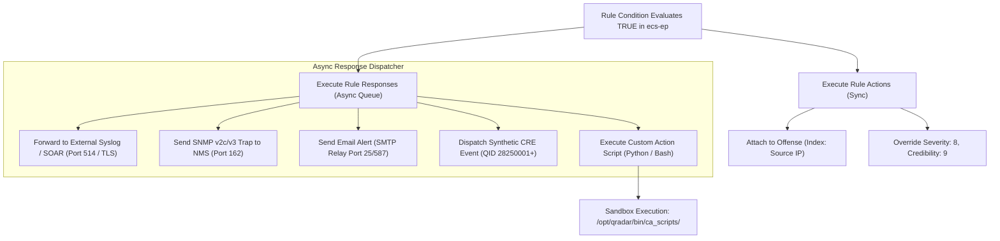
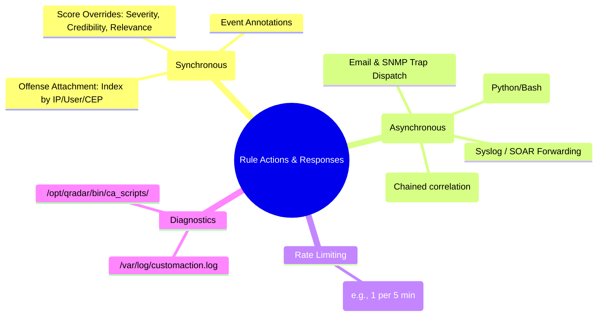

# 📖 Chapter 49: Rule Actions & Responses: Offense Creation, SNMP, Syslog & Custom Scripts Masterclass

> **The IBM QRadar Administrator's Technical Guide** | Phase 5: Custom Rules Engine (CRE) & Offense Architecture  
> **Target Audience:** 1.5-Year Administrators $\rightarrow$ Senior SIEM Engineers & Detection Engineering Specialists  
> **Focus:** Rule Actions vs Rule Responses, Offense Triggers, CRE Synthetic Events, Custom Action Scripts, & Hands-on Lab 49

---

## 📸 1. Visual Overview: Rule Action & Response Dispatch Architecture


*Figure 49.1: The QRadar Rule Execution Post-Processing Pipeline: When a rule matches in `ecs-ep`, it executes Rule Actions (Offense Indexing, Severity Overrides) and dispatches Rule Responses (Synthetic CRE Events, Syslog Forwarding, SNMP Traps, and Custom Python Scripts) (`![[stage7_cre_correlation_engine_3d.jpg|1000]]`)*

---

## 2. Rule Actions vs Rule Responses: The Fundamental Architectural Distinction

Many junior administrators confuse Rule Actions and Rule Responses. In QRadar, they represent two distinct execution stages:

```
┌────────────────────────────────────────────────────────────────────────┐
│ ⚙️ RULE ACTIONS VS RULE RESPONSES                                       │
│                                                                        │
│ 1. RULE ACTIONS (In-Engine Transformations & Offense Attachment)       │
│    • Executed synchronously within the `ecs-ep` pipeline.              │
│    • Modifies event metadata before Ariel storage.                     │
│    • Controls: "Ensure the detected event is part of an OFFENSE",      │
│      sets Severity/Credibility/Relevance overrides, and defines the    │
│      Offense Indexing Field (SourceIP, DestIP, Username, CEP).         │
│ ├────────────────────────────────────────────────────────────────────┤
│ 2. RULE RESPONSES (Out-of-Engine Notifications & Side Effects)         │
│    • Dispatched asynchronously via worker queues.                      │
│    • Triggers external actions without blocking the event stream.      │
│    • Controls: Send Email, Send SNMP Trap, Forward to Syslog / SOAR,   │
│      Dispatch Synthetic CRE Event, Execute Custom Action Script.       │
└────────────────────────────────────────────────────────────────────────┘
```

---

## 3. Deep Dive: Rule Actions Architecture

| Rule Action Feature | Purpose | Operational Mechanics |
| :--- | :--- | :--- |
| **Ensure detected event is part of an Offense** | Creates or appends to an active Offense. | Sends an offense notification message to the **Magistrate** daemon on the Console. |
| **Offense Indexing Field** | Determines how events are grouped into an incident. | Groups events by `Source IP`, `Destination IP`, `Username`, or `Custom Event Property`. |
| **Severity / Credibility / Relevance Overrides** | Overrides default DSM taxonomy values. | Injects static values (0–10) or increments existing event scores for dynamic offense ranking. |
| **Annotate Event** | Appends notes to the normalized record. | Stores an annotation string in Ariel records for analyst visibility in Log Activity. |
| **Drop Event** | Drops event from storage pipeline. | Evaluates rule and discards payload before Ariel write (rarely used, high risk). |

---

## 4. Deep Dive: Rule Responses Architecture



### A. Dispatching Synthetic CRE Events
- Generates a **new internal event** fed back into the `ecs-ec-ingress` pipeline.
- Uses **QID 28250001 to 28259999** (Custom Rule Engine Event).
- Allows **Multi-Stage Chained Correlation**: Rule A generates a CRE event; Rule B listens for that CRE event and triggers a critical offense.

### B. Response Rate Limiting (Frequency Capping)
- Prevents alert storms (e.g., if an attacker generates 100,000 hits in 1 minute, you do not want 100,000 emails or script executions).
- Configurable: `Execute response at most once every X minutes (or seconds) per Rule / per Index`.

### C. Custom Action Scripts (Python / Bash)
- Scripts reside on the Console in `/opt/qradar/bin/ca_scripts/`.
- Executes in an isolated process space spawned by `customaction.sh`.
- Passed parameters: `$1 = Rule Name`, `$2 = Source IP`, `$3 = Dest IP`, `$4 = Username`, etc.

---

## 5. Filesystem Layout & Custom Action Script Architecture

| File / Directory Path | Purpose | Execution Context |
| :--- | :--- | :--- |
| `/opt/qradar/bin/ca_scripts/` | Repository of uploaded Custom Action scripts (Python, Bash). | Spawns under user `nobody` or `customaction` for security. |
| `/var/log/customaction.log` | Captures standard output (stdout), errors (stderr), and exit codes of custom scripts. | Primary debugging log for custom automation. |
| `/opt/qradar/conf/snmp.conf` | SNMP trap targets, community strings, and MIB configurations. | Used by CRE response dispatcher. |
| `/opt/qradar/conf/alert.properties` | SMTP relay configurations, timeout thresholds, and email templates. | Used for email alert generation. |

---

## 📌 6. Visual Mind Map & Sticky Notes (Chapter 49 Quick-Review)

### 🧠 Hierarchical Mind Map


### 🗂️ Color-Coded Digital Sticky Notes

#### 🟨 Sticky Note 1: Action vs Response Boundary
```text
┌─────────────────────────────────────────────────────────────┐
│ 📌 CONCEPT: ACTION = IN-ENGINE, RESPONSE = OUT-OF-ENGINE    │
│                                                             │
│ • Actions modify event fields and attach to offenses.       │
│ • Responses send external notifications (email, scripts).   │
└─────────────────────────────────────────────────────────────┘
```

#### 🟩 Sticky Note 2: Always Rate-Limit Responses
```text
┌─────────────────────────────────────────────────────────────┐
│ 📌 GOLDEN RULE: ENABLE RESPONSE RATE LIMITING               │
│                                                             │
│ • Always check "Execute response at most once every..." for │
│   emails, scripts, and syslog forwarders to prevent flooding│
└─────────────────────────────────────────────────────────────┘
```

#### 🟪 Sticky Note 3: Synthetic CRE Event Chaining
```text
┌─────────────────────────────────────────────────────────────┐
│ 📌 ARCHITECTURE: MULTI-STAGE CORRELATION                    │
│                                                             │
│ • Use "Dispatch New Event" to create a synthetic CRE event  │
│   that serves as an input building block for higher-order   │
│   rules.                                                    │
└─────────────────────────────────────────────────────────────┘
```

#### 🟦 Sticky Note 4: Custom Script Execution Timeouts
```text
┌─────────────────────────────────────────────────────────────┐
│ 📌 SECURITY: SCRIPT TIMEOUT RESTRICTIONS                    │
│                                                             │
│ • Custom Action scripts timeout after 60 seconds.           │
│ • Never run long blocking HTTP calls or loops in a script!  │
└─────────────────────────────────────────────────────────────┘
```

#### 🟧 Sticky Note 5: Interview Cheat Code (Rule Responses)
```text
┌─────────────────────────────────────────────────────────────┐
│ 📌 INTERVIEW CHEAT CODE: "WHAT HAPPENS WHEN A RULE FIRES?"  │
│                                                             │
│ "Synchronously, it executes Actions: indexing the offense   │
│ and adjusting magnitude scores. Asynchronously, it dispatches│
│ Responses: sending emails, SNMP traps, synthetic CRE events,│
│ or executing custom Python automation scripts."             │
└─────────────────────────────────────────────────────────────┘
```

#### 🟥 Sticky Note 6: Critical Pitfall
```text
┌─────────────────────────────────────────────────────────────┐
│ ⚠️ CRITICAL PITFALL: UNRESTRICTED EMAIL ALERTS              │
│                                                             │
│ • Enabling email notifications without a frequency cap on a │
│   noisy rule can generate 50,000 emails in 10 minutes,      │
│   blacklisting your corporate SMTP relay!                   │
└─────────────────────────────────────────────────────────────┘
```

---

## ⚡ Rapid-Recall Flashcards

| # | Question (Front) | Answer (Back) |
| :-: | :--- | :--- |
| **01** | What is the fundamental difference between a Rule Action and a Rule Response? | Rule Actions execute synchronously (offense indexing, scoring); Rule Responses execute asynchronously (emails, scripts, SNMP). |
| **02** | What is a synthetic CRE Event? | A newly generated internal event (QIDs 28250001+) reinjected into the pipeline for chained correlation. |
| **03** | Why must response rate limiting be enabled for automated emails or script execution? | To prevent alert storms and resource exhaustion during massive attack spikes. |
| **04** | Where are Custom Action scripts located on the QRadar Console filesystem? | **`/opt/qradar/bin/ca_scripts/`**. |
| **05** | What log file records the standard output and error output of Custom Action scripts? | **`/var/log/customaction.log`**. |
| **06** | What is the default maximum execution timeout for a QRadar Custom Action script? | **60 seconds**. |

---

## 🧪 7. Hands-on Practice Lab 49: Custom Action Scripting & Synthetic CRE Event Auditing

### 🎯 Lab Objectives
1. Author and test a Custom Action Python script on the QRadar Console.
2. Configure script execution parameters and response rate limiting.
3. Monitor `/var/log/customaction.log` for script execution telemetry.
4. Audit synthetic CRE events using AQL.

---

### 📋 Step-by-Step Practical Lab Procedures

#### Step 1: Create a Custom Action Script for Automated SOAR Webhook Notification
Log into the QRadar Console via SSH as `root`:
```bash
# Create a sample Python automation script in the custom action directory
cat << 'EOF' > /opt/qradar/bin/ca_scripts/soar_alert_webhook.py
#!/usr/bin/env python3
import sys
import datetime

def main():
    rule_name = sys.argv[1] if len(sys.argv) > 1 else "Unknown Rule"
    src_ip = sys.argv[2] if len(sys.argv) > 2 else "0.0.0.0"
    dst_ip = sys.argv[3] if len(sys.argv) > 3 else "0.0.0.0"
    username = sys.argv[4] if len(sys.argv) > 4 else "N/A"
    
    timestamp = datetime.datetime.utcnow().isoformat()
    log_entry = f"[{timestamp}] SOAR_DISPATCH: Rule='{rule_name}' Src={src_ip} Dst={dst_ip} User='{username}'\n"
    
    print(log_entry.strip())
    # In production: Send HTTPS POST to SOAR / Webhook endpoint

if __name__ == "__main__":
    main()
EOF

# Grant execution permissions
chmod +x /opt/qradar/bin/ca_scripts/soar_alert_webhook.py
```

---

#### Step 2: Test Script Execution via CLI
```bash
# Execute the script directly to verify syntax and output
/opt/qradar/bin/ca_scripts/soar_alert_webhook.py "Brute Force Attack Detected" "198.51.100.55" "10.100.1.10" "admin"
```

---

#### Step 3: Monitor Custom Action Execution Logs
```bash
# Tail the custom action execution log in real time
tail -F /var/log/customaction.log
```

---

#### Step 4: Query Synthetic CRE Events Generated by Active Rules via AQL
```bash
/opt/qradar/bin/arielsql -p 32011 -q "
SELECT 
    DATEFORMAT(starttime, 'YYYY-MM-dd HH:mm:ss') AS EventTime, 
    qid AS EventQID, 
    qidname(qid) AS CREEventName, 
    sourceip AS AttackerIP, 
    username AS TargetUser 
FROM events 
WHERE qid >= 28250001 AND qid <= 28259999 
LAST 24 HOURS 
ORDER BY starttime DESC 
LIMIT 10;
"
```
